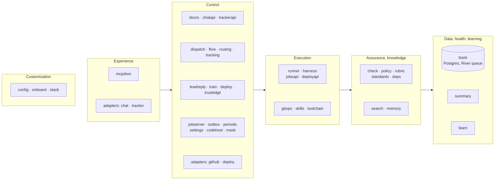
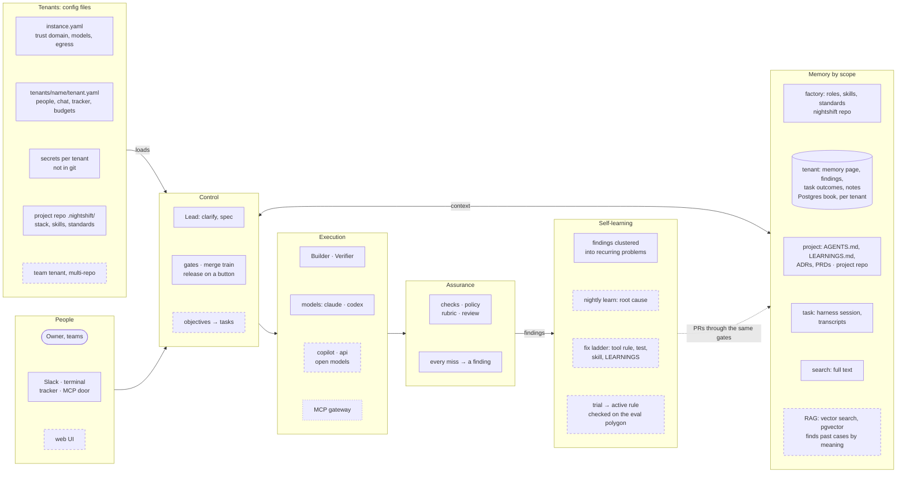

# Nightshift

Nightshift runs coding tasks from chat or the terminal. The tenant config selects which agents plan,
build and review each change. The review policy controls when a person must approve a pull request.
Docker Compose starts the configured instance from the `deploy/` directory.

## Where it is going

Nightshift is a governed, knowledge-driven, self-improving software factory: it turns an authorized
idea into a reviewed, tested change that a person releases with one button. It is built in planes,
each owning one responsibility and its state
([ADR 0026](docs/adr/0026-architecture-planes.md)):

Each column is one or more plane folders `internal/<plane>/` with their packages; a task moves
from left to right, and Customization configures every column. Security is cross-cutting:
the worker runs agents with no tokens and no access to the book, and egress goes through a proxy.

The target factory. Solid boxes run today; dashed boxes are planned (phase in
[`docs/plan.md`](docs/plan.md)) or an owner idea not yet in the plan. Tenant config lives in
files and is loaded at start; memory has four scopes, each with its own home and writer
([design section 28](docs/design/04-knowledge.md)); self-learning turns findings into rules
([design section 10](docs/design/06-evolution.md)).

The design starts at [`docs/design.md`](docs/design.md): the vision, the plane map and one file per
plane in [`docs/design/`](docs/design/).

## Where things are

- Plan and progress: [`docs/plan.md`](docs/plan.md) (one folder per phase in `docs/plan/`), [`docs/status.md`](docs/status.md)
- Rules for agents and contributors: [`AGENTS.md`](AGENTS.md)
- Code: one binary in [`cmd/nightshift/`](cmd/nightshift/); the core in [`internal/`](internal/AGENTS.md), one folder per plane (`internal/control/`, `internal/execution/` and so on). An architecture test in [`internal/testing/archtest/`](internal/testing/archtest/) runs with `make test` and fails when a package crosses a plane boundary
- Skills for agents that work on this repo (add a migration, change a schema or the design, fix CI, finish a task, let the factory work on itself): [`.agents/skills/`](.agents/skills); Claude Code finds them through `.claude/skills`, which links there

## Run it

Follow [`docs/setup.md`](docs/setup.md): secrets, model credentials, Slack, a sandbox
repository, the GitHub App, config, start and a first task. An agent can lead you through it
with the [`set-up-instance`](.agents/skills/set-up-instance/SKILL.md) skill.

Operations (backups, restore, rotation): [`docs/runbook.md`](docs/runbook.md).

## Test a checkout

From the repository root, run `mise install --locked`, then `mise exec -- make verify`.
This runs the format and lint checks, Go tests, security scanners and repository checks.
For the Go tests alone, run `mise exec -- make test`. Start Docker before running either
command for Postgres integration coverage. With no working Docker provider or configured
test Postgres, the database tests can skip. The test helper also skips them in Go's short mode.

For the separate backup, restore and isolation exercise, run `mise exec -- make drill`
after initializing the local files in setup section 1. The drill recreates the disposable
`nightshift-drill` Compose project and its volumes. [Drill procedure](docs/runbook.md#drill-do-the-backups-and-the-isolation-really-work)
