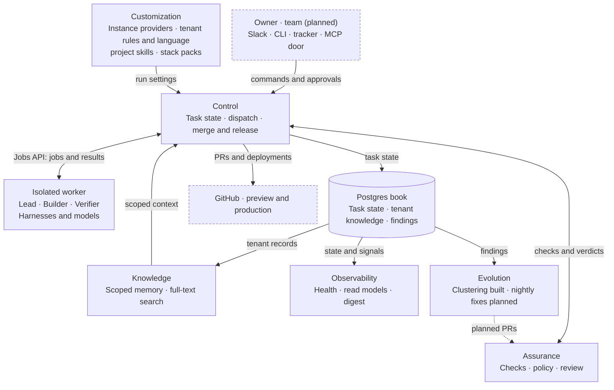

# Nightshift

Nightshift runs coding tasks from chat or the terminal. The tenant config selects which agents plan,
build and review each change. The review policy controls when a person must approve a pull request.
Docker Compose starts the configured instance from the `deploy/` directory.

## Where it is going

Nightshift coordinates isolated coding agents, checks their work, and releases changes under the
tenant's review policy. Tenant settings shape each job. Findings feed the self-improvement loop.

| Scope | Where it lives and what it holds |
| --- | --- |
| Factory | The Nightshift repository holds roles, skills and standards. Its development notes guide contributors. |
| Instance and tenant | Instance and tenant config files set providers, permissions and chat language. Postgres holds tenant memory, findings and task outcomes. |
| Project | The project repository holds instructions, skills, ADRs and decisions. |
| Task | The harness session, handoff and artifacts hold the context of a run. |

Dashed borders mark participants and systems outside Nightshift. Tenant lessons stay within their tenant. A tenant-neutral improvement can enter the factory through
a human-reviewed PR. [Memory and access rules](docs/design/04-knowledge.md#28-knowledge-scopes-factory-and-tenant-memory).

The MCP door is a task entry point. A shared MCP gateway for agent tools is an idea. Phase 9
adds hybrid retrieval for agent context. The vector column and ranking code exist, and the
embedder, backfill and quality check are planned. [Architecture map](docs/design.md#26-vision-and-plane-map) ·
[MCP door status](docs/plan/doors/README.md) · [Hybrid search plan](docs/plan/phase-9/README.md) ·
[Task lifecycle](docs/design/02-control.md).

**Next milestone: the MVP** ([validation plan](docs/plan/mvp-validation/README.md)).

- **Works today:** the path from an idea in the terminal, through preview and acceptance, to a
  release, on the owner's machine (2026-11-28); isolation of the preview and recovery after a
  worker dies passed there too.
- **Being checked on a real stack:** the same path started from Slack with an evidence card and
  your approval, an automatic rollback with a revert pull request, and the morning digest.
- **Direction:** self-learning that turns repeated findings into rules and skills (phase 7),
  team tenants (phase 8), search by meaning (phase 9) and tasks across several repositories
  (phase 10); see [`docs/plan.md`](docs/plan.md).

## Where things are

- Plan and progress: [`docs/plan.md`](docs/plan.md) (one folder per phase in `docs/plan/`), [`docs/status.md`](docs/status.md)
- Rules for agents and contributors: [`AGENTS.md`](AGENTS.md)
- Code: one binary in [`cmd/nightshift/`](cmd/nightshift/); the core in [`internal/`](internal/AGENTS.md), one folder per plane (`internal/control/`, `internal/execution/` and so on). An architecture test in [`internal/testing/archtest/`](internal/testing/archtest/) runs with `make test` and fails when a package crosses a plane boundary
- Skills for agents that work on this repo (add a migration, change a schema or the design, fix CI, finish a task, let the factory work on itself): [`.agents/skills/`](.agents/skills); Claude Code finds them through `.claude/skills`, which links there

## Run it

Follow [`docs/setup.md`](docs/setup.md): secrets, model credentials, Slack, a sandbox
repository, the GitHub App, config, start and a first task. An agent can lead you through it
with the [`set-up-instance`](.agents/skills/set-up-instance/SKILL.md) skill.

Operations (backups, restore, rotation): [`docs/runbook.md`](docs/runbook.md).

## Test a checkout

From the repository root, run `mise install --locked`, then `mise exec -- make verify`.
This runs the format and lint checks, Go tests, security scanners and repository checks.
For the Go tests alone, run `mise exec -- make test`. Start Docker before running either
command for Postgres integration coverage. With no working Docker provider or configured
test Postgres, the database tests can skip. The test helper also skips them in Go's short mode.

For the separate backup, restore and isolation exercise, run `mise exec -- make drill`
after initializing the local files in setup section 1. The drill recreates the disposable
`nightshift-drill` Compose project and its volumes. [Drill procedure](docs/runbook.md#drill-do-the-backups-and-the-isolation-really-work)
