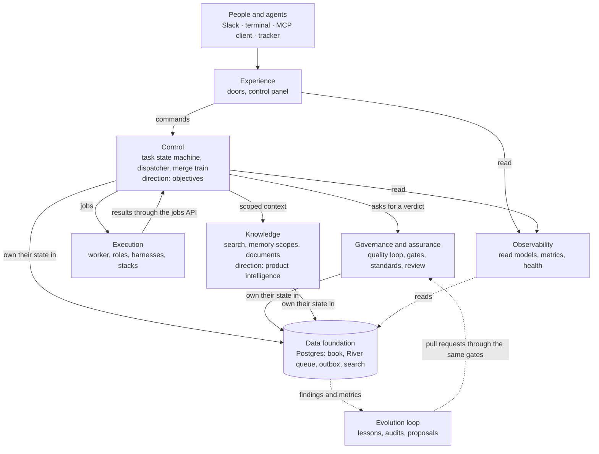

# Nightshift — software factory design

> Nightshift is a standalone product with its own `nightshift` repository, versions and plan. One codebase and one set of images run in separate instances, for example a **personal** instance (the owner's own projects) and a **work** instance (employer projects). This document describes only the core: concrete projects are configured through their own packs and are never named here (section 17).
> Principle: keep it simple. Everything the factory can start without goes to "Later". "The owner" is the tenant's `owner` role; where other people (`approvers`) approve something, the text says so.

## Summary

Nightshift is a governed, knowledge-driven, self-improving software factory that turns an authorized idea from chat into a reviewed, tested change that reaches production on a person's button. Three agents (Lead, Builder, Verifier) work behind deterministic gates written in code; Postgres is the single book of record.

This file is the overview: the vision, the map of planes and the decisions that span them. Each plane has its own file under `docs/design/`, and section numbers are unique across all files, so "design section N" always points to one place. Start with section 0 for the decisions, section 22 for the phases and section 17 for how a project plugs in.

## Contents

- [26. Vision and plane map](#26-vision-and-plane-map)
- [0. Decisions at a glance](#0-decisions-at-a-glance)
- [1. What it is and who it is for](#1-what-it-is-and-who-it-is-for)
- [2. Principles](#2-principles)
- [3. Architecture of the first version](design/07-data-foundation.md#3-architecture-of-the-first-version)
- [4. Components](#4-components)
- [5. Stack and tools](design/03-execution.md#5-stack-and-tools)
- [6. Roles](design/03-execution.md#6-roles)
- [7. Task flow](design/02-control.md#7-task-flow)
- [8. Quality loop before a human](design/05-assurance.md#8-quality-loop-before-a-human)
- [9. Standards: where they live and how they change](design/05-assurance.md#9-standards-where-they-live-and-how-they-change)
- [10. Self-improvement: how the factory fixes itself](design/06-evolution.md#10-self-improvement-how-the-factory-fixes-itself)
- [11. Engineer in the loop: design and code review](design/05-assurance.md#11-engineer-in-the-loop-design-and-code-review)
- [12. Models and harnesses](design/03-execution.md#12-models-and-harnesses)
- [13. Search](design/04-knowledge.md#13-search)
- [14. Data and logs: what lives where](design/07-data-foundation.md#14-data-and-logs-what-lives-where)
- [15. Doors and control panel](design/01-experience.md#15-doors-and-control-panel)
- [16. Security](design/08-security.md#16-security)
- [17. Core and customization: packs, tenant, project](design/09-customization.md#17-core-and-customization-packs-tenant-project)
- [18. Things to keep in mind](#18-things-to-keep-in-mind)
- [19. What we take from each source](#19-what-we-take-from-each-source)
- [20. Testing the factory and evals](design/10-testing.md#20-testing-the-factory-and-evals)
- [21. Implementation start](#21-implementation-start)
- [22. Phases](#22-phases)
- [23. Later](#23-later)
- [24. Where concrete projects are described](#24-where-concrete-projects-are-described)
- [25. Open questions](#25-open-questions)
- [27. Signals, metrics and diagnostics](design/11-observability.md#27-signals-metrics-and-diagnostics)
- [28. Knowledge scopes: factory and tenant memory](design/04-knowledge.md#28-knowledge-scopes-factory-and-tenant-memory)
- [29. Capabilities as compositions](design/12-capabilities.md#29-capabilities-as-compositions)

## 26. Vision and plane map

**Vision.** Nightshift aims to be a governed, knowledge-driven, self-improving engineering platform that turns authorized product intent into software that is independently verified and operated. Today it delivers one bounded task at a time through agents behind deterministic gates, with the owner's or the team's authority as designed. The life cycle below keeps the two apart: a "Direction" entry is not adopted until a plan item names it, even when the map shows it.

| Stage | Today | Direction |
|---|---|---|
| Intent | An idea or task in chat; Lead questions it in the `grilling` state before any work (section 7) | Objective management: a measurable outcome that Control splits into tasks and tracks to its result; no research yet |
| Product understanding | The project memory page, PRDs and decisions (sections 13, 28) | Product intelligence: a tenant-scoped product charter ([PR #340](https://github.com/IlyaChakun/nightshift/pull/340)) |
| Spec and build | Lead's spec on the owner's Approve; Builder in the worker (sections 6, 7) | Change impact analysis ([PR #344](https://github.com/IlyaChakun/nightshift/pull/344)) |
| Verify and accept | The quality loop, Verifier and the review policy (sections 8, 11) | |
| Release | The merge train and production on a person's button, with rollback (section 7) | |
| Operate | Smoke and health checks after a release, the watchdog (section 27) | Production intelligence ([PR #346](https://github.com/IlyaChakun/nightshift/pull/346)) |
| Learn | Findings and the fix ladder (section 10) | Controlled experiments ([PR #350](https://github.com/IlyaChakun/nightshift/pull/350)), cross-tenant promotion ([PR #351](https://github.com/IlyaChakun/nightshift/pull/351)) |

The factory is built in planes. Each plane owns one kind of responsibility, its state and the rules for changing that state; ADR 0026 records the planes and the rules, and architecture tests that enforce them come next (stream `docs/plan/architecture/`).

- **State.** One Postgres holds the book, but a shared store is not a shared right to write. Others change a plane's state only through its commands, read it through scoped queries or read models, and a read model never authorizes anything. The worker has no access to the book; it talks to `nightshift` only through the jobs API.
- **Dependencies.** A narrow interface owned by the consumer stands at each boundary of behavior, authority or replaceable infrastructure. Value types, protocol messages and pure functions may be imported directly where the import direction allows. `cmd/nightshift` wires the concrete adapters. An import rule is checked statically; a runtime right (who may write, merge or release) is checked by integration and negative tests.

Observability is a plane of its own: signals, metric definitions, read models and health; it decides nothing. Security (section 16) and customization (section 17) cut across every plane; configuration resolves along one axis: core, packs, instance, tenant, project, task.

| Plane | File | Sections | Packages today | Planned |
|---|---|---|---|---|
| Experience | [01-experience.md](design/01-experience.md) | 15 (doors, panel) | `mcpdoor`, `adapters/chat`, `adapters/tracker` | a separate web UI (section 23) |
| Observability | [11-observability.md](design/11-observability.md) | 27 | `summary` | the "Direction" column of section 27 |
| Control | [02-control.md](design/02-control.md) | 7 | `flow`, `dispatch`, `train`, `settings`, `deploy` | splitting `dispatch` by responsibility (stream `docs/plan/architecture/`, A6); objective management (direction) |
| Execution | [03-execution.md](design/03-execution.md) | 5, 6, 12 | `runner`, `jobsapi`, `harness`, `gitops`, `toolchain`, `stack`, `skills`, `deployer` | |
| Knowledge | [04-knowledge.md](design/04-knowledge.md) | 13, 28 | `search`, `memory` | the "Direction" table of section 28, product intelligence among it |
| Governance and assurance | [05-assurance.md](design/05-assurance.md) | 8, 9, 11 | `check`, `policy`, `standards`, `rubric`, `deps` | provenance of changes on the book: research in [PR #369](https://github.com/IlyaChakun/nightshift/pull/369) |
| Evolution loop | [06-evolution.md](design/06-evolution.md) | 10 | `learn` | |
| Data foundation | [07-data-foundation.md](design/07-data-foundation.md) | 3, 14 | `book` | a tenant data catalog and lineage adapter, with the first tenant that needs it |
| Security | [08-security.md](design/08-security.md) | 16 | rules in every plane | |
| Customization | [09-customization.md](design/09-customization.md) | 17 | `config`, `onboard`, `adapters`, stack packs under `stacks/`, tenant packs | |
| Testing and evals | [10-testing.md](design/10-testing.md) | 20 | `evals`, `testutil`, `evals/` | |
| Capabilities (a map, not a plane) | [12-capabilities.md](design/12-capabilities.md) | 29 | none: parts live in their planes | the examples of section 29 |

Folder names under `internal/` follow the planes: `experience`, `control`, `execution`, `knowledge`, `assurance`, `evolution`, `data`, `customization`, `observability`, `testing`; composition roots are `cmd/nightshift` and the adapter selector `internal/adapters`. Packages are mapped by their purpose today, and some span planes: `gitops` holds both the worker's checkout and the trusted push, `jobsapi` both the protocol and the server. The dependency audit checks the map against the imports before any package moves. Adapters belong to the plane they serve.

## 0. Decisions at a glance

| Question | Decision |
|---|---|
| What it is | An autonomous software factory (dark factory): idea in chat → spec → code → checks → preview → card with evidence → production on the owner's button |
| People | `owner` decides and does not write code; `approvers` approve specs and PRs (in `solo` the owner, in `team` the team under the repository rules) (section 11) |
| Instance and tenant | An instance is a trust boundary (`personal` or `work`: own providers, secrets, book, logs). A tenant is a project inside it; its `governance: solo \| team` says who approves and whether the factory merges (sections 7, 11, 17) |
| Customization | One core; packs, tenant and project layers configure it; the core is tested on synthetic tenants (section 17) |
| Quality before a human | Standards → linters and tests → change metrics → rubrics → Verifier (section 8) |
| Human review | Specs ask; PRs and documents use `all` / `blast_radius` / `off` with an autonomy ladder (section 11) |
| Control | Slack channels and the Home tab; the same thread from a terminal or an MCP client; Grafana for diagnostics (section 27) |
| Self-improvement | Every mistake is a `finding`; nightly learn proposes the cheapest fix as a PR (section 10) |
| Startup and book | One `docker compose up`, no exposed ports; Postgres is the source of truth, chat and tracker are projections (section 3) |
| Roles | Lead, Builder, Verifier and the nightly learn job; a role is YAML, the rest is Go (section 6) |
| Agents and vendors | Every role runs through a harness adapter; a provider is a line of config (section 12) |
| Testing | Factory code without models ($0); agent quality by evals, $60 per month cap (section 20) |
| Rhythm | Artifacts in English, chat may be Russian; night 22:00–09:00 works silently, morning digest |
| Budget and place | Personal: $200 per month subscription with its API credits, on the owner's machine, later a VM. Work: the employer's licences and infrastructure, never next to the personal one |

## 1. What it is and who it is for

**Who it is for.** A developer who runs personal products and also works in a team. In the personal instance the factory does everything up to production, on the owner's button. At work it takes a task to a PR that is ready for team review, with evidence; the team merges and deploys with its own process.

**What it looks like.** The owner writes or dictates an idea in `#planning`. Lead studies the code and practices, asks one question at a time, argues if the idea is weak, and prepares short PRDs and ADRs with diagrams. The documents pass the quality loop (template, doc-lint, LLM rubrics) and only then reach the owner with "Do you want to review?" and the buttons Approve / Review / Edit / Reject. After Approve, Builder writes code until the checks are green; Verifier checks the code and runs hidden scenarios on preview. If the PR falls under the review policy, the owner is mentioned in Slack. `#deployments` receives a card: links, video, screenshots, numbers, and the buttons Merge to Prod / Rollback. At work the path is the same up to review, but it ends in the `handed_off` state: a PR with evidence handed to the team.

**How it differs from Claude Code, OpenCode or Deep Agents with skills.** A harness is one engineer: one session, one task, and a human next to it who starts it, watches and merges. It writes memory and `CLAUDE.md` to disk, but only within its session and machine. The factory is everything around the engineers. It does not replace the harness; it runs the harness inside a job:

| Need | Harness with skills | Factory |
|---|---|---|
| Write code for a task | Yes | Yes (through a harness) |
| Work while the owner sleeps, through a queue of many tasks | No | Queue, scheduler, budgets |
| Take tasks from chat, answer with cards, keep the tracker | No | Yes |
| Prevent a merge without checks and the owner's Approve | On trust | Gates in code |
| Remember decisions across tasks, roles and vendors | Partly, locally | Book + search |
| Isolation, secrets, production rollback | No | Yes |
| Learn from the owner's edits and from mistakes | No | findings → rules |

The risk of overengineering is real. So the plan goes in phases, and phases 0–3 are the minimal core that already pays off: Slack → PR with checks → the owner's button. Each next phase starts only when its absence hurts.

**What a user of the factory gets.** Nightshift is self-hosted: one `docker compose up` on the user's machine or VM, not a hosted service and not an app builder for new projects. It works on existing repositories. The user talks to it through Slack, a terminal or their own Claude client (section 15). They customize it with files in their own repository (instructions, skills, rules, checks, toolchain), changed through pull requests like any code (section 17), and with `tenant.yaml` in their instance. A separate web UI is "Later".

**Three required properties:**

1. **A standalone product.** Its own repository and versioned images. Nothing about specific projects in the factory code.
2. **A new project is connected by config** in any instance, with its own chat, tracker, repository, stack and governance profile, without changing factory code (section 17).
3. **The factory improves itself** from the owner's feedback, check results and audits, but cannot weaken its own gates without the owner's decision (section 10).

## 2. Principles

1. **One database.** Postgres is the book, the queue and the search. No Kafka, Redis, Temporal or separate vector DB.
2. **Code writes the book, not an agent.** The runner records every agent turn before and after it runs.
3. **An agent only where judgment is needed.** Dispatcher, gates, merge, release, sync and watchdog are Go code.
4. **Code performs side effects.** An agent returns a result that matches a JSON Schema. Push, PR, merge, chat and tracker messages are done by the `nightshift` service. Neither the agent nor the worker holds GitHub, chat or tracker tokens.
5. **Cheap checks before expensive ones.** Deterministic tools first (seconds, $0), then LLM rubrics, then a strong model, then a human.
6. **Rules into tools; words last.** A mistake becomes a linter, an analyzer rule, a test or a schema; text in a skill or `LEARNINGS.md` only when nothing else works.
7. **Gates live in factory code.** A merge is impossible until checks pass and, if the policy requires, the right people approved. In the `solo` profile only `nightshift` merges, and a GitHub ruleset is an extra layer. In the `team` profile the team merges under the repository rules; the factory only hands over the PR.
8. **Irreversible actions only on a human's button.** Production deploys, production migrations, billing, data deletion, access and secrets. The gate is code without AI. The only exception is an SLA permission that the owner switches on in advance for blast radius `low` in the `solo` profile (section 7); `critical` never qualifies, and `team` has no SLA.
9. **Evidence, not words.** Only artifacts count: tool reports, video, screenshots, traces, before/after numbers.
10. **Heavy things go to files.** Logs, transcripts, SARIF reports and video live in the `artifacts` volume. A prompt gets a path and a short summary.
11. **Documents are for humans.** PRDs, ADRs and component designs are short, follow a template and include a mermaid diagram.
12. **A project's instructions are its own.** If a project already has `AGENTS.md`, skills and agent configs, the factory uses them as they are. For a project without instructions the factory creates `AGENTS.md`: an index of about 100 lines with links to standards, `docs/`, skills, a glossary and `LEARNINGS.md`.
13. **A project describes itself.** Project commands come only from `.nightshift/project.yaml`, and always from the `main` version, never from the PR branch.
14. **No vendor lock-in.** Vendor products (Claude Tag, Claude Code Projects, cloud agents) are an option, not the foundation.
15. **Languages.** Factory code: Go for the core, Python for evals and data, TypeScript only for the factory's frontend and e2e; no Java in factory code, Rust only when clearly needed and with an ADR. Projects can use any stack: the project's own toolchain and `verify` run every language, and stack packs add their quality tools.
16. **The working language is English.** PRDs, ADRs, standards, skills, code, comments, PRs, commits, tracker issues and cards are in English. The owner may write to Lead in Russian: Lead answers in the thread in Russian, but everything that goes to git, the tracker and cards stays in English. Doc-lint checks this.
17. **An instance is a trust boundary.** Personal and corporate code, their providers, secrets, book, artifacts and logs never share an instance.

## 4. Components

| Component | Purpose | Input → output | Where it lives | Language |
|---|---|---|---|---|
| **nightshift** | Core: tenants, chat and tracker adapters, projections, dispatcher and fair scheduling, jobs API for workers, provider router, repository mirrors and push, gates, merge train, release, outbox, indexer, watchdog | Chat events, tracker and GitHub polling, job results → book, jobs, cards, merges (in `solo`) | `nightshift` container | Go |
| **Book** | Source of truth and queue | `tasks`, `events`, `jobs`, `outbox`, `reviews`, `findings`, `standards_index`, `documents`, `budgets`, `settings`, `eval_runs` | `postgres` container | SQL |
| **runner** | Takes a job through the jobs API, prepares a worktree from the repository mirror (`repos` volume, read-only), selects standards and skills, runs the role and checks as the agent user, returns the result and the patch | Job + role → result by schema, patch, reports with sha256, usage | `worker` container, an OS user separate from the agent | Go |
| **Harness adapters** | One interface to agents and models (`claude`, `copilot`, `codex`, `api`, `fake`, later `opencode`, `acpx`) | `Run(RunRequest)` → `RunResult`: result by schema, session, transcript path, usage, exit reason (section 21) | Inside the runner; nightly batch calls of eval judges are sent by `nightshift` | Go |
| **ns CLI** | Read-only agent tools: search, standards, task. Access is limited by role | Query + job token → JSON with links | worker image, talks to `nightshift` | Go |
| **nightshift check** | The project's `verify` plus factory checks (gitleaks, osv-scanner, opengrep, doc-lint); converts reports to SARIF and turns new violations into findings | Worktree + standards + `main` baseline → SARIF, findings | Inside the runner, runs as the agent user | Go |
| **doc-lint** | Document structure: template, sections, length limits, diagram, front matter | Markdown → violations | Subcommand of `nightshift check` | Go |
| **Review policy** | Computes blast radius, decides whether a human is needed; review queue, reminders | Task, diff, tags, rules, switch → level, review request, `reviews` | Inside `nightshift` | Go |
| **Control panel** | Slack app Home tab: work in progress, review queue, switches, limits, task context | Book, `settings` → Block Kit view; clicks → events and setting changes | Inside `nightshift` | Go |
| **learn and audit** | Self-improvement loop and periodic audit (section 10) | findings, reports → PRs with standards, skills, rules | Periodic River jobs | Go + agent roles |
| **Polygon and evals** | Regression runs of the factory on reference tasks | Task set → quality, cost and time metrics | `evals/tasks/` of this repository, run locally (ADR 0011) | Python |
| **Transcription** | Slack voice messages → text | Audio → text in the thread and the book | Job in the worker, faster-whisper on CPU | Python |
| **Integration adapters** | Tracker (Linear; later Jira), documents (git; later Confluence), chat (our own Slack app; at work a corporate Slack or GitHub only), external checks (CodeQL, Sonar as findings), logs (later Splunk, read-only) | Core commands → API calls; external events → book events | Inside `nightshift`, `internal/adapters/` | Go |
| **Stack packs** | Quality tools, configs and worker image for the project's stack | `project.yaml: stack` → tools, configs, image | `nightshift/stacks/<pack>/` | Dockerfile, YAML |
| **Tenant pack** | Everything the factory knows about a project | Files → loaded at startup | `tenants/<name>/` + `.nightshift/` in the repository | YAML, Markdown |

## 18. Things to keep in mind

Security is section 16, observability 15, retention 14.

### Irreversible actions

Production deploys and migrations, billing, deleting data and tenants, access and secret changes, messages to real people, DNS: all blast radius `critical`, so SLA auto-merge and `off` never apply. Migrations are expand-only and checked by squawk; a production migration runs in `release` after the button, with a backup first, so a code rollback needs no schema rollback.

### Limits and cost of the personal instance (checked 2026-11-22)

| Service | Limit that matters |
|---|---|
| Claude Ultra, $200 per month | 10× Pro weekly, a separate weekly limit for Fable; shared with the owner's own chats and `claude -p` |
| Ultra API credits, $200 per month | After 7 days on the plan; one Console organization; API, Agent SDK and `claude -p` with a key, not the GitHub Action or IDEs; no rollover; stop without charges unless auto-reload is on |
| LangSmith Developer | $0, 5,000 traces per month, 14-day retention |
| Linear Free | 250 issues, 2 teams; agent subtasks live in the book |
| Slack Free | 90 days of visible history, 10 apps; Socket Mode and the Home tab unlimited |
| GitHub Free | Private Actions ~2,000 Linux minutes per month (a self-hosted runner is free); rulesets on private repositories need a paid plan; 500 MB for packages and artifacts |

### Subscription terms in automation

- The Claude subscription runs only through an unmodified `claude` on the owner's account, one session at a time, as ordinary individual use; bulk work uses API credits (section 12). If the use is judged not ordinary, the owner's own chats are limited too: hence `concurrency: 1` and a soft `weekly_share`.
- Company code never runs on the personal subscription or credits.
- Other people's Claude credentials are never stored or used; a product for others means their own instance or their API keys under commercial terms.
- Codex: CI uses `CODEX_API_KEY`, never the ChatGPT plan. `codex-sub` follows the Claude subscription rules and keeps its token like a password. The Codex [auth](https://learn.chatgpt.com/docs/auth) page advises an API key for automation (**unverified**, paraphrase read 2026-11-26); if the terms forbid this use, roles move to `codex-api`, one line of `providers.yaml`.
- `nightshift doctor` reminds the owner weekly to recheck the terms.

### Reliability

- An expired worker lease requeues the job while attempts remain, then records `lease_expired`; outbox recovery is in section 3.
- External effects go through the outbox with idempotency keys; the tracker is reconciled with the book.
- The merge train journals every step and reconciles with GitHub after a restart (section 7).
- A harness failure retries on the next provider; a limit parks the work until the reset. 401 and 403 are not retried: the work parks and a "Blocker" arrives; `nightshift doctor` warns before tokens expire.
- A production rollback is a revert PR plus `rollback`, automatic when smoke fails. A factory rollback is `scripts/stable.sh up <previous tag>`.

## 19. What we take from each source

Each outside system we learned from, what we take and what we do not, is in `docs/prior-art.md`.

## 21. Implementation start

Phase 0 added the contracts that CI checks from then on, for both profiles (`solo`, `team`) and both instances; parts needed only at work come in phase 8. The repository map is in `AGENTS.md` ("Repository layout") and each directory's `AGENTS.md`.

**Contracts and where they live:**

| Contract | Source of truth |
|---|---|
| Config schemas (`instance`, `tenant` with `governance`, `data_classification`, `people`, adapters; `project` with `stack`, `instructions`, `skills`, `protected`, `tests`, `capabilities`; `role`, `blast-radius`, `providers`) and role results (`lead-reply`, `spec`, `builder-result`, `verdict`, `finding`, `rubric-result`, `eval-result`) | `schemas/` |
| `Harness.Run(ctx, RunRequest) (RunResult, error)`: role, worktree, prompt, output schema, session to continue, budget, provider env, an `Observe` callback; the result is schema-validated output, session id, transcript path, usage and an exit reason (`done`, `budget`, `rate_limit`, `error`) | `internal/harness` |
| Integration interfaces the core holds: `Tracker`, `DocsTarget`, `Chat`, `ExternalChecks`, `Deployer` (`Up`, `Down`, `Release`, `Smoke`, `Rollback`, `Status`); concrete services are chosen by name from `tenant.yaml` | `internal/integration`, implementations in `internal/adapters/` |
| Jobs API: `POST /jobs/claim` (long-poll, job and job token), `/jobs/{id}/heartbeat`, `/events`, `/complete`; `GET /ns/search`, `/ns/standards`, `/ns/task`, filtered by role | `internal/jobsapi` |
| Slack app: Socket Mode, bot scopes and events | `deploy/slack-manifest.yaml` |
| Egress: model APIs, package registries, exact preview hosts, everything else and private ranges denied; gh-runner has its own instance without model APIs, because one [Smokescreen](https://github.com/stripe/smokescreen) tells roles apart only by mTLS certificate | `deploy/egress-acl.yaml`, `deploy/egress-ci-acl.yaml` |

**Definition of Done for every factory PR:** `make verify` is green; no tenant or concrete service names in `internal/` outside `adapters/` (depguard and a grep in CI); tests at the required levels (logic T1–T2, a flow change a T4 scenario, security and deploy T6); an ADR for an architectural decision; the documents updated; a new dependency only through a `critical` review.

**Handoff documents.** Any agent (local, cloud, or the factory itself) can pick up work, so everything needed to continue lives in the repository, not in chat. The files, their limits and who edits them are in `docs/AGENTS.md` and `docs/plan.md` ("How the plan is kept"); `make verify` checks the limits (`scripts/repo-check.sh`, `scripts/doc-budget.sh`). An agent starts with `AGENTS.md`, `docs/status.md`, `docs/plan.md` and its phase folder, and takes the next open item. History lives in git and ADRs. These are not the session handoff blocks of section 12.

## 22. Phases

An agent writes the factory; the owner sets tasks and accepts results. Sessions merge their own PRs under the merge rule of `AGENTS.md` (ADR 0013), bring only the "Ask before you do it" items to the owner, and list every merge in the morning digest. From the end of phase 3 Nightshift is a tenant of itself: factory tasks go through Builder, Lead and the gates. Isolation and gates come before autonomy. Each phase ends with a checkable "Done"; the next starts only when it is met. By the owner's decision phase 3 also builds a minimal Lead and the Verifier's review leg on `fake`, so the whole path is tested end to end. Items and status per phase: `docs/plan.md` and `docs/plan/`.

### Phase 0. Skeleton and the factory's own quality loop

Repository, `mise.toml` and `mise.lock`, `make verify`, the first ADRs, linters and scanners, CI by SHA, `schemas/`, the harness interface, the jobs API, the `fake` adapter.

- **Done:** `make verify` is green on the skeleton; a training PR with a secret, a vulnerable dependency and a lint error turns red in CI for each reason; every config example, including `example-solo` and `example-team`, validates against its schema.

### Phase 1. Book and core

Book schema and migrations, River, sqlc, Postgres roles, append-only `events`; `instance.yaml` and tenant packs with schema validation; Slack Socket Mode with an outbox that masks secrets; slog and OpenTelemetry; backups.

- **Done:** after `docker compose up` the bot answers in a Slack thread of the first tenant; state survives a restart; the book restores by `runbook.md`; T1–T3 are green without network.

### Phase 2. Runner, harnesses and isolation

The worker image, one job per container, separate runner and agent users; isolated networks with `egress` and `egress-ci`; the `fake` and `claude` adapters and the `claude-sub`, `claude-api`, `claude-cheap` providers; the jobs API with job tokens, repository mirrors, a worktree per task, artifact sha256, push from the bare copy; the `obs` profile with agent telemetry in the task trace.

- **Done:** an e2e test on `fake` passes "job → worktree → result → artifacts"; a real `claude` job shows in Grafana as one trace; the agent finds no GitHub token and cannot reach a host outside the allowlist, the local network or Postgres; a Builder token gets no hidden scenarios; T6 tests check all of this.

### Phase 3. Builder, checks, gates

Roles from YAML, Builder, `nightshift check` with SARIF findings and automatic return, protected paths, the merge train with a step journal, PRs and the `nightshift/human-review` status, blast radius and the review switch, cards, the morning summary, GitHub and Linear twins, session handoff (section 12), a minimal Lead and Verifier review on `fake`, and onboarding of the `nightshift` tenant (section 17).

- **Done:** all T4 and T5 scenarios are green; no project or service names in the core; Slack message → Lead spec and Approve → draft PR → L1–L3 green → a card for the owner; a red check returns to Builder without the owner; no merge without the owner's Approve; a Builder patch to `.github/` is rejected; two parallel PRs merge in turn without breaking `main`; `nightshift` killed mid-merge finishes after a restart.

### Phase 4. Standards and the document quality loop

Gates per repository (ADR 0017, section 8); any language through mise, `setup` and project packs (sections 5, 17); the standards library, `standards sync` and the stack and technology packs (section 9); document templates and linters; L4 rubrics; the polygon with `nightshift eval` and judge calibration; `nightshift deps check` and research before building (section 6); the starter skill set (section 12).

- **Done:** a synthetic Rust project with a `mise.toml` passes `tenant doctor` and `verify` without a pack; a planted weak PRD gets L1 and L4 findings; planted code defects are caught at L1 or L4, not by the owner; smoke and fast polygon sets run by `evals/selection.yaml` on skill, prompt and rubric changes, not on core code.

### Phase 5. Lead: planning and support

- Lead in full: the `challenge`, `grilling`, `to-spec`, `to-tickets` skills, hidden scenarios, task dependencies, web research as a separate job, `build-vs-buy` and Builder's `needs_research` stop (section 6).
- Several tenants on one instance and agent-made configuration (section 17, ADR 0015).
- Project memory (section 13): the page with `revision` and its cap, `/ns remember` and `/ns memory`, `memory[]` in Lead's result, the nightly prune.
- Approve / Review / Edit / Reject; docs PRs and the design review loop; the tracker projection; full-text search with `task_outcome` documents and `superseded_by`; #support with duplicate search; voice; the search eval set (section 13).
- **Done:** a raw idea in text or voice → a short spec with a diagram, fixed by the quality loop before the owner sees it → optionally a review and a new version → tasks in the tracker, without a terminal. On 3 prepared duplicates Lead gives a link instead of a task; a fact given once is not asked again; a write with a stale `revision` is refused and a page over its cap is not extended.

### Phase 6. Verifier, preview, production

- Verifier acceptance through Playwright (skill `browser-acceptance`), read-only and live; hidden scenarios through the job tmpfs; preview hooks from `main`; the #deployments card with tracker issue, preview URL, PR, video, screenshots and metrics.
- Deploy targets (section 17, ADR 0014): the `Deployer` interface and its twin, the `deployer` job and the `compose-local` adapter; `script`, `external`, `compose-ssh` and `kubernetes` come with the first tenant that needs them.
- `release`, `smoke`, `rollback` and the optional `load` capability; a revert PR and a frozen train on rollback; preview capacity limits; `deploy/upgrade.sh` for the factory itself.
- **Done:** on `compose-local` a task from Slack ends with a card with evidence and a preview that is torn down afterwards; Merge deploys, Rollback rolls back; a training smoke failure rolls production back on its own, and the bad commit does not ship with the next release.

### Phase 7. Self-improvement

- The polygon to 10 tasks with holdout; E2–E4, paired comparison with early stopping, Message Batches for judges, the `caps.evals` cap.
- Finding taxonomy and escapes; nightly learn (section 10); the "Lessons of the week" card; agent `notes[]` promoted by learn; `/ns feedback`, `/ns standard`, `/ns rule off`.
- Friction counters as `process` findings, transcript sampling, the per-tenant "what to improve" part and the operator report with `nightshift report --preview` (section 10, ADR 0016).
- Weekly Verifier audit, quality dashboards, alerts and an external dead man's switch.
- The autonomy ladder (section 11) and the Home tab control panel (section 15).
- **Done:** a planted recurring defect turns overnight into a tool rule that catches past cases and passes trial; a skill change that degrades the polygon is rejected automatically; learn's attempt to weaken a rule or change a skill goes to the owner for Approve.

### Phase 8. The `team` profile and a second instance

Starts when the first team tenant appears and its instance's provider, place and access are settled.

- The `team` path to `handed_off`: the factory takes the PR out of draft, assigns reviewers and waits for GitHub events; a T4 scenario that reaches `handed_off` without merging.
- A separate work instance from the same images; `claude-corp` and the `copilot` adapter; Jira, Confluence and `github-only` adapters; CodeQL and Sonar results as findings.
- `java-maven` and a Maven proxy mirror; `ci` and `external` test levels and previews; per-tenant worker resources; `data_classification` limits; the `team` standards overlay.
- Pilot: the first `team` tenant in `all` mode with `low` tasks first; `pci` tenants last.
- **Done:** `example-team` scenarios on Jira and Confluence twins are green; a team tenant's task from Jira reaches `handed_off` with evidence and the team merges it; neither instance can reach the other's secrets, transcripts or logs (T6 tests of both).

### Phase 9. Hybrid search on

- An `Embedder` (local in a compose profile, or API), `embedding_model` per row, a backfill job, `search.embedder`; only the kinds in section 13 are embedded.
- **Done:** on the 20 questions of the search eval, hybrid search puts the right document in the top three more often than full text, and Lead asks fewer questions that already have an answer. Until then the setting stays off.

### Phase 10. New projects, multi-repository tasks and dark mode in the personal instance

- A second personal project from scratch, with a new Slack workspace.
- Related tenants: one spec → dependent tasks in several repositories, blast radius as the maximum (section 17).
- In the personal instance: `review.mode: blast_radius` when the autonomy ladder proposes it and the owner applies it; SLA for `low`.
- **Done:** a new project connects in under an hour without factory code changes; a spec for two repositories produces linked PRs in the right order; in the personal instance a week of `low` and `medium` tasks without the owner's clicks gives 0 rollbacks, 0 incidents and 0 comments in the `sample`.

## 23. Later

Critic, Triage and Taste Judge roles (with a blind test); computer use across the whole app; native Android and iOS builds and skills, macOS runners, a tenant worker image for stacks that need system packages (C++ libraries, Android SDK), open models on own hardware for Builder, simulators and device end-to-end tests; mutation tests, TLA+ for critical modules; a timing-based performance gate and a nightly benchmark trend on a quiet slot; query plan checks (`EXPLAIN`) for new queries; diff-cover and jscpd; monthly drills that kill services; preview for projects without a cluster; webhooks instead of polling; access to preview from outside the owner's network (Tailscale); SOPS + age for secrets in git; SBOM and image signing; Deep Agents for Lead on API credits; a second model vendor in the personal instance (Codex or DeepSeek through OpenCode), for which the adapter interface and router are ready; a Splunk adapter; Copilot ACP mode through `acpx`; moving the personal instance to Hetzner or AWS; a second reviewer on another model with a judge for `critical` PRs; a separate web UI.

**Deliberately not doing:** Claude Tag, Claude Code Projects and vendor cloud agents as the foundation, Temporal, Kafka, Redis, a separate vector DB, Kubernetes for the factory itself, Java in the factory code, one instance for personal and corporate projects.

## 24. Where concrete projects are described

Not here. Each tenant is described in its own pack: `.nightshift/` and the project documents in its repository, `tenants/<name>/` in its instance. The core and this document do not know about them; `nightshift tenant list` shows an instance's tenants. If a tenant is missing a core capability, that is a task for a new pack or a schema field in `nightshift`, not a core change for the project.

## 25. Open questions

**Settled:** the name is Nightshift; one core, projects configured by packs, tenant and project; personal and work projects in different instances from the same code; the working language is English, chatting with Lead can be in your own language; `solo` and `team` profiles, and in `team` the factory neither merges nor deploys; the personal instance uses only Claude (the subscription and its API credits, `weekly_share` = 0.6), the work instance a provider approved by the employer (Claude or Copilot); the personal instance is local now, later Hetzner or AWS; the switch from `all` to `blast_radius` is the owner's toggle, proposed by the autonomy ladder after a clean window; stepping back up is automatic.

- [ ] Remote MCP door: the connectors docs (2025-11) list OAuth (dynamic client registration, client ID metadata document) as the default and a static bearer or API-key header as a beta limited to some organizations; the door ships the static bearer token. Still to check live: that the person's organization has the beta and that a connector reaches a tunnel address. See the [custom connectors guide](https://support.claude.com/en/articles/11175166-get-started-with-custom-connectors-using-remote-mcp) before the remote door is built; the local door does not depend on it.
- [ ] Operator report to the maintainer (section 10, item 12, ADR 0016): an uploader needs an egress host and a collector; until the owner approves both, the report is previewed and sent by hand
- [ ] The starter skill set (needed by phase 4). Recommendation: Go (candidates A and B on the polygon), Python, review, security, Playwright; frontend and mobile when a tenant with that stack appears.

**Sources for terms and pricing:** [Claude Code: legal and compliance](https://code.claude.com/docs/en/legal-and-compliance) · [Agent SDK and your plan](https://support.claude.com/en/articles/15036540-use-the-claude-agent-sdk-with-your-plan) · [API credits for Max, Ultra, Team](https://support.claude.com/en/articles/17154008) · [Claude Code: monitoring with OpenTelemetry](https://code.claude.com/docs/en/monitoring-usage) · [Claude Code CLI reference](https://code.claude.com/docs/en/cli-reference) · [LangSmith](https://www.langchain.com/pricing) · [Linear](https://linear.app/pricing) · [Slack Free](https://slack.com/help/articles/115002422943-Slack-Free-plan) · [Slack app approval](https://slack.com/help/articles/222386767-Manage-app-approval-for-your-workspace) · [Slack Socket Mode](https://docs.slack.dev/apis/events-api/using-socket-mode/) · [Slack limits for non-Marketplace apps](https://docs.slack.dev/changelog/2025/05/29/rate-limit-changes-for-non-marketplace-apps) · [GitHub Actions billing](https://docs.github.com/en/billing/concepts/product-billing/github-actions) · [GitHub Packages billing](https://docs.github.com/en/billing/concepts/product-billing/github-packages) · [GitHub rulesets](https://docs.github.com/en/repositories/configuring-branches-and-merges-in-your-repository/managing-rulesets/available-rules-for-rulesets) · [Trivy attack, March 2026](https://github.com/aquasecurity/trivy/security/advisories/GHSA-69fq-xp46-6x23) · [Snyk: Agent Skills security audit, February 2026](https://snyk.io/blog/toxicskills-malicious-ai-agent-skills-clawhub/) · [Splunk Free](https://help.splunk.com/en/splunk-enterprise/administer/admin-manual/9.3/configure-splunk-licenses/about-splunk-free) · [Codex non-interactive](https://learn.chatgpt.com/docs/non-interactive-mode) · [Copilot CLI: programmatic reference](https://docs.github.com/en/copilot/reference/copilot-cli-reference/cli-programmatic-reference) · [Copilot CLI: ACP server](https://docs.github.com/en/copilot/reference/copilot-cli-reference/acp-server) · [Claude Code: data usage](https://code.claude.com/docs/en/data-usage)
