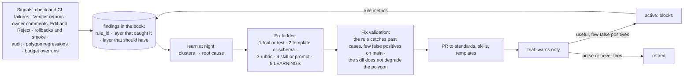
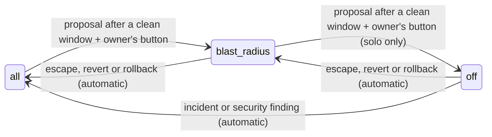
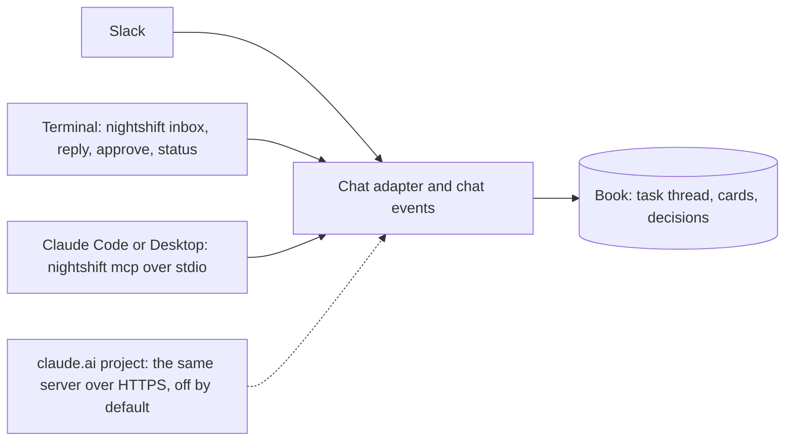
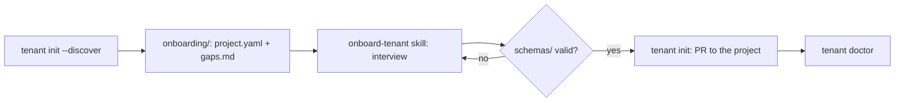

# Nightshift — software factory design

> Nightshift is a standalone product with its own `nightshift` repository, versions and plan. One codebase and one set of images run in separate instances, for example a **personal** instance (the owner's own projects) and a **work** instance (employer projects). This document describes only the core: concrete projects are configured through their own packs and are never named here (section 17).
> Principle: keep it simple. Everything the factory can start without goes to "Later". "The owner" is the tenant's `owner` role; where other people (`approvers`) approve something, the text says so.

## Summary

Nightshift turns an idea from chat into a reviewed, tested change that reaches production on a person's button. Three agents (Lead, Builder, Verifier) work behind deterministic gates written in code; Postgres is the single book of record. Start with section 0 for the decisions, section 22 for the phases and section 17 for how a project plugs in.

## Contents

- [0. Decisions at a glance](#0-decisions-at-a-glance)
- [1. What it is and who it is for](#1-what-it-is-and-who-it-is-for)
- [2. Principles](#2-principles)
- [3. Architecture of the first version](#3-architecture-of-the-first-version)
- [4. Components](#4-components)
- [5. Stack and tools](#5-stack-and-tools)
- [6. Roles](#6-roles)
- [7. Task flow](#7-task-flow)
- [8. Quality loop before a human](#8-quality-loop-before-a-human)
- [9. Standards: where they live and how they change](#9-standards-where-they-live-and-how-they-change)
- [10. Self-improvement: how the factory fixes itself](#10-self-improvement-how-the-factory-fixes-itself)
- [11. Engineer in the loop: design and code review](#11-engineer-in-the-loop-design-and-code-review)
- [12. Models and harnesses](#12-models-and-harnesses)
- [13. Search](#13-search)
- [14. Data and logs: what lives where](#14-data-and-logs-what-lives-where)
- [15. Observability and control panel](#15-observability-and-control-panel)
- [16. Security](#16-security)
- [17. Core and customization: packs, tenant, project](#17-core-and-customization-packs-tenant-project)
- [18. Things to keep in mind](#18-things-to-keep-in-mind)
- [19. What we take from each source](#19-what-we-take-from-each-source)
- [20. Testing the factory and evals](#20-testing-the-factory-and-evals)
- [21. Implementation start](#21-implementation-start)
- [22. Phases](#22-phases)
- [23. Later](#23-later)
- [24. Where concrete projects are described](#24-where-concrete-projects-are-described)
- [25. Open questions](#25-open-questions)

## 0. Decisions at a glance

| Question | Decision |
|---|---|
| What it is | An autonomous software factory (level 4–5, dark factory): idea in Slack → spec → code → checks → preview → card with evidence → production on the owner's button |
| People | `owner`: product owner and architect (human-on-the-loop) who does not write code. `approvers`: who approves specs and PRs; in the personal instance that is the owner, in the work instance the team under the repository rules. Communication goes through chat (Slack); at work also GitHub and the tracker (section 11) |
| Customization | One core. A project is configured by three layers below it: packs (stack, profile, adapters), tenant (`tenant.yaml`, secrets, providers), project (`.nightshift/`, its own instructions, skills and standards). The core is tested on synthetic tenants (section 17) |
| Instances and tenants | **An instance is a trust boundary:** personal and work are separate instances built from the same code and images, each with its own model providers, secrets, book and logs. **A tenant is a project boundary** inside an instance. The tenant profile `governance: solo \| team` decides who approves, whether the factory merges on its own and where its work ends. The two axes are independent: the instance (`personal` or `work`) says whose data it is, the profile (`solo` or `team`) says who decides; a personal project is usually `solo` and an employer project `team` (sections 7, 11, 17) |
| Quality before a human | A layered loop: templates and standards at the input → linters, analyzers and tests → change metrics → LLM rubric checks → Verifier. The owner sees a result only after all layers (section 8) |
| Human review | A spec always asks whether the owner wants to review it. For PRs and documents there is a mode switch (`all` / `blast_radius` / `off`) with an autonomy ladder (automatic step up on an escape, step down only on the owner's button) and configurable blast radius rules: tests and small fixes go through on their own, critical logic, architecture, infrastructure and payments go to the owner (section 11) |
| Control panel | Slack: channels for work, and the app's Home tab as the control panel (work in progress, review queue, switches, limits). Grafana for deep diagnostics (section 15). Slack is the default, not a requirement: the same task thread can be driven from a terminal or from any Claude client through the `inbox` chat adapter, `nightshift` commands and an MCP server (section 15) |
| Self-improvement | Every mistake is a `finding` record. At night, learn turns recurring mistakes into the cheapest fix (check → template → rubric → skill → note), tests it on the polygon and proposes a PR (section 10) |
| Startup | One `docker compose up`: Postgres + `nightshift` + `worker` + `egress` (outbound proxy). Observability and the CI runner are profiles. No ports exposed |
| Book of record | Postgres is the source of truth: tasks, events, worker jobs, the outbox, reviews, findings, budgets, search. Chat and tracker are projections |
| Roles | 3 agents, **Lead, Builder, Verifier**, plus the nightly **learn** job. A role is a YAML config. Everything else is Go code and tools |
| Skills | Ready-made sets in the Agent Skills format (official ones from technology vendors plus vetted community sets), vendored by SHA, security-checked and selected on the polygon; our own only for factory specifics (section 12) |
| Language and rhythm | Artifacts in English; chat may be in Russian. Daytime: dialogue and decisions; night (22:00–09:00): work without messages; morning: a summary |
| Testing | Factory code: deterministic tests without models ($0): unit, properties, integration, scenarios on twins with the `fake` adapter, failures, sandbox escape. Agent quality: evals on the polygon; code graders first, LLM judges only for documents, only what a change touches runs, $60 per month cap (section 20) |
| Agents and vendors | All roles run through harness adapters (`claude`, `codex`, `copilot`, later `opencode`, `acpx`) in the `worker` container. A provider is a line of config. Each instance has its own providers: in the personal instance the Ultra subscription and its API credits, at work Claude or Copilot under the company license (section 12) |
| Stack | Factory: Go 1.27 (core), Python (evals, transcription), Postgres 18 + pgvector, River, slack-go, OpenTelemetry, grafana/otel-lgtm, Smokescreen. Projects: any language through the project's own toolchain file (`mise.toml`), `setup` and `verify`; stack packs (`go`, `python`, `ts`, `js`, `java-maven`, `java-gradle`, others such as `rust` with their first tenant) add structured checks (sections 5, 17) |
| Budget | Personal instance: $200 per month (Claude Ultra and its $200 of API credits), local infrastructure at $0, free tiers of Slack, Linear, GitHub and LangSmith. Work instance: the employer's licenses and budget |
| Where it lives | Personal instance on the owner's machine, later the same compose on a VM in Hetzner or AWS. Work instance on the employer's infrastructure, never on a personal machine next to the personal one |
| Repositories | Personal: private, gates held by the factory itself, CI fits the free GitHub allowance or moves to a self-hosted runner. Work: organization repositories, the team merges under branch protection, the factory hands over a ready PR |

## 1. What it is and who it is for

**Who it is for.** A developer who runs personal products and also works in a team. In the personal instance the factory does everything up to production, on the owner's button. At work it takes a task to a PR that is ready for team review, with evidence; the team merges and deploys with its own process.

**What it looks like.** The owner writes or dictates an idea in `#planning`. Lead studies the code and practices, asks one question at a time, argues if the idea is weak, and prepares short PRDs and ADRs with diagrams. The documents pass the quality loop (template, doc-lint, LLM rubrics) and only then reach the owner with "Do you want to review?" and the buttons Approve / Review / Edit / Reject. After Approve, Builder writes code until the checks are green; Verifier checks the code and runs hidden scenarios on preview. If the PR falls under the review policy, the owner is mentioned in Slack. `#deployments` receives a card: links, video, screenshots, numbers, and the buttons Merge to Prod / Rollback. At work the path is the same up to review, but it ends in the `handed_off` state: a PR with evidence handed to the team.

**How it differs from Claude Code, OpenCode or Deep Agents with skills.** A harness is one engineer: one session, one task, and a human next to it who starts it, watches and merges. It writes memory and `CLAUDE.md` to disk, but only within its session and machine. The factory is everything around the engineers. It does not replace the harness; it runs the harness inside a job:

| Need | Harness with skills | Factory |
|---|---|---|
| Write code for a task | Yes | Yes (through a harness) |
| Work while the owner sleeps, through a queue of many tasks | No | Queue, scheduler, budgets |
| Take tasks from chat, answer with cards, keep the tracker | No | Yes |
| Prevent a merge without checks and the owner's Approve | On trust | Gates in code |
| Remember decisions across tasks, roles and vendors | Partly, locally | Book + search |
| Isolation, secrets, production rollback | No | Yes |
| Learn from the owner's edits and from mistakes | No | findings → rules |

The risk of overengineering is real. So the plan goes in phases, and phases 0–3 are the minimal core that already pays off: Slack → PR with checks → the owner's button. Each next phase starts only when its absence hurts.

**What a user of the factory gets.** Nightshift is self-hosted: one `docker compose up` on the user's machine or VM, not a hosted service and not an app builder for new projects. It works on existing repositories. The user talks to it through Slack, a terminal or their own Claude client (section 15). They customize it with files in their own repository (instructions, skills, rules, checks, toolchain), changed through pull requests like any code (section 17), and with `tenant.yaml` in their instance. A separate web UI is "Later".

**Three required properties:**

1. **A standalone product.** Its own repository and versioned images. Nothing about specific projects in the factory code.
2. **A new project is connected by config** in any instance, with its own chat, tracker, repository, stack and governance profile, without changing factory code (section 17).
3. **The factory improves itself** from the owner's feedback, check results and audits, but cannot weaken its own gates without the owner's decision (section 10).

## 2. Principles

1. **One database.** Postgres is the book, the queue and the search. No Kafka, Redis, Temporal or separate vector DB.
2. **Code writes the book, not an agent.** The runner records every agent turn before and after it runs.
3. **An agent only where judgment is needed.** Dispatcher, gates, merge, release, sync and watchdog are Go code.
4. **Code performs side effects.** An agent returns a result that matches a JSON Schema. Push, PR, merge, chat and tracker messages are done by the `nightshift` service. Neither the agent nor the worker holds GitHub, chat or tracker tokens.
5. **Cheap checks before expensive ones.** Deterministic tools first (seconds, $0), then LLM rubrics, then a strong model, then a human.
6. **Rules into tools; words last.** A mistake becomes a linter, an analyzer rule, a test or a schema; text in a skill or `LEARNINGS.md` only when nothing else works.
7. **Gates live in factory code.** A merge is impossible until checks pass and, if the policy requires, the right people approved. In the `solo` profile only `nightshift` merges, and a GitHub ruleset is an extra layer. In the `team` profile the team merges under the repository rules; the factory only hands over the PR.
8. **Irreversible actions only on a human's button.** Production deploys, production migrations, billing, data deletion, access and secrets. The gate is code without AI. The only exception is an SLA permission that the owner switches on in advance for blast radius `low` in the `solo` profile (section 7); `critical` never qualifies, and `team` has no SLA.
9. **Evidence, not words.** Only artifacts count: tool reports, video, screenshots, traces, before/after numbers.
10. **Heavy things go to files.** Logs, transcripts, SARIF reports and video live in the `artifacts` volume. A prompt gets a path and a short summary.
11. **Documents are for humans.** PRDs, ADRs and component designs are short, follow a template and include a mermaid diagram.
12. **A project's instructions are its own.** If a project already has `AGENTS.md`, skills and agent configs, the factory uses them as they are. For a project without instructions the factory creates `AGENTS.md`: an index of about 100 lines with links to standards, `docs/`, skills, a glossary and `LEARNINGS.md`.
13. **A project describes itself.** Project commands come only from `.nightshift/project.yaml`, and always from the `main` version, never from the PR branch.
14. **No vendor lock-in.** Vendor products (Claude Tag, Claude Code Projects, cloud agents) are an option, not the foundation.
15. **Languages.** Factory code: Go for the core, Python for evals and data, TypeScript only for the factory's frontend and e2e; no Java in factory code, Rust only when clearly needed and with an ADR. Projects can use any stack: the project's own toolchain and `verify` run every language, and stack packs add their quality tools.
16. **The working language is English.** PRDs, ADRs, standards, skills, code, comments, PRs, commits, tracker issues and cards are in English. The owner may write to Lead in Russian: Lead answers in the thread in Russian, but everything that goes to git, the tracker and cards stays in English. Doc-lint checks this.
17. **An instance is a trust boundary.** Personal and corporate code, their providers, secrets, book, artifacts and logs never share an instance.

## 3. Architecture of the first version


```yaml
# deploy/docker-compose.yml
x-hardened: &hardened
  read_only: true
  security_opt: ["no-new-privileges:true"]
  cap_drop: [ALL]
  tmpfs: ["/tmp"]

services:
  postgres:
    image: pgvector/pgvector:pg18
    environment: { POSTGRES_PASSWORD_FILE: /run/secrets/pg_admin }
    secrets: [pg_admin, pg_owner_password, pg_nightshift_password, pg_backup_password]   # the init script creates the login roles
    volumes: ["pgdata:/var/lib/postgresql/data", "./postgres/10-roles.sh:/docker-entrypoint-initdb.d/10-roles.sh:ro"]
    networks: [core]
    healthcheck: { test: ["CMD", "pg_isready"], interval: 5s }

  migrate:                                  # one shot as the schema owner; serve never holds this secret
    build: { context: .., target: nightshift }
    <<: *hardened
    command: ["serve", "--migrate-only"]
    secrets: [pg_owner]
    networks: [core]
    depends_on: { postgres: { condition: service_healthy } }
    restart: "no"

  nightshift:                               # Go: Slack, polling, dispatcher, outbox, gates, merge, release
    build: { context: .., target: nightshift }   # images are built locally
    <<: *hardened
    user: "10001"
    secrets: [pg_nightshift, chat_bot_token, chat_app_token, worker_token_sha256, github_token, github_app_id, github_app_key, mcp_token, deployer_token]   # the only service with chat, GitHub and door secrets
    volumes: ["artifacts:/artifacts:ro", "repos:/repos"]   # repos: mirrors of tenant repositories
    networks: [core, jobs, internet, deploy]
    depends_on:
      postgres: { condition: service_healthy }
      migrate: { condition: service_completed_successfully }
    healthcheck: { test: ["CMD", "nightshift", "status", "--health"], interval: 15s }
    restart: unless-stopped

  backup:                                   # pg_dump hourly, restore test weekly
    image: postgres:<version>
    secrets: [pg_backup_password]           # the read-only book_backup role, not the superuser
    volumes: ["dumps:/dumps", "./backup:/etc/backup:ro"]
    networks: [core]

  offsite:                                  # restic copy of the dumps, daily, encrypted
    image: restic/restic:<version>
    secrets: [restic_repository, restic_password]
    volumes: ["dumps:/dumps:ro", "./backup:/etc/backup:ro"]
    networks: [internet]

  worker:                                   # one job at a time; parallelism = replica count; no Postgres access
    build: { context: .., target: worker }
    <<: *hardened
    cap_add: [SETUID, SETGID]               # the runner (root without other capabilities) starts the agent as uid 20001
    shm_size: 1gb                           # Chromium for Playwright
    secrets: [worker_token, harness]        # jobs API token + harness credentials
    volumes: ["work:/work", "artifacts:/artifacts", "agent-home:/home/agent", "repos:/repos:ro"]   # agent HOME; repository mirrors read-only
    networks: [jobs]                        # no direct way out
    environment:
      HTTPS_PROXY: "http://egress:4750"
      NO_PROXY: "nightshift,lgtm"
      CLAUDE_CODE_DISABLE_NONESSENTIAL_TRAFFIC: "1"
    deploy: { replicas: 2, resources: { limits: { cpus: "4", memory: 8g, pids: 2048 } } }
    healthcheck: { test: ["CMD", "nightshift", "status", "--health"], interval: 15s }
    restart: unless-stopped

  egress:                                   # Smokescreen: the only way out for the worker, by allowlist
    image: ghcr.io/stripe/smokescreen:<version>
    command: ["--egress-acl-file", "/etc/smokescreen/acl.yaml"]
    volumes: ["./egress-acl.yaml:/etc/smokescreen/acl.yaml:ro"]
    networks: [jobs, internet]
    restart: unless-stopped

  modcache:                                 # Athens: Go modules for the worker (the worker has GOPROXY=http://modcache:3000); the only container besides egress on jobs and internet
    image: gomods/athens:<version>
    environment: { ATHENS_STORAGE_TYPE: disk, ATHENS_GO_BINARY_ENV_VARS: "GOPROXY=https://proxy.golang.org" }
    volumes: ["modcache:/var/lib/athens"]
    networks: [jobs, internet]
    restart: unless-stopped

  toolchain:                                # installs the toolchain a project pins (`mise install`) before the agent starts; the only container besides egress-install that reaches the tool hosts (ADR 0010)
    build: { context: .., target: worker }
    command: ["toolchain"]
    secrets: [worker_token]                 # the same token authenticates the worker's call
    volumes: ["work:/work", "agent-home:/home/agent"]
    environment: { HTTPS_PROXY: "http://egress-install:4750", NO_PROXY: "localhost,modcache", GOPROXY: "http://modcache:3000" }
    networks: [jobs, install]               # the worker calls POST /install on the jobs network; its way out is the install allowlist
    depends_on: [egress-install, modcache]
    restart: unless-stopped

  egress-install:                           # Smokescreen with the tool hosts; only toolchain reaches it, the worker is not on the install network
    build: { context: .., target: egress }
    command: ["--config-file", "/etc/smokescreen/config.yaml", "--egress-acl-file", "/etc/smokescreen/acl.yaml"]
    volumes: ["./egress-install-acl.yaml:/etc/smokescreen/acl.yaml:ro", "./egress-config.yaml:/etc/smokescreen/config.yaml:ro"]
    networks: [install, internet]
    restart: unless-stopped

  deployer:                                 # brings previews and releases up on the Docker engine (section 17); the only service with the socket
    profiles: [deploy]
    build: { context: .., target: deployer }
    <<: *hardened
    cap_add: [DAC_READ_SEARCH]              # root without it cannot open deployer_token
    user: "0"                               # the socket belongs to root; the worker never reaches this service
    command: ["deployer", "--work", "${NIGHTSHIFT_DEPLOY_DIR:-/tmp/nightshift-deploy}"]
    secrets: [deployer_token]
    volumes: ["repos:/repos:ro", "/var/run/docker.sock:/var/run/docker.sock", "${NIGHTSHIFT_DEPLOY_DIR:-/tmp/nightshift-deploy}:${NIGHTSHIFT_DEPLOY_DIR:-/tmp/nightshift-deploy}"]
    networks: [deploy]
    restart: unless-stopped

  grafana-login:                            # obs profile: one shot, gives grafana_ro its login
    build: { context: .., target: nightshift }
    <<: *hardened
    profiles: [obs]
    command: ["serve", "--migrate-only"]
    secrets: [pg_owner, pg_grafana_password]
    networks: [core]

  lgtm:                                     # obs profile: logs, metrics, traces
    image: grafana/otel-lgtm:<version>
    profiles: [obs]
    environment:
      GF_ANALYTICS_REPORTING_ENABLED: "false"
      GF_ANALYTICS_CHECK_FOR_UPDATES: "false"
    ports: ["127.0.0.1:3000:3000"]          # Grafana from the local machine only
    secrets: [pg_grafana_password]          # the book data source logs in as grafana_ro
    volumes: ["lgtm:/data", "./grafana/datasource.yaml:/otel-lgtm/grafana/conf/provisioning/datasources/nightshift.yaml:ro"]   # and the dashboards
    networks: [core, jobs, ui]              # ui, because a port cannot be published from an internal network

networks:
  core: { internal: true }                  # Postgres, nightshift, lgtm
  jobs: { internal: true }                  # worker ↔ nightshift (jobs API), lgtm, egress
  install: { internal: true }               # toolchain ↔ egress-install; the worker is not on it
  deploy: { internal: true }                # nightshift ↔ deployer
  ui: {}                                    # only to publish Grafana on 127.0.0.1
  internet: {}

secrets:                                    # files in deploy/secrets/, mode 0400, owned by the reading service's uid; not in git
  pg_admin: { file: ./secrets/pg_admin }                         # superuser; postgres only
  pg_owner_password: { file: ./secrets/pg_owner_password }       # postgres creates the roles from these two
  pg_nightshift_password: { file: ./secrets/pg_nightshift_password }
  pg_backup_password: { file: ./secrets/pg_backup_password }
  pg_owner: { file: ./secrets/pg_owner }                         # postgres://book_owner:<password>@postgres:5432/book
  pg_nightshift: { file: ./secrets/pg_nightshift }               # postgres://nightshift:<password>@postgres:5432/book
  pg_grafana_password: { file: ./secrets/pg_grafana_password }   # grafana_ro, which reads only the dash_* views
  chat_bot_token: { file: ./secrets/chat_bot_token }             # pasted by the owner; one chat app per instance
  chat_app_token: { file: ./secrets/chat_app_token }
  restic_repository: { file: ./secrets/restic_repository }
  restic_password: { file: ./secrets/restic_password }           # a copy lives in the owner's password manager
  deployer_token: { file: ./secrets/deployer_token }             # nightshift and the deployer only
  worker_token: { file: ./secrets/worker_token }                 # created by deploy/init-secrets.sh
  worker_token_sha256: { file: ./secrets/worker_token.sha256 }   # nightshift checks the token against its hash
  harness: { file: ./secrets/harness }      # directory, one file per credential
  github_token: { file: ./secrets/github_token }                 # empty until pasted; nightshift only
  github_app_id: { file: ./secrets/github_app_id }               # the GitHub App, preferred over the token
  github_app_key: { file: ./secrets/github_app_key }
  mcp_token: { file: ./secrets/mcp_token }                       # the remote door's bearer token

volumes: { pgdata: {}, dumps: {}, work: {}, artifacts: {}, agent-home: {}, repos: {}, lgtm: {}, modcache: {} }
```

- **Worker jobs.** `book.jobs` stores queued work for the agent roles. The jobs API leases a row, renews it on heartbeat and records the result. On the next claim after a lease expires, the API requeues the job if attempts remain or marks it failed. A late result carrying an expired lease cannot complete the job.
- **The worker never touches the database.** It takes a job through the internal HTTP API of `nightshift` on the `jobs` network: `claim` (long-poll), `heartbeat`, `events`, `complete`. The worker authenticates with `worker_token`, and each job gets its own short-lived token scoped to the task and role (the `ns` CLI uses it too). This keeps permissions simple. The agent physically cannot reach the book.
- **Outbox delivery.** River runs the periodic outbox flush inside `nightshift`, including at service startup. `book.outbox` holds each message, its idempotency key and its next attempt. The outbox retries due messages with backoff and marks permanent or exhausted failures. A crash before delivery is recorded leaves the message eligible for another attempt.
- **Isolation.** One job per worker container, so files and processes of different jobs never mix. Each task has its own worktree in `/work/<tenant>/<task>`; the agent writes only to its worktree and its job's artifact directory. No Docker-in-Docker.
- **Networks.** (The `ci` profile with `gh-runner` and `egress-ci` is designed but not in `deploy/docker-compose.yml` yet; the compose example above lists only what exists, and `TestDesignComposeExample` keeps the two in step.) The worker and gh-runner sit in separate networks with no way out (gh-runner runs code from PR branches, so it cannot see the jobs API). They reach the internet only through their own Smokescreen (`egress` and `egress-ci`) by allowlist. Private ranges (the local network, cluster APIs) are denied, and preview hosts are allowed one by one. Only `nightshift` talks to the outside directly (chat, tracker, GitHub).
- **Postgres roles.** `nightshift` has rights on the book but no `UPDATE` or `DELETE` on `events`. `grafana_ro` can only read the dashboard views (no hidden scenarios, no secrets). Migrations run under a separate schema-owner role, only in the one-shot `migrate` service (`nightshift serve --migrate-only`), which every start of a release runs; the running service never holds the owner's password. `book_backup` reads everything (`pg_read_all_data`) and may create only the scratch database of the restore test; the superuser password stays inside `postgres`.
- **Users in the worker.** The runner is root without capabilities except `SETUID` and `SETGID`. The agent and all project commands run as uid 20001 and cannot open the worker's secrets: they are mounted under `/run/worker-secrets`, a root-only directory of the image, because file modes alone do not hold on every host (Docker Desktop shows a mounted file as owned by its reader). The runner creates the checkout and runs git as that user, so it never changes file owners and never runs git as root on files the agent can write. The mirrors belong to `nightshift`; only the clone gets their group, so the agent cannot browse other repositories. Playwright's Chromium runs without its own sandbox (the Playwright default); the container provides isolation.
- **Images** are built locally (`docker compose build`); a single machine needs no registry. If a registry is needed (VPS, second host), GHCR works: GitHub Container registry storage and traffic are free today, and GitHub promises advance notice before charging.
- **Where it runs.** The personal instance runs locally for now; later the same compose moves to a VM in Hetzner or AWS with no code changes. The work instance runs on the employer's machine or VM.
- **Two instances.** Personal and work start from the same compose and images. They differ only in `instance.yaml` (trust domain, providers, egress allowlist), the `tenants/` directory and secrets. They share only the code in git; books, artifacts, logs and secrets are separate.

## 4. Components

| Component | Purpose | Input → output | Where it lives | Language |
|---|---|---|---|---|
| **nightshift** | Core: tenants, chat and tracker adapters, projections, dispatcher and fair scheduling, jobs API for workers, provider router, repository mirrors and push, gates, merge train, release, outbox, indexer, watchdog | Chat events, tracker and GitHub polling, job results → book, jobs, cards, merges (in `solo`) | `nightshift` container | Go |
| **Book** | Source of truth and queue | `tasks`, `events`, `jobs`, `outbox`, `reviews`, `findings`, `standards_index`, `documents`, `budgets`, `settings`, `eval_runs` | `postgres` container | SQL |
| **runner** | Takes a job through the jobs API, prepares a worktree from the repository mirror (`repos` volume, read-only), selects standards and skills, runs the role and checks as the agent user, returns the result and the patch | Job + role → result by schema, patch, reports with sha256, usage | `worker` container, an OS user separate from the agent | Go |
| **Harness adapters** | One interface to agents and models (`claude`, `copilot`, `codex`, `api`, `fake`, later `opencode`, `acpx`) | `Run(RunRequest)` → `RunResult`: result by schema, session, transcript path, usage, exit reason (section 21) | Inside the runner; nightly batch calls of eval judges are sent by `nightshift` | Go |
| **ns CLI** | Read-only agent tools: search, standards, task. Access is limited by role | Query + job token → JSON with links | worker image, talks to `nightshift` | Go |
| **nightshift check** | The project's `verify` plus factory checks (gitleaks, osv-scanner, opengrep, doc-lint); converts reports to SARIF and turns new violations into findings | Worktree + standards + `main` baseline → SARIF, findings | Inside the runner, runs as the agent user | Go |
| **doc-lint** | Document structure: template, sections, length limits, diagram, front matter | Markdown → violations | Subcommand of `nightshift check` | Go |
| **Review policy** | Computes blast radius, decides whether a human is needed; review queue, reminders | Task, diff, tags, rules, switch → level, review request, `reviews` | Inside `nightshift` | Go |
| **Control panel** | Slack app Home tab: work in progress, review queue, switches, limits, task context | Book, `settings` → Block Kit view; clicks → events and setting changes | Inside `nightshift` | Go |
| **learn and audit** | Self-improvement loop and periodic audit (section 10) | findings, reports → PRs with standards, skills, rules | Periodic River jobs | Go + agent roles |
| **Polygon and evals** | Regression runs of the factory on reference tasks | Task set → quality, cost and time metrics | `evals/tasks/` of this repository, run locally (ADR 0011) | Python |
| **Transcription** | Slack voice messages → text | Audio → text in the thread and the book | Job in the worker, faster-whisper on CPU | Python |
| **Integration adapters** | Tracker (Linear; later Jira), documents (git; later Confluence), chat (our own Slack app; at work a corporate Slack or GitHub only), external checks (CodeQL, Sonar as findings), logs (later Splunk, read-only) | Core commands → API calls; external events → book events | Inside `nightshift`, `internal/adapters/` | Go |
| **Stack packs** | Quality tools, configs and worker image for the project's stack | `project.yaml: stack` → tools, configs, image | `nightshift/stacks/<pack>/` | Dockerfile, YAML |
| **Tenant pack** | Everything the factory knows about a project | Files → loaded at startup | `tenants/<name>/` + `.nightshift/` in the repository | YAML, Markdown |

## 5. Stack and tools

Versions of all tools are pinned in `mise.toml` and checksummed in `mise.lock` (lockfile enabled); the same in the worker image and in CI. The `claude` version is pinned too (see section 12).

### The factory itself

| Layer | Choice | Why |
|---|---|---|
| Core language | Go 1.27 | One `nightshift` binary with the subcommands `serve`, `work`, `deps`, `toolchain`, `deployer`, `check`, `standards`, `skills`, `tenant`, `config`, `task`, `memory`, `search`, `digest`, `setup`, `eval`, `doctor`, `status`, `inbox`, `reply`, `approve`, `cancel`, `mcp` |
| Database | Postgres 18 + pgvector | Book, queue and search in one database |
| Queue | River (MPL-2.0) | Periodic outbox flush on Postgres. The jobs API handles leasing and retries for agent jobs in `book.jobs`. |
| DB access | pgx v5, sqlc, goose | Typed queries, expand-only migrations |
| Integrations | slack-go (Socket Mode, Block Kit), genqlient (Linear GraphQL), go-github + GitHub App | No inbound ports |
| Config and schemas | YAML + JSON Schema (santhosh-tekuri/jsonschema) | Validation of tenant packs, roles and agent results |
| Logs and telemetry | log/slog (JSON) + OpenTelemetry Go SDK | One format for logs, traces and metrics |
| Tests | go test (+ `-fuzz`), rapid for state machine properties, httptest twins of Slack, Linear and GitHub, the `fake` adapter with scenarios; integration tests with a real Postgres (testcontainers-go) run only in CI (L3), because the worker has no Docker socket | All factory logic is tested without network, tokens or models (section 20) |
| Python | uv, ruff, mypy, pytest | Polygon eval graders, transcription (faster-whisper) |
| Factory CI | GitHub Actions, actions pinned by commit SHA; Dependabot | Protection against retagged actions |

### Project toolchains in the worker

Any language runs without a pack. The worker image is Debian slim with mise, git, bash and the agent CLIs, and carries no language toolchain of its own. Before a job the runner prepares the worktree in three steps, all as the agent user:

1. **Toolchain.** `mise install` reads the project's `mise.toml` or `.tool-versions` and installs the pinned versions (Go, Node, Java, Rust, Python and others). It runs in the `toolchain` service, the only container that reaches the tool hosts, before the agent starts; the tools persist in the `agent-home` volume, so a second job with the same versions installs nothing (ADR 0010). Go modules come from the `modcache` service (ADR 0008).
2. **Dependencies.** `project.yaml: setup` (for example `npm ci` or `./mvnw -q dependency:go-offline`) runs in the worktree.
3. **Checks.** `verify` is the gate for every language; stack packs add L1 tools with SARIF on top of it.

A project without a toolchain file gets the toolchains of its detected stack packs at the pack's default versions; `tenant doctor` reports that and proposes a `mise.toml`. Packages that need a system package manager and root (C++ system libraries, an Android SDK) are out of reach for the agent user: such a stack needs a tenant worker image, which is "Later". The base is Debian rather than Alpine because prebuilt toolchains and browsers usually target glibc (ADR 0009).

### Quality tools (stack packs)

| Area | Tools | What they catch |
|---|---|---|
| Go | golangci-lint v2 (staticcheck, gosec, errcheck, revive, gocognit, dupl, depguard), govulncheck | Bugs, unsafe constructs, complexity, layer violations, vulnerable dependencies: any known advisory in a required module fails, called or not |
| Python | ruff (lint, format, bandit rules), mypy, pytest + coverage | Style, types, unsafe calls, tests |
| TypeScript (e2e, frontend) | tsc, ESLint, Playwright Test | Types, e2e |
| Own rules | Opengrep (LGPL fork of Semgrep, same rule format) | Project rules and anti-patterns found by the factory |
| Secrets | gitleaks | Keys and tokens in diffs and history |
| Dependencies | osv-scanner (all ecosystems), govulncheck | Known vulnerabilities |
| Postgres migrations | squawk | Blocking and breaking migrations |
| API contracts (`openapi` pack) | Spectral, oasdiff | API style rules from the project's ruleset, breaking changes against `main` |
| Accessibility (`web` pack) | axe-core through `@axe-core/playwright` | WCAG violations on the pages that e2e tests open |
| Containers and CI | hadolint, actionlint, zizmor, shellcheck | Dockerfile mistakes, unsafe workflows (template injection, token leaks) |
| Change metrics | Start: diff size, new dependencies, coverage from `go test -cover` and coverage.py. Later: diff-cover, jscpd | Bloated PRs, uncovered new code, duplicates |
| Documents (in English) | doc-lint, markdownlint-cli2, mermaid-cli, Vale with ready styles (Microsoft or Google, write-good) and our own rules, lychee | Structure, length, diagrams that do not render, style, dead links |
| Java (`java-maven` pack, when the first tenant needs it) | Maven wrapper, Spotless or Checkstyle, Error Prone or SpotBugs and PMD, ArchUnit for layer rules, JaCoCo for new-line coverage, Flyway, OpenAPI diff | Style, bugs, architecture violations, uncovered new code, breaking contract changes |
| Project packs | Plugged in through `.nightshift/standards/` (for example, kubeconform for projects on Kubernetes) | Project specifics |

### Observability and security

| Task | Choice |
|---|---|
| Factory telemetry | OTLP from `nightshift` and the runner: a trace per task, a span per job and agent turn |
| Agent telemetry | Claude Code: metrics and events through OpenTelemetry, traces in beta; Codex: the `[otel]` section of `config.toml` |
| Storage and UI | `grafana/otel-lgtm` in the `obs` profile: OTel Collector, Loki, Tempo, Prometheus, Pyroscope and Grafana in one container, data in the `/data` volume. Officially aimed at dev, demos and tests, which is enough for one owner |
| Why not Splunk | Splunk is proprietary. The free version is limited to 500 MB per day and one instance, has no alerts and no users, and has no OTel traces and metrics out of the box. LGTM is open source, one container, all three signals (logs, metrics, traces) through OpenTelemetry, and Grafana can read the Postgres book directly. If LGTM gets too small, OTel lets us switch the backend without code changes (SigNoz, OpenObserve, ClickStack) |
| Factory dashboards | Grafana reads the book directly as a Postgres data source |
| Egress | Smokescreen (Stripe's HTTP CONNECT proxy), the `egress` service by default: the worker sits in an isolated network, outbound only through the allowlist |
| Supply chain | Versions in `mise.toml`, checksums in `mise.lock`, actions by SHA, zizmor, dependency updates only through PRs |

## 6. Roles

A separate role exists only where a **different context, a different model or a conflict of interest** is needed. Everything else is a role mode, a tool or code.

| Role | What it does | Rights |
|---|---|---|
| **Lead** | The only conversation partner in chat. **#planning:** research → grilling → PRD, ADR, criteria and hidden scenarios → slicing into tasks with dependencies. **#support:** looks for reasons *not* to open a task → reproduction → card with a priority. Answers other roles from the owner's past decisions, with quote, source and date | Reads the repository, `ns`. Writes to the worktree; only documents leave, as a patch through `nightshift`. Web research is a separate job without access to code: the input is only the formulated question, the output only the findings |
| **Builder** | TDD, unit and e2e tests, the "edit → `nightshift check`" loop until green. Answers findings of all layers (or disputes them) and every comment of the owner's review | Writes to the worktree. Does not see hidden scenarios; `nightshift` rejects a patch that touches protected paths (section 10, item 8) |
| **Verifier** | Fresh context, preferably a model of another family. **review:** spec first, then quality. **acceptance:** hidden scenarios on preview in Chromium through Playwright (own skill `browser-acceptance`; the browser is baked into the worker image). **audit** (scheduled): audit of the repository and of the factory itself (section 10). Settles disputes over findings. Escalates after 3 returns | Reads the repository only; writes only to its job directory. Receives hidden scenarios from the runner through the job tmpfs; after acceptance Builder sees only a description of the failed behavior |
| **learn** (nightly job) | Clusters findings, looks for the root cause, proposes the cheapest fix, tests it and opens a PR (section 10) | PRs to standards, skills, templates and `LEARNINGS.md`; what goes in without the owner is in section 9 |

**Why this is enough.** Author and checker are separated. Planning and triage need one context, so they are Lead modes. Audit is a Verifier mode, because it also needs fresh eyes without authorship. LLM rubric checks are not a role but a tool: one call to a cheap model without tools. The dispatcher, team-lead coordinator, release manager and watchdog from the Majento design are Go code.

**How Lead challenges a task.** The `challenge` skill on top of `grilling`:

1. Before every question it searches the book (`ns search`). If the answer exists, it quotes the decision instead of asking.
2. It checks: what problem we solve and how we will know it is solved; why now and what happens if we do nothing; the smallest version that tests the idea; contradictions with ADRs, standards and past decisions; money, data, access, architecture and irreversibility (then it sets a tag that raises the blast radius, section 11); what we deliberately do not do.
3. It asks one question per message, with 2–3 options and a recommendation (a reply carries one set of options). It may recommend Reject outright.
4. It stops at the Definition of Ready: goal, acceptance criteria, scope, blast radius tags, tasks and their dependencies.

**Research before building.** When a task implies writing something new, an agent first answers "write it ourselves or take something that exists?" with a repeatable record, and does not start coding. Two own skills carry it: `research-options` (any design choice with two to four real options) and `build-vs-buy` (the same method for a new capability, with `nightshift deps check` as its tool). The trigger is detected by roles and enforced by code:

- **Lead.** In the `challenge` skill (step 2 above), a spec that adds a capability the repository and the book do not have (a new module, protocol, format, integration or dependency) runs `build-vs-buy` before the spec card. The owner's own "we need to write X" counts as the trigger.
- **Builder.** A plan that needs a new dependency, a new top-level package or a client of an external protocol the spec's record does not cover stops: `status: blocked`, `blocked_reason` starting with `needs_research:`. The task goes back to Lead (state `grilling`, Builder's reason in the thread), who runs the skill; Builder does not pick a library on its own. A third stop, or another reason, escalates to the owner.
- **Verifier.** In review, a new dependency or a large new module without a record is a finding.
- **Code.** `nightshift check` (L2) reports a finding when a lockfile gains a dependency, or the diff adds a package over a size limit, and the task has no research record. A dependency without a record is an error; a large package without one is a warning. The record is an ADR (MADR 4.0, so doc-lint already demands at least two options) whose options include "write it ourselves" and that the spec links.

The skill works in five steps. (1) Search the book (`ns search`), the repository and the standard library: the answer may already exist. (2) State the need in three lines with its must-haves. (3) List candidates: write it ourselves, the standard library or a dependency we already have, and one to three libraries. `nightshift deps check <package>` is code, not a model: it reads deps.dev and OSV and returns the licence against the tenant's allowed list, age, last release, known advisories, number of dependents, size of the dependency tree and install scripts. API fit is judged from the library's documentation by a web research job without access to code (section 16). (4) Compare cost of owning it, risk, lock-in and size. (5) Recommend one option. The spec card carries a summary of at most 60 words ("write ourselves, because ..." or "take X, because ..."), and the table goes into the ADR. Text from registries and README files is data, never instructions. The new dependency itself stays blast radius `critical` (section 16): research prepares the owner's Approve and does not replace it.

**When to add a role.** A mode needs a different model; a role's context grows too large; a conflict of interest appears; an agent becomes a bottleneck. Candidates: Critic on another model, Triage, Taste Judge with a blind test of ≥ 90%.

**A role is config:**

```yaml
# nightshift/roles/verifier.yaml
name: verifier
access: read_only
skills: [sentry/code-review, sentry/find-bugs, obra/verification-before-completion, own/browser-acceptance, own/evidence-report, own/audit]
output_schema: schemas/verdict.json           # pass | return(findings) | escalate
limits: { max_returns: 3, minutes: 30, tokens: 400000 }
```

The file holds what the runner reads: the access mode, skills, the output schema and the limits. When a role runs is decided in code by the conductor (a task state, a chat message or a schedule starts it), and what a role may see is fixed in code too (hidden scenarios go to the Verifier only), so neither is a config key. Providers per role are in `tenant.yaml` (`providers.<role>`, order is priority). Today a tenant tunes a role through `project.yaml: instructions` and its own skills;

A project may brief a role in `.nightshift/roles/<name>.yaml`: `instructions` (more instruction files of the repository, at most 8) and `skills` (ids from the shared skill set, at most 8). Both only add. The output schema, limits, access and gates stay the factory's, so an override cannot weaken a role. A file with another key, a bad path or id, or an instruction file that is not a regular file of the repository is skipped whole, with a warning, and the role runs as the factory defines it. Instruction files are read from the checked-out worktree, so for Verifier they come from the change under review, as `AGENTS.md` does today.

## 7. Task flow


From any active state, `/ns cancel` or a cancel in the tracker leads to `canceled`; these transitions are left off the diagram.

**Two ends of the path.** In the `solo` profile a task goes through the merge train to `released`. In the `team` profile it ends in `handed_off`: the PR leaves draft, carries a summary and evidence, and reviewers are assigned from CODEOWNERS or the `approvers` list. The team merges under the repository rules; `nightshift` polls GitHub and moves the task to `merged_by_team`, and Request changes from the team send it back to Builder. A pull request merged or closed on GitHub while the task waits in `human_review` or `ready` (the owner pressed the button, or a person closed it) is followed the same way: `merged_by_team` or `canceled`, recorded as `merged_outside` or `closed_outside`. Deployment follows the company process. The merge train, `preview`, `release`, `rollback` and `smoke` are tenant capabilities (`project.yaml: capabilities`), not a mandatory part of the flow.

**Channels and messages.** This is the personal instance example; at work `tenant.yaml` defines the channels, and without a Slack app of its own the same cards go as comments on the PR and the tracker issue. The owner talks only to Lead (who is also the architect): discussion, plan and progress of a task live in its thread in `#planning`; PR review requests and "ready for production" cards go to `#deployments` with a link to the thread; triage happens in `#support`. Builder and Verifier do not post in Slack; their work shows as status lines in the thread. One task, one thread. Four message types of up to 60 words: "Question with options", "Decision needed" (Approve / Review / Edit / Reject or a PR review), "Ready for acceptance" (Merge to Prod / Rollback), "Blocker or summary". Details go to attachments and links. A recommendation or a spec card carries one short basis line (at most 25 words: what Lead opened, what it inferred, confidence); the `basis` field of the Lead reply is required with `recommended` or `spec_ready`, and `nightshift` sends a reply with low confidence or nothing checked back to Lead once. Every role report states what it checked and what it inferred (AGENTS.md "Evidence"). A tenant without Slack uses the `inbox` adapter (section 15): the same cards and the same thread live in the book and are read and answered from a terminal or a Claude client.

**One channel.** The `channels` map may point all three intents to the same channel, for example `{ planning: factory, support: factory, deployments: factory }`. One task is still one thread. Lead tells an idea from a problem report by the first message of a thread and, when unsure, asks with two buttons: [Idea] [Problem]. "Decision needed" and "Ready for acceptance" cards go into the task thread with a mention of the owner, and the Home tab "Waiting for you" list collects them. This fits a tenant with one person and few tasks; with several people or parallel tasks, separate channels keep the review queue apart from discussion.

- **#planning.** Text or voice → Lead → document quality loop → spec card asking "Do you want to review?". Approve: `nightshift` merges the docs PR with the PRD and ADR, creates tasks in the tracker, and the tasks are queued with their dependencies. Edit: a change in words or voice; the diff between versions is kept for learn. Reject: the reason is kept as a decision.
- **#support.** Lead looks for duplicates in tracker issues (through the projection in the book), PRs and commits. Duplicate → a link, no task. Otherwise: reproduction in a worktree from `main` or on the `main` preview, never on production or user data (a failing test or a playwright script), and a card: priority P0–P3, steps, evidence, [Create task] [Not needed].
- **#deployments.** Only after the full cycle: green checks and CI (Playwright Test headless), Verifier review, acceptance on preview (Playwright) and, if the policy requires, the owner's Approve. The card holds the tracker issue, preview URL, PR, video and screenshots, metrics, the blast radius level with reasons, and the `trace_id`. **Merge to Prod** runs the merge train, `release` and `smoke`; a failed smoke triggers an automatic rollback. **Rollback** before the merge closes the PR and tears down the preview; after a release it rolls production back.

**Flow rules enforced by code:**

- **Transitions are atomic.** Each transition is a compare-and-set on (state, version, `head_sha`) in one transaction. Decisions (Approve, Merge, Rollback) are bound to a SHA; repeating the same decision is idempotent. If conflicting decisions arrive at once (Approve in chat and Request changes in GitHub), the stricter one wins.
- **Verifier results.** Jobs API validates and stores findings with job completion. The conductor commits raised risk, consumption and the task transition together. If that transaction fails, the same verdict remains available and the stored findings stay available for retry. Only applied returns to Builder use the review-return budget.
- **Task budget.** One per task: iterations, tokens, hours. It bounds all return loops (checks, Verifier, acceptance, review, train). When exhausted: `escalated` and a "Decision needed" card.
- **Merge train.** Only `nightshift` merges, one PR per repository at a time: rebase on a fresh `main` → L1–L3 again → merge → `release` → `smoke`. Each step (`rebased_sha`, `ci_run`, `merged_sha`, `released_sha`) is written to the book before and after; after a restart the train reconciles with GitHub and continues from the right step. If the rebase had no conflicts and `git range-diff` is empty, the owner's Approve and the Verifier verdicts carry over to the new SHA; if Builder resolved a conflict, they are all dropped.
- **Resuming publication.** A task in `ready` or `merging` needs a recorded path through the review gate backed by a passing Verifier result or an authorized decision for its recorded head. If review evidence is missing, an open pull request at the recorded head or a completed rebase returns to `human_review`. An unmatched head waits for reconciliation. The train reconciles an already merged pull request with the release journal.
- **Rollback.** On `rolled_back` the tenant's train freezes and `nightshift` opens a revert PR itself; it passes only L1–L3 and merges out of turn. Then the task returns to `building` with an `incident` finding and the train unfreezes. This way the bad commit does not ship again with the next release.
- **Dependencies.** Tasks from `to-tickets` keep blocking links; the dispatcher runs only unblocked tasks. A dependency counts as closed at `released`, or at `merged_by_team` (the team, or someone outside the factory, merged it). If a dependency is canceled, dependent tasks move to `blocked` with a "Decision needed" card.
- **Changing a spec after Approve.** Edit stops only the spec's unmerged tasks and returns the spec to `grilling`. To change what is already merged, Lead opens new tasks.
- **Cancel.** `/ns cancel` or a cancel in the tracker: jobs stop, the PR closes, the preview is torn down, the worktree is deleted. From the tracker the factory accepts only cancel and priority; everything else is overwritten from the book (in Jira, within the existing workflow).
- **Capacity.** Limits on parallel tasks and previews per tenant live in `tenant.yaml`. Tasks in `human_review`, `handed_off`, `ready` and `merging` do not take a slot; their preview is torn down N hours after acceptance and brought back when needed.
- **Pause.** `/ns pause` stops the dispatcher and all trains; `/ns resume` resumes.
- **Day and night.** In the daytime (by default 09:00–22:00 in the tenant's time zone) there is dialogue: the owner sets and discusses tasks, approves specs, looks at reviews. At night (quiet hours 22:00–09:00) the factory runs everything approved during the day without the owner: Builder, checks, Verifier, preview, plus learn, audit and the polygon. No messages at night. If a task needs the owner's decision, it is parked until morning and the factory takes the next one. Waking the owner is allowed only for a production incident that the automatic rollback did not fix. No production releases at night (neither by SLA nor by schedule), only rollbacks. At 09:00 a morning summary arrives: what was done overnight, what waits for the owner, the review queue, limit usage. Quiet hours are a tenant setting; in the `team` profile the factory also works at night, but hands nothing to the team and posts nothing to shared channels until morning.
- **SLA auto-merge** (`solo` only) is a permission the owner gives in advance for blast radius `low`. It is switched on only by a toggle (panel or `/ns sla on`) and stays on until the owner switches it off. If the owner has not answered in N hours, the card goes through the merge train on its own. It never applies to `high` and `critical`, new dependencies, or PRs waiting for review.
- **Buttons** carry the `task_id` and the card version; a click on a stale card is rejected. Commands and decisions are accepted only from the tenant's `owner` and `approvers` (by their IDs in chat, GitHub and the tracker).

## 8. Quality loop before a human

The goal is that the owner receives a result that has already passed everything that can be checked cheaply. Each layer returns machine-readable findings to the author (SARIF or JSON by schema) with a `rule_id`; the author fixes them and the layer runs again. The owner sees a task only when all layers are green.

| Layer | What it does | Code | Documents (PRD, ADR, design) | Cost |
|---|---|---|---|---|
| **L0. Input** | The runner selects the applicable standards (by task kind and paths) and puts a short checklist with links into the prompt | Language and project standards, `LEARNINGS.md` | Templates (ADR by MADR 4.0), glossary, past ADRs | ~0 |
| **L1. Local tools** | `nightshift check` in the worktree before push | Formatters, linters, types, tests, opengrep, gitleaks, osv-scanner, squawk, hadolint, layer rules | doc-lint (sections, limits, front matter by JSON Schema, Given/When/Then in criteria, ≥ 2 alternatives in an ADR, English), markdownlint, Vale, lychee, mermaid rendering | Seconds, $0 |
| **L2. Change metrics** | Ratchet: no worse than `main` | New-line coverage, complexity, duplicates, PR size, new dependencies | Length, number of open questions, links to ADRs | Seconds, $0 |
| **L3. CI** | The same checks in a clean environment + e2e | GitHub Actions | GitHub Actions | CI minutes |
| **L4. LLM rubrics** | A cheap model without tools, fresh context, rubrics from standards; findings by schema | Spec conformance, error handling, observability, security, readability | Ambiguities, contradictions with ADRs, missing non-functional requirements (security, privacy, observability, rollback, cost), clarity for an engineer | Cents |
| **L5. Verifier** | A strong model, a different context (preferably another family); review and acceptance with evidence | Review + hidden scenarios on preview | Spec review against the goal and decisions | Dollars |
| **L6. Human** | By the review policy (section 11) | PR | Docs PR | The owner's time |

**Summaries for the human** are generated by the runner, not by the owner. For a PR: what and why (3–5 lines), a diagram of the touched modules, 2–5 places to look, and which layers found and fixed what. For a document: a 3-line TL;DR, the key decision and the rejected alternatives, a diagram.

**Findings tell the author how to fix.** Each finding carries a short `remediation`: what to change and which standard applies. Our own Opengrep rules and doc-lint messages are written for an agent reader, so the next attempt fixes the cause instead of guessing.

**Reports** of each layer live in `artifacts/<tenant>/<task>/<job>/` (SARIF, JSON, logs). The book gets only findings, paths and file sha256.

**Rules that keep the loop from spinning:**

- **Baseline.** Only new violations relative to `main` block (by SARIF fingerprints). Old violations do not block the task and go to audit.
- **Dispute.** Builder's result schema has `dispute(finding_id, reason)`. Verifier settles the dispute; an accepted dispute counts as a false positive of the rule.
- **L4 repeats.** An L4 finding with the same fingerprint (`rule_id` + location) after "fixed" blocks at most twice, then becomes a warning. L4 rechecks only changed fragments.
- **Two automatic rounds per layer.** L1–L3 return a task to Builder at most twice for the same layer; on a third red result the task goes from `building` to `escalated` with a "Decision needed" card instead of a third run of Builder. Further attempts rarely help and only spend the budget.
- **The task budget** bounds all iterations (section 7).

### Gates: which checks block a merge, per repository

The repository states in `.nightshift/gates.yaml` (named by `project.yaml: gates`) what must pass before a PR merges. Without the file every check blocks, as in sections 8 and 11. An entry names a check or a layer and gives its `mode` and, optionally, `when`:

```yaml
# .nightshift/gates.yaml — phase 4
gates:
  - check: golangci-lint            # a tool of a stack pack, by its name
    mode: block
  - check: rubric:error-handling    # an L4 rubric card by id
    mode: warn
    reason: too noisy until the card is tuned
  - check: ci
    mode: block
  - check: verifier                 # L5 review and acceptance
    mode: block
    when: { blast: [medium, high, critical] }
  - check: integration-tests        # the project's own check, from project.yaml: tests.external
    mode: block
    when: { paths: ["internal/store/**"] }
```

- **Modes.** `block` returns the task to Builder as in section 8. `warn` puts the finding in the summary and does not return the task. `off` does not run the check. Every `warn` and `off` entry needs a `reason`.
- **`when`.** Optional path globs from the diff and blast radius levels (section 11). The entry applies when any listed path is touched or the level matches. An entry without `when` applies to every PR.
- **The floor.** gitleaks, osv-scanner, the factory's security rules, the protected paths check, `verify`, the CI verdict and, for `critical`, Verifier and the owner's review are always `block` and cannot be narrowed by `when`. The schema rejects a file that tries, and `tenant doctor` reports it.
- **Weakening is `critical`.** Any change that lowers a mode, adds `when` to a `block` entry, or removes an entry needs the owner's Approve, like a weaker standards card (section 9). Making a gate stricter needs none. The file is under `.nightshift/`, so an agent's patch to it is rejected as a protected path (section 10).
- **A skip.** `/ns skip <check> <reason>` waives one `warn` check for one task and is an event in the book. A `block` check cannot be skipped.
- **From an agent.** The MCP door (section 15) gets tools to read the gates, the blast radius rules and the review mode, and to run `check --plan`. A tool that changes any of them opens a PR with the edit and never writes the file directly; a weakening still waits for the owner's Approve, and the door's token has no right to merge or to lower a gate.
- **A preview.** `nightshift check --plan` prints, for the current diff, each check, its mode and why it applies, without running any of them.

**Prior art.** From CodeRabbit's pre-merge check modes, Danger's `warn` and `fail`, and reviewdog's fail level we take severity mapped to outcome; from Trunk, a logged skip. We do not take a tool-specific web UI for the rules, a natural-language check that can block on its own, or agent scores as merge gates: a gate is a tool result or a review verdict with a `rule_id`. A second reviewer plus a judge for `critical` (Entire's local review runs several agents and a judge) is in "Later".

## 9. Standards: where they live and how they change

**Three levels, all files in git** (versions, diffs, review through PRs), indexed into the book for search and metrics:

| Level | Where | What | Who changes it |
|---|---|---|---|
| **industry** | `nightshift/standards/industry/` | Industry practices: Effective Go and Google Go Style, PEP 8 and typing, OWASP ASVS and Top 10, 12-Factor, MADR, Diátaxis, SRE (SLO, rollback), safe Postgres migrations | learn and audit through PRs to `nightshift` |
| **house** | `nightshift/standards/house/` | The owner's cross-project preferences, learned from the owner's edits in all projects. Not applied to `team` tenants by default: these are personal tastes, not team rules | learn through PRs to `nightshift` |
| **project** | `<project>/.nightshift/standards/` | Rules of a specific project (for example, "no writes to the client's external systems" or "foreign text only through a filter"), including the project's own instructions (`AGENTS.md`, skills) | `solo`: learn and Lead through PRs to the project. `team`: learn collects rules in the overlay `tenants/<name>/standards/` on the factory side and proposes them to the team as a weekly batch; they reach the project only through a regular team PR |

**Precedence:** factory rules on security and gates > project (including the project's own instructions) > house > industry. Overriding a more general rule requires a `reason` field. learn does not propose a rule that contradicts a higher-precedence rule.

**Who approves standard changes.** Only **new or stricter rules with `enforcement: tool`** go in without the owner, through trial (their behavior is checkable and reversible). Everything else (rubric, guidance, weakening and removing rules, skills, role prompts, templates, `AGENTS.md`, `LEARNINGS.md`) is blast radius `critical` and needs the owner's Approve. To avoid pinging the owner one by one, learn collects such changes into a weekly "Lessons of the week" card with a button per item.

**The owner's own path.** `/ns standard <text>`: Lead drafts a rule card, picks the level and enforcement and opens a PR. `/ns rule off <id>` switches a rule off immediately.

**External skills and rule packs** (mattpocock/skills, obra/superpowers, linter presets) are vendored into the repository by commit SHA; an update is a PR with a diff that the owner approves.

**A standard is a rule card:**

```yaml
# standards/industry/docs/adr-alternatives.yaml
id: docs.adr.alternatives
title: An ADR lists at least two considered alternatives with the reason for rejecting each
applies_to: { kind: [adr] }                 # or paths: ["**/*.go"], tags: [migrations]
enforcement: tool                           # tool | rubric | guidance
tool: { name: doc-lint, check: adr-alternatives }
rubric: null                                # for enforcement: rubric, the question for the LLM rubric
params: null                                # per param: type, enum or stricter direction, default
severity: block                             # block | warn
status: active                              # trial | active | retired
source: https://adr.github.io/madr/         # or a finding id / a link to the owner's comment
```

- **`tool`**: a tool enforces the rule. Configs (`.golangci.yml`, `rules/*.opengrep.yaml`, `.squawk.toml`, `ruff.toml`) live next to it and are copied into the project by `nightshift standards sync` through a PR.
- **`rubric`**: a question that L4 asks the cheap model; the answer is a finding with a `rule_id`.
- **`guidance`**: text for the prompt when neither a tool nor a rubric fits.
- **Rule metrics** are computed in the book: how often it fired, how many false positives (the owner or Verifier rejected the finding), at which layer it catches, how many defects under it slipped further.
- **`params`**: values that differ between projects (API style and versioning, naming conventions). The card declares each param's type, its enum or stricter direction (for example `stricter: lower`) and a default; a project sets its values in a card with the same `id` in `.nightshift/standards/` with a `reason`. Only `rubric` and `guidance` cards and our own checks (doc-lint, `nightshift check`) read params. A third-party tool is configured by the project's own config extending the pack's config (Spectral `extends`, golangci-lint config, Vale `BasedOnStyles`), with no templating. Weakening (lower severity, `retired`, a value less strict than the default) is blast radius `critical` with the owner's Approve. Cards for the factory's security and gates have no params.

### Engineering disciplines

A discipline is not a new concept or role. It is a folder of cards in `standards/industry/<discipline>/`, the tools of the stack packs that enforce them, and skills from the catalog (section 12) selected by `applies_to`. Audit of a discipline is a Verifier audit mode with its rubrics. Stack packs exist per language (`go`, `python`, `ts`, `js`, `java-maven`, `java-gradle`) and per technology (`openapi`, `postgres`, `docker`, `web`): tools such as Spectral or squawk do not depend on the language. Discovery (section 17) proposes the packs from their `detect` files. A language without a pack still works through the project's toolchain and `verify` (section 5); a pack is added when the first tenant on that stack needs structured findings. Frameworks (React, Next.js, Vue, React Native) are not packs: the `ts` and `js` packs carry their tools, and framework skills are selected by the project's dependencies (section 12).

| Discipline | Cards and rubrics | L1–L2 tools | Skills | Phase |
|---|---|---|---|---|
| Security | OWASP ASVS and Top 10; L4 security rubric | gosec, bandit rules, opengrep, gitleaks, osv-scanner, zizmor | `security-review`, Trail of Bits set, own `threat-model` | 4 |
| DevOps | Dockerfile and CI rules, 12-Factor | hadolint, actionlint, shellcheck; kubeconform and IaC tools with the first tenant that has them | `gitops-workflow`, `k8s-*`, `terraform-*` | 4; IaC by tenant |
| SRE and monitoring | SRE (SLO, rollback); "a new handler or job emits a span, a metric and a structured log" | opengrep rules per stack | `slo-implementation`, `grafana-dashboards`, own `postmortem` | 4; smoke against tenant SLO in 6 |
| Database | Safe Postgres migrations, expand-only, indexes for new queries | squawk | `golang-database`; candidates `database-migration`, `supabase-postgres-best-practices` | 4 |
| API design | REST or gRPC style, versioning, errors, pagination as `params`; L4 API rubric | Spectral, oasdiff (`openapi` pack); candidate `proto` pack with `buf lint` and `buf breaking` for gRPC; OpenAPI diff in `java-maven` | candidate `api-design-principles` | 4 |
| Naming | Language naming rules; names match the project glossary | revive, ruff `N` rules; Vale vocabulary built from the glossary | `domain-modeling` | 4 |
| UX and UI | The project's design system and UI rules live in the project, not in the core | axe-core in Playwright e2e (`web` pack) | `frontend-design`, `web-design-guidelines` | With the first frontend tenant |
| Performance | Wall time never gates on the shared worker: runner noise is about 2.7% CV, so a 2% gate gives about 45% false positives ([CodSpeed](https://codspeed.io/blog/benchmarks-in-ci-without-noise)). A warn-only ratchet on `allocs/op` and `B/op` from `go test -bench -benchmem` for packages that have benchmarks | none in L1 | own, when needed | 4 (candidate, warn only) |
| Load testing | Project-defined thresholds | the `load` capability: the project's own script against preview | none | 6 at the earliest |

**What we deliberately do not do:** no DBA, SRE, security or UX roles (section 6: they need neither a different model nor a separate context); no performance gate or load tests before preview exists; no own skill where a vendor or community skill passes the polygon; no CodSpeed (an external service, and for Go it measures only wall time).

## 10. Self-improvement: how the factory fixes itself



**1. Everything becomes a finding.** Source, `rule_id` (or `new` if there is no rule), category (code, design, docs, test, security, process, prompt), severity, evidence, **the layer that caught it** and **the cheapest layer that could have caught it**. The owner's review comments and Edits are classified by a cheap model; the owner can correct the classification with a reaction. The `/ns feedback <text>` command or 👎 on any factory message also creates a finding.

**2. The key metric is escapes.** A defect caught later than it could have been (by the owner, in production, by Verifier instead of a linter) is a signal to shift the check left. "Could have caught" counts only when the new rule actually fires on the original commit; until then the escape is marked `unverified` and stays out of the metric. learn aims to reduce escapes and the owner's comments per task.

**3. Nightly learn** clusters new findings (full text, plus embeddings when an embedder is configured), finds the root cause (missing knowledge, missing check, missing template, a poor skill, a flaky test, the environment) and picks **the lowest rung of the ladder** that solves the problem. At most 3 PRs per night. A rule the owner rejected or that is `retired` is not proposed again without new cases.

**4. Validation before rollout.**

- A new tool rule runs on the commits where the defect existed (it must fire) and on `main` (false positives below a threshold).
- A change to a skill, prompt or template runs on the **polygon**: the score must not drop and the target cases must get fixed (ratchet).
- A new rule enters as `trial` (warn only) for N tasks. learn moves it from `trial` to `active` or `retired` by its metrics; only the owner switches off an `active` rule (`/ns rule off`).

**5. `LEARNINGS.md` without duplicates.** Before writing, learn searches for similar lessons (`ns search kind=learning`) and updates the existing one instead of adding a new one. A lesson that became a tool rule is removed from the file with a link to the rule. Once a month the file is compressed to 100 lines.

**6. The polygon** is a set of reference tasks with known answers in `evals/tasks/` (ADR 0011), each a small project of its own in Go, Python or TypeScript: features with hidden tests, planted bugs, design tasks with planted mistakes in the statement, prompt injection traps. It starts with 10 tasks. Every confirmed escape is added as a regression task. A third of the tasks are holdout: learn does not see them and cannot overfit to them. It runs without Slack, Linear and GitHub, on twins and local git. Sets and their triggers follow the saving rules (section 20): the smoke and fast sets run only on changes to skills, prompts, rubrics, the model or the harness version; core code changes are covered by tests; the full set runs weekly at night on API credits. Metrics: solve rate, escapes, cost, time, standard violations.

**7. Weekly audit** (Verifier in audit mode + tools over the whole repository). Findings it can fix in a few lines (a stale document, a broken link, drift of a doc from an accepted ADR) become small PRs of blast radius `low` instead of findings only; everything else stays a finding. It covers: vulnerable dependencies, secrets in history, dead code, duplicates, complexity hot spots, coverage trend, drift of code from accepted ADRs, stale documents, standards health (rules that never fire or are noisy), factory health (escapes, returns, cost per task, time to merge). The result is a Slack summary and findings.

**8. Protection against self-damage (the "constitution").** A list of protected paths in `nightshift`: gates, review policy, merge train, security, roles and their prompts, standard precedence, the constitution itself. In every project the protected paths are `.nightshift/**`, `.github/**` (including `.github/agents/**` and `copilot-instructions.md`), `.claude/**`, `.mcp.json`, `opencode.json`, `.opencode/**`, the command scripts from `project.yaml`, `Makefile`, `mise.toml`, `mise.lock`, `AGENTS.md`, `LEARNINGS.md` and the paths from `project.yaml: protected`. `nightshift` rejects a Builder patch in these paths; changes there are made only by Lead or learn in a separate PR with blast radius `critical` and the owner's review. This also protects against rule poisoning through foreign text: everything learn derives from tickets, #support, the web or preview goes through the owner, unless it is a tool rule in trial.

**9. Nightshift is a tenant of itself.** Improvements to factory code follow the same flow as other tenants' tasks, with the constitution on top. The instance that does this work runs a tagged release of `main` as its own compose project (`scripts/stable.sh up <tag>`), so a development build cannot break it; the tag moves only after a live check of the new commit. But the `nightshift` tenant never deploys automatically: an external script `deploy/upgrade.sh` does the update on the owner's command (live checks of the commit on the development stack, wait for the stable instance to be idle, tag, start the new release; restore the previous tag if startup fails, a service fails during the settling period, release logs contain errors, or the service state or logs cannot be read; confirm the running core and worker belong to the restored release; the fast polygon joins the checks in phase 6). If a broken version cannot fix itself, the emergency path is an interactive Claude Code session outside the factory.

**10. Sessions and logs are signals too (phase 7, ADR 0016).** Findings so far come from checks, reviews and the owner. A second source is what the agents did. Counters come from `events` and the job records, in SQL, with no model: returns and retries per task, jobs per task (a loop), limit hits and fallbacks, tool errors, a question to the owner that the memory page or search already answers, tokens per merged task. A counter over its threshold for several tasks becomes a `process` finding with a `rule_id` such as `friction.retry_loop`. Only for such a cluster does a model read a sample of transcripts (at most 5, secrets masked, treated as foreign text like every transcript); its output is a finding or a fix-ladder proposal, never a direct change. For `confidential` and `pci` tenants it runs only on providers the tenant allows.

**11. The tenant improvement report (phase 7).** Once a week, after the morning summary, one part of the "Lessons of the week" card says what to improve for that tenant: the top three recurring problems, the trend of escapes and of the owner's comments per task, friction counters, cost per task and the ladder window. Each proposal is a PR already open (a tool rule, a skill, a memory page entry), a PR to the tenant's `.nightshift/` files (a blast radius rule, `capacity`, `max_wait`, a provider chain) made through the path of section 17, or a question to the owner. The report is SQL over the book; a model only words and ranks it. Changes to protected paths stay `critical` with the owner's Approve (item 8), and the limit of 3 PRs per night holds.

**12. The operator report (phase 7).** The operator runs an instance; in a work instance that person is not the tenant's owner, and the maintainer of Nightshift is a third party. Tenant data reaches neither without consent.

- **Inside the instance.** The operator sees per tenant only aggregates: counts and rates of tasks, escapes, returns, limits, cost. Text of tasks, code, PR titles, findings and transcripts stay with the tenant unless its `tenant.yaml` sets `report.operator: detail`. In a personal instance the operator is the tenant's owner and sees everything.
- **To the maintainer.** Off by default. It needs `report.upstream: counts` in the instance and in the tenant (the lower one wins); a tenant of class `confidential` or `pci` never contributes. The content is counts only: versions of the factory and harnesses, counts per `rule_id` of the core's own rules, error classes, gate failures, limit hits. No tenant or repository names, paths, text or transcripts, and no group smaller than 5. `nightshift report --preview` prints the exact payload and keeps a local copy; sending is by hand (the operator files it as an issue) until the owner approves an egress host for an uploader (section 25).

## 11. Engineer in the loop: design and code review

The **review policy** in the tenant config decides when to call people. Review gets only what passed layers L0–L5. Every review is a record in the book.

**Who approves.**

- **`solo`:** the `owner` approves.
- **`team`:** the `approvers` approve: people, a GitHub team or CODEOWNERS; PR approval happens in GitHub under the repository rules. Four-eyes: the code author is the factory bot, so the PR is approved by a person who did not create the task, if the repository rules require a second person. `off` mode and SLA auto-merge are disabled in `team` and cannot be switched on.

### Design documents

- **Format.** Templates live in `nightshift/templates/`. PRD: up to two screens: problem, goal and metric, solution, diagram, non-goals, risks, acceptance criteria. ADR: MADR 4.0, up to one screen: context, decision, alternatives, consequences. Component design: up to two screens: purpose, input and output, diagram, failures, observability. A change to architecture or flow needs at least one mermaid diagram.
- **Documents always go through a docs PR** (or are published by a docs adapter, for example to Confluence). Approve approves the docs PR; in `solo` `nightshift` merges it, in `team` the team does.
- **The owner is always asked.** Spec card: "Do you want to review?" and the buttons [Approve] [Review] [Edit] [Reject]. For specs at `high` and `critical` (new component, ADR, critical logic) the card arrives as a review request right away.
- **Review loop.** The owner comments on the docs PR: line comments in GitHub, general ones in the thread as text or voice. Each comment is a record with a status and a finding for learn. Lead answers each one ("fixed" or "disagree, because…"), the document goes through the quality loop again, and the owner is asked to review again. Builder does not start without the owner's Approve.

### Code

- **What the agent works on is visible.** Draft PR from the first push. One line in the thread at every stage change: what it does, which step, how much it spent. `/ns status` shows all active tasks.
- **When a human is needed**, `nightshift` sets the PR status `nightshift/human-review` = pending, adds the label `needs-human-review`, requests the owner's review in GitHub and posts a card to `#deployments` that mentions the owner: the summary from section 8, the blast radius level and the triggered rules, a link to the task thread.
- **The answer** is Approve or Request changes in GitHub, or buttons in chat (in `team` only in GitHub, under the repository rules). Request changes: Builder answers every comment, fixes, all layers run again, and review is requested again. Approve is bound to the change content (patch-id): a rebase without conflicts keeps it, a new Builder commit or a conflict drops it. While the status is pending, the merge train does not take the PR.

### Review policy: switch + blast radius

Two independent mechanisms:

1. **Mode switch** (per tenant; `team` has only `all` and `blast_radius`): `all`: everything goes to the owner; `blast_radius`: by the rules below; `off`: only `critical` goes to the owner. Changed on the panel or with `/ns review all | blast_radius | off`; every switch is an event in the book. Starts at `all`; the autonomy ladder below decides when to move.
2. **Blast radius rules**: how dangerous a change is. The project defines them and the factory uses them to classify every PR and every spec. The table below holds the starting values for a new project: the project overrides any row, and the core has no level that cannot be changed. How to handle a domain where almost everything is critical is in section 17.

| Level | What falls here (by default) | Default action |
|---|---|---|
| **low** | Only tests, documentation, a small fix without a change in public behavior, a small diff | Merges on its own (with SLA, if enabled) |
| **medium** | A regular feature or fix inside existing modules | Merges after all layers; the owner gets a note in the summary |
| **high** | Architecture (a new module or service, an ADR change, public API or data schema), infrastructure and deployment, a large diff | PR review (and spec review) |
| **critical** | Payments and billing, auth and secrets, privacy and data deletion, production migrations, integrations with money and other people's accounts, new dependencies, CI and the factory's protected paths | Spec review + PR review + production only by button; `off` mode and SLA never apply |

```yaml
# testdata/tenants/example-solo/.nightshift/blast-radius.yaml — project rules
levels:
  critical:
    paths: ["**/migrations/**", "**/privacy/**", "**/billing/**", "**/auth/**", ".nightshift/**", ".github/**"]
    tags: [payments, auth, secrets, privacy, data_deletion]
    signals: { new_dependency: true }
  high:
    paths: ["deploy/**", "infra/**", "proto/**", "docs/adr/**"]
    tags: [architecture, public_api, schema_change]
    signals: { new_module: true, diff_lines_over: 400 }
  low:
    paths: ["**/*_test.go", "**/test_*.py", "e2e/**", "docs/guides/**"]
    max_diff_lines: 80
  # anything unmatched is medium
```

```yaml
# testdata/tenants/example-solo/tenant.yaml — what to do at each level
review:
  mode: all                     # switch: all | blast_radius | off
  actions:
    low: auto
    medium: notify
    high: review
    critical: review_design_and_pr
  sample: 0.1                   # 10% of low and medium PRs still go to the owner, for calibration
  remind_after_hours: [4, 24]
  sla_automerge_hours: 12       # only while SLA auto-merge is switched on
```

- **How the level is computed.** By code, not an agent: paths from the diff, signals (a new dependency in a lockfile, a new module, a migration, diff size) and tags. Lead sets tags when it creates a task (for example, `payments`); Verifier may raise the level if it sees critical logic. **Agents can only raise the level, never lower it.** The result is the maximum of all signals; the card shows it with the reason ("high: new dependency `x`, path `deploy/…`"). Whatever a project's rules say, a change to a built-in protected path, to a script that a command of `project.yaml` runs (`setup`, `verify`, a preview or deploy capability) or to a compose recipe of one is `critical`: a privileged service runs it. Scripts are found by the simple rule of section 10, item 8; a quoted or computed path goes in the project's `protected` list.
- **Documents too.** A spec gets a level from its tags and touched components; for `high` and `critical` design review is mandatory, for the rest the owner is simply asked.
- **Configuration.** The rules live in git (`.nightshift/blast-radius.yaml`): versions and history. They can be changed by hand, from the panel or with `/ns blast <level> add <path or tag>`: Lead opens a PR, the owner confirms. Once a week learn shows statistics (where the owner approved without comments, where the owner found problems at `low` and `medium`) and proposes adjustments, which apply only on the owner's button.
- **Commands:** `/ns review all | blast_radius | off`, `/ns review <task>` to require review of a specific task, `/ns reviews` for the review queue, `/ns blast` for the current rules.
- **Tracking.** The `reviews` table: task, type, level and reasons, round, comments and their statuses, waiting time. The review queue shows on the panel and in the morning summary; reminders after 4 and 24 hours.

### Autonomy ladder: when the review mode changes

The modes form a ladder: `all` → `blast_radius` → `off` (`team` stops at `blast_radius`). The factory moves a tenant **up** (more review) on its own as soon as something slips through, and only **proposes** a move **down**; the owner presses the button. This is an error-budget policy for review: tightening is cheap and reversible, loosening needs evidence and a human.



**Metrics.** All of them are SQL over book records that already exist (`events`, `reviews`, `findings`), per tenant and per blast radius level. Nothing new is collected.

| Metric | What it counts | Source in the book |
|---|---|---|
| Escapes after the gate | Defects found after merge (by the owner, a smoke test, production, a later task) in tasks that the current mode let through without human review | `findings` with the caught layer "human after merge" or "production", joined to the task's `reviews` |
| Reverts and rollbacks | Reverts of a task's merge and merge-train rollbacks of tasks merged without human review | `events` from the merge train and gitops |
| Owner change rate | Share of PRs the owner reviewed (`high`, `critical` and the `sample` of `low` and `medium`) that got a substantive Request changes or Edit, not a nit. Every such PR has already passed Verifier, so this is also the rate of disagreement between Verifier and the human | `reviews`: rounds and the classified comments (section 10) |

For the ladder, an escape counts as soon as the owner confirms the finding; it does not wait for the `verified` mark of section 10, because a wrong step up costs little. A task enters the window only once it is **mature**: `maturity_days` after merge, since escapes surface late.

**Rules.**

- **Step down, one rung, by proposal only.** In the window, at least `window_tasks` mature tasks without human review and at least `window_days` days, zero escapes, reverts and rollbacks, at least `min_reviewed` reviewed PRs and an owner change rate at or below `max_owner_change_rate`. The card in `#deployments` shows the numbers per level and the buttons [Apply] [Not now]. "Not now" waits for a new full window.
- **Step up at once, by code.** Any escape, revert or rollback of a task the mode let through moves the tenant one rung up; a production incident or a security, privacy or data finding moves it straight to `all`. The window starts again from zero. The event in the book names the cause and the chat gets one line.
- **The owner's switch always wins.** `/ns review` and the panel change the mode at any time; the ladder starts counting from the new rung.
- **Fixed by code:** `team` never reaches `off`; `critical` is always reviewed; the ladder never changes blast radius rules (learn proposes those weekly, see above), only the mode.

**Defaults (tunable per tenant).** 30 tasks is the "rule of three": with 0 escapes in 30 tasks the escape rate is below 10% with 95% confidence; a stronger claim needs 60 tasks and would make the window months long at personal-instance volume. 14 days and 7 days of maturity cover the time escapes and rollbacks usually take to appear. 10% matches the `sample` share. These numbers are starting points; learn shows them weekly next to the actual rates.

```yaml
# tenant.yaml, phase 7 — the ladder block; the schema field arrives with phase 7
review:
  ladder:
    enabled: true
    window_tasks: 30
    window_days: 14
    maturity_days: 7
    min_reviewed: 10
    max_owner_change_rate: 0.10
```

**Where it runs and is seen.** A nightly River job in `nightshift` computes the window from a SQL view and writes a `review.ladder.evaluated` event; the step up runs right in the handler of the finding, revert or rollback event. The current rung, the window progress and the three metrics per level appear in the panel's "Quality" and "Switches" blocks, in the morning summary and on the Grafana quality dashboard through `grafana_ro`. No new service, table or role: the mode stays in `settings`, the history in `events`.

**Prior art.** From the [SRE error budget policy](https://sre.google/workbook/error-budget-policy/) we take automatic tightening on a spent budget and a written policy; we do not take SLO percentages, because task volume is too small. From progressive delivery ([Argo Rollouts analysis](https://argo-rollouts.readthedocs.io/en/stable/features/analysis/)) we take metric-driven automatic rollback; we do not take automatic promotion. From [Levels of Autonomy for AI Agents](https://arxiv.org/abs/2506.12469) we take autonomy as the human's role (approver in `all`, observer in `off`) granted by evidence; we do not take its certificates. From [DORA](https://dora.dev/guides/dora-metrics/) we take change failure and rework rate as the shape of the metrics.

## 12. Models and harnesses

**Provider = harness + way to pay.** Each instance has its own list of providers; a tenant chooses only from its instance's providers, and the budget pool is bound to the tenant or the instance.

```yaml
# personal instance: providers.yaml
claude-sub:   { harness: claude, auth: subscription, concurrency: 1, weekly_share: 0.6 }  # Ultra limits
claude-api:   { harness: claude, auth: api_key, key_env: ANTHROPIC_API_KEY, pool: anthropic-credits }   # Ultra API credits
claude-cheap: { harness: api, auth: api_key, model: <small model>, pool: anthropic-credits, batch: allowed }  # L4, classification, eval judges
pools:
  anthropic-credits:
    monthly_usd: 200                                    # one credit budget for all API providers
    caps: { l4_and_classify: 40, learn_audit: 40, evals: 60, research: 20, reserve: 40 }   # soft caps by kind of work
codex-api:    { harness: codex, auth: api_key, key_env: OPENAI_API_KEY, model: <model>, pool: openai-credits, price: { input_per_mtok: <usd>, output_per_mtok: <usd> } }   # OpenAI API key only; the price covers a harness that reports no cost
codex-sub:    { harness: codex, auth: chatgpt, concurrency: 1, batch: forbidden }   # the owner's ChatGPT plan, one session at a time
deepseek:     { harness: codex, auth: api_key, key_env: DEEPSEEK_API_KEY, model: <model>, base_url: https://api.deepseek.com/, tier: fallback }  # any Responses API endpoint
# later:
# any-acp:  { harness: acpx, agent: <name> }
```

```yaml
# work instance: providers.yaml — what is allowed is the employer's decision
claude-corp: { harness: claude, auth: org_api_key, pool: corp }     # the company's Claude Team/Enterprise or API organization
copilot:     { harness: copilot, auth: copilot_token, pool: corp }   # the company's Copilot Business/Enterprise
pools: { corp: { monthly_usd: null } }                              # the company sets the limit
```

**Adapters:**

- `claude`: `claude -p --output-format json --json-schema <role schema>` (the result is in `structured_output`) or `--output-format stream-json --verbose --include-partial-messages` for an event stream with live token counts. Permissions are explicit through `--permission-mode` and `--allowedTools`, plus `--permission-prompts none`, because nobody is there to answer permission prompts. The subscription is used through a `claude setup-token` token (valid for one year). API providers run with `--bare` and `ANTHROPIC_API_KEY`.
- `api`: a direct Messages API call without tools and without a harness: L4 rubrics, finding classification, eval judges. It executes nothing, so it needs no sandbox; nightly calls go through the Message Batches API at a 50% discount (section 20). Same interface as the harnesses; another vendor is another implementation of `api`.
- `copilot`: `copilot -p <prompt> --output-format=json --allow-tool=<list> --no-ask-user --secret-env-vars=<variables>`: the output is JSONL, permissions are an explicit tool list. The CLI does not validate the result against a JSON Schema, so the role writes its result to `result.json`, the runner validates it against the schema and on error asks once for a fix. ACP server mode (`copilot --acp`) is still in public preview; later through `acpx`.
- `fake`: for factory tests from day one; replays a scenario from a file (section 20).
- `codex`: `codex exec --json --skip-git-repo-check --sandbox <mode> --output-schema <file> -o <file> -` with the prompt on stdin. The final message goes to the `-o` file and is the schema-shaped result; usage comes from the `turn.completed` event. The key is `CODEX_API_KEY` for OpenAI; with `base_url` the adapter declares a custom model provider through `-c model_providers.<name>.*` (`wire_api = "responses"`, `env_key = key_env`) and passes only that provider's key, so one adapter reaches OpenAI and DeepSeek. With `auth: chatgpt` the run uses the owner's ChatGPT plan instead: the adapter passes a personal access token as `CODEX_ACCESS_TOKEN`, no API key, and `-c forced_login_method="chatgpt"`, so a run never falls back to paid API usage; it reaches only OpenAI (no `base_url`), needs `chatgpt.com` and `auth.openai.com` on the egress allowlist, and runs one session at a time like `claude-sub` (the variable, the `--with-access-token` login and the setting are in the [Codex CLI source](https://github.com/openai/codex/tree/rust-v0.172.0/codex-rs/login/src/auth), `rust-v0.172.0`, read 2026-11-26; experimental until a live run passes). Read-only roles run with `--sandbox read-only`; the worker passes `danger-full-access` for the others because the container is the boundary (ADR 0004) and the CLI's own sandbox needs namespaces the container does not grant. Sessions are not resumed: a turn starts fresh and the context is rebuilt from the book. Flags are from the [non-interactive mode](https://learn.chatgpt.com/docs/non-interactive-mode) page; DeepSeek [documents a Responses API endpoint](https://api-docs.deepseek.com/guides/responses_api.md) for Codex at `https://api.deepseek.com`; it is stateless and partial (no `previous_response_id`, `store`), which suits turns that start fresh. The `deepseek` provider is experimental until a live run passes.
- Later: `opencode run` (no verified non-interactive flags yet) and `acpx --format json` as one adapter for all ACP agents.

**Open and local models.** The paid model keeps the roles where judgment matters (Lead, Verifier); Builder may move to an open model behind an OpenAI- or Anthropic-compatible endpoint, because the gates trust no model. Two hooks keep that cheap. `base_url` works for the `claude` adapter as it does for `codex`: Ollama 0.14 and later serves a subset of the Anthropic Messages API that Claude Code reaches through `ANTHROPIC_BASE_URL`, without prompt caching, `tool_choice` or token counting ([Ollama](https://docs.ollama.com/api/anthropic-compatibility)). A provider may declare `context_tokens`, so that the router does not give a job to a provider whose window it would not fit. A local provider uses its own pool with a zero price, and its endpoint is one more egress allowlist entry. Which role moves to which provider is decided on the polygon (section 20), not by default; running models on own hardware is "Later".

**Model and effort per role.** Who thinks how hard is configuration, never the agent's own choice (ADR 0020). A role sets `model` per harness (`model: { claude: claude-opus-5-5 }`) and a neutral `effort` (`low`, `medium`, `high`, `xhigh`, `max`); a tenant overrides both per role under `roles` in `tenant.yaml`. A provider's own `model` is a pin and wins, because it is all that provider serves (a DeepSeek endpoint, a cheap `api` provider). Model ids are full ids, never aliases such as `opus`: an alias and the CLI's default model move with CLI versions ([model config](https://code.claude.com/docs/en/model-config), 2026-11-26), so the schemas reject the CLI's aliases. Lead and Verifier default to a strong model at `high`; Builder keeps the harness default until the polygon decides. The adapters map it: `claude --model <id> --effort <level>` ([CLI reference](https://code.claude.com/docs/en/cli-reference), 2026-11-26; a level the model lacks runs as the highest one below it), `codex -m <id> -c model_reasoning_effort=<level>` (passed as is). The job carries both, so the book records what each run was asked to use; the `api` harness does not read them yet.

Role prompts, standards and skills are vendor-neutral text. Everything that depends on a CLI (flags, instruction file names, permission syntax, environment) lives in the adapter.

**About `--bare`.** Anthropic recommends `--bare` for scripts and plans to make it the default for `-p`. In bare mode the subscription is not read at all; only an API key works. So the `claude` version is pinned in `mise.toml`, and `nightshift doctor` checks that `claude-sub` really runs on the subscription. Without `--bare`, `claude -p` runs hooks from the project's `.claude/settings.json` and connects MCP servers from `.mcp.json`; these paths are protected (section 10, item 8), and the runner passes the role settings through `--settings`.

**Instructions and skills are passed explicitly, the same way for every harness.** `--bare` does not pick up `CLAUDE.md`, skills, hooks or MCP, and other harnesses look for instructions each in their own way. So the runner does not rely on auto-discovery. It assembles the project instructions (`project.yaml: instructions`) and the L0 standards checklist into one file and passes it as a system prompt addition (`--append-system-prompt-file` for `claude`; other adapters use their own mechanism). It puts the skills selected for the task into a separate job directory, connects them explicitly (`--add-dir <dir>`: bare mode loads skills from its `.claude/skills/`) and lists them in the prompt, because bare mode does not tell the model which skills exist. This way a role behaves the same on the subscription and the API and across vendors. `--permission-prompts none` requires `claude` 2.1.259 or newer, so the pinned version is not lower; permissions come from `--permission-mode dontAsk` plus `--allowedTools`. The harness contract test T8 checks this ([CLI reference](https://code.claude.com/docs/en/cli-reference), [headless](https://code.claude.com/docs/en/headless)).

**Claude subscription rules (personal instance).** Subscription OAuth is only for Claude Code and Anthropic's native apps, and the advertised limits assume ordinary individual use. Therefore:

- `claude-sub` runs only through an unmodified `claude` and only one session at a time (`concurrency: 1`), like one developer: Lead's conversations with the owner, Builder and Verifier on the owner's tasks, and the role under test in the owner's evals (section 20, item 11);
- other background and bulk work (learn, audit, L4 rubrics, batch judges) goes through `claude-api` and `claude-cheap` on API credits;
- the subscription is never used in GitHub Actions and never handed to OpenCode, acpx wrappers or other tools;
- `ANTHROPIC_API_KEY` is passed only to API provider processes. From the `claude-sub` environment the runner removes everything that would override the subscription: `ANTHROPIC_API_KEY`, `ANTHROPIC_AUTH_TOKEN`, `apiKeyHelper`, cloud provider variables (`CLAUDE_CODE_USE_BEDROCK` and similar).

**Work instance.** The personal subscription and personal API credits are never used for company code. The default is the company's commercial account: under Anthropic's commercial terms (Team, Enterprise, API) Claude Code code and prompts are not used to train models, and zero data retention is available for Enterprise. Copilot runs under the company license. What exactly is allowed is the company policy's decision, recorded in the work instance pack. A tenant with `data_classification: pci` may use only a provider explicitly approved for that data class.

**Conversation continuity.** For each (task, role) pair the book keeps the harness session id; Lead's next turn in the thread continues it. When the provider changes, the context is rebuilt from the book: thread summary, documents, decisions.

**Session handoff.** A long task outlives one session: a restart of `nightshift` or the worker, a provider switch, a context limit, or a harness such as `codex` that never resumes. Every Lead and Builder result carries a `handoff` block, at most 2 KB: `done`, `pending` and `decisions` (what was chosen and why), each a short list. `nightshift` validates it against `schemas/` and keeps the latest one per (task, role) in the book, next to the harness session. When a session cannot be continued, the runner starts a fresh one and puts the handoff into its prompt as data under "Previous session, unverified", together with the facts it can check: the task's `events`, the diff of the worktree and open findings. If the session died before it wrote a handoff, `nightshift` builds a minimal one from those events alone, with no model. A handoff is a hint for the same role on the same task: it is never searched, promoted or shown to other roles, and it is deleted with the task's harness sessions (section 14). It is not the task state (`handed_off`, section 7) and not the repository handoff files (section 21).

**Router and scheduler.** The router takes usage from harness responses and estimates the weekly limit usage (the subscription does not report an exact number, so `weekly_share` is a soft threshold for the whole factory). A limit is a fact stored per provider in the book with its reset time (from the harness, else `Retry-After`, else a backoff of 15 minutes to 6 hours); the job goes back to the queue without counting an attempt and the task keeps its state (ADR 0012). If the earliest reset in the role's chain is within `max_wait` (tenant setting, default 2 hours) the task waits; past it the router uses the next provider of the chain. A provider marked `tier: fallback` runs only tasks that opt in (`nightshift task add --allow-fallback`, or the tenant's `on_limit.fallback: always`; `never` forbids it), never answers the owner for Lead, and spends only its own pool. The opt-in is per task because the blast radius is known only after the diff exists; the gates stay the same, so a weaker model costs rounds, not safety. If the whole chain is out, the task is parked until the earliest reset; the morning summary lists the waiting and the fallback runs, and a "Blocker" is sent only when the reset is more than 12 hours away. Tasks are planned ahead: a task carries `not_before` and `priority`, approved tasks queue with their dependencies from any door, and the factory works day and night while the queue is not empty; quiet hours limit messages and releases, not Builder work. The scheduler hands out jobs round-robin across tenants (weights in `tenant.yaml`) with priority: Lead's answers to the owner → Builder and Verifier → learn, audit, polygon. The `nightshift` tenant has a guaranteed minimum.

### Skills

A skill is a folder with a `SKILL.md` in the open Agent Skills format, understood by Claude Code, Codex, OpenCode, Cursor, Gemini CLI and others. A role defines *who* works; skills define *how*. So skills carry most of the quality, and we almost never need to write them from scratch: in 2026 there are official sets from technology vendors and strong community sets. We write our own only for what is specific to the factory.

**Catalog by role and area.** Skill names and paths were checked in their repositories on 2026-11-23; `vendor.yaml` (below) pins the SHA. From large sets we take only the listed skills, not the whole repository.

| Area | Skills (exact names) | Source, license | Role |
|---|---|---|---|
| Planning and analysis | `grilling`, `grill-with-docs`, `domain-modeling`, `to-spec`, `to-tickets`, `triage`, `research` | [mattpocock/skills](https://github.com/mattpocock/skills), MIT | Lead |
| Architecture and documents | Own: `challenge`, `research-options`, `build-vs-buy`, `write-adr` (MADR 4.0), `design-doc`, `prd`, `mermaid-diagrams`, `threat-model`, `hidden-scenarios` | own | Lead |
| Development process | `test-driven-development`, `systematic-debugging`, `verification-before-completion`, `using-git-worktrees` | [obra/superpowers](https://github.com/obra/superpowers), MIT | Builder, Verifier |
| Go | Candidate A: `golang-code-style`, `golang-error-handling`, `golang-testing`, `golang-concurrency`, `golang-context`, `golang-database`, `golang-observability`, `golang-security`, `golang-project-layout`. Candidate B: `go-style-core`, `go-error-handling`, `go-testing`, `go-concurrency`, `go-context`, `go-interfaces`, `go-code-review` (Google Go Style). We pick one on the polygon | A: [samber/cc-skills-golang](https://github.com/samber/cc-skills-golang), MIT; B: [cxuu/golang-skills](https://github.com/cxuu/golang-skills), Apache 2.0 | Builder, Verifier |
| Python | `python-type-safety`, `python-testing-patterns`, `python-error-handling`, `async-python-patterns`, `uv-package-manager`, `python-observability` | [wshobson/agents](https://github.com/wshobson/agents) (`python-development` plugin), MIT | Builder |
| Frontend (React, web) | `frontend-design`; `react-best-practices`, `web-design-guidelines` | [anthropics/skills](https://github.com/anthropics/skills), Apache 2.0; [vercel-labs/agent-skills](https://github.com/vercel-labs/agent-skills), MIT | Builder |
| Mobile (Expo, React Native) | `expo-overview`, `expo-project-structure`, `expo-router`, `expo-native-ui`, `expo-data-fetching`, `expo-dev-client`, `eas-workflows`, `eas-update`, `eas-app-stores`; `react-native-skills` | [expo/skills](https://github.com/expo/skills), MIT; vercel-labs/agent-skills, MIT | Builder |
| e2e and UI acceptance | Own skill `browser-acceptance` on `playwright-core` and the image's Chromium (nothing installed at run time; `playwright-cli` is not vendored, its text installs a package); Playwright Test for e2e; `webapp-testing` | [microsoft/playwright](https://github.com/microsoft/playwright), Apache 2.0; anthropics/skills, Apache 2.0 | Builder, Verifier |
| Code review | `code-review`, `find-bugs`, `security-review` | [getsentry/skills](https://github.com/getsentry/skills), Apache 2.0 | Verifier |
| Security | `differential-review`, `semgrep`, `sarif-parsing`, `supply-chain-risk-auditor`, `agentic-actions-auditor` (audits GitHub Actions for vulnerabilities to AI agents) | [trailofbits/skills](https://github.com/trailofbits/skills), CC BY-SA 4.0 | Verifier (review, audit) |
| Java | The project's own skills first; external Java sets are selected on the polygon under the same rules | project repository; external by selection | Builder, Verifier |
| Infrastructure and deployment | `gitops-workflow`, `k8s-manifest-generator`, `k8s-security-policies`; for Terraform `terraform-style-guide`, `terraform-test`, once Terraform appears | wshobson/agents (`kubernetes-operations` plugin), MIT; [hashicorp/agent-skills](https://github.com/hashicorp/agent-skills), MPL 2.0 | Builder |
| Database and API design | Candidates: `database-migration`, `api-design-principles`; `supabase-postgres-best-practices`. Listed on skills.sh on 2026-11-24; licenses are checked at vendoring | wshobson/agents, MIT; [supabase/agent-skills](https://github.com/supabase/agent-skills), license unverified | Builder, Verifier |
| Incidents, logs, traces | `postmortem-writing`, `incident-runbook-templates`, `connectivity-triage`; `distributed-tracing`, `grafana-dashboards`, `slo-implementation`; our own `postmortem` (our template and finding format) | wshobson/agents (`incident-response`, `observability-monitoring` plugins), MIT + own | Lead, Verifier |
| The factory itself | `skill-writer`, `skill-scanner`; `skill-creator`; `semgrep-rule-creator` (for the first rung of the ladder: finding → Opengrep rule); own `evidence-report`, `audit`, `extract-lessons`, `fix-ladder` | getsentry/skills; anthropics/skills, Apache 2.0; trailofbits/skills; own | learn, Verifier |

We do not take `doc-coauthoring` from anthropics/skills: unlike its neighbors, it has no license file. Trail of Bits skills are CC BY-SA 4.0: modifications must be released under the same license, so we do not modify them and put our own thin overlay on top (item 5 below).

```yaml
# nightshift/skills/vendor.yaml — the single source of external skills
- id: sentry/code-review
  repo: https://github.com/getsentry/skills
  path: skills/code-review
  sha: <40 characters>        # updates only through a PR with a diff and the owner's Approve
  license: Apache-2.0
  roles: [verifier]
  applies_to: { always: true }
- id: expo/expo-router
  repo: https://github.com/expo/skills
  path: plugins/expo/skills/expo-router
  sha: <40 characters>
  license: MIT
  roles: [builder]
  applies_to: { paths: ["apps/mobile/**"] }
```

`nightshift skills sync` downloads skills by SHA into `skills/vendor/<id>/`, checks them with `skill-scanner` and gitleaks and opens a PR. Role configs refer to skills by `id` (`sentry/code-review`, `obra/verification-before-completion`), so that identical names from different sets do not clash.

**Where to find more.** The [skills.sh](https://skills.sh/official) catalog (the official skills section: about 100 publishers, including Cloudflare, HashiCorp, Sentry, Expo, Flutter, Semgrep, Temporal, Stripe) and the agentskills.io specification. Order of preference: the technology vendor's official skill → a recognized community set → our own.

**Selecting and connecting an external skill:**

1. **Security.** Skills are the same supply chain as packages, but with agent rights: in Snyk's February 2026 audit (3,984 skills from ClawHub and skills.sh), 13.4% had at least one critical issue and 76 skills were malicious. So a skill is vendored into `nightshift/skills/vendor/<id>/` by the SHA from `vendor.yaml`, its scripts and instructions are checked by `skill-scanner` and gitleaks, and adding or updating one is blast radius `critical` with the owner's Approve. We do not take skills that download anything at runtime.
2. **Value.** The skill runs on the polygon with and without it; we take it only if the result is better and the cost has not grown noticeably.
3. **License.** It is recorded in the skill card (MIT, Apache 2.0, CC BY-SA and so on); we do not vendor source-available skills.
4. **Connection.** A role config lists skills; the runner gives the harness only the ones relevant to the task (by paths, tags, project stack and dependencies: `applies_to: { deps: [next] }` matches a dependency in `package.json` or another manifest), so the context does not bloat. Project skills live in the project's `.nightshift/skills/`.
5. **Improvement.** learn changes skills through the same fix ladder and polygon (section 10); an external skill is never edited in place; a thin overlay skill of our own goes on top.

**Supervisor (ADR 0019).** Every run is watched from outside, whatever the harness. Adapters turn what their CLI prints into three events (output, tool call, usage), and `internal/harness/supervise` stops the run when a rule fires: no event for `stall_after`, the same tool call `repeat_limit` times in a row, or more than `tokens` tokens or `cost_usd` dollars in the turn. The CLI and every process it started get SIGTERM, then SIGKILL after a grace period. A stopped run ends with the exit `budget` and the reason in its result. A zero limit switches its rule off; the limits come from the worker's default, then the role (`limits.stall_minutes`, `repeat_limit`, `cost_usd`, next to `minutes` and `tokens`), then the tenant (`budget.run`, same keys), each key overriding the one before; the job's token budget is the default for `tokens`. A harness that emits no events keeps the stall rule and the turn's timeout. Further rules plug in as the `Rule` interface.

## 13. Search

**Over code: we build nothing.** Harnesses search on their own: grep, symbols, reading files. Our part is a short `AGENTS.md` and a clear `docs/` layout.

**Over knowledge: one table in the same Postgres:**

```sql
documents(id, tenant_id, kind, source_url, title, body, quoted_at, visibility,
          status,              -- active | proposed | superseded
          superseded_by,       -- id of the document that replaced this one
          provenance jsonb,    -- task, role, model, job for documents written from agent output
          tsv tsvector,        -- full text, russian and english configurations
          embedding vector,    -- pgvector, nullable: empty until an embedder is configured
          embedding_model,     -- model id the embedding was made with
          created_at)
-- kind: decision | adr | prd | standard | learning | finding | tracker_issue | pr | commit | chat_thread | incident
--       | task_outcome | note
-- visibility: all | lead_verifier (Builder does not see hidden scenarios)
```

**Memory types map to what exists; there is no separate "agent brain".** Working memory is the harness session and its handoff (section 12). The facts a tenant would otherwise be asked again live on its project memory page (below). Episodic memory is the book (`events`, findings, reviews), transcripts in `artifacts` and `task_outcome` documents. Semantic memory is ADRs, PRDs, `docs/` and decisions. Procedural memory is standards, skills, `AGENTS.md` and `LEARNINGS.md`, changed only by learn through the fix ladder (section 10).

**Two memory levels.** They differ in who reads them and how much there is.

| Level | Where | How it is read |
|---|---|---|
| Building the factory | `LEARNINGS.md` and the dev skills (`.agents/skills/`, for example `fix-ci`) in the `nightshift` repository | Changed through PR review; an agent reads the whole file (under 100 lines), so no search is needed |
| The factory working for a tenant | Findings, notes and lessons per tenant in the book, indexed in `documents` | `ns search`: full text; with a configured embedder, vector search fused with it (section 13) |

An approved tenant lesson is not left in the book alone: it becomes a lint rule, a test, or an entry in the tenant repository (`LEARNINGS.md`, a skill), so the team sees it in review (the fix ladder, section 10). The `learning` document is an index of that entry, rebuilt from git. Search finds similar cases, such as a repeated finding or a lesson that already exists; it is never the only place a lesson lives.

- **Task outcome.** When a task reaches `released`, `handed_off`, `canceled` or `escalated`, the runner writes a `task_outcome` document from the PR summary (section 8) and the book: what was done, what failed and why, links to the PR and transcript. Lead uses it to find similar past work before planning.
- **Agent notes.** An agent never writes to the book. A role result may carry `notes[]` (kind, text, source), validated against `schemas/`; `nightshift` stores each one as `kind=note`, `status=proposed`, with provenance. Notes are found by `ns search` and marked "unverified", but they are never put into a prompt automatically; learn may promote a note into `LEARNINGS.md` or a rule through the usual approvals. This keeps "side effects are code" and limits memory poisoning through foreign text ([MINJA](https://arxiv.org/abs/2503.03704)).
- **Project memory.** One page per tenant, kept in the book, for facts that would otherwise be asked of the owner again: how the tests run on this machine, which environment the owner uses for a preview, a preference such as "short answers" or "no new dependencies without asking". It is the only memory that goes into prompts on its own: whole, as data, into the context of Lead and Builder. That is safe because the page is small, hard-capped and written under a strict rule.
  - **Shape and cap.** Entries of one line (`key`, `text`, `source`, `expires_at`), at most 40 entries and 4 KB; the page carries a `revision`. A write over the cap is refused with "page full: merge or drop an entry"; nothing is evicted silently.
  - **Writes.** Only through `nightshift`, and only read-then-write: a write names the `revision` it read, and a stale one is refused, so two agents cannot overwrite each other (the same compare-and-swap as state transitions, section 7). The owner writes with `/ns remember <text>`; Lead proposes entries in its result (`memory[]`), accepted only when `source` is a message of the owner or a file of the tenant repository. Builder and Verifier cannot write the page; their `notes[]` stay proposed. Text from tickets, the web or preview never reaches the page, so foreign text cannot poison it (section 10, item 8).
  - **Pruning.** The nightly job drops, without a model: duplicates; entries whose fact now lives in the repository (`project.yaml`, `AGENTS.md`, a standard), with a link to it; and entries past `expires_at` (90 days by default, unless the owner pinned it). Each drop is an `events` row, and `/ns memory` shows the page and what was dropped.
  - **Not a second `LEARNINGS.md`.** A stable rule about how to work in a repository goes to the tenant repository through the fix ladder (section 10). The page is the cheap place for what is true now, small, and of use to the owner's conversation with Lead. It holds no findings, no lessons and no task history; those stay in the book and are found by search.
- **Superseded decisions.** A new decision or ADR that replaces an old one sets `superseded_by`; search returns superseded documents only on request, with a link to the replacement.

- **Indexer:** a River job. After a merge to `main` it reindexes changed documents and standards; after an answer in a thread, the decision.
- **Who searches:** Lead before asking the owner, Lead in #support ("is this a duplicate?"), learn ("does the rule exist already?"), any role through `ns search`, within its visibility.
- **One retrieval interface, hybrid-ready.** pgvector is in the Postgres image and the `embedding` column exists from the first migration, nullable. `ns search` and every caller use one interface: full text (`tsvector` + `ts_rank`) always; when `search.embedder` is set in the instance config, it also runs vector search and fuses both lists with Reciprocal Rank Fusion, a plain formula that needs no model. Without an embedder only full text runs, with no extra service and no egress. Full text misses synonyms ("timeout" and "deadline exceeded"), which is what the vector half adds.
- **Search eval.** From phase 5 the book collects real questions that search should have answered (Lead asked the owner about something already decided, a duplicate was missed, a lesson was not found), up to a set of 20 with the expected document. The owner sets `search.embedder` once an embedder is configured and hybrid search beats full text on this set (the expected document in the top three more often).
- **What is embedded.** Short texts where wording varies: `decision`, `adr`, `prd`, `learning`, `task_outcome`, `incident`, `tracker_issue`. Long documents are split by headings. Chat threads, findings, transcripts and code are not embedded; harnesses search code with grep.
- **Embedding model.** An `Embedder` interface in `internal/harness/`, like every other model call; both options are optional and nothing is configured by default. Local: a multilingual model such as bge-m3 through Ollama or ONNX in an optional compose profile (about 0.5 to 2 GB of memory), so texts do not leave the machine. API: a provider named in the instance or tenant pack, which means outbound traffic and a key, so the work instance pack sets it by company policy. Each row stores `embedding_model`; changing the model means a reindex, which is cheap because the index is rebuilt from git and the book. Rows whose `embedding` is empty are served by full text alone.
- Every result comes with a quote, source and date. Slack Free shows 90 days of history, so whatever matters from threads is copied into the book right away.

## 14. Data and logs: what lives where

| Data | Where | Retention | Backup |
|---|---|---|---|
| Tasks, events, queue, reviews, findings, budgets, decisions, standards index | Postgres (book) | Forever; `events` is append-only | `pg_dump` hourly to disk; daily an encrypted restic copy off the machine (a second disk or a free cloud storage tier); weekly a restore test. The restic password is in the owner's password manager |
| PRDs, ADRs, standards, skills, `LEARNINGS.md` | git: project repositories and `nightshift` | Forever | GitHub |
| Project memory page, session handoffs | Postgres (book) | The page is capped at 40 entries and 4 KB, each entry expires after 90 days unless pinned; a handoff is kept with its harness sessions (30 days after the task closes) | With the book |
| Operator report (`nightshift report --preview`) | A local file in the instance's data directory; counts only | 90 days | Not needed |
| Search index | Postgres `documents` | Rebuilt from git and the book; `task_outcome` and superseded documents kept forever (superseded ones hidden from search); `proposed` notes not promoted by learn within 90 days are deleted | Not needed |
| Agent transcripts, SARIF and JSON reports, command logs | `artifacts/<tenant>/<task>/<job>/` volume, secrets masked | 90 days; longer if a finding refers to the file | Not needed |
| Video, screenshots, Playwright traces | `artifacts` + a copy in the chat thread if the data class allows; preview only on synthetic data | 30 days | Chat |
| Voice messages | Temporary job file | Deleted right after transcription | Not needed |
| Service logs | stdout as JSON (Docker `local` driver with rotation) + Loki in the `obs` profile | 14 days | Not needed |
| Metrics and traces | Prometheus and Tempo in `lgtm` | 30 days | Not needed |
| Secrets | `deploy/secrets/` (compose secrets, mode 0400, owned by the reading service's uid) | Rotation every 3 months and on suspicion | A copy in the owner's password manager |
| Worktrees, agent HOME, repository mirrors | `work`, `agent-home`, `repos` volumes | Worktree until the task closes; harness sessions 30 days; mirrors are refreshed by `nightshift` | Not needed: everything is restored from GitHub |
| What leaves the host | Model providers (code and prompts; training on data is off in the accounts), chat (summaries, video), GitHub (code), tracker (issue titles), LangSmith (only if enabled) | By the provider's terms | — |
| Data class limits | The tenant's `data_classification`: `public` and `internal`: everything as above; `confidential`: no video or screenshots in chat, no LangSmith, transcripts 30 days; `pci`: the same plus only an approved provider, and everything in PCI scope is `critical` with `overridable: false`; the instance pack sets the exact rules | — | — |

**Disk.** When a volume is 80% full, new jobs do not start, artifacts older than 30 days without references from findings are deleted, and the owner gets a message.

## 15. Observability and control panel

### Control panel: the Home tab of the Slack app

We do not build a separate web UI at the start. The Home tab of the factory's Slack app plays that role: it exists on phone and desktop, works through the same Socket Mode, needs no ports, login or new service. It is a configurable Block Kit tab with buttons and drop-down menus, up to 100 blocks. The tab refreshes when opened and on important events.

| Panel block | What is visible and what can be done |
|---|---|
| **In progress** | Tasks by stage: who works (role, provider), how much of the task budget is spent, a link to the thread. Buttons: pause the task, cancel |
| **Waiting for you** | Review and decision queue with age, blast radius level and reasons |
| **Switches** | Review mode (`all` / `blast_radius` / `off`), SLA auto-merge, pause the whole factory, parallelism, `weekly_share` |
| **Limits and spend** | Ultra weekly limit usage (estimate), remaining API credits, tokens by role for the week |
| **Quality** | Escapes, Verifier returns, the owner's comments per task, rollbacks for the week; the autonomy ladder rung and window progress; rules in trial |
| **Task context** | A button on a task opens a modal: what the agent received (`AGENTS.md`, applied standards and skills with SHAs, documents, level and reasons), links to the transcript and trace |
| **Blast radius rules** | The current rules; "change" opens a form from which Lead makes a PR |

**Where settings live.** Static ones (roles, standards, blast radius rules, tenant pack) live in git: versions, history, review. Operational switches (review mode, SLA, pause, parallelism, `weekly_share`) live in the `settings` table of the book. They change only from the panel or a `/ns` command from the owner; every change is a book event with author and time.

At work the panel is the same Home tab if the app is allowed in the corporate Slack; otherwise `/ns status` in PR comments and the work instance's Grafana.

**A separate web UI comes later**, when the factory moves to the cloud or a second person appears. It is a Go server with server-side HTML (htmx) on the same book, access through Tailscale or SSO, no SPA. Until then deep diagnostics live in Grafana.

### Other ways to talk to the factory

Slack is the default door, not a requirement. A tenant that does not want Slack, for example one person who works from their own Claude, sets `chat: { adapter: inbox }` and gets the same task thread through other doors. The thread, the cards and every decision live in the book, so the conversation is not lost and nothing is built twice.



- **The `inbox` adapter** implements the `Chat` interface on the book. `Post` stores the card in the task's thread; a reply or a decision from any door becomes the same chat event that a Slack button produces, with the same checks (owner and approvers, card version, SHA binding). Each decision event records its `source`: `slack`, `cli`, `mcp` or `mcp-remote`, and the Slack thread, when there is one, shows "approved from the terminal".
- **The terminal** has `nightshift status` (with `--task <id>`, one task's timeline of moves and jobs, and why a run ended), `inbox` (cards waiting for an answer), `reply <task> "text"` and `approve <task>` next to the existing `task add` and `doctor`. They run inside the `nightshift` service like `task add`.
- **The MCP server** is `nightshift mcp`, built on the official Go SDK (`github.com/modelcontextprotocol/go-sdk`), not by hand. Its tools are thin wrappers over the commands above: `task_add`, `status`, `inbox`, `reply`, `approve`. Over stdio it is started by the client, for example `claude mcp add nightshift -- docker compose exec -T nightshift nightshift mcp`; it opens no port. The Claude is the conversation partner: Lead's question arrives as an inbox card, the person answers in their own client, and the answer goes through `reply`.
- **The remote door** serves the same tools over HTTPS for a claude.ai project, which cannot reach a local process. It is off by default and enabled by one line in `tenant.yaml`: `mcp: { remote: { listen: 127.0.0.1:8765 } }`. It listens on `127.0.0.1` like Grafana; the person exposes it with an outbound tunnel of their choice, so the host still opens no port. It requires a token from `mcp_token` in the secrets directory. A remote token may read the status, add tasks, answer Lead and approve a spec (that only queues work behind the gates); Merge to Prod, Rollback and settings are accepted only from Slack or the local terminal.
- **What stays out.** A web UI of our own stays in "Later" (below). `github-only` stays for the `team` profile, where people already discuss in the pull request.

### Telemetry and diagnostics

- **A trace per task.** `nightshift` and the runner write OTLP: the root span is the task, children are jobs, agent turns, check layers, merges. Claude Code and Codex send their own telemetry (tokens, tool calls, latencies) to the same collector. The `trace_id` appears in the card, the PR body and a commit trailer, so any point leads to the trace.
- **"Why did the agent do X".** Each job records in the book: the role and the hash of its config, the SHAs of skills and standards, the model, the provider, the `session_id`, the transcript path. Any agent decision is reproducible from this data.
- **The owner's actions** (clicks, commands, comments) are book events too.
- **Where to look.** Grafana on `127.0.0.1:3000` (`obs` profile, admin password from a secret): logs in Loki, traces in Tempo, metrics in Prometheus, factory dashboards from the book through the `grafana_ro` role.
- **Dashboards:** task flow (time from idea to production, where tasks get stuck), quality (escapes by layer, Verifier returns, the owner's comments per task, rollbacks), standards (hits, false positives), cost (tokens by role, provider and tenant, share of the weekly limit, remaining credits), health (River queue, job errors, external API latency).
- **Alerts.** In the daytime the watchdog messages the owner directly only about what needs action: production or smoke is down, the factory is stuck, limits are exhausted, a loop (more than N jobs per task per hour), budget burning too fast. In quiet hours only a production incident that the automatic rollback did not fix wakes the owner. Everything else goes to the 09:00 morning summary (what was done, what waits for the owner, the review queue, limit usage, failures). The watchdog itself is watched by an external free dead man's switch (for example, healthchecks.io): if the factory stops checking in, the owner gets an email.
- **LangSmith** is an optional trace export for evals. It sends transcripts with code to an external SaaS, so it is off by default.

## 16. Security

**What we protect:** private and corporate code, secrets (chat, tracker and GitHub App tokens, model provider credentials, kubeconfig), project production environments, client data in corporate projects, the identities of people in chat.

**Threats:** prompt injection from tickets, the web and preview content → leaks or sabotage; poisoning of standards and skills through learn; an agent mistake with a destructive action; malicious dependencies added by an agent; tampering with tools and actions (the March 2026 attack on Trivy retagged `trivy-action`); theft of credentials from the worker; self-damage of the factory; forged commands in chat and the tracker; mixing personal and corporate data.

| Control | How |
|---|---|
| Least privilege for the agent | The agent runs as a separate OS user without GitHub, chat or tracker tokens; all project code (checks, tests) runs as that user too. The worker gets code from the repository mirror that `nightshift` maintains (`repos` volume, read-only) and returns changes as a patch. `nightshift` applies the patch in its own bare copy (`core.hooksPath=/dev/null`, project hooks and filters do not run) and pushes with the GitHub App token; the worker has no GitHub tokens at all. Branches and PR titles are generated by `nightshift` (`ns/<task_id>`). Merge, chat and tracker belong to `nightshift` only |
| Project commands | `preview`, `release`, `rollback` and `smoke` come from `main`, not from the PR branch, and run in a `deployer` job (section 17, "Deploy targets") with credentials of that tenant only; the worker never holds a Docker socket, kubeconfig or SSH key. If deployment is GitOps (for example, Argo CD), release is a merge and a tag, and the factory needs no kubeconfig |
| Secrets | Through compose `secrets:` in `/run/secrets` (the worker: `/run/worker-secrets`), one file per value, not through environment variables: Go code never reads the environment (a forbidigo rule), and the runner builds the harness environment from an explicit list with only the variable it needs. Tenant secrets live only in `nightshift`. The subscription connects through `claude setup-token` (a long-lived inference-only token). Masking by exact values of known secrets (and the passwords inside URLs) plus gitleaks on every output: artifacts, logs, OTel, chat, GitHub, tracker |
| Database and jobs API | The worker does not connect to Postgres (section 3). The jobs API gives a job only its role's data: Builder does not get hidden scenarios, and no agent can read reviews and decisions directly or forge an Approve. A job token is bound to the task and role and lives no longer than the job |
| Gates in GitHub | `team`: the gates are the organization's branch protection and rulesets plus the required status `nightshift/human-review`; the team merges. `solo` (personal instance, without GitHub Pro): on the free plan rulesets work only for public repositories, so `nightshift` holds the gates: only it merges. The GitHub App has no `workflows` permission; workflows use `permissions: contents: read` (the factory's own code scanning job also gets `security-events: write`) and Actions has no secrets. With Pro or a public repository, a ruleset is added as a second layer |
| Containers | Not root (in the worker only the runner is root, without capabilities except `SETUID` and `SETGID`), read-only rootfs (writes only to the worktree, the job directory and the agent HOME), `no-new-privileges`, `cap_drop: ALL`, CPU, memory and process limits, no Docker socket; one job per container; gh-runner is ephemeral |
| Outbound traffic | The worker is in a network with no way out; the only path is Smokescreen by allowlist: model APIs, package registries (read-only), vulnerability services, exact preview hosts; gh-runner has its own list (GitHub). Private ranges are denied. Web research is a separate job without code. The outbox posts to Slack with link unfurling off and strips links to hosts outside the allowlist. This breaks the leak channel of "private data + foreign text + a way out" |
| Prompt injection | Foreign text is marked as data; the agent has no tools with side effects; the result passes the JSON Schema; irreversible actions only by button; Verifier only reads; learn's conclusions from foreign text go through the owner (section 9) |
| Dependencies | A new dependency is blast radius `critical`: it calls the owner in any mode, SLA never applies. A lockfile is mandatory, installs run with `--ignore-scripts`, and package age and popularity (deps.dev) and known vulnerabilities are checked by `nightshift deps check`. A dependency needs a research record (section 6, "Research before building") before the owner's Approve |
| Supply chain | Tools with checksums in `mise.lock`, actions by SHA, external skills vendored by SHA, zizmor and actionlint on workflows, updates only through PRs |
| Self-damage | The constitution (section 10): protected paths; weakening gates, rules or role prompts only with the owner's Approve |
| Forged commands | Only events from the tenant's `owner` and `approvers` are accepted (their IDs in chat, GitHub and the tracker); buttons carry the card version. A repository's mirror holds only its branches and tags, and CI counts no GitHub Actions run of a fork, so a fork's pull request reaches neither the agent's checkout nor the verdict of Actions. Checks of other apps and commit statuses count whoever triggered them. The terminal and MCP doors act as the owner only with a token from the secrets directory; the remote MCP door is off by default, listens on `127.0.0.1` behind a tunnel the person starts, and its token cannot merge, roll back or change settings (section 15) |
| Instances and data classes | Personal and corporate code live in different instances: secrets, books, artifacts and logs never overlap. `data_classification` limits providers, chat attachments, external exports and retention (section 14) |
| Go modules | Large modules redirect from `proxy.golang.org` to `storage.googleapis.com`, which the worker's allowlist does not open. The `modcache` service (Athens, a volume for its disk) is the only container that reaches both hosts; the worker's `GOPROXY` points at it, so the worker's egress does not widen and the cache survives restarts. Caches for npm, pip and Maven follow the same pattern when their phase needs them (ADR 0008) |
| Project toolchains | `mise install` needs `go.dev`, `nodejs.org`, `github.com` and similar hosts, which the worker's allowlist does not open, because for the agent `github.com` is a leak path. The `toolchain` service reaches them, the sqlc download host, the npm registry and the Sigstore trust root through its own allowlist, and Go tools through `modcache`; the runner calls it once per job before the agent starts, and a second call for the same job is refused. Java and Rust hosts are added per instance with the first such project (ADR 0010) |
| Private package registries | The agent gets no registry tokens. For work projects `nightshift` runs a proxy mirror (for example, Maven for `~/.m2`), and only that mirror is open in the worker's egress allowlist |
| Integrity and audit | `events` is append-only. The runner writes artifact sha256 to the book, so a tampered report is visible |

**Residual risk:** harness credentials live in the worker, and the agent can technically read them. Mitigation: the egress allowlist, a dedicated token for the factory, rotation every 3 months and immediately on suspicion (procedure in `docs/runbook.md`), API credits without auto-reload.

## 17. Core and customization: packs, tenant, project

### Four layers

There is one core for everyone. Everything that makes projects differ lives in three layers below it, and each layer lives in its own place.

| Layer | What it holds | Where it lives | Who changes it |
|---|---|---|---|
| **Core** | Task flow, gates, roles, book, review policy, contracts, schemas and adapter interfaces. No project names and no concrete services | `nightshift` repository: `internal/`, `schemas/`, `roles/` | PR to `nightshift` |
| **Packs** | Stack packs by language (`go`, `python`, `ts`, `java-maven`…) and by technology (`openapi`, `postgres`, `docker`, `web`), `solo` and `team` profile presets, adapters (Linear, Jira, Slack, Confluence…), industry standards, external skills | `nightshift` repository: `stacks/`, `internal/adapters/`, `standards/`, `skills/`; a project's own packs in its `.nightshift/stacks/` | PR to `nightshift`; a new pack when the first tenant needs it |
| **Tenant** | `tenant.yaml`: profile, data class, people, adapters, providers, resources, budgets, schedule; secrets; the overlay of learned rules for `team` | `tenants/<name>/` directory of its instance | The instance owner |
| **Project** | `.nightshift/project.yaml` and `blast-radius.yaml`, its own standards, skills and roles, its own instructions (`AGENTS.md` and others), domain context, ADRs | The project repository | The project team or the owner through a PR |

**Layer rules.**

- A lower layer chooses from what the upper one provides and overrides its values, but cannot weaken the factory's rules on security and gates.
- If a project is missing something, that is a new pack or a new schema field, not a condition in the core.
- The core is tested on the synthetic tenants in `testdata/tenants/` (`example-solo` and `example-team`). Real tenants are never named in code, tests or this document.
- The description of a real project (domain, standards, blast radius rules, preview) lives in its repository and its documents.

### Tenant pack

| Where | What |
|---|---|
| Factory: `instance.yaml` | The instance trust domain (`personal` or `work`), providers (`providers.yaml`), egress allowlist, package registry mirrors |
| Factory: `tenants/<name>/tenant.yaml` | `governance` profile, `data_classification`, repositories, people (`owner`, `approvers`), chat, tracker and docs adapters, providers by role, capacity, worker resources, budgets, review policy, schedule |
| Factory: `deploy/secrets/tenants/<name>/` (one file per value, not in git) | Tracker tokens, a GitHub token of its own (`github_token`, else the instance's App or token is used), kubeconfig if preview needs it. They live only in the instance of their trust domain. Chat tokens belong to the instance, not the tenant: one chat app per instance, a tenant is its channels |
| Factory: `tenants/<name>/standards/` | The overlay of learned rules for `team` tenants (section 9) |
| Project: `.nightshift/project.yaml`, `.nightshift/blast-radius.yaml` | Stack, the project's own instructions and skills, protected paths, test levels, capabilities (merge train, preview, release, rollback, smoke, load), blast radius rules, where documents live |
| Project: `.nightshift/standards/`, `.nightshift/skills/`, `.nightshift/stacks/`, `.nightshift/roles/` | Project standards, skills, stack packs and role overrides, if the project has none of its own |
| Project: `AGENTS.md`, `LEARNINGS.md`, `docs/`, tool configs | The project's own instructions or a ~100-line index from the factory, lessons, ADRs, PRDs, glossary, linter configs |

### Synthetic tenants

Two tenants in `testdata/tenants/` cover both profiles. They differ only in the values of the `tenant` schema fields (section 21), and schemas, T4 scenarios and the polygon are checked on them.

```yaml
# testdata/tenants/example-solo/tenant.yaml — personal project, personal instance
name: example-solo
governance: solo
data_classification: internal
repos: [github.com/example-owner/example-solo]
people: { owner: { chat: U0OWNER, github: example-owner }, approvers: [owner] }
chat: { adapter: slack-app, channels: { planning: planning, support: support, deployments: deployments } }
tracker: { adapter: linear, project: EX }
docs: { adapter: git, path: docs/ }
providers: { lead: [claude-sub], builder: [claude-sub, claude-api], verifier: [claude-sub], cheap: [claude-cheap] }
capacity: { tasks: 2, previews: 1 }
resources: { cpus: 4, memory: 8g }
budget: { weight: 1, task: { iterations: 12, tokens: 2000000, hours: 8 } }
review: { mode: all }                      # switch and per-level actions: section 11
schedule: { timezone: Etc/UTC, quiet_hours: "22:00-09:00", releases_in_quiet_hours: false, morning_summary: "09:00" }
language: { artifacts: en, chat: auto }    # artifacts always in English, chat in the language of the message
```

```yaml
# testdata/tenants/example-team/tenant.yaml — team project, work instance
name: example-team
governance: team
data_classification: confidential
repos: [github.com/example-org/example-team]
people: { owner: { chat: U0OWNER, github: example-owner }, approvers: [github-team:example-org/maintainers] }
chat: { adapter: github-only, channels: {} }   # cards go as comments on the PR and the tracker issue
tracker: { adapter: jira, project: EX }        # existing workflow and statuses, we create none
docs: { adapter: confluence, space: EX }
providers: { lead: [claude-corp], builder: [claude-corp, copilot], verifier: [copilot], cheap: [claude-corp] }
capacity: { tasks: 1, previews: 0 }
resources: { cpus: 8, memory: 16g }
budget: { weight: 1, task: { iterations: 12, tokens: 3000000, hours: 10 } }
review: { mode: all }
schedule: { timezone: Etc/UTC, quiet_hours: "19:00-08:00", releases_in_quiet_hours: false, morning_summary: "08:30" }
language: { artifacts: en, chat: auto }
```

In the `team` profile Verifier can run through `copilot` on a model of a different family than Builder's.

```yaml
# testdata/tenants/example-solo/.nightshift/project.yaml
name: example-solo
stack: [go, python, ts]
instructions: [AGENTS.md]
skills: [.nightshift/skills/]
protected: []
setup: go mod download                     # dependencies; the toolchain comes from mise.toml
verify: make verify                        # fast level, runs in the worker
tests: { ci: github-actions, external: null }
capabilities:
  merge_train: true
  preview: { kind: script, up: ./scripts/preview-up.sh, down: ./scripts/preview-down.sh }   # up prints the URL
  release: ./scripts/release.sh
  rollback: ./scripts/rollback.sh
  smoke: ./scripts/smoke-main-path.sh
blast_radius: .nightshift/blast-radius.yaml   # level rules: section 11
docs: { adr: docs/adr, prd: docs/prd }
```

```yaml
# testdata/tenants/example-team/.nightshift/project.yaml
name: example-team
stack: [java-maven]
instructions: [AGENTS.md]                  # the project's own file, used as is
skills: [.opencode/skills/]                # the project's own skills, not vendored
protected: [opencode.json, .opencode/**, .github/agents/**]
setup: ./mvnw -q dependency:go-offline
verify: ./mvnw -q verify -DskipITs
tests:
  ci: github-actions                       # external checks (CodeQL, Sonar, review bots) are read as findings
  external: { kind: manual, ask: approvers }   # tests that need Docker, VPN or real sandboxes
capabilities:
  merge_train: false                       # the team merges
  preview: { kind: external, envs: [qa] }  # the team's existing environments
  release: null                            # deployment is the team's process
  rollback: null
  smoke: null
blast_radius: .nightshift/blast-radius.yaml
docs: { adr: docs/adr }
```

### What the project configures itself

- **Its own instructions and skills.** If the repository already has `AGENTS.md`, skills and agent configs, `project.yaml` points to them. The factory does not rewrite them into the `.nightshift/` format, does not cut `AGENTS.md` to 100 lines and does not vendor project skills. Only the factory's security and gate rules apply on top.
- **Where a project customizes the factory.** Everything a project adds is a file in its repository, changed through a PR like any code; nothing needs a fork of the core or a UI. Precedence is that of section 9.

  | What | Where | `tenant doctor` checks |
  |---|---|---|
  | Instructions | `AGENTS.md`, or another file listed in `project.yaml: instructions` | the file exists |
  | Skills | `.agents/skills/` or `.nightshift/skills/`, listed in `project.yaml: skills` | `SKILL.md` format, skill-scanner, gitleaks |
  | Rules | cards in `.nightshift/standards/` | schema; a weaker value has a `reason` |
  | Own checks | a pack in `.nightshift/stacks/<name>/pack.yaml` (the schema of the factory's packs) or Opengrep rules in `.nightshift/rules/` | schema; the tool's executable is in the worker |
  | Toolchain | `mise.toml` or `.tool-versions` | mise installs it |
  | Dependencies and checks | `project.yaml: setup` and `verify` | both pass on a clean worktree |
  | Risk | `.nightshift/blast-radius.yaml`, `protected` | schema |
  | Gates | `.nightshift/gates.yaml`, named by `project.yaml: gates` | schema; the floor is present; every `warn` and `off` has a `reason` |

  A project pack named like a factory pack replaces it for that project. The factory's own checks (gitleaks, osv-scanner, the security rules) belong to no pack and cannot be switched off this way. A stack with neither a factory nor a project pack is allowed: `tenant doctor` reports that it runs on `verify` alone.
- **Test levels.** `verify` (fast) runs in the worker. `ci` is GitHub Actions; the factory reads the PR check results. `external` is what does not fit in the worker (Docker, VPN, real sandboxes): the factory prepares the run, the task waits for the result, and a person from `approvers` or a separate runner with access starts it. Worker resources and the hour budget are per tenant.
- **Preview and deploy.** Each of `preview`, `release`, `rollback` and `smoke` names a deploy adapter; see "Deploy targets" below. `kind: external` is the team's existing environments; if browser acceptance is unavailable, Verifier works from integration test results and logs.
- **Blast radius in a domain where everything is critical.** If, for example, the whole product is payments, a `payments` tag would make every PR critical. Then the levels describe *what exactly* is touched: the payment state machine and signatures are `critical`, the public contract and migrations are `high`, a change inside one module is `medium`, tests and documentation are `low`. Paths that may never be lowered (for example, PCI scope) are marked `overridable: false`.
- **Tasks across several repositories** come in phase 10: a group of related tenants, where one spec produces tasks in several repositories with dependencies ("first the contract of service A, then the client in service B"), and the blast radius is the maximum over all repositories. The task schema keeps `repo` from phase 1, so this needs no migration.

### Deploy targets

Tenants deploy in different ways: `docker compose` on a laptop, a rented server over SSH, Kubernetes in a cloud, the team's own pipeline. The core knows one small interface and no platform (ADR 0014). Each platform is an adapter under `internal/adapters/deploy/`, with a twin in `deploy/fake`.

```go
type Deployer interface { // compose-local, script, external; later compose-ssh, kubernetes
	Up(ctx context.Context, e EnvRef, rev Revision) (Endpoint, error) // a preview or the production stack
	Down(ctx context.Context, e EnvRef) error
	Release(ctx context.Context, rev Revision) (Released, error)      // returns the previous revision
	Smoke(ctx context.Context, e EnvRef) (SmokeResult, error)
	Rollback(ctx context.Context, to Revision) error
	Status(ctx context.Context, e EnvRef) (EnvStatus, error)          // absent | starting | healthy | unhealthy, and the revision
}
```

- **Rules for every adapter.** An operation is idempotent and keyed by tenant, task and step; each is a step in the book's journal, and after a restart the conductor asks `status` and continues. A revision is a commit of the task branch (preview) or of `main` (release). The recipe (compose file, chart, scripts) is read from `main`; the code under test is the revision. An adapter reports unsupported operations. A declared release needs a configured deployer and a supported adapter with a usable recipe. A project that delegates release to the team declares `release: null`. Only `release` and `rollback` of production need a human's button; `up` and `down` of a preview do not.
- **Release scheduling.** The train reads the release capability before merging. A confirmed absent target permits a merge at any hour. A production release waits for a readable quiet window and an allowed release time. If the capability or window cannot be read, keep the task in `merging` and retry on the next tick.
- **Adapters.**

  | Adapter | Phase | What it does |
  |---|---|---|
  | `compose-local` | 6 | One Docker host, for example the owner's laptop. Preview is a separate compose project `ns-<tenant>-<task>` with its own network and a loopback port; release brings up the production stack at a revision, rollback brings up the previous one; smoke waits for the services' healthchecks, then runs the project's own check if there is one |
  | `script` | 6 | The escape hatch: the project's own commands from `main`, run as one-off jobs. `up` prints the URL; the exit code is the result. Anything the other adapters do not cover |
  | `external` | 6 | The team's existing environments (`envs`): `status` only |
  | `compose-ssh` | with the first tenant on a rented server | The same recipe on a remote Docker host over SSH; the key is a tenant secret, the host an exact egress entry |
  | `kubernetes` | with the first tenant on a cluster | Helm or `kubectl apply` from `main`; preview is a namespace `pr-<task>`; the kubeconfig is a service account limited to the tenant's namespaces. With GitOps (for example Argo CD) release is a merge and a tag and the factory holds no kubeconfig |

  Creating the servers or the cluster is not an adapter. Terraform or similar lives in the project, changes through a task like any code (`infra/**` is `high`) and is applied on a human's button.
- **Configuration.** The adapter is chosen per capability; a bare string is `kind: script`; one tenant can mix adapters. A project that starts empty begins with `compose-local` and changes `kind` when it moves to a server, without a change in the factory.

  ```yaml
  # a project on one laptop; the recipe is deploy/compose.yaml
  capabilities:
    merge_train: true
    preview: { kind: compose-local, file: deploy/compose.yaml, entry: web, limits: { cpus: 2, memory: 2g } }
    release: { kind: compose-local, file: deploy/compose.yaml }
    rollback: { kind: compose-local }
    smoke: ./scripts/smoke-main-path.sh        # run after the healthchecks
  ```

  ```yaml
  # later: preview on the laptop, production on a cluster
  capabilities:
    merge_train: true
    preview: { kind: compose-local, file: deploy/compose.yaml, entry: web }
    release: { kind: kubernetes, chart: deploy/chart, namespace: prod }
    rollback: { kind: kubernetes }
    smoke: { kind: kubernetes }                 # rollout status, then the project's check
  ```

  `limits` keep a preview small (these defaults can change per tenant); how many run at once is `capacity.previews` in `tenant.yaml`, and a preview is torn down on cancel and after the time to live of section 7.
- **Where it runs.** A `deployer` job, not the worker and not the core: the worker has no Docker socket, kubeconfig or SSH key and the agent cannot call the deployer. The job gets the credentials of one tenant (`deploy/secrets/tenants/<name>/`) and runs the adapter's operation from `main`, as `toolchain` runs installs (ADR 0010). It is the `deployer` service of `deploy/docker-compose.yml` (profile `deploy`): the only container with the Docker socket, reached by `nightshift` over the internal `deploy` network with `deployer_token`. It reads the recipe from `main`, never from the task branch, and keeps its checkouts in `NIGHTSHIFT_DEPLOY_DIR`, mounted at the same path inside and on the host because the engine mounts them from the host. Only `compose-local` runs there; `script` and `external` come later. The service runs no command from the project: a project's own smoke command waits until it can run in a container without the engine socket, and health checks gate the preview and the release meanwhile.
- **`compose-local` and the Docker engine.** Access to the engine is root-equivalent on its host. The recipe is one file: before the render the deployer refuses `include`, `extends` of another file, `label_file`, a key whose YAML tag hides its name, a recipe in a linked directory and a `.env` that is a link out of the checkout, because the render reads those files itself. Then it renders the recipe (`docker compose config`) and accepts only keys on an allowlist, so a key the engine adds later is closed until it is read. Of the allowed ones it refuses privileged mode, host networking, host PID or IPC, added capabilities, devices, bind mounts outside the checkout or not read-only, env files outside the checkout, the Docker socket, and networks or volumes that are not the project's own; it binds ports to loopback, gives every service a limit (the tenant's, else 1 CPU, 1g and 256 processes) and refuses a project limit above 16g or 4096 processes and puts the stack in its own network. A preview runs the code of a task branch, so it comes up only after Verifier's review and green checks (section 7). Verifier reaches the preview through the egress proxy by an exact host name for the life of the preview ("exact preview hosts", section 16); a `preview` network and its first allowed host are an egress change and need the owner. The owner approved the engine access and the preview network on 2026-11-25.
- **Tests.** T1 contract tests for every adapter run on `deploy/fake`; a T4 scenario runs preview, acceptance, release, a failed smoke and the automatic rollback; T6 checks that the recipe lint refuses each forbidden setting; `compose-local` against a real engine runs in CI (L3) and in the drill on the owner's Mac.

### Connecting a new project from scratch

1. **Instance.** Choose the instance by trust domain: a personal project goes to `personal`, a company project to `work`. Every step below runs inside that instance and for one tenant at a time; onboarding never collects data about projects of another instance.
2. **Chat** (if the tenant needs its own). Create a workspace or get the admins' approval and create the app from the manifest `deploy/slack-manifest.yaml` (Socket Mode, buttons, the `/ns` slash command, file reading for voice). The app is created separately in each workspace rather than distributed: this way it counts as internal and is not subject to the lower API limits for apps outside the Marketplace. In a corporate workspace where installing apps needs admin approval that is not given, the tenant uses `chat: { adapter: github-only }` (phase 8): cards go as comments on the PR and the tracker issue, and no chat admin is involved.
3. **Tracker and GitHub.** Access to the tracker (Linear or Jira) and a project in it. Install the factory's GitHub App on the repository (in an organization, with its admins' approval).
4. **Discovery.** `nightshift tenant init <name> --discover` reads the repository mirror without a model and writes two drafts into `tenants/<name>/onboarding/`: `project.yaml` filled with what it found, and `gaps.md` with what it could not infer. It looks for the files in the table below and never edits them.
5. **Interview.** The owner runs the `onboard-tenant` skill (our own, Agent Skills format, so any harness can run it interactively). It reads the two drafts, asks only about the gaps (profile, people, blast radius levels, preview, test levels), fills `tenant.yaml` and `project.yaml` and shows the owner where each kind of knowledge goes. It writes only into `tenants/<name>/onboarding/` and never touches secrets: the owner puts tokens into `deploy/secrets/tenants/<name>/` by hand. Later changes to a connected tenant go through the `configure-tenant` skill and `nightshift config validate`.
6. **Initialization.** `nightshift tenant init <name>` validates the drafts against `schemas/`, moves `tenant.yaml` into place, creates channels and tracker labels (in Jira only within the existing workflow) and opens a PR to the project with `.nightshift/` and whatever the project lacks: `AGENTS.md`, `LEARNINGS.md`, `docs/`, base standards and tool configs (`standards sync`), CI with actions by SHA. A generated `AGENTS.md` is a short draft for review; an existing one is referenced as is. In the `team` profile this is a regular PR for team review.
7. **Check.** `nightshift tenant doctor <name>`: tokens, channels, the `verify` command, quality checks on the current code (baseline: existing violations do not block, new ones do), and a readiness report: build, tests, linters and types, project instructions, a reproducible dev environment, observability, security checks, each present or missing with the fix. The report informs the owner's choice of review mode; it does not change the mode itself. Merge the PR and the project is connected.

**Where project knowledge goes.** Discovery and the skill use this map. The factory reads these files where they are and does not move them.

| Knowledge | Where it lives | Found by discovery |
|---|---|---|
| Instructions for agents | `AGENTS.md`, or the project's `CLAUDE.md`, `.github/copilot-instructions.md`, `.cursor/rules/`; listed in `project.yaml: instructions` | yes |
| Code style and review rules | Tool configs (`.golangci.yml`, `ruff.toml`, `.editorconfig` and others) and rule cards in `.nightshift/standards/`; a prose style guide becomes a `guidance` card that links to it | configs yes, prose guides by file name |
| Architecture and decisions | `docs/adr/`, design docs, PRDs; listed in `project.yaml: docs` | yes |
| Domain context and glossary | `docs/` (for example `docs/glossary.md`), linked from `AGENTS.md` | by file name |
| How-to for agents | Project skills (`.nightshift/skills/` or the project's own skill folder); listed in `project.yaml: skills` | yes |
| What is risky | `.nightshift/blast-radius.yaml` and `protected` paths | no, asked in the interview |
| How to test and preview | `verify`, `tests`, `capabilities` in `project.yaml` | `Makefile` and CI files; the rest is asked |
| Lessons | `LEARNINGS.md`, written by learn | — |
| People, chat, tracker, providers, budgets | `tenants/<name>/tenant.yaml` in the instance, never in the project | no, asked in the interview |

**Why no onboarding role or wizard.** Discovery is plain code, so it is tested on `example-solo` and `example-team` without a model. The interview is one skill: it works in any harness, and the owner sees every question. Prior art agrees that a generated instructions file is only a starting point to review and trim (section 19).



### Several tenants in one instance

One instance serves any number of tenants of one trust domain at the same time, so several projects are built in parallel on a laptop (ADR 0015). Tenants are separate in the book and in policy, and share the machine: the worker pool, the model credentials, the egress filter and the model limits.

- **Separate per tenant:** `tenant` in every table, its channels, tracker project, memory page, review policy, blast radius, budgets, provider chains and conductor state. A tenant's providers are chosen from the instance's list; a tenant cannot name a provider the instance lacks.
- **Shared, with rules:**
  - *Workers.* A worker claims the oldest queued job of the tenant that has the fewest running jobs, weighted by `budget.weight`; one tenant with a long queue cannot starve another. A tenant starts no queued task while `capacity.tasks` of its tasks are in work (tasks in `human_review`, `handed_off`, `ready` and `merging` do not count). A task that a person, a rollback or a merge-train conflict sends back to work continues at once, so the count can pass the cap for a while; nothing new starts until it is below it again.
  - *Model limits.* A provider's `concurrency` is a count over all tenants, because the subscription or key is one. `claude-sub` ships with `concurrency: 1`, a choice of this design (section 12: use that looks like one developer), not a technical limit of the plan; the plan's usage limit is shared by all sessions and `weekly_share` bounds it. The router counts queued and running jobs against it when it picks a provider, and a claim takes no job of a provider that already runs `concurrency` jobs (claims are serialized for this, and a job whose lease ran out is requeued first, or failed after its third attempt). An instance raises `concurrency` in its `providers.yaml` to build in parallel; an API provider is the alternative and costs money.
  - *Conductor.* Each tenant is advanced by its own loop, so a slow clone or a hung call of one tenant does not delay the others. Two loops may enqueue past a provider's `concurrency`; the claim still holds it, so the extra job waits in the queue. The loops share the repository mirrors, so a repository belongs to one tenant: the config refuses two tenants that name the same one. A step that runs longer than `StepTimeout` (30 minutes) is cut and logged, and the next tick looks at the task again from the book. Cutting is safe because the PR open finds an open pull request of the branch again, every other side effect repeats (`internal/dispatch/sideeffects_test.go`), and a canceled git is stopped with SIGTERM so that it removes its locks.
  - *Worker state.* A job sees only its own tenant's repository mirror, and its HOME and work directories are cleaned between jobs of different tenants, so a prompt-injected job cannot leave data for another tenant's job (T6 escape tests). Built: no checkout outlives its job (the runner removes it, read-only directories included), a tenant directory that an agent replaced by a link is not followed, and each tenant has its own agent HOME (`/home/agent/tenants/<tenant>`, for `~/.claude` and the mise tools, which the `toolchain` service installs into the same directory). Open: mise data the agent cannot write, `/tmp` and other files an agent writes in the work root are still shared, and with more than one worker replica the agents share one `/work` and one uid, so a live checkout of another replica is readable (plan M3).
  - *Secrets.* Code-host credentials are read from `deploy/secrets/tenants/<name>/` when present and from the instance otherwise. Chat tokens belong to the instance. Model credentials are the instance's.
- **Not isolated, by design:** the egress allowlist (a host one tenant needs is open for all, so each addition is the owner's decision), the Postgres role, and the model credentials. A tenant whose data must not meet another's, or whose rules differ in trust, runs in another instance. The boundary between personal and corporate is the instance, not the tenant.
- **Adding a tenant.** The directory `tenants/<name>/` is read at start, so `docker compose restart nightshift` picks it up. `nightshift config validate` checks the whole instance and a project checkout before the restart, and the `configure-tenant` skill uses it (see "Configuring a tenant with an agent").

### Configuring a tenant with an agent

The owner's own agent, connected to a running factory through the inbox or the MCP door, configures a tenant with files and a PR, not with write tools in the factory. The `configure-tenant` skill edits `.nightshift/project.yaml`, `blast-radius.yaml`, project skills and instructions in a checkout, writes a proposed `tenants/<name>/tenant.yaml` beside the live one for the owner to put in place, runs `nightshift config validate` and `nightshift tenant doctor`, and opens a PR; the project's files go through the normal review and merge rules. `nightshift config validate` loads the instance, providers and every tenant, and with `--repo-dir` the project's files, against `schemas/`; it also checks the references a schema cannot see (providers, skills, stack packs, repositories). It reads no secret and makes no network call. The skill never edits secrets, `deploy/` or egress, and a change that lowers `review.mode` or a protection is the owner's decision. Write tools in the MCP door come later and only through PRs.

## 18. Things to keep in mind

Security, secrets and prompt injection are in section 16; observability in section 15; data retention in section 14. The rest is here.

### Irreversible actions

Production deploys, production migrations, billing and payments, deleting data and tenants, changing access and secrets, messages to real people, DNS. All of this is blast radius `critical`: SLA auto-merge and `off` mode never apply. Migrations are expand-only (expand → contract) and checked by squawk; a production migration runs in `release` after the button, with a backup before it. So a code rollback needs no schema rollback: the old version works with the new schema.

### Limits and cost of the personal instance (checked 2026-11-22)

- **Claude Ultra, $200 per month:** 10× the Pro weekly limit and a separate weekly limit for Fable models; verified accounts have no 5-hour limit, weekly limits remain. The limit is shared with the owner's chats and interactive Claude Code; `claude -p` on the subscription spends the same limits.
- **Ultra API credits, $200 per month:** available once the plan has been active for at least 7 days; bound to one Claude Console organization, with a balance shared by all its keys. They cover the Claude API, the Agent SDK and `claude -p` with an API key; runs through the Claude Code GitHub Action, IDEs and the desktop app are not covered. They do not roll over. When they run out, requests stop without extra charges unless credits were bought or auto-reload is on. Suitable for L4 rubrics, classification, the polygon and learn.
- **LangSmith Developer:** $0, 1 seat, 5,000 base traces per month, 14-day retention, cloud only.
- **Linear Free:** up to 250 issues and 2 teams; API and webhooks available. Agent subtasks live in the book; closed issues are archived.
- **Slack Free:** 90 days of visible history, data older than a year is deleted, up to 10 third-party or custom apps (the factory app is one). Socket Mode and the Home tab have no plan limit; Socket Mode apps cannot be listed in the Marketplace, which does not matter for an app created per workspace. On any plan, workspace owners may require approval for apps, and on Enterprise plans org admins may restrict them.
- **GitHub Free:** Actions free for public repositories; for private ones the included allowance is $12 per month, about 2,000 Linux runner minutes; a self-hosted runner (`ci` profile) is free today, and the announced $0.002 per minute charge is postponed. Rulesets for private repositories only on paid plans. Packages and Actions artifacts for private repositories share 500 MB; the Container registry (GHCR) is free today.

### Subscription terms in automation

- The Claude subscription runs only through an unmodified `claude`, signed in with the owner's account, one session at a time, for ordinary individual use; background and bulk work runs on API credits (section 12). Risk: if Anthropic considers the use not "ordinary", the limits hit the owner's personal chats too; hence `concurrency: 1` and a soft `weekly_share`.
- For company code the personal subscription and personal credits are never used: the work instance runs on a provider approved by the company (section 12).
- The Claude subscription does not work for other people: storing and using their Claude credentials is forbidden. If Nightshift becomes a product for others, it is either their own Nightshift instance or their API keys under Anthropic's commercial terms.
- Codex: `CODEX_API_KEY` is recommended in CI, and CI never uses the ChatGPT plan. In the personal instance `codex-sub` runs on the owner's ChatGPT plan under the same rules as the Claude subscription: the owner's own account, one session at a time, never for company code. Its personal access token is kept like a password. Risk: the Codex [auth](https://learn.chatgpt.com/docs/auth) page advises an API key for automation (unverified: read as a paraphrase on 2026-11-26, the page is not reachable from here); if the terms forbid this use, the roles move to `codex-api`, one line of `providers.yaml`.
- Terms change often: `nightshift doctor` reminds the owner weekly to recheck them against the links at the end of this document.

### Reliability

- An expired worker lease returns the job to the queue while attempts remain. An exhausted lease is recorded as `lease_expired`. See section 3 for outbox recovery.
- External effects go through the outbox with idempotency keys. The tracker is reconciled with the book every few minutes.
- The merge train journals every step and reconciles with GitHub after a restart (section 7).
- A harness failure → retry on the next provider. A limit → park until the reset.
- 401 and 403 responses are not retried: the tenant's work is parked and a "Blocker" arrives. `nightshift doctor` checks token expiry daily and warns in advance.
- A production rollback is a revert PR plus the project's `rollback`; automatic when smoke fails. A factory rollback is `scripts/stable.sh up <previous tag>`; book migrations are expand-only.

## 19. What we take from each source

| Source | We take | We do not take now |
|---|---|---|
| [Majento "Dark Factory"](https://df.majento.ai/talk/) | A book written by code; dispatcher and watchdog as code; one conversation partner; research → grilling → PRD and ADR → tickets; AGENTS.md of ~100 lines; 4 message types of up to 60 words; trust layers; evidence as artifacts; acceptance by a fresh model; a hard gate without AI; a train to production; a nightly lessons loop with an exam and rollback; "words last" | TLA+ and mutation testing as mandatory; a separate team lead, critic and arbiter; a −10% performance gate |
| [LangChain GTM agent](https://www.langchain.com/blog/how-we-built-langchains-gtm-agent) | send / edit / cancel cards → Approve / Edit / Reject; SLA auto-send → SLA auto-merge; learning from diffs with structured observations in Postgres; periodic memory compression; evals (rules + LLM judge) in CI with mocks; behavior drift = a bug | LangSmith Deployment |
| [Deep Agents](https://docs.langchain.com/oss/python/deepagents/deploy) and [LangSmith](https://www.langchain.com/pricing) | Offloading large results to files; LangSmith Developer as an optional trace export | Deep Agents as the base of Lead: roles run through harnesses |
| [Open SWE](https://github.com/langchain-ai/open-swe) | A sandbox per thread; a reviewer that cannot push; rerunning only confirmed-flaky CI jobs | The framework itself: under active development, does not accept outside contributions |
| [Claude Code `/init`](https://www.claude.com/blog/using-claude-md-files), Codex `/init`, [Open SWE rules](https://docs.langchain.com/labs/swe/usage/custom-rules) | Read the repository before asking; `AGENTS.md` first, other agent files as fallbacks; a generated file is a draft to review and trim | Regenerating or rewriting a project's existing instructions |
| [OpenAI Symphony](https://openai.com/index/open-source-codex-orchestration-symphony/) | A workspace per task; setup and cleanup hooks; restarting stuck agents; policy in a file in the repository; proof of work with video; the tracker token is never given to the agent; work along the dependency graph | Linear as the state machine |
| [StrongDM Software Factory](https://simonwillison.net/2026/feb/7/software-factory/) | Hidden scenarios (holdout); twins of external services for the polygon; "humans do not write code", reading is allowed by policy | The satisfaction metric, a $1,000 per day budget |
| [obra/superpowers](https://github.com/obra/superpowers), [mattpocock/skills](https://github.com/mattpocock/skills) | Process and planning skills (section 12) | — |
| [anthropics/skills](https://github.com/anthropics/skills), [getsentry/skills](https://github.com/getsentry/skills), [trailofbits/skills](https://github.com/trailofbits/skills), [expo/skills](https://github.com/expo/skills), [vercel-labs/agent-skills](https://github.com/vercel-labs/agent-skills), [hashicorp/agent-skills](https://github.com/hashicorp/agent-skills), [wshobson/agents](https://github.com/wshobson/agents), [skills.sh](https://skills.sh/official), [agentskills.io](https://agentskills.io) | Ready skills by area: documents, review, security, mobile, frontend, infrastructure, incidents; the catalog and the format | Skills that download code at runtime and source-available skills |
| [acpx / ACP](https://github.com/janitrai/acpx), [Codex non-interactive](https://learn.chatgpt.com/docs/non-interactive-mode) | One adapter for all ACP agents; `codex exec --json --output-schema` | acpx as the main adapter: pre-1.0, and the Claude subscription works only in the native `claude` |
| [Playwright Test Agents](https://playwright.dev/docs/test-agents), [playwright-cli](https://playwright.dev/docs/getting-started-cli) | Playwright library for acceptance (screenshots, trace); planner, generator, healer for e2e | Playwright MCP |
| [LangMem](https://langchain-ai.github.io/langmem/concepts/conceptual_guide), [mem0](https://arxiv.org/abs/2504.19413), [Zep / Graphiti](https://arxiv.org/abs/2501.13956), [Letta](https://docs.letta.com/) | Memory types (working, episodic, semantic, procedural); writing memory in the background (learn) rather than in the hot path; add / update / no-op on write (deduplication); validity in time (`superseded_by`) | A memory service or SaaS, a graph database, agents editing their own memory, top-k memory injected into every prompt |
| [Multica](https://github.com/multica-ai/multica) | "Go server + Postgres + a daemon that runs agent CLIs"; workspaces as tenants | Its own UI and a license with restrictions |
| [Paperclip](https://github.com/paperclipai/paperclip) | Budgets at company, project and agent level; approval gates; several companies in one instance | The agent org chart |
| [Sortie](https://github.com/sortie-ai/sortie), [Cyrus](https://github.com/cyrusagents/cyrus) | One Go binary with tracker and agent adapters; feeding CI and review back to the agent; a worktree per task | SQLite, the cloud part of Cyrus |
| [Anthropic: Demystifying evals for AI agents](https://www.anthropic.com/engineering/demystifying-evals-for-ai-agents) | Start with a small set of tasks from real failures; regression and capability evals; code graders before LLM judges; one judge, one dimension, and an "I don't know" answer; calibrating judges against a human; reading transcripts; pass^k for reliability; a clean environment for every run | Large sets at the start |
| [Stripe Minions](https://stripe.dev/blog/minions-stripes-one-shot-end-to-end-coding-agents-part-2) | Deterministic steps around agent steps; at most two CI rounds, then a human; a small tool set per agent; rules scoped by directory | Hundreds of tools per agent; cloud devboxes |
| [OpenAI: harness engineering](https://openai.com/index/harness-engineering/) | `AGENTS.md` as a map of about 100 lines; architecture enforced by linters whose messages tell the agent how to fix; background PRs that fix stale docs | Merging without human review as the default |
| [Devin blueprint](https://docs.devin.ai/onboard-devin/environment-yaml), [OpenHands repository setup](https://docs.openhands.dev/openhands/usage/customization/repository.md), [Copilot setup steps](https://docs.github.com/en/copilot/how-tos/use-copilot-agents/coding-agent/customize-the-agent-environment) | The project describes its own environment: toolchain, a setup step for dependencies, commands for the agent; skills in `.agents/skills/` selected by paths | Snapshots in a vendor cloud; GitHub Actions as the agent runtime; a quality gate as an agent hook |
| [Factory: agent readiness](https://factory.com/news/agent-readiness) | A readiness report for a repository before agents work in it (`tenant doctor`) | Five maturity levels as a gate |
| [Harbor](https://github.com/laude-institute/harbor) | The polygon task format: `instruction.md`, `task.toml`, hidden `tests/`, `solution/` | Running in Harbor's Docker environments: later, to compare harnesses and models on the host |
| [rapid](https://github.com/flyingmutant/rapid), [Message Batches API](https://docs.anthropic.com/en/docs/build-with-claude/batch-processing) | Property tests of the state machine; −50% on nightly judge calls | — |
| [MADR](https://adr.github.io/madr/), [Vale](https://vale.sh/), [Opengrep](https://github.com/opengrep/opengrep), [squawk](https://squawkhq.com), [zizmor](https://github.com/zizmorcore/zizmor), [River](https://riverqueue.com), [grafana/otel-lgtm](https://github.com/grafana/docker-otel-lgtm), [Smokescreen](https://github.com/stripe/smokescreen) | ADR template; a prose linter with ready styles; our own SAST rules; a migration linter; workflow audit; a queue on Postgres; observability in one container; an egress proxy | — |

## 20. Testing the factory and evals

These are two different questions, and we keep them apart:

1. **Does the factory code work correctly**: the state machine, gates, merge train, isolation. These are ordinary deterministic tests without models; they cost $0 and run on every PR.
2. **Do the agents work well**: do Builder and Lead write good code and documents, does Verifier catch defects. These are evals on the polygon. They cost money, so they run only when something that affects agent behavior changes.

### Factory code tests: no models, $0

| Level | What it checks | How | When |
|---|---|---|---|
| **T1. Unit** | State transitions and CAS, blast radius, review policy, secret masking, the scheduler, parsing of SARIF, YAML and harness output | `go test`, table tests; `go test -fuzz` for parsers (Slack events, SARIF, harness JSON) | `make verify`, every PR |
| **T2. Properties** | Invariants under random event sequences. Common: the task budget is never exceeded; repeating a decision is idempotent; an agent cannot lower the blast radius; a decision is accepted only from `owner` or `approvers`. `solo`: no merge without Approve when the policy requires it; one merge per repository at a time. `team`: the factory never merges or deploys; a task leaves `handed_off` only on a GitHub event or a cancel; in `team` the person who created the task cannot give the Approve if four-eyes is on | [rapid](https://github.com/flyingmutant/rapid) (MPL 2.0): a model of the state machine and random steps | `make verify` |
| **T3. Integration** | Migrations, River, outbox, `grafana_ro` rights, the jobs API (a Builder token does not get hidden scenarios) | testcontainers-go with a real Postgres | CI |
| **T4. Scenarios** | The whole flow for both profiles: chat message → spec → PR → checks → review → merge → release → rollback (`solo`) or → `handed_off` → merge by the team (`team`) | Twins of Slack, Linear and GitHub (`httptest`) + local git + the `fake` adapter replaying a scenario. The result is compared with the reference sequence of book events (a golden file, refreshed with `-update`) | CI; locally `make e2e` |
| **T5. Failures** | Restart in the middle of the merge train, 429, 5xx and timeouts of external APIs, a worker dying mid-job, an expired token, a full disk | Twins with fault injection, `kill -9` inside T4 scenarios | CI at night and on core changes |
| **T6. Sandbox escape** | The agent cannot read `/run/secrets`, `/run/worker-secrets` or others' variables, cannot bypass `egress`, cannot reach the local network or `169.254.169.254`, cannot write to protected paths, cannot see Postgres or hidden scenarios | The `fake` adapter runs attack scripts from `testdata/escape/` in the real compose; every attempt must fail | CI (GitHub runners have Docker) on changes to `deploy/`, the runner and egress, and weekly |
| **T7. Twin contracts** | The twins behave like the real Slack, Linear and GitHub (from phase 8 also Jira and Confluence) | Weekly the same T4 scenarios against a test workspace, team and repository (free tiers); a mismatch is a finding | At night, $0 |
| **T8. Harness contract** | The adapter understands the current `claude`: `structured_output`, permission denial, session continuation, telemetry, limits | 3 tiny runs on `claude-api` | On a version change in `mise.toml` and weekly, cents |

**A scenario for the `fake` adapter** is a file that says what the "agent" returns at each step:

```yaml
# testdata/scenarios/happy-path.yaml
given: { tenant: example-solo, review_mode: all }
steps:
  - chat: { channel: planning, user: owner, text: "Add CSV export" }
  - agent: { role: lead, result: fixtures/lead-spec.json }
  - click: { card: spec, action: approve }
  - agent: { role: builder, patch: fixtures/csv-export.patch, result: fixtures/builder-done.json }
  - ci: { status: success }
  - agent: { role: verifier, result: { verdict: pass } }
  - expect: { state: human_review, github_status: "nightshift/human-review=pending" }
  - github_review: { state: approved }
  - click: { card: deploy, action: merge }
  - expect: { state: released, events: golden/happy-path.events }
```

The suite is built from such files: the `solo` happy path, the `team` path to `handed_off` without a factory merge and with Request changes from the team, a Builder return after a red check, a dispute over a finding, Request changes, a rebase conflict, a cancel from the tracker, a rollback after smoke, an exhausted budget. Every factory bug found adds a new scenario.

### Evals: agent quality

**The polygon** (`evals/tasks/`) holds tasks in the [Harbor](https://github.com/laude-institute/harbor) format (Apache 2.0, the framework of the Terminal-Bench authors): `instruction.md`, `task.toml`, hidden `tests/`, a reference `solution/`. Harbor itself spins up Docker environments, and the worker has no Docker socket, so we take the format and run it with our own runner in a worker worktree. Harbor itself will be useful later to compare harnesses and models on the host.

The polygon has tasks in the stacks of all connected packs: Go, Python and TypeScript from phase 4, Java and Maven when the `java-maven` pack is connected.

Tasks are of two kinds: **regression** tasks should pass almost always and protect against degradation; **capability** tasks pass rarely at first and show what agents still do poorly. A mastered task moves to regression. Anthropic advises starting with 20–50 tasks from real failures; we start with 10 and grow the set from escapes.

**Graders by cost:** code first (hidden tests, linters, diff size, protected paths, cost), then an LLM judge with a rubric only where code cannot check (PRD and ADR quality, clarity of a summary). One judge checks one dimension and may answer "I don't know". The owner is needed only to calibrate judges.

| Level | What we evaluate | Example | Cost |
|---|---|---|---|
| **E1. A role on frozen inputs** | One role on ready artifacts, without rerunning the others | Verifier gets saved diffs with planted bugs: did it find them? The L4 rubric gets a weak PRD: did it catch it? Metrics: precision and recall | Cents per case |
| **E2. A role on a task** | A role solves a polygon task end to end | Builder makes a feature, hidden tests grade it | The most expensive step |
| **E3. The whole factory** | Lead → Builder → Verifier on twins | Raw idea → spec → code → verdict | Weekly |
| **E4. Production** | Every real task | Escapes, returns, the owner's comments, rollbacks, cost per task | $0, the data is already in the book |

**Judge calibration.** The owner labels 20–30 examples 👍/👎 right in chat. While a judge agrees with the owner less than 80% of the time, its findings only warn and do not block. Weekly, Verifier in audit mode reads 3 random transcripts of failed evals: is the agent or the grader at fault?

### How to save on evals

1. **Code before models.** Factory logic is checked by tests T1–T8, not by evals. A change to core Go code does not trigger evals.
2. **Run only what is affected.** `evals/selection.yaml` maps change paths to sets. A skill or role prompt triggers E1 and E2 of that role only. A rubric triggers only E1 of its rubric. A model or harness version change triggers the fast set.
3. **Frozen inputs.** To evaluate Verifier, Builder is not rerun: saved artifacts of past runs and real tasks are used.
4. **Result cache.** The key is the hash of the task, the role config, the SHAs of skills and standards, the model and the harness version. If nothing changed, the result comes from the book.
5. **Sets by level.** Smoke of 2 tasks on a PR that changes skills and prompts; fast of 5 before merging such changes; full of 10 weekly at night; holdout monthly.
6. **Paired comparison and early stopping.** The candidate and the current version run on the same tasks. By default one attempt per task. If the candidate has already lost 2 of the first 3 tasks, the run stops. Three attempts only on contested tasks and before rollout; for regression tasks we count pass^k (success in all k attempts), not pass@k.
7. **A cheap judge, batch and prompt caching.** Judges run on `claude-cheap` through the `api` adapter. At night through the Message Batches API, which is 50% off. The shared prefix (rubric, standards) is cached: a cache read costs 10% of the normal input price or less, and the discounts stack.
8. **Small tasks.** A polygon task takes up to 30 minutes and up to 300 thousand tokens; the task budget cuts off a stuck run and counts it as a failure.
9. **A hard cap.** Evals get $60 per month from the API credit pool (`caps.evals`). Over the cap only smoke runs, and the owner gets a card.
10. **Production is the main eval.** E4 metrics are free and more honest than the polygon. The polygon checks a change before production, not instead of it.
11. **The subscription for the owner's own evals.** In the personal instance evals are the owner's own learning work, so the role under test may run on `claude-sub`, including nightly and full sets: an unmodified `claude`, one session at a time (`concurrency: 1`), inside the soft `weekly_share`. Batch judges (Message Batches) and anything in GitHub Actions or CI use an API key, because the subscription has no batch mode and never goes to CI. The work instance never runs evals on a personal subscription. Risk: Anthropic's terms assume subscription limits for "ordinary, individual usage" ([legal and compliance](https://code.claude.com/docs/en/legal-and-compliance)), and `claude -p` on the subscription spends the same limits as the owner's chats ([Agent SDK and your plan](https://support.claude.com/en/articles/15036540-use-the-claude-agent-sdk-with-your-plan)); if eval runs crowd out the owner's own work or the terms change, the sets move to `claude-api`.

**Estimates before measuring:** E1 costs cents per case; an E2 task about $0.5–3 depending on the model and cache; the weekly full set about $10–30. We measure the real cost per task in phase 4 on the cost dashboard and adjust the caps.

**Where it lives.** Tasks in `evals/tasks/<id>/`: `task.yaml` (id, set, level, role, prompt, the grading `test` command), the starting files in `repo/` and the hidden tests in `hidden/`. A run makes a throwaway local git repository from `repo/`, lets the harness solve the prompt there, copies `hidden/` in only afterwards and runs `test`; the repository is then removed. No GitHub, no sandbox repository and no book are involved, and the task directory does not change when the polygon later moves to a hosted repository: only the source of the starting files does. Results go to `./eval-runs/<candidate>/<task>.json` (schema `eval-result`); the `eval_runs` table of the book takes them when instances run evals (Later). Run: `nightshift eval run --set fast --role builder --candidate <branch>`.

**Local runs with your own key.** Evals do not need a running factory: `nightshift eval run` also works on a developer machine, without Slack, GitHub or the book (results go to `./eval-runs/` instead of `eval_runs`). The provider is chosen the same way as in an instance, as a line from a providers file (`--providers ./providers.local.yaml --provider <name>`), and the key comes from the environment variable that the provider names (for example, `auth: api_key, key_env: ANTHROPIC_API_KEY`; other vendors use their own key). The subscription is allowed only for the manual smoke run (item 11 above); everything else runs on an API key. The `caps.evals` cap applies locally too, if the providers file sets it.

## 21. Implementation start

The document is ready as the base for phases 0–3. So that an agent can write code without guessing, the first phase 0 PRs add the contracts: files that CI checks from then on. The contracts cover both profiles (`solo`, `team`) and both instances from the start, while the parts needed only at work are implemented in phase 8.

**Repository layout:**

```text
nightshift/
  cmd/nightshift/        # single entry point: serve, work, check, standards, skills, tenant, task, setup, eval, doctor, status
  internal/
    book/                # schema, sqlc queries, goose migrations
    config/              # YAML configs validated against schemas/
    flow/                # state machine, CAS, task budgets
    dispatch/            # River jobs, scheduler, provider router
    jobsapi/             # jobs API for the worker and the ns CLI
    runner/              # worktree, role run, checks, patch
    harness/             # interface + claude, api, fake; copilot in phase 8
    check/               # nightshift check, SARIF, baseline, doc-lint
    policy/              # blast radius, review policy, constitution
    train/               # merge train, release, rollback
    gitops/              # repository mirrors, push, PRs
    integration/         # adapter interfaces the core uses (below)
    adapters/            # tracker (linear; later jira), docs (git; later confluence), chat (slack-app, github-only), github, checks (SARIF); twins in */fake
    testutil/            # test helpers: golden files, throwaway Postgres
    outbox/ mask/ telemetry/
  schemas/               # JSON Schemas of configs and role results
  roles/ standards/ templates/
  stacks/                # stack packs: go, python, ts, js, java-maven, java-gradle
  skills/                # vendor.yaml, vendor/, own/
  deploy/                # docker-compose.yml, egress-acl.yaml, slack-manifest.yaml, upgrade.sh, secrets/ (not in git)
  testdata/              # synthetic tenants example-solo and example-team, fake scenarios, golden events, escape scripts
  docs/                  # design, plan, status, ADRs, runbook
```

**Phase 0 contracts:**

- `schemas/`: `instance`, `tenant` (including `governance`, `data_classification`, `people`, adapters), `project` (including `stack`, `instructions`, `skills`, `protected`, `tests`, `capabilities`), `role`, `blast-radius`, `providers`; role results: `lead-reply`, `spec`, `builder-result` (summary, changed files, tests, `disputes[]`), `verdict` (`pass` | `return` | `escalate` + findings), `finding`, `rubric-result`, `eval-result`.
- The harness interface:

```go
type Harness interface {
	Run(ctx context.Context, req RunRequest) (RunResult, error)
}

type RunRequest struct {
	Role         RoleConfig        // prompt, skills, permissions, limits
	Workspace    string            // worktree path
	Prompt       string
	OutputSchema json.RawMessage
	SessionID    string            // session to continue, if any
	Budget       Budget            // tokens, minutes
	Env          map[string]string // only what this provider needs
	Observe      func(Event)       // output, tool calls and usage while the turn runs
}

type RunResult struct {
	Output     json.RawMessage // already validated against the schema
	SessionID  string
	Transcript string          // path in artifacts
	Usage      Usage           // tokens, cost, limit flag
	ExitReason string          // done | budget | rate_limit | error
}
```

- Integration adapter interfaces (the core holds only these; concrete services live in `internal/adapters/`):

```go
type Tracker interface { // linear; later jira
	Upsert(ctx context.Context, t TaskView) (ExternalRef, error) // in Jira only existing statuses
	Poll(ctx context.Context, since time.Time) ([]TrackerEvent, error)
}

type DocsTarget interface { // git; later confluence
	Publish(ctx context.Context, d Doc) (ExternalRef, error)
}

type Chat interface { // slack-app; github-only posts cards as PR comments
	Post(ctx context.Context, c Card) (MessageRef, error)
	Events(ctx context.Context) (<-chan ChatEvent, error)
}

type ExternalChecks interface { // CodeQL, Sonar, Copilot review: we read them, we do not duplicate them
	Findings(ctx context.Context, pr PRRef) ([]Finding, error)
}

type Deployer interface { // compose-local, script, external; later compose-ssh, kubernetes (section 17)
	Up(ctx context.Context, e EnvRef, rev Revision) (Endpoint, error)
	Down(ctx context.Context, e EnvRef) error
	Release(ctx context.Context, rev Revision) (Released, error)
	Smoke(ctx context.Context, e EnvRef) (SmokeResult, error)
	Rollback(ctx context.Context, to Revision) error
	Status(ctx context.Context, e EnvRef) (EnvStatus, error)
}
```

- Jobs API: `POST /jobs/claim` (long-poll, returns the job and the job token), `POST /jobs/{id}/heartbeat`, `POST /jobs/{id}/events`, `POST /jobs/{id}/complete` (result, patch path, artifact sha256); for `ns`: `GET /ns/search`, `/ns/standards`, `/ns/task`, filtered by role.
- `deploy/slack-manifest.yaml`: Socket Mode (an app token with `connections:write`); bot scopes `chat:write`, `channels:history`, `groups:history`, `channels:read`, `files:read`, `files:write`, `commands`, `im:write`, `reactions:read`, `reactions:write` (the bot puts 👀 on an owner message it got); events `message.channels`, `message.groups`, `app_home_opened`, `reaction_added`; interactivity and the Home tab enabled.
- `deploy/egress-acl.yaml` at the start: model APIs, `proxy.golang.org`, `sum.golang.org`, `pypi.org`, `files.pythonhosted.org`, `registry.npmjs.org`, `api.deps.dev`, `api.osv.dev`, exact preview hosts. Everything else and private ranges are denied; Playwright browsers are already in the image. gh-runner gets a separate `egress-ci` instance with its own `deploy/egress-ci-acl.yaml`: `github.com`, `api.github.com`, action download hosts and package registries, and no model APIs. One Smokescreen tells roles apart only by the mTLS client certificate, so two instances are simpler. The ACL matches hostnames, and Smokescreen denies private and internal IP ranges by default ([Smokescreen](https://github.com/stripe/smokescreen)).

**Definition of Done for every factory PR:** `make verify` is green; `internal/` outside `adapters/` holds no tenant names and no concrete services (Linear, Jira, Argo CD and so on), which depguard and a grep in CI check; tests at the required levels (logic T1–T2, a flow change a T4 scenario, security and deploy T6); an architectural decision has an ADR; the document is updated; a new dependency only through a `critical` review.

**Handoff documents.** Any agent can pick up work on the factory: a local session, a cloud session, or the factory itself from phase 3. So everything needed to continue lives in the repository, not in chat. Parallel sessions must not edit the same file, so the plan is one page for the owner plus one folder per phase, and each file has its own hard limit:

| File | What it holds | Limit | Who updates it and when |
|---|---|---|---|
| `docs/design.md` | This document: architecture and decisions | No limit; an agent reads only the sections it needs | A PR that changes architecture or flow, together with an ADR |
| `docs/plan.md` | The owner's page: each phase and stream, its state, the link to its file | 60 lines | Only when a phase starts or closes |
| `docs/plan/phase-N/README.md`, `docs/plan/<stream>/README.md` | One phase or owner-request stream: its "Done" criterion, a "Status" block (last done, next, open) and its items with `[ ]` / `[x]` marks | 200 lines each | The session working on that phase: every PR ticks its item; a new item only if it follows from the design |
| `docs/plan/<phase or stream>/<id>-<topic>.md` | One item proposed by a session that does not own the phase: a `State:` line (`proposed`, `open`, `done`), the source, what to do, how to check | 80 lines each | Any session adds the file; the phase's session takes the item into its `README.md` after the owner agrees |
| `docs/status.md` | What holds across phases: live checks waiting, blockers | 40 lines, rewritten rather than appended | When a cross-phase fact changes |

Rules: an agent starts with `AGENTS.md` → `docs/status.md` → `docs/plan.md` → the file of its phase and takes the next open item there; work outside the plan first needs a plan change agreed with the owner. One session owns the `README.md` of a plan folder; another session asks it, or adds an item file to the folder, instead of editing. History lives in git and ADRs, not in `status.md`. `make verify` checks the limits (a line and a word count per file) and that `docs/plan.md` links every plan folder, so the files do not grow and do not flood the context.

**Phase 0 PR order.** One PR, one concern, up to ~400 changed lines (an `AGENTS.md` rule). PRs that touch files from the "Ask before you do it" list in `AGENTS.md` (`.github/`, `deploy/`, `schemas/`, `Makefile`, `mise.toml`, new dependencies) get the `needs-owner-review` label, which lists them in the morning digest; it does not block the merge (ADR 0013).

| # | PR | What it holds |
|---|---|---|
| 1 | `docs: add agent instructions, plan and status` | `AGENTS.md`, `CLAUDE.md`, `README.md`, `docs/plan.md`, `docs/status.md`: the base for the other PRs |
| 2 | `docs: add design document` | This document in `docs/design.md`; after the merge the repository file is the design master |
| 3 | `chore: scaffold Go module and make verify` | `go.mod` (Go 1.27), `cmd/nightshift` with stub subcommands, `Makefile`, `mise.toml` and `mise.lock`, golangci-lint, gitleaks and markdownlint configs, line-limit check |
| 4 | `ci: add verify workflow` | GitHub Actions with actions by SHA and `permissions: contents: read`, Dependabot |
| 5 | `feat(schemas): add config schemas and synthetic tenants` | Schemas `instance`, `tenant`, `project`, `role`, `blast-radius`, `providers`; `testdata/tenants/example-solo` and `example-team`; a test that validates every example |
| 6 | `feat(schemas): add role result schemas` | `lead-reply`, `spec`, `builder-result`, `verdict`, `finding`, `rubric-result`, `eval-result` and examples |
| 7 | `feat(harness): add harness interface and fake adapter` | The interface, the `fake` adapter driven by the `agent` steps of a scenario, result validation by schema, a golden helper |
| 8 | `feat(jobsapi): define jobs API contract` | Request and response types, routes, integration adapter interfaces; no server |
| 9 | `feat(deploy): add Slack manifest and egress ACL` | `deploy/slack-manifest.yaml`, `deploy/egress-acl.yaml`, `deploy/egress-ci-acl.yaml` |
| 10 | `docs: add first ADRs and runbook` | Four ADRs (MADR 4.0), `docs/runbook.md`, the `standards/`, `templates/`, `roles/` directories and `skills/vendor.yaml` |

A training PR with a secret, a vulnerable dependency and a lint error is opened after PR 4. It proves the "Done" criterion and is closed without a merge.

**Still open, not blocking the start:** the starter skill set is needed by phase 4. Questions about concrete tenants and instances are settled in their packs.

## 22. Phases

An agent writes the factory. Phases 0–3 run in interactive Claude Code sessions: the owner sets tasks and accepts results. In phases 0–2 the session merges its own PRs when `make verify` and CI are green, and brings the "Ask before you do it" items from `AGENTS.md` (secrets, new egress hosts, money, irreversible steps, weakened protections) to the owner in one batch. Since 2026-11-25 (ADR 0013) the session also merges gated paths and dependencies on green after the independent review, and every merge is listed in the morning digest with its reason and a revert link. At the end of phase 3 Nightshift connects as a tenant of itself: from then on factory tasks go through Builder and the gates (the owner writes the spec in Slack), and through Lead once it is built. The phase order puts isolation and gates before autonomy. Each phase ends with a checkable "Done" criterion; the next one does not start until it is met. One exception, by the owner's decision: phase 3 also builds a minimal Lead (spec and approval in the Slack thread) and the Verifier's review leg on the `fake` harness, so the whole path can be tested end to end; live runs of both wait for the owner. The full Lead stays in phase 5, and preview and acceptance in phase 6.

### Phase 0. Skeleton and the factory's own quality loop

- The `nightshift` repository: Go module, `mise.toml` and `mise.lock` (tool versions and checksums), `Makefile` with `make verify`, `AGENTS.md`, `docs/design.md`, `docs/plan.md`, `docs/status.md` (section 21), `docs/runbook.md`, `docs/adr/` (first ADRs: Postgres + River, harnesses instead of a framework, gates in code, worker isolation).
- Configs: golangci-lint, ruff, mypy, gitleaks, osv-scanner, govulncheck, actionlint, zizmor, markdownlint.
- CI on GitHub Actions with actions by SHA and `permissions: contents: read`; Dependabot.
- Repository layout and contracts from section 21: `schemas/`, the harness interface, the jobs API, the Slack manifest, the egress allowlist.
- Directories `standards/`, `templates/`, `roles/`, `skills/` (`vendor.yaml`), `testdata/`.
- Test skeleton: the `fake` adapter replays the `agent` steps of a scenario file (result by role schema, patch, usage); golden files and rapid come in with the first tests. Running whole scenarios with twins of Slack, Linear and GitHub comes in phase 3.
- **Done:** `make verify` is green on the skeleton; a training PR with a secret, a vulnerable dependency and a lint error turns red in CI for each of the three reasons; every config example in this document, including the synthetic tenants `example-solo` and `example-team`, validates against its schema.

### Phase 1. Book and core

- Book schema and migrations (goose), River, sqlc; Postgres roles (`nightshift`, `grafana_ro`, `book_backup`, a schema owner for migrations), append-only `events`.
- `instance.yaml` and the tenant pack with JSON Schema validation; compose secrets; a `repo` field in the task schema (groundwork for multi-repository tasks).
- Slack Socket Mode, answers in the thread to the owner only, an outbox with secret masking and link unfurling off; a Slack twin for tests.
- Tests T1–T3 for the book, the outbox and the state machine; first T2 properties.
- slog + OpenTelemetry; `pg_dump` hourly, restic daily, a weekly restore test.
- **Done:** after `docker compose up` the bot answers in a Slack thread of the first tenant; state survives a restart; restoring the book from a copy works by `runbook.md`; tests T1–T3 are green without network.

### Phase 2. Runner, harnesses and isolation

- The worker image (tools from `mise.toml`, Playwright, `claude`), one job per container, separate users for the runner and the agent, agent HOME on a volume.
- Networks `core`, `jobs`, `ci` without a way out and `ui` for Grafana; `egress` and `egress-ci` (Smokescreen), each with its own allowlist.
- The adapter interface, the `fake` and `claude` adapters; providers `claude-sub` (`concurrency: 1`), `claude-api` and `claude-cheap`; result validation by schema; the task budget; harness sessions in the book.
- The jobs API in `nightshift` (claim, heartbeat, events, complete) and job tokens; repository mirrors in the `repos` volume; a worktree per task; job directories; artifact sha256; patch → push from the bare copy in `nightshift`.
- The `obs` profile (`lgtm`), Claude Code telemetry to the collector (`CLAUDE_CODE_ENABLE_TELEMETRY=1`, `CLAUDE_CODE_ENHANCED_TELEMETRY_BETA=1`, `OTEL_TRACES_EXPORTER=otlp`; the runner passes `TRACEPARENT` so the agent's spans land in the task trace).
- **Done:** an e2e test on `fake` passes "job → worktree → result → artifacts"; a real `claude` job shows in Grafana as one trace; the agent finds no GitHub token and cannot reach a host outside the allowlist, the local network or Postgres; a Builder token does not get hidden scenarios from the jobs API; T6 tests check all of this.

### Phase 3. Builder, checks, gates

- Roles from YAML; Builder; `nightshift check` (L1, L2) with a baseline → SARIF → findings → automatic return to Builder; `dispute`.
- Protected paths (constitution) checked in `nightshift` when a patch is accepted; atomic state transitions; the merge train with a step journal and reconciliation after restart; Approve carried over on a clean rebase.
- PRs from `nightshift`, CI polling, the `nightshift/human-review` status, blast radius from `.nightshift/blast-radius.yaml`, the mode switch (start at `all`), cards, cancel, `/ns pause`.
- The morning summary as one message: what was done, what waits for the owner, and two numbers from the book: the share of PRs accepted without the owner's changes and the median time to merge. `/ns status` shows the same on demand.
- GitHub and Linear twins; T4 scenarios (`solo` happy path, return after a red check, a third red check that escalates, Request changes, rebase conflict, cancel) and T5 failures.
- Session handoff (section 12): the `handoff` block in Builder results, its storage next to the harness session, a fresh session fed from it after a restart or a provider switch, and a minimal handoff built from `events` when none was written; T1, and a T4 scenario where the runner dies mid-task and the task finishes on a new session. Lead gets the same block when it is built.
- A minimal Lead: a raw idea in a Slack thread becomes a short spec (60 words, options, a recommendation) sent to the owner; Approve queues the task, Reject or an edit loops. The Verifier's read-only review on the pushed head returns findings to Builder; both run on `fake` in T4 scenarios.
- Connecting the `nightshift` tenant through `tenant init --discover`, the `onboard-tenant` skill, `tenant init` and `tenant doctor` (section 17); T1 for discovery on `example-solo` and `example-team`.
- **Done:** all T4 and T5 scenarios are green; the CI check finds no project or service names in the core; Slack message → (Lead spec and Approve) → draft PR → L1–L3 green → a card mentioning the owner; a red check returns the task to Builder without the owner; without the owner's Approve a merge is impossible; a Builder patch to `.github/` is rejected; two parallel PRs merge one after another without breaking `main` and without a second review; `nightshift` killed in the middle of a merge finishes it after a restart.

### Phase 4. Standards and the document quality loop

- Gates (ADR 0017): `.nightshift/gates.yaml` with `block`, `warn` and `off`, the floor, `nightshift check --plan` and `/ns skip` (section 8); T1 on `example-solo` and `example-team`.
- Any language first: the worker on Debian slim with mise and a toolchain cache, `project.yaml: setup`, project packs in `.nightshift/stacks/`, discovery that reads each pack's `detect`, and `tenant doctor` reporting a stack without a pack (sections 5, 17). Provider fields for open models (`base_url` for `claude`, `context_tokens`) are only described (section 12).
- The standards library (cards with `params`, level precedence, index in the book), `standards sync`, a base industry pack (Go, Python, documents, security, migrations, API design, observability, naming); stack packs `java-maven`, `java-gradle` and `js` (plain JavaScript) beside `go`, `python` and `ts`, and `rust` (clippy, cargo-audit) with the first Rust tenant; skills for web development (`web-dev`) and for React Native (`mobile-dev`: TypeScript or JavaScript, Expo and Metro, Jest, ESLint and type checks that run on Linux CI; the `ts` and `js` packs carry the tools); the `openapi` and `postgres` technology packs (section 9, engineering disciplines).
- PRD, ADR (MADR 4.0) and component design templates in English; doc-lint, Vale with ready styles, lychee, mermaid rendering.
- L4 rubrics on `claude-cheap`; summaries for the human; rule metrics.
- The polygon: Harbor task format, the first 5 tasks, `nightshift eval`, the `eval_runs` table, `evals/selection.yaml`, the result cache; E1 for L4 rubrics; judge calibration on 20–30 of the owner's labels; measuring the real cost per task.
- `nightshift deps check` (deps.dev and OSV, licence list, install scripts), the L2 finding for a new dependency or a large new package without a research record, and the own skills `research-options` and `build-vs-buy`, selected on the fast polygon with and without the skill (section 6, "Research before building").
- The starter skill set from the catalog (section 12): vendoring by SHA, `skill-scanner`, selection on the fast polygon "with and without the skill".
- **Done:** a synthetic Rust project with a `mise.toml` passes `tenant doctor` and `verify` in the worker without a pack; a planted weak PRD in a docs PR (no metric, one alternative, no diagram, contradicts an ADR) gets L1 and L4 findings; planted code defects are caught at L1 or L4, not by the owner; smoke and fast polygon sets run by `evals/selection.yaml` on changes to skills, prompts and rubrics, and not on core code changes.

### Phase 5. Lead: planning and support

- Lead in full (phase 3 builds its minimal loop): the `challenge`, `grilling`, `to-spec`, `to-tickets` skills; hidden scenarios; task dependencies; web research as a separate job; Lead's `build-vs-buy` trigger in `challenge` and Builder's `needs_research` stop (section 6, "Research before building").
- Several tenants on one instance and agent-made configuration (section 17, ADR 0015): `nightshift config validate`, the `configure-tenant` skill, per-tenant `capacity.tasks`, fair claims by `budget.weight`, per-tenant conductor loops, worker state cleaned between tenants, per-tenant code-host credentials. Order and items: `docs/plan.md`, "Several tenants".
- Project memory (section 13): the page with `revision` and its cap, `/ns remember` and `/ns memory`, `memory[]` in Lead's result, the nightly prune, and the page in Lead's and Builder's context.
- Approve / Review / Edit / Reject; docs PRs and the design review loop; the tracker projection; the indexer and full-text search with `task_outcome` documents and `superseded_by`; #support with duplicate search and reproduction; voice; collecting the search eval set (section 13).
- **Done:** a raw idea in text or voice → a short spec with a diagram, fixed by the quality loop before the owner sees it → (optionally) a review and a new version → tasks in the tracker, without a terminal. On 3 prepared duplicates Lead does not open a task and gives a link; a fact the owner gave once is not asked again in a later task; a write with a stale `revision` is refused and a page over its cap is not extended.

### Phase 6. Verifier, preview, production

- Verifier acceptance through Playwright (skill `browser-acceptance`), read-only, live (phase 3 builds its review leg on `fake`); hidden scenarios through the job tmpfs; preview hooks from `main`; the #deployments card: tracker issue, preview URL, PR, video, screenshots, metrics.
- Deploy targets (section 17, ADR 0014): the `Deployer` interface and its twin, the `deployer` job, adapters `compose-local`, `script` and `external`; `compose-ssh` and `kubernetes` come with the first tenant that needs them.
- `release`, `smoke`, `rollback` and the optional `load` capability through the adapter; a revert PR and a frozen train on rollback; preview capacity limits; `deploy/upgrade.sh` for the factory itself.
- **Done:** on `compose-local` a task from Slack ends with a card with evidence and a preview that is torn down afterwards; Merge deploys, Rollback rolls back; a training smoke failure rolls production back on its own, and the bad commit does not ship with the next release.

### Phase 7. Self-improvement

- The polygon up to 10 tasks with holdout; E2 and E3, paired comparison with early stopping, Message Batches for judges, the `caps.evals` cap; E4 metrics from production.
- Finding taxonomy, escapes; nightly learn (clusters → cause → fix ladder → validation → PR → trial → active or retired); the "Lessons of the week" card; agent `notes[]` stored as proposed and promoted by learn; `/ns feedback`, `/ns standard`, `/ns rule off`.
- Friction counters from the book as `process` findings; transcript sampling by a model for clusters over a threshold; the weekly per-tenant "what to improve" part of the lessons card; the operator report with `nightshift report --preview` and the `report` settings (section 10, items 10 to 12, ADR 0016).
- Weekly Verifier audit; quality dashboards; alerts and the external dead man's switch.
- The autonomy ladder (section 11): the `review.ladder` schema field, the nightly window job, automatic step up, the step-down card.
- Control panel in the Home tab: "In progress", "Waiting for you", switches and the `settings` table, then "Limits and spend", "Quality", "Task context", "Blast radius rules"; weekly statistics by level and proposals to tune the rules.
- **Done:** a planted recurring defect turns overnight into a tool rule that catches past cases and passes trial; a skill change that degrades the polygon is rejected automatically; an attempt by learn to weaken a rule or change a skill goes to the owner for Approve.

### Phase 8. The `team` profile and a second instance

Starts when the first team tenant appears and the questions of its instance (provider, where to run, access) are settled; they are tracked in that instance's pack.

- The `team` path to `handed_off` in the flow: the factory takes the PR out of draft, assigns reviewers and waits for GitHub events; a T4 scenario where the factory takes the task to `handed_off` and does not merge. The states already exist in the state machine from phase 1.
- A separate instance on the employer's infrastructure from the same images: its own `instance.yaml`, providers, secrets, book, Grafana.
- `claude-corp` providers and the `copilot` adapter (result through `result.json` and schema validation); a router inside the company pool.
- Adapters: Jira tracker (existing project and statuses), Confluence docs (through the project's existing skills where possible), `github-only` chat, CodeQL and Sonar external checks as findings; later Splunk read-only with PII masking.
- The `java-maven` stack pack if not yet connected; a Maven proxy mirror; the `ci` and `external` test levels; `external` preview (the team's existing environments); worker resources per tenant; `data_classification` limits.
- The `team` standards overlay and a weekly batch of proposals to the team; `house` does not apply.
- Polygon: a Java and Maven task; T4 and T7 scenarios with Jira and Confluence twins.
- Pilot: the first `team` tenant in `all` mode, first only `low` tasks (tests, documentation); tenants with `data_classification: pci` are connected last.
- **Done:** `example-team` scenarios on Jira and Confluence twins are green; a task of the first team tenant from Jira reaches `handed_off` with evidence, and the team reviews and merges it on its own; secrets, transcripts and logs of the work instance are unreachable from the personal one and vice versa (T6 tests of both instances check this).

### Phase 9. Hybrid search on

- The retrieval interface, the nullable `embedding` column and pgvector in the image come with the book (phase 3 memory work); this phase configures an embedder.
- An `Embedder` implementation (local in a compose profile, or API), `embedding_model` per row, a backfill job, `search.embedder` in the instance config; only the kinds listed in section 13 are embedded.
- **Done:** on the 20 questions of the search eval (decisions, duplicate tasks, lessons), hybrid search puts the right document in the top three more often than full text; Lead asks the owner fewer questions that already have an answer. Until then the setting stays off.

### Phase 10. New projects, multi-repository tasks and dark mode in the personal instance

- A second personal project from scratch, including a new Slack workspace.
- A group of related tenants: one spec → tasks in several repositories with dependencies (for example, the contract of service A → the client in service B), blast radius as the maximum over the repositories.
- In the personal instance: switching to `review.mode: blast_radius` when the autonomy ladder proposes it and the owner applies it; SLA for `low`.
- **Done:** a new project connects in less than an hour without factory code changes; a spec for two repositories produces linked PRs in the right order; in the personal instance, a week of `low` and `medium` tasks without the owner's clicks gives 0 rollbacks, 0 incidents and 0 comments in the `sample`.

## 23. Later

Critic, Triage and Taste Judge roles (with a blind test); computer use across the whole app; native Android and iOS builds and skills, macOS runners, a tenant worker image for stacks that need system packages (C++ libraries, Android SDK), open models on own hardware for Builder, simulators and device end-to-end tests; mutation tests, TLA+ for critical modules; a timing-based performance gate and a nightly benchmark trend on a quiet slot; query plan checks (`EXPLAIN`) for new queries; diff-cover and jscpd; monthly drills that kill services; preview for projects without a cluster; webhooks instead of polling; access to preview from outside the owner's network (Tailscale); SOPS + age for secrets in git; SBOM and image signing; Deep Agents for Lead on API credits; a second model vendor in the personal instance (Codex or DeepSeek through OpenCode), for which the adapter interface and router are ready; a Splunk adapter; Copilot ACP mode through `acpx`; moving the personal instance to Hetzner or AWS; a second reviewer on another model with a judge for `critical` PRs; a separate web UI.

**Deliberately not doing:** Claude Tag, Claude Code Projects and vendor cloud agents as the foundation, Temporal, Kafka, Redis, a separate vector DB, Kubernetes for the factory itself, Java in the factory code, one instance for personal and corporate projects.

## 24. Where concrete projects are described

Not here. Each tenant is described in its own pack: `.nightshift/` and the project documents in its repository, `tenants/<name>/` in its instance. The core and this document do not know about them; `nightshift tenant list` shows an instance's tenants. If a tenant is missing a core capability, that is a task for a new pack or a schema field in `nightshift`, not a core change for the project.

## 25. Open questions

**Settled:** the name is Nightshift; one core, projects configured by packs, tenant and project; personal and work projects in different instances from the same code; the working language is English, chatting with Lead can be in your own language; `solo` and `team` profiles, and in `team` the factory neither merges nor deploys; the personal instance uses only Claude (the subscription and its API credits, `weekly_share` = 0.6), the work instance a provider approved by the employer (Claude or Copilot); the personal instance is local now, later Hetzner or AWS; the switch from `all` to `blast_radius` is the owner's toggle, proposed by the autonomy ladder after a clean window; stepping back up is automatic.

- [ ] Remote MCP door: the connectors docs (2025-11) list OAuth (dynamic client registration, client ID metadata document) as the default and a static bearer or API-key header as a beta limited to some organizations; the door ships the static bearer token. Still to check live: that the person's organization has the beta and that a connector reaches a tunnel address. See the [custom connectors guide](https://support.claude.com/en/articles/11175166-get-started-with-custom-connectors-using-remote-mcp) before the remote door is built; the local door does not depend on it.
- [ ] Operator report to the maintainer (section 10, item 12, ADR 0016): an uploader needs an egress host and a collector; until the owner approves both, the report is previewed and sent by hand
- [ ] The starter skill set (needed by phase 4). Recommendation: Go (candidates A and B on the polygon), Python, review, security, Playwright; frontend and mobile when a tenant with that stack appears.

**Sources for terms and pricing:** [Claude Code: legal and compliance](https://code.claude.com/docs/en/legal-and-compliance) · [Agent SDK and your plan](https://support.claude.com/en/articles/15036540-use-the-claude-agent-sdk-with-your-plan) · [API credits for Max, Ultra, Team](https://support.claude.com/en/articles/17154008) · [Claude Code: monitoring with OpenTelemetry](https://code.claude.com/docs/en/monitoring-usage) · [Claude Code CLI reference](https://code.claude.com/docs/en/cli-reference) · [LangSmith](https://www.langchain.com/pricing) · [Linear](https://linear.app/pricing) · [Slack Free](https://slack.com/help/articles/115002422943-Slack-Free-plan) · [Slack app approval](https://slack.com/help/articles/222386767-Manage-app-approval-for-your-workspace) · [Slack Socket Mode](https://docs.slack.dev/apis/events-api/using-socket-mode/) · [Slack limits for non-Marketplace apps](https://docs.slack.dev/changelog/2025/05/29/rate-limit-changes-for-non-marketplace-apps) · [GitHub Actions billing](https://docs.github.com/en/billing/concepts/product-billing/github-actions) · [GitHub Packages billing](https://docs.github.com/en/billing/concepts/product-billing/github-packages) · [GitHub rulesets](https://docs.github.com/en/repositories/configuring-branches-and-merges-in-your-repository/managing-rulesets/available-rules-for-rulesets) · [Trivy attack, March 2026](https://github.com/aquasecurity/trivy/security/advisories/GHSA-69fq-xp46-6x23) · [Snyk: Agent Skills security audit, February 2026](https://snyk.io/blog/toxicskills-malicious-ai-agent-skills-clawhub/) · [Splunk Free](https://help.splunk.com/en/splunk-enterprise/administer/admin-manual/9.3/configure-splunk-licenses/about-splunk-free) · [Codex non-interactive](https://learn.chatgpt.com/docs/non-interactive-mode) · [Copilot CLI: programmatic reference](https://docs.github.com/en/copilot/reference/copilot-cli-reference/cli-programmatic-reference) · [Copilot CLI: ACP server](https://docs.github.com/en/copilot/reference/copilot-cli-reference/acp-server) · [Claude Code: data usage](https://code.claude.com/docs/en/data-usage)
