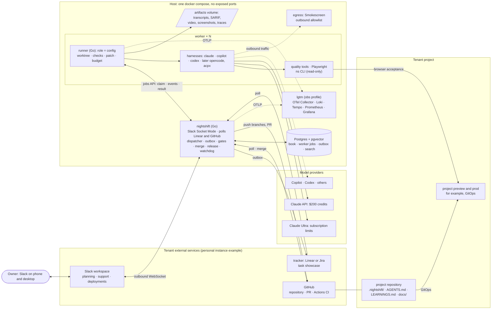
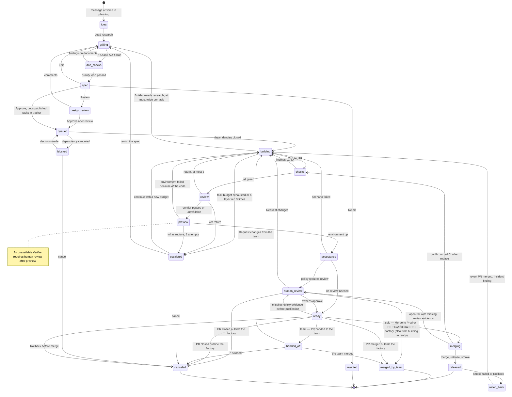
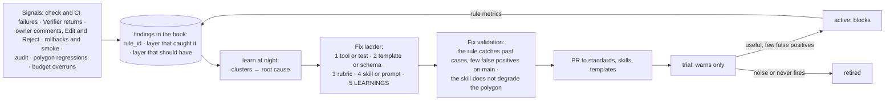
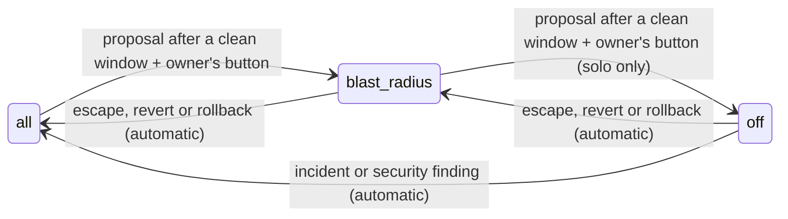
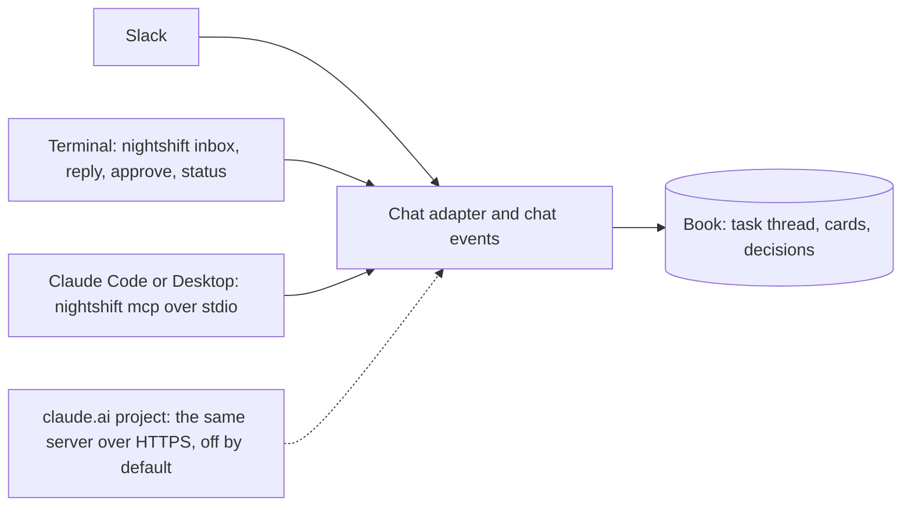
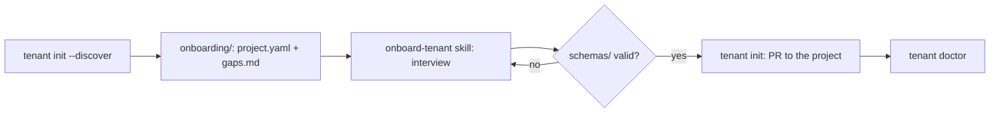

# Nightshift — software factory design

> Nightshift is a standalone product with its own `nightshift` repository, versions and plan. One codebase and one set of images run in separate instances, for example a **personal** instance (the owner's own projects) and a **work** instance (employer projects). This document describes only the core: concrete projects are configured through their own packs and are never named here (section 17).
> Principle: keep it simple. Everything the factory can start without goes to "Later". "The owner" is the tenant's `owner` role; where other people (`approvers`) approve something, the text says so.

## Summary

Nightshift turns an idea from chat into a reviewed, tested change that reaches production on a person's button. Three agents (Lead, Builder, Verifier) work behind deterministic gates written in code; Postgres is the single book of record. Start with section 0 for the decisions, section 22 for the phases and section 17 for how a project plugs in.

## Contents

- [0. Decisions at a glance](#0-decisions-at-a-glance)
- [1. What it is and who it is for](#1-what-it-is-and-who-it-is-for)
- [2. Principles](#2-principles)
- [3. Architecture of the first version](#3-architecture-of-the-first-version)
- [4. Components](#4-components)
- [5. Stack and tools](#5-stack-and-tools)
- [6. Roles](#6-roles)
- [7. Task flow](#7-task-flow)
- [8. Quality loop before a human](#8-quality-loop-before-a-human)
- [9. Standards: where they live and how they change](#9-standards-where-they-live-and-how-they-change)
- [10. Self-improvement: how the factory fixes itself](#10-self-improvement-how-the-factory-fixes-itself)
- [11. Engineer in the loop: design and code review](#11-engineer-in-the-loop-design-and-code-review)
- [12. Models and harnesses](#12-models-and-harnesses)
- [13. Search](#13-search)
- [14. Data and logs: what lives where](#14-data-and-logs-what-lives-where)
- [15. Observability and control panel](#15-observability-and-control-panel)
- [16. Security](#16-security)
- [17. Core and customization: packs, tenant, project](#17-core-and-customization-packs-tenant-project)
- [18. Things to keep in mind](#18-things-to-keep-in-mind)
- [19. What we take from each source](#19-what-we-take-from-each-source)
- [20. Testing the factory and evals](#20-testing-the-factory-and-evals)
- [21. Implementation start](#21-implementation-start)
- [22. Phases](#22-phases)
- [23. Later](#23-later)
- [24. Where concrete projects are described](#24-where-concrete-projects-are-described)
- [25. Open questions](#25-open-questions)

## 0. Decisions at a glance

| Question | Decision |
|---|---|
| What it is | An autonomous software factory (dark factory): idea in chat → spec → code → checks → preview → card with evidence → production on the owner's button |
| People | `owner` decides and does not write code; `approvers` approve specs and PRs (in `solo` the owner, in `team` the team under the repository rules) (section 11) |
| Instance and tenant | An instance is a trust boundary (`personal` or `work`: own providers, secrets, book, logs). A tenant is a project inside it; its `governance: solo \| team` says who approves and whether the factory merges (sections 7, 11, 17) |
| Customization | One core; packs, tenant and project layers configure it; the core is tested on synthetic tenants (section 17) |
| Quality before a human | Standards → linters and tests → change metrics → rubrics → Verifier (section 8) |
| Human review | Specs ask; PRs and documents use `all` / `blast_radius` / `off` with an autonomy ladder (section 11) |
| Control | Slack channels and the Home tab; the same thread from a terminal or an MCP client; Grafana for diagnostics (section 15) |
| Self-improvement | Every mistake is a `finding`; nightly learn proposes the cheapest fix as a PR (section 10) |
| Startup and book | One `docker compose up`, no exposed ports; Postgres is the source of truth, chat and tracker are projections (section 3) |
| Roles | Lead, Builder, Verifier and the nightly learn job; a role is YAML, the rest is Go (section 6) |
| Agents and vendors | Every role runs through a harness adapter; a provider is a line of config (section 12) |
| Testing | Factory code without models ($0); agent quality by evals, $60 per month cap (section 20) |
| Rhythm | Artifacts in English, chat may be Russian; night 22:00–09:00 works silently, morning digest |
| Budget and place | Personal: $200 per month subscription with its API credits, on the owner's machine, later a VM. Work: the employer's licences and infrastructure, never next to the personal one |

## 1. What it is and who it is for

**Who it is for.** A developer who runs personal products and also works in a team. In the personal instance the factory does everything up to production, on the owner's button. At work it takes a task to a PR that is ready for team review, with evidence; the team merges and deploys with its own process.

**What it looks like.** The owner writes or dictates an idea in `#planning`. Lead studies the code and practices, asks one question at a time, argues if the idea is weak, and prepares short PRDs and ADRs with diagrams. The documents pass the quality loop (template, doc-lint, LLM rubrics) and only then reach the owner with "Do you want to review?" and the buttons Approve / Review / Edit / Reject. After Approve, Builder writes code until the checks are green; Verifier checks the code and runs hidden scenarios on preview. If the PR falls under the review policy, the owner is mentioned in Slack. `#deployments` receives a card: links, video, screenshots, numbers, and the buttons Merge to Prod / Rollback. At work the path is the same up to review, but it ends in the `handed_off` state: a PR with evidence handed to the team.

**How it differs from Claude Code, OpenCode or Deep Agents with skills.** A harness is one engineer: one session, one task, and a human next to it who starts it, watches and merges. It writes memory and `CLAUDE.md` to disk, but only within its session and machine. The factory is everything around the engineers. It does not replace the harness; it runs the harness inside a job:

| Need | Harness with skills | Factory |
|---|---|---|
| Write code for a task | Yes | Yes (through a harness) |
| Work while the owner sleeps, through a queue of many tasks | No | Queue, scheduler, budgets |
| Take tasks from chat, answer with cards, keep the tracker | No | Yes |
| Prevent a merge without checks and the owner's Approve | On trust | Gates in code |
| Remember decisions across tasks, roles and vendors | Partly, locally | Book + search |
| Isolation, secrets, production rollback | No | Yes |
| Learn from the owner's edits and from mistakes | No | findings → rules |

The risk of overengineering is real. So the plan goes in phases, and phases 0–3 are the minimal core that already pays off: Slack → PR with checks → the owner's button. Each next phase starts only when its absence hurts.

**What a user of the factory gets.** Nightshift is self-hosted: one `docker compose up` on the user's machine or VM, not a hosted service and not an app builder for new projects. It works on existing repositories. The user talks to it through Slack, a terminal or their own Claude client (section 15). They customize it with files in their own repository (instructions, skills, rules, checks, toolchain), changed through pull requests like any code (section 17), and with `tenant.yaml` in their instance. A separate web UI is "Later".

**Three required properties:**

1. **A standalone product.** Its own repository and versioned images. Nothing about specific projects in the factory code.
2. **A new project is connected by config** in any instance, with its own chat, tracker, repository, stack and governance profile, without changing factory code (section 17).
3. **The factory improves itself** from the owner's feedback, check results and audits, but cannot weaken its own gates without the owner's decision (section 10).

## 2. Principles

1. **One database.** Postgres is the book, the queue and the search. No Kafka, Redis, Temporal or separate vector DB.
2. **Code writes the book, not an agent.** The runner records every agent turn before and after it runs.
3. **An agent only where judgment is needed.** Dispatcher, gates, merge, release, sync and watchdog are Go code.
4. **Code performs side effects.** An agent returns a result that matches a JSON Schema. Push, PR, merge, chat and tracker messages are done by the `nightshift` service. Neither the agent nor the worker holds GitHub, chat or tracker tokens.
5. **Cheap checks before expensive ones.** Deterministic tools first (seconds, $0), then LLM rubrics, then a strong model, then a human.
6. **Rules into tools; words last.** A mistake becomes a linter, an analyzer rule, a test or a schema; text in a skill or `LEARNINGS.md` only when nothing else works.
7. **Gates live in factory code.** A merge is impossible until checks pass and, if the policy requires, the right people approved. In the `solo` profile only `nightshift` merges, and a GitHub ruleset is an extra layer. In the `team` profile the team merges under the repository rules; the factory only hands over the PR.
8. **Irreversible actions only on a human's button.** Production deploys, production migrations, billing, data deletion, access and secrets. The gate is code without AI. The only exception is an SLA permission that the owner switches on in advance for blast radius `low` in the `solo` profile (section 7); `critical` never qualifies, and `team` has no SLA.
9. **Evidence, not words.** Only artifacts count: tool reports, video, screenshots, traces, before/after numbers.
10. **Heavy things go to files.** Logs, transcripts, SARIF reports and video live in the `artifacts` volume. A prompt gets a path and a short summary.
11. **Documents are for humans.** PRDs, ADRs and component designs are short, follow a template and include a mermaid diagram.
12. **A project's instructions are its own.** If a project already has `AGENTS.md`, skills and agent configs, the factory uses them as they are. For a project without instructions the factory creates `AGENTS.md`: an index of about 100 lines with links to standards, `docs/`, skills, a glossary and `LEARNINGS.md`.
13. **A project describes itself.** Project commands come only from `.nightshift/project.yaml`, and always from the `main` version, never from the PR branch.
14. **No vendor lock-in.** Vendor products (Claude Tag, Claude Code Projects, cloud agents) are an option, not the foundation.
15. **Languages.** Factory code: Go for the core, Python for evals and data, TypeScript only for the factory's frontend and e2e; no Java in factory code, Rust only when clearly needed and with an ADR. Projects can use any stack: the project's own toolchain and `verify` run every language, and stack packs add their quality tools.
16. **The working language is English.** PRDs, ADRs, standards, skills, code, comments, PRs, commits, tracker issues and cards are in English. The owner may write to Lead in Russian: Lead answers in the thread in Russian, but everything that goes to git, the tracker and cards stays in English. Doc-lint checks this.
17. **An instance is a trust boundary.** Personal and corporate code, their providers, secrets, book, artifacts and logs never share an instance.

## 3. Architecture of the first version



```yaml
# deploy/docker-compose.yml
x-hardened: &hardened
  read_only: true
  security_opt: ["no-new-privileges:true"]
  cap_drop: [ALL]
  tmpfs: ["/tmp"]

services:
  postgres:
    image: pgvector/pgvector:pg18
    environment: { POSTGRES_PASSWORD_FILE: /run/secrets/pg_admin }
    secrets: [pg_admin, pg_owner_password, pg_nightshift_password, pg_backup_password]   # the init script creates the login roles
    volumes: ["pgdata:/var/lib/postgresql/data", "./postgres/10-roles.sh:/docker-entrypoint-initdb.d/10-roles.sh:ro"]
    networks: [core]
    healthcheck: { test: ["CMD", "pg_isready"], interval: 5s }

  migrate:                                  # one shot as the schema owner; serve never holds this secret
    build: { context: .., target: nightshift }
    <<: *hardened
    command: ["serve", "--migrate-only"]
    secrets: [pg_owner]
    networks: [core]
    depends_on: { postgres: { condition: service_healthy } }
    restart: "no"

  nightshift:                               # Go: Slack, polling, dispatcher, outbox, gates, merge, release
    build: { context: .., target: nightshift }   # images are built locally
    <<: *hardened
    user: "10001"
    secrets: [pg_nightshift, chat_bot_token, chat_app_token, worker_token_sha256, github_token, github_app_id, github_app_key, mcp_token, deployer_token]   # the only service with chat, GitHub and door secrets
    volumes: ["artifacts:/artifacts:ro", "repos:/repos"]   # repos: mirrors of tenant repositories
    networks: [core, jobs, internet, deploy]
    depends_on:
      postgres: { condition: service_healthy }
      migrate: { condition: service_completed_successfully }
    healthcheck: { test: ["CMD", "nightshift", "status", "--health"], interval: 15s }
    restart: unless-stopped

  backup:                                   # pg_dump hourly, restore test weekly
    image: postgres:<version>
    secrets: [pg_backup_password]           # the read-only book_backup role, not the superuser
    volumes: ["dumps:/dumps", "./backup:/etc/backup:ro"]
    networks: [core]

  offsite:                                  # restic copy of the dumps, daily, encrypted
    image: restic/restic:<version>
    secrets: [restic_repository, restic_password]
    volumes: ["dumps:/dumps:ro", "./backup:/etc/backup:ro"]
    networks: [internet]

  worker:                                   # one job at a time; parallelism = replica count; no Postgres access
    build: { context: .., target: worker }
    <<: *hardened
    cap_add: [SETUID, SETGID]               # the runner (root without other capabilities) starts the agent as uid 20001
    shm_size: 1gb                           # Chromium for Playwright
    secrets: [worker_token, harness]        # jobs API token + harness credentials
    volumes: ["work:/work", "artifacts:/artifacts", "agent-home:/home/agent", "repos:/repos:ro"]   # agent HOME; repository mirrors read-only
    networks: [jobs]                        # no direct way out
    environment:
      HTTPS_PROXY: "http://egress:4750"
      NO_PROXY: "nightshift,lgtm"
      CLAUDE_CODE_DISABLE_NONESSENTIAL_TRAFFIC: "1"
    deploy: { replicas: 2, resources: { limits: { cpus: "4", memory: 8g, pids: 2048 } } }
    healthcheck: { test: ["CMD", "nightshift", "status", "--health"], interval: 15s }
    restart: unless-stopped

  egress:                                   # Smokescreen: the only way out for the worker, by allowlist
    image: ghcr.io/stripe/smokescreen:<version>
    command: ["--egress-acl-file", "/etc/smokescreen/acl.yaml"]
    volumes: ["./egress-acl.yaml:/etc/smokescreen/acl.yaml:ro"]
    networks: [jobs, internet]
    restart: unless-stopped

  modcache:                                 # Athens: Go modules for the worker (the worker has GOPROXY=http://modcache:3000); the only container besides egress on jobs and internet
    image: gomods/athens:<version>
    environment: { ATHENS_STORAGE_TYPE: disk, ATHENS_GO_BINARY_ENV_VARS: "GOPROXY=https://proxy.golang.org" }
    volumes: ["modcache:/var/lib/athens"]
    networks: [jobs, internet]
    restart: unless-stopped

  toolchain:                                # installs the toolchain a project pins (`mise install`) before the agent starts; the only container besides egress-install that reaches the tool hosts (ADR 0010)
    build: { context: .., target: worker }
    command: ["toolchain"]
    secrets: [worker_token]                 # the same token authenticates the worker's call
    volumes: ["work:/work", "agent-home:/home/agent"]
    environment: { HTTPS_PROXY: "http://egress-install:4750", NO_PROXY: "localhost,modcache", GOPROXY: "http://modcache:3000" }
    networks: [jobs, install]               # the worker calls POST /install on the jobs network; its way out is the install allowlist
    depends_on: [egress-install, modcache]
    restart: unless-stopped

  egress-install:                           # Smokescreen with the tool hosts; only toolchain reaches it, the worker is not on the install network
    build: { context: .., target: egress }
    command: ["--config-file", "/etc/smokescreen/config.yaml", "--egress-acl-file", "/etc/smokescreen/acl.yaml"]
    volumes: ["./egress-install-acl.yaml:/etc/smokescreen/acl.yaml:ro", "./egress-config.yaml:/etc/smokescreen/config.yaml:ro"]
    networks: [install, internet]
    restart: unless-stopped

  deployer:                                 # brings previews and releases up on the Docker engine (section 17); the only service with the socket
    profiles: [deploy]
    build: { context: .., target: deployer }
    <<: *hardened
    cap_add: [DAC_READ_SEARCH]              # root without it cannot open deployer_token
    user: "0"                               # the socket belongs to root; the worker never reaches this service
    command: ["deployer", "--work", "${NIGHTSHIFT_DEPLOY_DIR:-/tmp/nightshift-deploy}"]
    secrets: [deployer_token]
    volumes: ["repos:/repos:ro", "/var/run/docker.sock:/var/run/docker.sock", "${NIGHTSHIFT_DEPLOY_DIR:-/tmp/nightshift-deploy}:${NIGHTSHIFT_DEPLOY_DIR:-/tmp/nightshift-deploy}"]
    networks: [deploy]
    restart: unless-stopped

  grafana-login:                            # obs profile: one shot, gives grafana_ro its login
    build: { context: .., target: nightshift }
    <<: *hardened
    profiles: [obs]
    command: ["serve", "--migrate-only"]
    secrets: [pg_owner, pg_grafana_password]
    networks: [core]

  lgtm:                                     # obs profile: logs, metrics, traces
    image: grafana/otel-lgtm:<version>
    profiles: [obs]
    environment:
      GF_ANALYTICS_REPORTING_ENABLED: "false"
      GF_ANALYTICS_CHECK_FOR_UPDATES: "false"
    ports: ["127.0.0.1:3000:3000"]          # Grafana from the local machine only
    secrets: [pg_grafana_password]          # the book data source logs in as grafana_ro
    volumes: ["lgtm:/data", "./grafana/datasource.yaml:/otel-lgtm/grafana/conf/provisioning/datasources/nightshift.yaml:ro"]   # and the dashboards
    networks: [core, jobs, ui]              # ui, because a port cannot be published from an internal network

networks:
  core: { internal: true }                  # Postgres, nightshift, lgtm
  jobs: { internal: true }                  # worker ↔ nightshift (jobs API), lgtm, egress
  install: { internal: true }               # toolchain ↔ egress-install; the worker is not on it
  deploy: { internal: true }                # nightshift ↔ deployer
  ui: {}                                    # only to publish Grafana on 127.0.0.1
  internet: {}

secrets:                                    # files in deploy/secrets/, mode 0400, owned by the reading service's uid; not in git
  pg_admin: { file: ./secrets/pg_admin }                         # superuser; postgres only
  pg_owner_password: { file: ./secrets/pg_owner_password }       # postgres creates the roles from these two
  pg_nightshift_password: { file: ./secrets/pg_nightshift_password }
  pg_backup_password: { file: ./secrets/pg_backup_password }
  pg_owner: { file: ./secrets/pg_owner }                         # postgres://book_owner:<password>@postgres:5432/book
  pg_nightshift: { file: ./secrets/pg_nightshift }               # postgres://nightshift:<password>@postgres:5432/book
  pg_grafana_password: { file: ./secrets/pg_grafana_password }   # grafana_ro, which reads only the dash_* views
  chat_bot_token: { file: ./secrets/chat_bot_token }             # pasted by the owner; one chat app per instance
  chat_app_token: { file: ./secrets/chat_app_token }
  restic_repository: { file: ./secrets/restic_repository }
  restic_password: { file: ./secrets/restic_password }           # a copy lives in the owner's password manager
  deployer_token: { file: ./secrets/deployer_token }             # nightshift and the deployer only
  worker_token: { file: ./secrets/worker_token }                 # created by deploy/init-secrets.sh
  worker_token_sha256: { file: ./secrets/worker_token.sha256 }   # nightshift checks the token against its hash
  harness: { file: ./secrets/harness }      # directory, one file per credential
  github_token: { file: ./secrets/github_token }                 # empty until pasted; nightshift only
  github_app_id: { file: ./secrets/github_app_id }               # the GitHub App, preferred over the token
  github_app_key: { file: ./secrets/github_app_key }
  mcp_token: { file: ./secrets/mcp_token }                       # the remote door's bearer token

volumes: { pgdata: {}, dumps: {}, work: {}, artifacts: {}, agent-home: {}, repos: {}, lgtm: {}, modcache: {} }
```

- **Worker jobs.** `book.jobs` stores queued work for the agent roles. The jobs API leases a row, renews it on heartbeat and records the result. On the next claim after a lease expires, the API requeues the job if attempts remain or marks it failed. A late result carrying an expired lease cannot complete the job.
- **The worker never touches the database.** It takes a job through the internal HTTP API of `nightshift` on the `jobs` network: `claim` (long-poll), `heartbeat`, `events`, `complete`. The worker authenticates with `worker_token`, and each job gets its own short-lived token scoped to the task and role (the `ns` CLI uses it too). This keeps permissions simple. The agent physically cannot reach the book.
- **Outbox delivery.** River runs the periodic outbox flush inside `nightshift`, including at service startup. `book.outbox` holds each message, its idempotency key and its next attempt. The outbox retries due messages with backoff and marks permanent or exhausted failures. A crash before delivery is recorded leaves the message eligible for another attempt.
- **Isolation.** One job per worker container, so files and processes of different jobs never mix. Each task has its own worktree in `/work/<tenant>/<task>`; the agent writes only to its worktree and its job's artifact directory. No Docker-in-Docker.
- **Networks.** (The `ci` profile with `gh-runner` and `egress-ci` is designed but not in `deploy/docker-compose.yml` yet; the compose example above lists only what exists, and `TestDesignComposeExample` keeps the two in step.) The worker and gh-runner sit in separate networks with no way out (gh-runner runs code from PR branches, so it cannot see the jobs API). They reach the internet only through their own Smokescreen (`egress` and `egress-ci`) by allowlist. Private ranges (the local network, cluster APIs) are denied, and preview hosts are allowed one by one. Only `nightshift` talks to the outside directly (chat, tracker, GitHub).
- **Postgres roles.** `nightshift` has rights on the book but no `UPDATE` or `DELETE` on `events`. `grafana_ro` can only read the dashboard views (no hidden scenarios, no secrets). Migrations run under a separate schema-owner role, only in the one-shot `migrate` service (`nightshift serve --migrate-only`), which every start of a release runs; the running service never holds the owner's password. `book_backup` reads everything (`pg_read_all_data`) and may create only the scratch database of the restore test; the superuser password stays inside `postgres`.
- **Users in the worker.** The runner is root without capabilities except `SETUID` and `SETGID`. The agent and all project commands run as uid 20001 and cannot open the worker's secrets: they are mounted under `/run/worker-secrets`, a root-only directory of the image, because file modes alone do not hold on every host (Docker Desktop shows a mounted file as owned by its reader). The runner creates the checkout and runs git as that user, so it never changes file owners and never runs git as root on files the agent can write. The mirrors belong to `nightshift`; only the clone gets their group, so the agent cannot browse other repositories. Playwright's Chromium runs without its own sandbox (the Playwright default); the container provides isolation.
- **Images** are built locally (`docker compose build`); a single machine needs no registry. If a registry is needed (VPS, second host), GHCR works: GitHub Container registry storage and traffic are free today, and GitHub promises advance notice before charging.
- **Where it runs.** The personal instance runs locally for now; later the same compose moves to a VM in Hetzner or AWS with no code changes. The work instance runs on the employer's machine or VM.
- **Two instances.** Personal and work start from the same compose and images. They differ only in `instance.yaml` (trust domain, providers, egress allowlist), the `tenants/` directory and secrets. They share only the code in git; books, artifacts, logs and secrets are separate.

## 4. Components

| Component | Purpose | Input → output | Where it lives | Language |
|---|---|---|---|---|
| **nightshift** | Core: tenants, chat and tracker adapters, projections, dispatcher and fair scheduling, jobs API for workers, provider router, repository mirrors and push, gates, merge train, release, outbox, indexer, watchdog | Chat events, tracker and GitHub polling, job results → book, jobs, cards, merges (in `solo`) | `nightshift` container | Go |
| **Book** | Source of truth and queue | `tasks`, `events`, `jobs`, `outbox`, `reviews`, `findings`, `standards_index`, `documents`, `budgets`, `settings`, `eval_runs` | `postgres` container | SQL |
| **runner** | Takes a job through the jobs API, prepares a worktree from the repository mirror (`repos` volume, read-only), selects standards and skills, runs the role and checks as the agent user, returns the result and the patch | Job + role → result by schema, patch, reports with sha256, usage | `worker` container, an OS user separate from the agent | Go |
| **Harness adapters** | One interface to agents and models (`claude`, `copilot`, `codex`, `api`, `fake`, later `opencode`, `acpx`) | `Run(RunRequest)` → `RunResult`: result by schema, session, transcript path, usage, exit reason (section 21) | Inside the runner; nightly batch calls of eval judges are sent by `nightshift` | Go |
| **ns CLI** | Read-only agent tools: search, standards, task. Access is limited by role | Query + job token → JSON with links | worker image, talks to `nightshift` | Go |
| **nightshift check** | The project's `verify` plus factory checks (gitleaks, osv-scanner, opengrep, doc-lint); converts reports to SARIF and turns new violations into findings | Worktree + standards + `main` baseline → SARIF, findings | Inside the runner, runs as the agent user | Go |
| **doc-lint** | Document structure: template, sections, length limits, diagram, front matter | Markdown → violations | Subcommand of `nightshift check` | Go |
| **Review policy** | Computes blast radius, decides whether a human is needed; review queue, reminders | Task, diff, tags, rules, switch → level, review request, `reviews` | Inside `nightshift` | Go |
| **Control panel** | Slack app Home tab: work in progress, review queue, switches, limits, task context | Book, `settings` → Block Kit view; clicks → events and setting changes | Inside `nightshift` | Go |
| **learn and audit** | Self-improvement loop and periodic audit (section 10) | findings, reports → PRs with standards, skills, rules | Periodic River jobs | Go + agent roles |
| **Polygon and evals** | Regression runs of the factory on reference tasks | Task set → quality, cost and time metrics | `evals/tasks/` of this repository, run locally (ADR 0011) | Python |
| **Transcription** | Slack voice messages → text | Audio → text in the thread and the book | Job in the worker, faster-whisper on CPU | Python |
| **Integration adapters** | Tracker (Linear; later Jira), documents (git; later Confluence), chat (our own Slack app; at work a corporate Slack or GitHub only), external checks (CodeQL, Sonar as findings), logs (later Splunk, read-only) | Core commands → API calls; external events → book events | Inside `nightshift`, `internal/adapters/` | Go |
| **Stack packs** | Quality tools, configs and worker image for the project's stack | `project.yaml: stack` → tools, configs, image | `nightshift/stacks/<pack>/` | Dockerfile, YAML |
| **Tenant pack** | Everything the factory knows about a project | Files → loaded at startup | `tenants/<name>/` + `.nightshift/` in the repository | YAML, Markdown |

## 5. Stack and tools

Tool versions are pinned in `mise.toml` and checksummed in `mise.lock`, the same in the worker image and in CI; `claude` is pinned too (section 12).

### The factory itself

| Layer | Choice | Why |
|---|---|---|
| Core language | Go 1.27 | One `nightshift` binary with the subcommands `serve`, `work`, `deps`, `toolchain`, `deployer`, `check`, `standards`, `skills`, `tenant`, `config`, `task`, `memory`, `search`, `digest`, `setup`, `eval`, `doctor`, `status`, `inbox`, `reply`, `approve`, `cancel`, `mcp` |
| Database and queue | Postgres 18 + pgvector; River (MPL-2.0) for the outbox flush; `book.jobs` for agent job leases | Book, queue and search in one database |
| DB access | pgx v5, sqlc, goose | Typed queries, expand-only migrations |
| Integrations | slack-go (Socket Mode), genqlient (Linear), go-github + GitHub App | No inbound ports |
| Config | YAML + JSON Schema (santhosh-tekuri/jsonschema) | Validated packs, roles, agent results |
| Telemetry | log/slog (JSON) + OpenTelemetry | One format for logs, traces, metrics |
| Tests | go test with `-fuzz`, rapid, httptest twins, the `fake` adapter; Postgres integration tests in CI only | No network, tokens or models (section 20) |
| Python | uv, ruff, mypy, pytest | Eval graders, transcription |
| CI | GitHub Actions pinned by SHA; Dependabot | Retagged actions |

### Project toolchains in the worker

Any language runs without a pack. The worker image (Debian slim, ADR 0009) has mise, git and the agent CLIs but no language toolchain. Before a job, as the agent user:

1. **Toolchain.** `mise install` from the project's `mise.toml` or `.tool-versions`, run by the `toolchain` service (the only container that reaches the tool hosts); tools persist in the `agent-home` volume (ADR 0010). Go modules come from `modcache` (ADR 0008).
2. **Dependencies.** `project.yaml: setup` (for example `npm ci`).
3. **Checks.** `verify` gates every language; stack packs add L1 tools with SARIF.

Without a toolchain file the detected stack packs' default versions apply and `tenant doctor` proposes a `mise.toml`. Stacks that need root packages need a tenant worker image ("Later").

### Quality tools (stack packs)

| Area | Tools |
|---|---|
| Go | golangci-lint v2 (staticcheck, gosec, errcheck, revive, gocognit, dupl, depguard), govulncheck (any advisory in a required module fails) |
| Python | ruff (with bandit rules), mypy, pytest + coverage |
| TypeScript | tsc, ESLint, Playwright Test |
| Own rules | Opengrep |
| Secrets, dependencies | gitleaks; osv-scanner, govulncheck |
| Migrations, APIs, accessibility | squawk; Spectral and oasdiff (`openapi` pack); axe-core (`web` pack) |
| Containers and CI | hadolint, actionlint, zizmor, shellcheck |
| Change metrics | diff size, new dependencies, coverage; later diff-cover, jscpd |
| Documents | doc-lint, markdownlint-cli2, mermaid-cli, Vale, lychee |
| Java (`java-maven`, with its first tenant) | Maven wrapper, Spotless or Checkstyle, Error Prone or SpotBugs, PMD, ArchUnit, JaCoCo, Flyway |
| Project specifics | `.nightshift/standards/` (for example kubeconform) |

### Observability and security

| Task | Choice |
|---|---|
| Telemetry | OTLP from `nightshift` and the runner: a trace per task, a span per job and agent turn; agent CLIs export their own OTel |
| Storage and UI | `grafana/otel-lgtm` in the `obs` profile; Grafana also reads the book as a Postgres source. Not Splunk: proprietary, and its free tier has no alerts or OTel traces; OTel lets the backend change without code |
| Egress | Smokescreen as the `egress` service: the worker's only way out, by allowlist |
| Supply chain | `mise.lock` checksums, actions by SHA, zizmor, updates only through PRs |

## 6. Roles

A separate role exists only where a **different context, a different model or a conflict of interest** is needed. Everything else is a role mode, a tool or code.

| Role | What it does | Rights |
|---|---|---|
| **Lead** | The only conversation partner in chat. **#planning:** research → grilling → PRD, ADR, criteria and hidden scenarios → slicing into tasks with dependencies. **#support:** looks for reasons *not* to open a task → reproduction → card with a priority. Answers other roles from the owner's past decisions, with quote, source and date | Reads the repository, `ns`. Writes to the worktree; only documents leave, as a patch through `nightshift`. Web research is a separate job without access to code: the input is only the formulated question, the output only the findings |
| **Builder** | TDD, unit and e2e tests, the "edit → `nightshift check`" loop until green. Answers findings of all layers (or disputes them) and every comment of the owner's review | Writes to the worktree. Does not see hidden scenarios; `nightshift` rejects a patch that touches protected paths (section 10, item 8) |
| **Verifier** | Fresh context, preferably a model of another family. **review:** spec first, then quality. **acceptance:** hidden scenarios on preview in Chromium through Playwright (own skill `browser-acceptance`; the browser is baked into the worker image). **audit** (scheduled): audit of the repository and of the factory itself (section 10). Settles disputes over findings. Escalates after 3 returns | Reads the repository only; writes only to its job directory. Receives hidden scenarios from the runner through the job tmpfs; after acceptance Builder sees only a description of the failed behavior |
| **learn** (nightly job) | Clusters findings, looks for the root cause, proposes the cheapest fix, tests it and opens a PR (section 10) | PRs to standards, skills, templates and `LEARNINGS.md`; what goes in without the owner is in section 9 |

**Why this is enough.** Author and checker are separated. Planning and triage need one context, so they are Lead modes. Audit is a Verifier mode, because it also needs fresh eyes without authorship. LLM rubric checks are not a role but a tool: one call to a cheap model without tools. The dispatcher, team-lead coordinator, release manager and watchdog from the Majento design are Go code.

**How Lead challenges a task.** The `challenge` skill on top of `grilling`:

1. Before every question it searches the book (`ns search`). If the answer exists, it quotes the decision instead of asking.
2. It checks: what problem we solve and how we will know it is solved; why now and what happens if we do nothing; the smallest version that tests the idea; contradictions with ADRs, standards and past decisions; money, data, access, architecture and irreversibility (then it sets a tag that raises the blast radius, section 11); what we deliberately do not do.
3. It asks one question per message, with 2–3 options and a recommendation (a reply carries one set of options). It may recommend Reject outright.
4. It stops at the Definition of Ready: goal, acceptance criteria, scope, blast radius tags, tasks and their dependencies.

**Research before building.** When a task implies writing something new, an agent first answers "write it ourselves or take something that exists?" with a repeatable record, and does not start coding. Two own skills carry it: `research-options` (any design choice with two to four real options) and `build-vs-buy` (the same method for a new capability, with `nightshift deps check` as its tool). The trigger is detected by roles and enforced by code:

- **Lead.** In the `challenge` skill (step 2 above), a spec that adds a capability the repository and the book do not have (a new module, protocol, format, integration or dependency) runs `build-vs-buy` before the spec card. The owner's own "we need to write X" counts as the trigger.
- **Builder.** A plan that needs a new dependency, a new top-level package or a client of an external protocol the spec's record does not cover stops: `status: blocked`, `blocked_reason` starting with `needs_research:`. The task goes back to Lead (state `grilling`, Builder's reason in the thread), who runs the skill; Builder does not pick a library on its own. A third stop, or another reason, escalates to the owner.
- **Verifier.** In review, a new dependency or a large new module without a record is a finding.
- **Code.** `nightshift check` (L2) reports a finding when a lockfile gains a dependency, or the diff adds a package over a size limit, and the task has no research record. A dependency without a record is an error; a large package without one is a warning. The record is an ADR (MADR 4.0, so doc-lint already demands at least two options) whose options include "write it ourselves" and that the spec links.

The skill works in five steps. (1) Search the book (`ns search`), the repository and the standard library: the answer may already exist. (2) State the need in three lines with its must-haves. (3) List candidates: write it ourselves, the standard library or a dependency we already have, and one to three libraries. `nightshift deps check <package>` is code, not a model: it reads deps.dev and OSV and returns the licence against the tenant's allowed list, age, last release, known advisories, number of dependents, size of the dependency tree and install scripts. API fit is judged from the library's documentation by a web research job without access to code (section 16). (4) Compare cost of owning it, risk, lock-in and size. (5) Recommend one option. The spec card carries a summary of at most 60 words ("write ourselves, because ..." or "take X, because ..."), and the table goes into the ADR. Text from registries and README files is data, never instructions. The new dependency itself stays blast radius `critical` (section 16): research prepares the owner's Approve and does not replace it.

**When to add a role.** A mode needs a different model; a role's context grows too large; a conflict of interest appears; an agent becomes a bottleneck. Candidates: Critic on another model, Triage, Taste Judge with a blind test of ≥ 90%.

**A role is config:**

```yaml
# nightshift/roles/verifier.yaml
name: verifier
access: read_only
skills: [sentry/code-review, sentry/find-bugs, obra/verification-before-completion, own/browser-acceptance, own/evidence-report, own/audit]
output_schema: schemas/verdict.json           # pass | return(findings) | escalate
limits: { max_returns: 3, minutes: 30, tokens: 400000 }
```

The file holds what the runner reads: the access mode, skills, the output schema and the limits. When a role runs is decided in code by the conductor (a task state, a chat message or a schedule starts it), and what a role may see is fixed in code too (hidden scenarios go to the Verifier only), so neither is a config key. Providers per role are in `tenant.yaml` (`providers.<role>`, order is priority). Today a tenant tunes a role through `project.yaml: instructions` and its own skills;

A project may brief a role in `.nightshift/roles/<name>.yaml`: `instructions` (more instruction files of the repository, at most 8) and `skills` (ids from the shared skill set, at most 8). Both only add. The output schema, limits, access and gates stay the factory's, so an override cannot weaken a role. A file with another key, a bad path or id, or an instruction file that is not a regular file of the repository is skipped whole, with a warning, and the role runs as the factory defines it. Instruction files are read from the checked-out worktree, so for Verifier they come from the change under review, as `AGENTS.md` does today.

## 7. Task flow



From any active state, `/ns cancel` or a cancel in the tracker leads to `canceled`; these transitions are left off the diagram.

**Two ends of the path.** In the `solo` profile a task goes through the merge train to `released`. In the `team` profile it ends in `handed_off`: the PR leaves draft, carries a summary and evidence, and reviewers are assigned from CODEOWNERS or the `approvers` list. The team merges under the repository rules; `nightshift` polls GitHub and moves the task to `merged_by_team`, and Request changes from the team send it back to Builder. A pull request merged or closed on GitHub while the task waits in `human_review` or `ready` (the owner pressed the button, or a person closed it) is followed the same way: `merged_by_team` or `canceled`, recorded as `merged_outside` or `closed_outside`. Deployment follows the company process. The merge train, `preview`, `release`, `rollback` and `smoke` are tenant capabilities (`project.yaml: capabilities`), not a mandatory part of the flow.

**Channels and messages.** This is the personal instance example; at work `tenant.yaml` defines the channels, and without a Slack app of its own the same cards go as comments on the PR and the tracker issue. The owner talks only to Lead (who is also the architect): discussion, plan and progress of a task live in its thread in `#planning`; PR review requests and "ready for production" cards go to `#deployments` with a link to the thread; triage happens in `#support`. Builder and Verifier do not post in Slack; their work shows as status lines in the thread. One task, one thread. Four message types of up to 60 words: "Question with options", "Decision needed" (Approve / Review / Edit / Reject or a PR review), "Ready for acceptance" (Merge to Prod / Rollback), "Blocker or summary". Details go to attachments and links. A recommendation or a spec card carries one short basis line (at most 25 words: what Lead opened, what it inferred, confidence); the `basis` field of the Lead reply is required with `recommended` or `spec_ready`, and `nightshift` sends a reply with low confidence or nothing checked back to Lead once. Every role report states what it checked and what it inferred (AGENTS.md "Evidence"). A tenant without Slack uses the `inbox` adapter (section 15): the same cards and the same thread live in the book and are read and answered from a terminal or a Claude client.

**One channel.** The `channels` map may point all three intents to the same channel, for example `{ planning: factory, support: factory, deployments: factory }`. One task is still one thread. Lead tells an idea from a problem report by the first message of a thread and, when unsure, asks with two buttons: [Idea] [Problem]. "Decision needed" and "Ready for acceptance" cards go into the task thread with a mention of the owner, and the Home tab "Waiting for you" list collects them. This fits a tenant with one person and few tasks; with several people or parallel tasks, separate channels keep the review queue apart from discussion.

- **#planning.** Text or voice → Lead → document quality loop → spec card asking "Do you want to review?". Approve: `nightshift` merges the docs PR with the PRD and ADR, creates tasks in the tracker, and the tasks are queued with their dependencies. Edit: a change in words or voice; the diff between versions is kept for learn. Reject: the reason is kept as a decision.
- **#support.** Lead looks for duplicates in tracker issues (through the projection in the book), PRs and commits. Duplicate → a link, no task. Otherwise: reproduction in a worktree from `main` or on the `main` preview, never on production or user data (a failing test or a playwright script), and a card: priority P0–P3, steps, evidence, [Create task] [Not needed].
- **#deployments.** Only after the full cycle: green checks and CI (Playwright Test headless), Verifier review, acceptance on preview (Playwright) and, if the policy requires, the owner's Approve. The card holds the tracker issue, preview URL, PR, video and screenshots, metrics, the blast radius level with reasons, and the `trace_id`. **Merge to Prod** runs the merge train, `release` and `smoke`; a failed smoke triggers an automatic rollback. **Rollback** before the merge closes the PR and tears down the preview; after a release it rolls production back.

**Flow rules enforced by code:**

- **Transitions are atomic.** Each transition is a compare-and-set on (state, version, `head_sha`) in one transaction. Decisions (Approve, Merge, Rollback) are bound to a SHA; repeating the same decision is idempotent. If conflicting decisions arrive at once (Approve in chat and Request changes in GitHub), the stricter one wins.
- **Verifier results.** Jobs API validates and stores findings with job completion. The conductor commits raised risk, consumption and the task transition together. If that transaction fails, the same verdict remains available and the stored findings stay available for retry. Only applied returns to Builder use the review-return budget.
- **Finding status.** A queued Builder job records its input findings as `handed_off` in the same transaction. The `book.finding_states` view shows that status for open findings with a Builder job. Unresolved findings remain available on retry. A passing Verifier review can confirm the findings listed for recheck on that head when its summary acknowledges the recheck. A still-reported finding stays unresolved. A local finding needs the same completed suite and report producers on the Builder patch being published. A CI finding needs positive results from the original failing check identities.
- **Task budget.** One per task: iterations, tokens, hours. It bounds all return loops (checks, Verifier, acceptance, review, train). When exhausted: `escalated` and a "Decision needed" card.
- **Merge train.** Only `nightshift` merges, one PR per repository at a time: rebase on a fresh `main` → L1–L3 again → merge → `release` → `smoke`. Each step (`rebased_sha`, `ci_run`, `merged_sha`, `released_sha`) is written to the book before and after; after a restart the train reconciles with GitHub and continues from the right step. If the rebase had no conflicts and `git range-diff` is empty, the owner's Approve and the Verifier verdicts carry over to the new SHA; if Builder resolved a conflict, they are all dropped. A clean rebase that changes the patch-id, or one resumed after a crash that cannot vouch for it, also drops them: the train does not merge, and the task returns to human review at the rebased head.
- **Resuming publication.** A task in `ready` or `merging` needs a recorded path through the review gate backed by a passing Verifier result or an authorized decision for its recorded head. If review evidence is missing, an open pull request at the recorded head or a completed rebase returns to `human_review`. An unmatched head waits for reconciliation. After candidate CI, the train rechecks the live head and review decisions before merging. An objection to a patch-equivalent reviewed revision stays in scope when the candidate returns to human review. The train reconciles an already merged pull request with the release journal.
- **Rollback.** On `rolled_back` the tenant's train freezes and `nightshift` opens a revert PR itself; it passes only L1–L3 and merges out of turn. Then the task returns to `building` with an `incident` finding and the train unfreezes. This way the bad commit does not ship again with the next release.
- **Dependencies.** Tasks from `to-tickets` keep blocking links; the dispatcher runs only unblocked tasks. A dependency counts as closed at `released`, or at `merged_by_team` (the team, or someone outside the factory, merged it). If a dependency is canceled, dependent tasks move to `blocked` with a "Decision needed" card.
- **Changing a spec after Approve.** Edit stops only the spec's unmerged tasks and returns the spec to `grilling`. To change what is already merged, Lead opens new tasks.
- **Cancel.** `/ns cancel` or a cancel in the tracker: jobs stop, the PR closes, the preview is torn down, the worktree is deleted. From the tracker the factory accepts only cancel and priority; everything else is overwritten from the book (in Jira, within the existing workflow).
- **Capacity.** Limits on parallel tasks and previews per tenant live in `tenant.yaml`. Tasks in `human_review`, `handed_off`, `ready` and `merging` do not take a slot; their preview is torn down N hours after acceptance and brought back when needed.
- **Pause.** `/ns pause` stops the dispatcher and all trains; `/ns resume` resumes.
- **Day and night.** In the daytime (by default 09:00–22:00 in the tenant's time zone) there is dialogue: the owner sets and discusses tasks, approves specs, looks at reviews. At night (quiet hours 22:00–09:00) the factory runs everything approved during the day without the owner: Builder, checks, Verifier, preview, plus learn, audit and the polygon. No messages at night. If a task needs the owner's decision, it is parked until morning and the factory takes the next one. Waking the owner is allowed only for a production incident that the automatic rollback did not fix. No production releases at night (neither by SLA nor by schedule), only rollbacks. At 09:00 a morning summary arrives: what was done overnight, what waits for the owner, the review queue, limit usage. Quiet hours are a tenant setting; in the `team` profile the factory also works at night, but hands nothing to the team and posts nothing to shared channels until morning.
- **SLA auto-merge** (`solo` only) is a permission the owner gives in advance for blast radius `low`. It is switched on only by a toggle (panel or `/ns sla on`) and stays on until the owner switches it off. If the owner has not answered in N hours, the card goes through the merge train on its own. It never applies to `high` and `critical`, new dependencies, or PRs waiting for review.
- **Buttons** carry the `task_id` and the card version; a click on a stale card is rejected. Commands and decisions are accepted only from the tenant's `owner` and `approvers` (by their IDs in chat, GitHub and the tracker).

## 8. Quality loop before a human

The goal is that the owner receives a result that has already passed everything that can be checked cheaply. Each layer returns machine-readable findings to the author (SARIF or JSON by schema) with a `rule_id`; the author fixes them and the layer runs again. The owner sees a task only when all layers are green.

| Layer | What it does | Code | Documents (PRD, ADR, design) | Cost |
|---|---|---|---|---|
| **L0. Input** | The runner selects the applicable standards (by task kind and paths) and puts a short checklist with links into the prompt | Language and project standards, `LEARNINGS.md` | Templates (ADR by MADR 4.0), glossary, past ADRs | ~0 |
| **L1. Local tools** | `nightshift check` in the worktree before push | Formatters, linters, types, tests, opengrep, gitleaks, osv-scanner, squawk, hadolint, layer rules | doc-lint (sections, limits, front matter by JSON Schema, Given/When/Then in criteria, ≥ 2 alternatives in an ADR, English), markdownlint, Vale, lychee, mermaid rendering | Seconds, $0 |
| **L2. Change metrics** | Ratchet: no worse than `main` | New-line coverage, complexity, duplicates, PR size, new dependencies | Length, number of open questions, links to ADRs | Seconds, $0 |
| **L3. CI** | The same checks in a clean environment + e2e | GitHub Actions | GitHub Actions | CI minutes |
| **L4. LLM rubrics** | A cheap model without tools, fresh context, rubrics from standards; findings by schema | Spec conformance, error handling, observability, security, readability | Ambiguities, contradictions with ADRs, missing non-functional requirements (security, privacy, observability, rollback, cost), clarity for an engineer | Cents |
| **L5. Verifier** | A strong model, a different context (preferably another family); review and acceptance with evidence | Review + hidden scenarios on preview | Spec review against the goal and decisions | Dollars |
| **L6. Human** | By the review policy (section 11) | PR | Docs PR | The owner's time |

**Summaries for the human** are generated by the runner, not by the owner. For a PR: what and why (3–5 lines), a diagram of the touched modules, 2–5 places to look, and which layers found and fixed what. For a document: a 3-line TL;DR, the key decision and the rejected alternatives, a diagram.

**Findings tell the author how to fix.** Each finding carries a short `remediation`: what to change and which standard applies. Our own Opengrep rules and doc-lint messages are written for an agent reader, so the next attempt fixes the cause instead of guessing.

**Reports** of each layer live in `artifacts/<tenant>/<task>/<job>/` (SARIF, JSON, logs). The book gets only findings, paths and file sha256.

**Rules that keep the loop from spinning:**

- **Baseline.** Only new violations relative to `main` block (by SARIF fingerprints). Old violations do not block the task and go to audit.
- **Dispute.** Builder's result schema has `dispute(finding_id, reason)`. Verifier settles the dispute; an accepted dispute counts as a false positive of the rule.
- **L4 repeats.** An L4 finding with the same fingerprint (`rule_id` + location) after "fixed" blocks at most twice, then becomes a warning. L4 rechecks only changed fragments.
- **Two automatic rounds per layer.** L1–L3 return a task to Builder at most twice for the same layer; on a third red result the task goes from `building` to `escalated` with a "Decision needed" card instead of a third run of Builder. Further attempts rarely help and only spend the budget.
- **The task budget** bounds all iterations (section 7).

### Gates: which checks block a merge, per repository

The repository states in `.nightshift/gates.yaml` (named by `project.yaml: gates`) what must pass before a PR merges. Without the file every check blocks, as in sections 8 and 11. An entry names a check or a layer and gives its `mode` and, optionally, `when`:

```yaml
# .nightshift/gates.yaml — phase 4
gates:
  - check: golangci-lint            # a tool of a stack pack, by its name
    mode: block
  - check: rubric:error-handling    # an L4 rubric card by id
    mode: warn
    reason: too noisy until the card is tuned
  - check: ci
    mode: block
  - check: verifier                 # L5 review and acceptance
    mode: block
    when: { blast: [medium, high, critical] }
  - check: integration-tests        # the project's own check, from project.yaml: tests.external
    mode: block
    when: { paths: ["internal/store/**"] }
```

- **Modes.** `block` returns the task to Builder as in section 8. `warn` puts the finding in the summary and does not return the task. `off` does not run the check. Every `warn` and `off` entry needs a `reason`.
- **`when`.** Optional path globs from the diff and blast radius levels (section 11). The entry applies when any listed path is touched or the level matches. An entry without `when` applies to every PR.
- **The floor.** gitleaks, osv-scanner, the factory's security rules, the protected paths check, `verify`, the CI verdict and, for `critical`, Verifier and the owner's review are always `block` and cannot be narrowed by `when`. The schema rejects a file that tries, and `tenant doctor` reports it.
- **Weakening is `critical`.** Any change that lowers a mode, adds `when` to a `block` entry, or removes an entry needs the owner's Approve, like a weaker standards card (section 9). Making a gate stricter needs none. The file is under `.nightshift/`, so an agent's patch to it is rejected as a protected path (section 10).
- **A skip.** `/ns skip <check> <reason>` waives one `warn` check for one task and is an event in the book. A `block` check cannot be skipped.
- **From an agent.** The MCP door (section 15) gets tools to read the gates, the blast radius rules and the review mode, and to run `check --plan`. A tool that changes any of them opens a PR with the edit and never writes the file directly; a weakening still waits for the owner's Approve, and the door's token has no right to merge or to lower a gate.
- **A preview.** `nightshift check --plan` prints, for the current diff, each check, its mode and why it applies, without running any of them.

**Prior art.** From CodeRabbit's pre-merge check modes, Danger's `warn` and `fail`, and reviewdog's fail level we take severity mapped to outcome; from Trunk, a logged skip. We do not take a tool-specific web UI for the rules, a natural-language check that can block on its own, or agent scores as merge gates: a gate is a tool result or a review verdict with a `rule_id`. A second reviewer plus a judge for `critical` (Entire's local review runs several agents and a judge) is in "Later".

## 9. Standards: where they live and how they change

**Three levels, all files in git** (versions, diffs, review through PRs), indexed into the book for search and metrics:

| Level | Where | What | Who changes it |
|---|---|---|---|
| **industry** | `nightshift/standards/industry/` | Industry practices: Effective Go and Google Go Style, PEP 8 and typing, OWASP ASVS and Top 10, 12-Factor, MADR, Diátaxis, SRE (SLO, rollback), safe Postgres migrations | learn and audit through PRs to `nightshift` |
| **house** | `nightshift/standards/house/` | The owner's cross-project preferences, learned from the owner's edits in all projects. Not applied to `team` tenants by default: these are personal tastes, not team rules | learn through PRs to `nightshift` |
| **project** | `<project>/.nightshift/standards/` | Rules of a specific project (for example, "no writes to the client's external systems" or "foreign text only through a filter"), including the project's own instructions (`AGENTS.md`, skills) | `solo`: learn and Lead through PRs to the project. `team`: learn collects rules in the overlay `tenants/<name>/standards/` on the factory side and proposes them to the team as a weekly batch; they reach the project only through a regular team PR |

**Precedence:** factory rules on security and gates > project (including the project's own instructions) > house > industry. Overriding a more general rule requires a `reason` field. learn does not propose a rule that contradicts a higher-precedence rule.

**Who approves standard changes.** Only **new or stricter rules with `enforcement: tool`** go in without the owner, through trial (their behavior is checkable and reversible). Everything else (rubric, guidance, weakening and removing rules, skills, role prompts, templates, `AGENTS.md`, `LEARNINGS.md`) is blast radius `critical` and needs the owner's Approve. To avoid pinging the owner one by one, learn collects such changes into a weekly "Lessons of the week" card with a button per item.

**The owner's own path.** `/ns standard <text>`: Lead drafts a rule card, picks the level and enforcement and opens a PR. `/ns rule off <id>` switches a rule off immediately.

**External skills and rule packs** (mattpocock/skills, obra/superpowers, linter presets) are vendored into the repository by commit SHA; an update is a PR with a diff that the owner approves.

**A standard is a rule card:**

```yaml
# standards/industry/docs/adr-alternatives.yaml
id: docs.adr.alternatives
title: An ADR lists at least two considered alternatives with the reason for rejecting each
applies_to: { kind: [adr] }                 # or paths: ["**/*.go"], tags: [migrations]
enforcement: tool                           # tool | rubric | guidance
tool: { name: doc-lint, check: adr-alternatives }
rubric: null                                # for enforcement: rubric, the question for the LLM rubric
params: null                                # per param: type, enum or stricter direction, default
severity: block                             # block | warn
status: active                              # trial | active | retired
source: https://adr.github.io/madr/         # or a finding id / a link to the owner's comment
```

- **`tool`**: a tool enforces the rule. Configs (`.golangci.yml`, `rules/*.opengrep.yaml`, `.squawk.toml`, `ruff.toml`) live next to it and are copied into the project by `nightshift standards sync` through a PR.
- **`rubric`**: a question that L4 asks the cheap model; the answer is a finding with a `rule_id`.
- **`guidance`**: text for the prompt when neither a tool nor a rubric fits.
- **Rule metrics** are computed in the book: how often it fired, how many false positives (the owner or Verifier rejected the finding), at which layer it catches, how many defects under it slipped further.
- **`params`**: values that differ between projects (API style and versioning, naming conventions). The card declares each param's type, its enum or stricter direction (for example `stricter: lower`) and a default; a project sets its values in a card with the same `id` in `.nightshift/standards/` with a `reason`. Only `rubric` and `guidance` cards and our own checks (doc-lint, `nightshift check`) read params. A third-party tool is configured by the project's own config extending the pack's config (Spectral `extends`, golangci-lint config, Vale `BasedOnStyles`), with no templating. Weakening (lower severity, `retired`, a value less strict than the default) is blast radius `critical` with the owner's Approve. Cards for the factory's security and gates have no params.

### Engineering disciplines

A discipline is not a new concept or role. It is a folder of cards in `standards/industry/<discipline>/`, the tools of the stack packs that enforce them, and skills from the catalog (section 12) selected by `applies_to`. Audit of a discipline is a Verifier audit mode with its rubrics. Stack packs exist per language (`go`, `python`, `ts`, `js`, `java-maven`, `java-gradle`) and per technology (`openapi`, `postgres`, `docker`, `web`): tools such as Spectral or squawk do not depend on the language. Discovery (section 17) proposes the packs from their `detect` files. A language without a pack still works through the project's toolchain and `verify` (section 5); a pack is added when the first tenant on that stack needs structured findings. Frameworks (React, Next.js, Vue, React Native) are not packs: the `ts` and `js` packs carry their tools, and framework skills are selected by the project's dependencies (section 12).

| Discipline | Cards and rubrics | L1–L2 tools | Skills | Phase |
|---|---|---|---|---|
| Security | OWASP ASVS and Top 10; L4 security rubric | gosec, bandit rules, opengrep, gitleaks, osv-scanner, zizmor | `security-review`, Trail of Bits set, own `threat-model` | 4 |
| DevOps | Dockerfile and CI rules, 12-Factor | hadolint, actionlint, shellcheck; kubeconform and IaC tools with the first tenant that has them | `gitops-workflow`, `k8s-*`, `terraform-*` | 4; IaC by tenant |
| SRE and monitoring | SRE (SLO, rollback); "a new handler or job emits a span, a metric and a structured log" | opengrep rules per stack | `slo-implementation`, `grafana-dashboards`, own `postmortem` | 4; smoke against tenant SLO in 6 |
| Database | Safe Postgres migrations, expand-only, indexes for new queries | squawk | `golang-database`; candidates `database-migration`, `supabase-postgres-best-practices` | 4 |
| API design | REST or gRPC style, versioning, errors, pagination as `params`; L4 API rubric | Spectral, oasdiff (`openapi` pack); candidate `proto` pack with `buf lint` and `buf breaking` for gRPC; OpenAPI diff in `java-maven` | candidate `api-design-principles` | 4 |
| Naming | Language naming rules; names match the project glossary | revive, ruff `N` rules; Vale vocabulary built from the glossary | `domain-modeling` | 4 |
| UX and UI | The project's design system and UI rules live in the project, not in the core | axe-core in Playwright e2e (`web` pack) | `frontend-design`, `web-design-guidelines` | With the first frontend tenant |
| Performance | Wall time never gates on the shared worker: runner noise is about 2.7% CV, so a 2% gate gives about 45% false positives ([CodSpeed](https://codspeed.io/blog/benchmarks-in-ci-without-noise)). A warn-only ratchet on `allocs/op` and `B/op` from `go test -bench -benchmem` for packages that have benchmarks | none in L1 | own, when needed | 4 (candidate, warn only) |
| Load testing | Project-defined thresholds | the `load` capability: the project's own script against preview | none | 6 at the earliest |

**What we deliberately do not do:** no DBA, SRE, security or UX roles (section 6: they need neither a different model nor a separate context); no performance gate or load tests before preview exists; no own skill where a vendor or community skill passes the polygon; no CodSpeed (an external service, and for Go it measures only wall time).

## 10. Self-improvement: how the factory fixes itself



**1. Everything becomes a finding:** source, `rule_id` (or `new`), category (code, design, docs, test, security, process, prompt), severity, evidence, **the layer that caught it** and **the cheapest layer that could have**. A cheap model classifies the owner's review comments and Edits (the owner corrects it with a reaction); `/ns feedback <text>` or 👎 on any factory message also makes a finding.

**2. The key metric is escapes:** a defect caught later than it could have been (by the owner, in production, by Verifier instead of a linter) means shifting a check left. "Could have caught" counts only once the new rule fires on the original commit; until then the escape is `unverified` and out of the metric. Learn aims to reduce escapes and owner comments per task.

**3. Nightly learn** clusters new findings (full text, plus embeddings if configured), finds the root cause (missing knowledge, check or template, a poor skill, a flaky test, the environment) and picks **the lowest rung of the ladder** that solves it. At most 3 PRs per night; a rule the owner rejected or that is `retired` returns only with new cases.

**4. Validation before rollout.** A tool rule must fire on the commits that had the defect and stay below a false-positive threshold on `main`. A skill, prompt or template change runs on the **polygon**: the score must not drop and the target cases must pass (ratchet). A new rule enters as `trial` (warn only) for N tasks; learn moves it to `active` or `retired` by its metrics, and only the owner switches off an `active` rule (`/ns rule off`).

**5. `LEARNINGS.md` without duplicates.** Learn searches for similar lessons (`ns search kind=learning`) and updates instead of adding; a lesson that became a tool rule is replaced by a link; the file is compressed to 100 lines monthly.

**6. The polygon** is reference tasks with known answers in `evals/tasks/` (ADR 0011), each a small Go, Python or TypeScript project: features with hidden tests, planted bugs, design tasks with planted mistakes, prompt injection traps. It starts with 10 tasks; every confirmed escape becomes a regression task; a third is holdout that learn never sees. It runs on twins and local git. Smoke and fast sets run only on changes to skills, prompts, rubrics, the model or the harness version; the full set runs weekly at night on API credits (section 20). Metrics: solve rate, escapes, cost, time, standard violations.

**7. Weekly audit** (Verifier in audit mode plus tools over the whole repository): vulnerable dependencies, secrets in history, dead code, duplicates, complexity, coverage trend, drift from accepted ADRs, stale documents, standards health (silent or noisy rules), factory health (escapes, returns, cost per task, time to merge). A fix of a few lines becomes a `low` PR; the rest stays a finding; the result is a Slack summary.

**8. Protection against self-damage (the "constitution").** Protected in `nightshift`: gates, review policy, merge train, security, roles and their prompts, standard precedence, the constitution itself. Protected in every project: `.nightshift/**`, `.github/**` (with `.github/agents/**` and `copilot-instructions.md`), `.claude/**`, `.mcp.json`, `opencode.json`, `.opencode/**`, the command scripts from `project.yaml`, `Makefile`, `mise.toml`, `mise.lock`, `AGENTS.md`, `LEARNINGS.md` and `project.yaml: protected`. `nightshift` rejects a Builder patch there; only Lead or learn change these paths, in a separate `critical` PR with the owner's review. Everything learn derives from tickets, #support, the web or previews goes through the owner, unless it is a tool rule in trial.

**9. Nightshift is a tenant of itself**, with the constitution on top. The instance doing this work runs a tagged release of `main` as its own compose project (`scripts/stable.sh up <tag>`), so a development build cannot break it, and the tag moves only after a live check. The `nightshift` tenant never deploys itself: `deploy/upgrade.sh` updates on the owner's command (live checks on the development stack, wait for idle, tag, start; restore the previous tag if startup fails, a service fails while settling, release logs show errors or state cannot be read; confirm core and worker run the restored release; the fast polygon joins in phase 6). If a broken version cannot fix itself, an interactive Claude Code session outside the factory repairs it.

**10. Sessions and logs are signals too (phase 7, ADR 0016).** SQL counters over `events` and job records, with no model: returns and retries per task, jobs per task, limit hits and fallbacks, tool errors, questions the memory page or search already answers, tokens per merged task. A counter over its threshold for several tasks becomes a `process` finding (`rule_id` such as `friction.retry_loop`). Only for such a cluster a model reads at most 5 masked transcripts, as foreign text, and proposes a finding or a fix, never a change; for `confidential` and `pci` tenants only on providers they allow.

**11. The tenant improvement report (phase 7).** Weekly, part of the "Lessons of the week" card: the top three recurring problems, the trend of escapes and owner comments per task, friction counters, cost per task and the ladder window. Each proposal is an open PR (tool rule, skill, memory entry), a PR to the tenant's `.nightshift/` files through section 17's path, or a question. The report is SQL; a model only words and ranks it. Protected paths stay `critical` (item 8) and the 3-PR nightly limit holds.

**12. The operator report (phase 7).** The operator runs an instance; at work that is not the tenant's owner, and the Nightshift maintainer is a third party. Tenant data reaches neither without consent.

- **Inside the instance** the operator sees per tenant only aggregates (counts and rates of tasks, escapes, returns, limits, cost) unless `tenant.yaml` sets `report.operator: detail`. In a personal instance the operator is the owner and sees everything.
- **To the maintainer**, off by default: it needs `report.upstream: counts` in the instance and the tenant (the lower wins), and `confidential` or `pci` tenants never contribute. Counts only (factory and harness versions, counts per core `rule_id`, error classes, gate failures, limit hits), no names, paths, text or transcripts, no group under 5. `nightshift report --preview` prints the exact payload and keeps a copy; the operator files it by hand as an issue until the owner approves an uploader's egress host (section 25).

## 11. Engineer in the loop: design and code review

The **review policy** in the tenant config decides when people are called. Review gets only what passed layers L0–L5, and every review is a record in the book.

**Who approves.** In `solo` the `owner`. In `team` the `approvers` (people, a GitHub team or CODEOWNERS) under the repository rules in GitHub; since the code author is the factory bot, a required second person is one who did not create the task. `off` mode and SLA auto-merge cannot be switched on in `team`.

### Design documents

- **Format.** Templates in `templates/`: PRD (up to two screens: problem, goal and metric, solution, diagram, non-goals, risks, acceptance criteria), ADR (MADR 4.0, one screen), component design (two screens: purpose, input and output, diagram, failures, observability). An architecture or flow change needs a mermaid diagram.
- **Always a docs PR** (or a docs adapter such as Confluence). Approve approves the docs PR; `nightshift` merges it in `solo`, the team in `team`.
- **The owner is always asked.** The spec card asks "Do you want to review?" with [Approve] [Review] [Edit] [Reject]; a `high` or `critical` spec (new component, ADR, critical logic) arrives as a review request.
- **Review loop.** Line comments in GitHub, general ones in the thread (text or voice). Each comment is a record with a status and a finding for learn; Lead answers each ("fixed" or "disagree, because…"), the document passes the quality loop again and review is requested again. Builder never starts without Approve.

### Code

- **Visible work.** A draft PR from the first push, one thread line per stage change (what, which step, spend), `/ns status` for all active tasks.
- **When a human is needed** `nightshift` sets `nightshift/human-review` to pending, labels `needs-human-review`, requests the owner's GitHub review and posts a `#deployments` card mentioning the owner: the section 8 summary, the blast radius level and its rules, the thread link.
- **The answer** is Approve or Request changes in GitHub or by buttons (in `team` only in GitHub). On Request changes Builder answers every comment, fixes, all layers rerun and review is requested again. Approve is bound to the patch-id: a clean rebase keeps it, a new commit or a conflict drops it. A pending PR is not taken by the merge train.

### Review policy: switch + blast radius

1. **Mode switch** per tenant: `all` sends everything to the owner, `blast_radius` follows the rules below, `off` sends only `critical` (`team` has only the first two). Changed on the panel or with `/ns review all | blast_radius | off`; each switch is a book event. It starts at `all`; the autonomy ladder decides when to move.
2. **Blast radius rules** say how dangerous a change is; the project defines them and the factory classifies every PR and spec. The defaults below are starting values a project may override row by row (a domain where everything is critical: section 17).

| Level | By default | Default action |
|---|---|---|
| **low** | Only tests, docs, a small fix without public behaviour change, a small diff | Merges on its own (with SLA, if on) |
| **medium** | A regular feature or fix inside existing modules | Merges after all layers; a note in the summary |
| **high** | Architecture (new module or service, ADR, public API or data schema), infrastructure and deployment, a large diff | PR review (and spec review) |
| **critical** | Payments, auth and secrets, privacy and data deletion, production migrations, money and other people's accounts, new dependencies, CI and protected paths | Spec and PR review, production only by button; never `off` or SLA |

The rules are paths, tags and signals per level in `.nightshift/blast-radius.yaml` (example: `testdata/tenants/example-solo/.nightshift/blast-radius.yaml`; unmatched means `medium`). The actions per level, `sample` (share of `low` and `medium` PRs still reviewed, for calibration), `remind_after_hours` and `sla_automerge_hours` live under `review:` in `tenant.yaml` (`schemas/tenant.json`).

- **How the level is computed.** By code from diff paths, signals (new dependency, new module, migration, diff size) and tags; Lead sets tags at creation and Verifier may raise the level. **Agents only raise a level, never lower it.** The result is the maximum, shown on the card with its reason ("high: new dependency `x`, path `deploy/…`"). Whatever the rules say, a built-in protected path, a script that a `project.yaml` command runs (`setup`, `verify`, a preview or deploy capability) or its compose recipe is `critical`, because a privileged service runs it; scripts are found by section 10, item 8, and a computed path goes in `protected`.
- **Documents too.** A spec's level comes from its tags and components; `high` and `critical` require design review.
- **Changing the rules.** They live in git; by hand, from the panel or with `/ns blast <level> add <path or tag>` (Lead opens a PR, the owner confirms). Weekly, learn shows where the owner approved without comment and where `low` or `medium` hid problems, and proposes changes for the owner's button.
- **Commands:** `/ns review all | blast_radius | off`, `/ns review <task>`, `/ns reviews` (queue), `/ns blast` (current rules).
- **Tracking.** The `reviews` table holds task, type, level and reasons, round, comments and statuses, waiting time; the queue shows on the panel and in the morning summary, with reminders after 4 and 24 hours.

### Autonomy ladder: when the review mode changes

The modes form a ladder `all` → `blast_radius` → `off` (`team` stops at `blast_radius`). The factory moves a tenant **up** on its own as soon as something slips through and only **proposes** a move **down** for the owner's button: tightening is cheap and reversible, loosening needs evidence and a human (an error-budget policy).



**Metrics**, SQL over existing book records per tenant and level:

| Metric | What it counts | Source |
|---|---|---|
| Escapes after the gate | Defects found after merge (owner, smoke, production, a later task) in tasks the mode let through unreviewed | `findings` caught "human after merge" or "production", joined to `reviews` |
| Reverts and rollbacks | Of tasks merged without human review | merge-train and gitops `events` |
| Owner change rate | Share of reviewed PRs with a substantive Request changes or Edit; also the Verifier–human disagreement rate | `reviews` rounds and classified comments (section 10) |

An escape counts once the owner confirms it, without waiting for section 10's `verified` mark. A task enters the window only when **mature**, `maturity_days` after merge.

**Rules.**

- **Step down one rung, by proposal only:** at least `window_tasks` mature unreviewed tasks over at least `window_days`, zero escapes, reverts and rollbacks, at least `min_reviewed` reviewed PRs and an owner change rate at most `max_owner_change_rate`. The `#deployments` card shows the numbers with [Apply] [Not now]; "Not now" waits a full new window.
- **Step up at once, by code:** an escape, revert or rollback of an unreviewed task moves one rung up; a production incident or a security, privacy or data finding moves straight to `all`. The window restarts, the event names the cause, the chat gets one line.
- **The owner's switch always wins**, and the ladder counts from the new rung.
- **Fixed by code:** `team` never reaches `off`, `critical` is always reviewed, and the ladder changes only the mode, never the rules.

**Defaults** (`review.ladder` in `tenant.yaml`, from phase 7): `window_tasks: 30` (0 escapes in 30 tasks bounds the rate below 10% at 95% confidence, the "rule of three"), `window_days: 14`, `maturity_days: 7`, `min_reviewed: 10`, `max_owner_change_rate: 0.10` (the `sample` share). Learn shows them weekly beside the actual rates.

**Where it runs.** A nightly River job computes the window from a SQL view and writes `review.ladder.evaluated`; a step up runs in the handler of the finding, revert or rollback. The rung, window progress and metrics show in the panel's "Quality" and "Switches", the morning summary and the Grafana quality dashboard. No new service, table or role: the mode stays in `settings`, history in `events`. Prior art (SRE error budgets, Argo Rollouts analysis, levels of autonomy, DORA): `docs/prior-art.md`.

## 12. Models and harnesses

**Provider = harness + way to pay.** Each instance lists its providers in `providers.yaml`; a tenant chooses only from them, and a budget pool belongs to the tenant or the instance.

```yaml
# personal instance: providers.yaml
claude-sub:   { harness: claude, auth: subscription, concurrency: 1, weekly_share: 0.6 }
claude-api:   { harness: claude, auth: api_key, key_env: ANTHROPIC_API_KEY, pool: anthropic-credits }
claude-cheap: { harness: api, auth: api_key, model: <small model>, pool: anthropic-credits, batch: allowed }  # L4, classification, judges
pools:
  anthropic-credits:
    monthly_usd: 200
    caps: { l4_and_classify: 40, learn_audit: 40, evals: 60, research: 20, reserve: 40 }   # soft caps by kind of work
codex-api:    { harness: codex, auth: api_key, key_env: OPENAI_API_KEY, model: <model>, pool: openai-credits, price: { input_per_mtok: <usd>, output_per_mtok: <usd> } }
codex-sub:    { harness: codex, auth: chatgpt, concurrency: 1, batch: forbidden }
deepseek:     { harness: codex, auth: api_key, key_env: DEEPSEEK_API_KEY, model: <model>, base_url: https://api.deepseek.com/, tier: fallback }
```

A work instance lists only what the employer allows (for example `claude-corp` on the company's organization key, `copilot` on its licence, pool `corp` with no factory cap).

**Adapters** (`internal/harness/<name>`; the flags live there, with links to the CLI docs):

| Harness | Runs | Result and permissions |
|---|---|---|
| `claude` | `claude -p`, JSON or stream-JSON | `--json-schema` result in `structured_output`; `--permission-mode dontAsk`, `--allowedTools`, `--permission-prompts none` (needs `claude` 2.1.259+, pinned in `mise.toml`); subscription by a `claude setup-token` token, API providers with `--bare` |
| `codex` | `codex exec --json` | `--output-schema`, result in the `-o` file; `base_url` declares a custom Responses provider (OpenAI, DeepSeek); `auth: chatgpt` passes `CODEX_ACCESS_TOKEN` and forces ChatGPT login, needs `chatgpt.com` and `auth.openai.com` on the egress list; sessions never resume |
| `copilot` | `copilot -p --output-format=json` | explicit `--allow-tool` list; no schema check in the CLI, so the runner validates `result.json` and asks once for a fix |
| `api` | one Messages API call, no tools | L4 rubrics, classification, judges; nightly calls through the Batches API (section 20) |
| `fake` | a scenario file | factory tests (section 20) |

Later: `opencode run`, `acpx` for ACP agents. `codex-sub` and `deepseek` are experimental until a live run passes.

**Open and local models.** Lead and Verifier stay on a paid model; Builder may move to an open model behind an Anthropic- or OpenAI-compatible endpoint, because the gates trust no model. `base_url` works for `claude` as for `codex` (Ollama 0.14+ serves part of the Messages API, [Ollama](https://docs.ollama.com/api/anthropic-compatibility)); a provider may declare `context_tokens` so the router skips it for jobs that would not fit; a local provider has its own zero-price pool and one egress entry. The polygon decides which role moves (section 20).

**Model and effort per role** are configuration, never the agent's choice (ADR 0020): `model` per harness and a neutral `effort` in the role file, overridable per tenant under `roles`; a provider's own `model` pins it. Ids are full, never aliases, because aliases move with CLI versions. The job records both.

Role prompts, standards and skills are vendor-neutral text; everything CLI-specific (flags, instruction file names, permission syntax, environment) lives in the adapter.

**Instructions and skills are passed explicitly.** Bare mode and other harnesses do not discover `CLAUDE.md`, skills, hooks or MCP the same way, so the runner relies on none of it. It joins the project instructions (`project.yaml: instructions`) and the L0 checklist into one system-prompt addition (`--append-system-prompt-file` for `claude`), copies the task's skills into a job directory passed with `--add-dir`, and lists them in the prompt. A subscription run is not bare, so the adapter sets `CLAUDE_CODE_DISABLE_CLAUDE_MDS=1` when the project names instruction files, or `CLAUDE.md` would load twice. Hooks and MCP from the worktree are protected paths (section 10); role settings come through `--settings`. Bare mode reads no subscription, only an API key, so `nightshift doctor` checks that `claude-sub` really runs on the subscription. Contract test T8 covers this.

**Claude subscription rules (personal instance).** Subscription OAuth is for Claude Code and Anthropic's apps, with limits for ordinary individual use. So:

- `claude-sub` runs only through an unmodified `claude`, one session at a time: Lead with the owner, Builder and Verifier on the owner's tasks, the role under test in the owner's evals (section 20);
- background and bulk work (learn, audit, L4, batch judges) uses `claude-api` and `claude-cheap`;
- never in GitHub Actions, never through other wrappers;
- the runner strips `ANTHROPIC_API_KEY`, `ANTHROPIC_AUTH_TOKEN`, `apiKeyHelper` and cloud provider variables from the `claude-sub` environment.

**Work instance.** Personal subscriptions and credits never touch company code; the company's commercial account is the default, and its policy, recorded in the work pack, says what is allowed. A tenant with `data_classification: pci` uses only a provider approved for that class.

**Continuity and handoff.** The book keeps the harness session id per (task, role), and Lead's next turn continues it. When a session cannot continue (restart, provider switch, context limit, `codex`), the runner starts a fresh one with the role's last `handoff` block (at most 2 KB: `done`, `pending`, `decisions`, validated against `schemas/`) as data under "Previous session, unverified", plus the task's `events`, the worktree diff and open findings. Without a handoff, `nightshift` builds one from the events, with no model. A handoff is never searched or shown to other roles and is deleted with the task's sessions (section 14).

**Router and scheduler** (ADR 0012). Usage comes from harness responses; `weekly_share` is a soft threshold because the subscription reports no exact number. A limit is stored per provider with its reset time; the job requeues without counting an attempt. Within `max_wait` (default 2 hours) the task waits, past it the next provider in the role's chain runs. A `tier: fallback` provider runs only opted-in tasks (`nightshift task add --allow-fallback` or `on_limit.fallback: always`), never answers the owner for Lead, and spends its own pool; the gates are the same, so a weaker model costs rounds, not safety. A fully exhausted chain parks the task; a "Blocker" goes out only when the reset is over 12 hours away. Tasks carry `not_before` and `priority`; the factory works while the queue is not empty, and quiet hours limit messages and releases, not work. Jobs go round-robin across tenants by `tenant.yaml` weights, with Lead's answers first, then Builder and Verifier, then learn, audit and polygon; the `nightshift` tenant has a guaranteed minimum.

### Skills

A skill is a folder with `SKILL.md` in the open Agent Skills format. A role says who works, skills say how. We prefer, in order: the technology vendor's official skill, a recognized community set ([skills.sh](https://skills.sh/official)), our own (`skills/own/`, only for what is specific to the factory).

| Area | Source, licence | Role |
|---|---|---|
| Planning, analysis | [mattpocock/skills](https://github.com/mattpocock/skills), MIT; own `challenge`, `research-options`, `build-vs-buy`, `hidden-scenarios`, `write-docs` | Lead |
| Process | [obra/superpowers](https://github.com/obra/superpowers), MIT | Builder, Verifier |
| Go | [samber/cc-skills-golang](https://github.com/samber/cc-skills-golang) or [cxuu/golang-skills](https://github.com/cxuu/golang-skills), chosen on the polygon | Builder, Verifier |
| Python, infrastructure, incidents | [wshobson/agents](https://github.com/wshobson/agents), MIT; [hashicorp/agent-skills](https://github.com/hashicorp/agent-skills), MPL 2.0 | Builder, Lead |
| Frontend, mobile | [anthropics/skills](https://github.com/anthropics/skills), Apache 2.0; [vercel-labs/agent-skills](https://github.com/vercel-labs/agent-skills), MIT; [expo/skills](https://github.com/expo/skills), MIT | Builder |
| UI acceptance | own `browser-acceptance` on the image's Chromium | Builder, Verifier |
| Review, security | [getsentry/skills](https://github.com/getsentry/skills), Apache 2.0; [trailofbits/skills](https://github.com/trailofbits/skills), CC BY-SA 4.0 (never modified, own overlay on top) | Verifier |
| The factory itself | getsentry `skill-scanner`, anthropics `skill-creator`; own `evidence-report`, `audit` | learn, Verifier |

`skills/vendor.yaml` is the single source of external skills: repository, path, 40-character `sha`, licence, `roles`, `applies_to`. `nightshift skills sync` fetches them by SHA into `skills/vendor/<id>/`, scans them with `skill-scanner` and gitleaks, and opens a PR. Roles name skills by `id` (`sentry/code-review`), so equal names from different sets do not clash.

**Taking an external skill:**

1. **Security.** Skills are supply chain with agent rights (Snyk's February 2026 audit found 13.4% of 3,984 skills with a critical issue, 76 malicious). Adding or updating one is blast radius `critical` with the owner's Approve; nothing that downloads at run time.
2. **Value.** It runs on the polygon with and without it; taken only if results improve at similar cost.
3. **Licence** recorded; no source-available skills.
4. **Connection.** The runner gives a job only the skills that apply (paths, tags, stack, dependencies such as `applies_to: { deps: [next] }`). Project skills live in `.nightshift/skills/`.
5. **Improvement** goes through the fix ladder and polygon (section 10); an external skill is never edited, an own overlay goes on top.

**Supervisor (ADR 0019).** Adapters turn CLI output into three events (output, tool call, usage), and `internal/harness/supervise` stops a run on no event for `stall_after`, the same tool call `repeat_limit` times, or more than `tokens` or `cost_usd` in the turn: SIGTERM, then SIGKILL, exit `budget` with the reason. Claude's prompt-cache reads and writes are recorded per job (`cache_read_tokens`, `cache_write_tokens`, `nightshift status --task`) but not counted, Codex counts them inside input. A zero limit switches a rule off; limits come from the worker default, the role (`limits.stall_minutes`, `repeat_limit`, `cost_usd`, `minutes`, `tokens`) and the tenant (`budget.run`), each overriding the one before. New rules plug in as the `Rule` interface.

## 13. Search

**Over code: we build nothing.** Harnesses search on their own: grep, symbols, reading files. Our part is a short `AGENTS.md` and a clear `docs/` layout.

**Over knowledge: one table in the same Postgres:**

```sql
documents(id, tenant_id, kind, source_url, title, body, quoted_at, visibility,
          status,              -- active | proposed | superseded
          superseded_by,       -- id of the document that replaced this one
          provenance jsonb,    -- task, role, model, job for documents written from agent output
          tsv tsvector,        -- full text, russian and english configurations
          embedding vector,    -- pgvector, nullable: empty until an embedder is configured
          embedding_model,     -- model id the embedding was made with
          created_at)
-- kind: decision | adr | prd | standard | learning | finding | tracker_issue | pr | commit | chat_thread | incident
--       | task_outcome | note
-- visibility: all | lead_verifier (Builder does not see hidden scenarios)
```

**Memory types map to what exists; there is no separate "agent brain".** Working memory is the harness session and its handoff (section 12). The facts a tenant would otherwise be asked again live on its project memory page (below). Episodic memory is the book (`events`, findings, reviews), transcripts in `artifacts` and `task_outcome` documents. Semantic memory is ADRs, PRDs, `docs/` and decisions. Procedural memory is standards, skills, `AGENTS.md` and `LEARNINGS.md`, changed only by learn through the fix ladder (section 10).

**Two memory levels.** They differ in who reads them and how much there is.

| Level | Where | How it is read |
|---|---|---|
| Building the factory | `LEARNINGS.md` and the dev skills (`.agents/skills/`, for example `fix-ci`) in the `nightshift` repository | Changed through PR review; an agent reads the whole file (under 100 lines), so no search is needed |
| The factory working for a tenant | Findings, notes and lessons per tenant in the book, indexed in `documents` | `ns search`: full text; with a configured embedder, vector search fused with it (section 13) |

An approved tenant lesson is not left in the book alone: it becomes a lint rule, a test, or an entry in the tenant repository (`LEARNINGS.md`, a skill), so the team sees it in review (the fix ladder, section 10). The `learning` document is an index of that entry, rebuilt from git. Search finds similar cases, such as a repeated finding or a lesson that already exists; it is never the only place a lesson lives.

- **Task outcome.** When a task reaches `released`, `handed_off`, `canceled` or `escalated`, the runner writes a `task_outcome` document from the PR summary (section 8) and the book: what was done, what failed and why, links to the PR and transcript. Lead uses it to find similar past work before planning.
- **Agent notes.** An agent never writes to the book. A role result may carry `notes[]` (kind, text, source), validated against `schemas/`; `nightshift` stores each one as `kind=note`, `status=proposed`, with provenance. Notes are found by `ns search` and marked "unverified", but they are never put into a prompt automatically; learn may promote a note into `LEARNINGS.md` or a rule through the usual approvals. This keeps "side effects are code" and limits memory poisoning through foreign text ([MINJA](https://arxiv.org/abs/2503.03704)).
- **Project memory.** One page per tenant, kept in the book, for facts that would otherwise be asked of the owner again: how the tests run on this machine, which environment the owner uses for a preview, a preference such as "short answers" or "no new dependencies without asking". It is the only memory that goes into prompts on its own: whole, as data, into the context of Lead and Builder. That is safe because the page is small, hard-capped and written under a strict rule.
  - **Shape and cap.** Entries of one line (`key`, `text`, `source`, `expires_at`), at most 40 entries and 4 KB; the page carries a `revision`. A write over the cap is refused with "page full: merge or drop an entry"; nothing is evicted silently.
  - **Writes.** Only through `nightshift`, and only read-then-write: a write names the `revision` it read, and a stale one is refused, so two agents cannot overwrite each other (the same compare-and-swap as state transitions, section 7). The owner writes with `/ns remember <text>`; Lead proposes entries in its result (`memory[]`), accepted only when `source` is a message of the owner or a file of the tenant repository. Builder and Verifier cannot write the page; their `notes[]` stay proposed. Text from tickets, the web or preview never reaches the page, so foreign text cannot poison it (section 10, item 8).
  - **Pruning.** The nightly job drops, without a model: duplicates; entries whose fact now lives in the repository (`project.yaml`, `AGENTS.md`, a standard), with a link to it; and entries past `expires_at` (90 days by default, unless the owner pinned it). Each drop is an `events` row, and `/ns memory` shows the page and what was dropped.
  - **Not a second `LEARNINGS.md`.** A stable rule about how to work in a repository goes to the tenant repository through the fix ladder (section 10). The page is the cheap place for what is true now, small, and of use to the owner's conversation with Lead. It holds no findings, no lessons and no task history; those stay in the book and are found by search.
- **Superseded decisions.** A new decision or ADR that replaces an old one sets `superseded_by`; search returns superseded documents only on request, with a link to the replacement.

- **Indexer:** a River job. After a merge to `main` it reindexes changed documents and standards; after an answer in a thread, the decision.
- **Who searches:** Lead before asking the owner, Lead in #support ("is this a duplicate?"), learn ("does the rule exist already?"), any role through `ns search`, within its visibility.
- **One retrieval interface, hybrid-ready.** pgvector is in the Postgres image and the `embedding` column exists from the first migration, nullable. `ns search` and every caller use one interface: full text (`tsvector` + `ts_rank`) always; when `search.embedder` is set in the instance config, it also runs vector search and fuses both lists with Reciprocal Rank Fusion, a plain formula that needs no model. Without an embedder only full text runs, with no extra service and no egress. Full text misses synonyms ("timeout" and "deadline exceeded"), which is what the vector half adds.
- **Search eval.** From phase 5 the book collects real questions that search should have answered (Lead asked the owner about something already decided, a duplicate was missed, a lesson was not found), up to a set of 20 with the expected document. The owner sets `search.embedder` once an embedder is configured and hybrid search beats full text on this set (the expected document in the top three more often).
- **What is embedded.** Short texts where wording varies: `decision`, `adr`, `prd`, `learning`, `task_outcome`, `incident`, `tracker_issue`. Long documents are split by headings. Chat threads, findings, transcripts and code are not embedded; harnesses search code with grep.
- **Embedding model.** An `Embedder` interface in `internal/harness/`, like every other model call; both options are optional and nothing is configured by default. Local: a multilingual model such as bge-m3 through Ollama or ONNX in an optional compose profile (about 0.5 to 2 GB of memory), so texts do not leave the machine. API: a provider named in the instance or tenant pack, which means outbound traffic and a key, so the work instance pack sets it by company policy. Each row stores `embedding_model`; changing the model means a reindex, which is cheap because the index is rebuilt from git and the book. Rows whose `embedding` is empty are served by full text alone.
- Every result comes with a quote, source and date. Slack Free shows 90 days of history, so whatever matters from threads is copied into the book right away.

## 14. Data and logs: what lives where

| Data | Where | Retention | Backup |
|---|---|---|---|
| Tasks, events, queue, reviews, findings, budgets, decisions, standards index | Postgres (book) | Forever; `events` is append-only | `pg_dump` hourly to disk; daily an encrypted restic copy off the machine (a second disk or a free cloud storage tier); weekly a restore test. The restic password is in the owner's password manager |
| PRDs, ADRs, standards, skills, `LEARNINGS.md` | git: project repositories and `nightshift` | Forever | GitHub |
| Project memory page, session handoffs | Postgres (book) | The page is capped at 40 entries and 4 KB, each entry expires after 90 days unless pinned; a handoff is kept with its harness sessions (30 days after the task closes) | With the book |
| Operator report (`nightshift report --preview`) | A local file in the instance's data directory; counts only | 90 days | Not needed |
| Search index | Postgres `documents` | Rebuilt from git and the book; `task_outcome` and superseded documents kept forever (superseded ones hidden from search); `proposed` notes not promoted by learn within 90 days are deleted | Not needed |
| Agent transcripts, SARIF and JSON reports, command logs | `artifacts/<tenant>/<task>/<job>/` volume, secrets masked | 90 days; longer if a finding refers to the file | Not needed |
| Video, screenshots, Playwright traces | `artifacts` + a copy in the chat thread if the data class allows; preview only on synthetic data | 30 days | Chat |
| Voice messages | Temporary job file | Deleted right after transcription | Not needed |
| Service logs | stdout as JSON (Docker `local` driver with rotation) + Loki in the `obs` profile | 14 days | Not needed |
| Metrics and traces | Prometheus and Tempo in `lgtm` | 30 days | Not needed |
| Secrets | `deploy/secrets/` (compose secrets, mode 0400, owned by the reading service's uid) | Rotation every 3 months and on suspicion | A copy in the owner's password manager |
| Worktrees, agent HOME, repository mirrors | `work`, `agent-home`, `repos` volumes | Worktree until the task closes; harness sessions 30 days; mirrors are refreshed by `nightshift` | Not needed: everything is restored from GitHub |
| What leaves the host | Model providers (code and prompts; training on data is off in the accounts), chat (summaries, video), GitHub (code), tracker (issue titles), LangSmith (only if enabled) | By the provider's terms | — |
| Data class limits | The tenant's `data_classification`: `public` and `internal`: everything as above; `confidential`: no video or screenshots in chat, no LangSmith, transcripts 30 days; `pci`: the same plus only an approved provider, and everything in PCI scope is `critical` with `overridable: false`; the instance pack sets the exact rules | — | — |

**Disk.** When a volume is 80% full, new jobs do not start, artifacts older than 30 days without references from findings are deleted, and the owner gets a message.

## 15. Observability and control panel

### Control panel: the Home tab of the Slack app

No web UI at the start: the factory's Slack Home tab is the panel (phone and desktop, same Socket Mode, no port, login or new service; Block Kit, up to 100 blocks, refreshed on open and on important events).

| Panel block | What is visible and what can be done |
|---|---|
| **In progress** | tasks by stage, role and provider, budget spent, thread link; pause, cancel |
| **Waiting for you** | review and decision queue with age, blast radius and reasons |
| **Switches** | review mode (`all` / `blast_radius` / `off`), SLA auto-merge, pause, parallelism, `weekly_share` |
| **Limits and spend** | weekly limit use (estimate), API credits left, tokens by role |
| **Quality** | escapes, Verifier returns, the owner's comments, rollbacks; the autonomy rung; rules in trial |
| **Task context** | what the agent received (`AGENTS.md`, standards and skills with SHAs, documents, level and reasons), transcript and trace links |
| **Blast radius rules** | the rules; "change" opens a form from which Lead makes a PR |

**Where settings live.** Static ones (roles, standards, blast radius rules, tenant pack) in git. Operational switches in the book's `settings` table, changed only from the panel or the owner's `/ns` command, each change a book event with author and time. At work, if the app is not allowed in the corporate Slack: `/ns status` in PR comments and the work instance's Grafana. A web UI of our own (Go, server-side HTML with htmx, behind Tailscale or SSO) is "Later".

### Other ways to talk to the factory

Slack is the default door, not a requirement. A tenant with `chat: { adapter: inbox }` gets the same task thread through other doors; thread, cards and decisions live in the book.



- **`inbox`** implements `Chat` on the book: `Post` stores the card in the thread; a reply or decision from any door becomes the same chat event as a Slack button, with the same checks (owner and approvers, card version, SHA binding), and records its `source` (`slack`, `cli`, `mcp`, `mcp-remote`).
- **The terminal**: `nightshift status` (`--task <id>` shows one task's moves, jobs and why a run ended), `inbox`, `reply <task> "text"`, `approve <task>`, beside `task add` and `doctor`.
- **`nightshift mcp`** (official Go SDK `github.com/modelcontextprotocol/go-sdk`) wraps them as tools `task_add`, `status`, `inbox`, `reply`, `approve`. Over stdio the client starts it (`claude mcp add nightshift -- docker compose exec -T nightshift nightshift mcp`); no port. Lead's question arrives as an inbox card, the answer goes through `reply`.
- **The remote door** serves the same tools over HTTPS for a claude.ai project: off by default, on with `mcp: { remote: { listen: 127.0.0.1:8765 } }` in `tenant.yaml`, behind an outbound tunnel the person starts, with a token from `mcp_token` in the secrets directory. It may read status, add tasks, answer Lead and approve a spec (work still passes the gates); Merge to Prod, Rollback and settings only from Slack or the local terminal.
- `github-only` stays for the `team` profile, where people discuss in the pull request.

### Telemetry and diagnostics

- **A trace per task.** `nightshift` and the runner write OTLP (task, jobs, agent turns, check layers, merges); Claude Code and Codex send their telemetry to the same collector. The `trace_id` is in the card, the PR body and a commit trailer.
- **"Why did the agent do X".** Each job records the role and its config hash, skill and standard SHAs, model, provider, `session_id` and transcript path, so any decision is reproducible. The owner's actions are book events too.
- **Where to look.** Grafana on `127.0.0.1:3000` (`obs` profile): Loki, Tempo, Prometheus, and factory dashboards from the book through `grafana_ro`: task flow, quality, standards, cost (by role, provider, tenant; weekly limit share; credits), health (River queue, job errors, API latency).
- **Alerts.** In the daytime the watchdog messages the owner only about what needs action: production or smoke down, the factory stuck, limits exhausted, a loop (over N jobs per task per hour), budget burning too fast. In quiet hours only a production incident the automatic rollback did not fix wakes the owner. The rest goes to the 09:00 morning summary. An external free dead man's switch (for example healthchecks.io) emails the owner if the factory stops checking in.
- **LangSmith** trace export for evals is optional and off by default: it sends transcripts with code to a SaaS.

## 16. Security

**What we protect:** private and corporate code, secrets (chat, tracker and GitHub App tokens, model credentials, kubeconfig), project production, client data, the identities of people in chat.

**Threats:** prompt injection from tickets, the web and previews; poisoned standards and skills through learn; destructive agent mistakes; malicious dependencies; tampered tools and actions (the March 2026 retag of `trivy-action`); credential theft from the worker; self-damage; forged commands; mixing personal and corporate data.

| Control | How |
|---|---|
| Least privilege for the agent | The agent and all project code run as a separate OS user with no GitHub, chat or tracker token. The worker reads code from the read-only `repos` mirror and returns a patch; `nightshift` applies it in its own bare copy (`core.hooksPath=/dev/null`, no project hooks or filters), names the branch `ns/<task_id>` and pushes with the GitHub App token. Merge, chat and tracker belong to `nightshift` only |
| Project commands | `preview`, `release`, `rollback` and `smoke` come from `main`, not the PR branch, and run in a `deployer` job with that tenant's credentials only (section 17); the worker never holds a Docker socket, kubeconfig or SSH key. With GitOps, release is a merge and a tag |
| Secrets | Compose `secrets:` files in `/run/secrets` (worker: `/run/worker-secrets`), never environment variables: Go code never reads the environment (forbidigo), and the runner passes the harness only the variable it needs. Tenant secrets live only in `nightshift`. The subscription uses `claude setup-token`. Known secret values (and URL passwords) are masked and gitleaks scans every output: artifacts, logs, OTel, chat, GitHub, tracker |
| Database and jobs API | The worker never connects to Postgres (section 3). A job gets only its role's data: Builder never sees hidden scenarios, no agent reads reviews or decisions or forges an Approve. A job token is bound to task and role and dies with the job |
| Gates in GitHub | `team`: the organization's branch protection and rulesets plus the required status `nightshift/human-review`; the team merges. `solo`: rulesets need a paid plan for private repositories, so `nightshift` holds the gates and only it merges. The GitHub App has no `workflows` permission; workflows use `permissions: contents: read` (code scanning adds `security-events: write`) and Actions has no secrets. With a paid plan or a public repository a ruleset is a second layer |
| Containers | Non-root (only the worker's runner is root, with just `SETUID` and `SETGID`), read-only rootfs, `no-new-privileges`, `cap_drop: ALL`, CPU, memory and process limits, no Docker socket, one job per container, ephemeral gh-runner |
| Outbound traffic | The worker's only way out is Smokescreen by allowlist: model APIs, read-only registries, vulnerability services, exact preview hosts; private ranges denied; gh-runner has its own list. Web research is a separate job without code. The outbox posts with unfurling off and strips links to hosts outside the allowlist. This cuts the "private data + foreign text + a way out" leak |
| Prompt injection | Foreign text is data; agents have no side-effect tools; results pass JSON Schema; irreversible actions only by button; Verifier only reads; learn's conclusions from foreign text go to the owner (section 9) |
| Dependencies | A new dependency is blast radius `critical` (owner in any mode, no SLA) and needs a research record (section 6). Lockfile mandatory, installs with `--ignore-scripts`, age, popularity and vulnerabilities checked by `nightshift deps check` |
| Supply chain | `mise.lock` checksums, actions and external skills by SHA, zizmor and actionlint, updates only through PRs |
| Self-damage | The constitution (section 10): protected paths; weakening gates, rules or role prompts needs the owner's Approve |
| Forged commands | Only events from the tenant's `owner` and `approvers` count; buttons carry the card version. Mirrors hold only the repository's own branches and tags, and CI counts no fork's Actions run; checks of other apps and commit statuses count whoever triggered them. The terminal and MCP doors act as the owner only with a token from the secrets directory; the remote MCP door is off by default, listens on `127.0.0.1` behind a tunnel the person starts, and cannot merge, roll back or change settings (section 15) |
| Instances and data classes | Personal and corporate code live in different instances that share no secrets, books, artifacts or logs. `data_classification` limits providers, attachments, exports and retention (section 14) |
| Package and tool hosts | The worker's allowlist opens no download hosts (`github.com` would be a leak path). `modcache` (Athens) serves Go modules (ADR 0008); `toolchain` reaches the tool hosts, the npm registry and the Sigstore trust root through its own allowlist, once per job before the agent starts, and refuses a second call (ADR 0010). For private registries `nightshift` runs a proxy mirror; the agent gets no registry tokens |
| Integrity and audit | `events` is append-only; the runner records artifact sha256 in the book |

**Residual risk:** harness credentials live in the worker and the agent can read them. Mitigation: the egress allowlist, a dedicated factory token, rotation every 3 months and on suspicion (`docs/runbook.md`), API credits without auto-reload.

## 17. Core and customization: packs, tenant, project

### Four layers

One core for everyone; what makes projects differ lives in three layers below it.

| Layer | What it holds | Where | Who changes it |
|---|---|---|---|
| **Core** | Task flow, gates, roles, book, review policy, schemas, adapter interfaces; no project names or concrete services | `internal/`, `schemas/`, `roles/` | PR to `nightshift` |
| **Packs** | Stack packs by language (`go`, `python`, `ts`, `java-maven`…) and technology (`openapi`, `postgres`, `docker`, `web`), `solo` and `team` presets, adapters, industry standards, external skills | `stacks/`, `internal/adapters/`, `standards/`, `skills/`; a project's own in `.nightshift/stacks/` | PR to `nightshift`, with the first tenant that needs it |
| **Tenant** | `tenant.yaml` (profile, data class, people, adapters, providers, resources, budgets, schedule), secrets, the learned-rule overlay of `team` | `tenants/<name>/` of its instance | The instance owner |
| **Project** | `.nightshift/project.yaml` and `blast-radius.yaml`, own standards, skills, roles and instructions (`AGENTS.md`), domain context, ADRs | The project repository | Its team or the owner, by PR |

**Layer rules.** A lower layer chooses from what the upper one provides and overrides its values, but cannot weaken security or gates. A missing feature is a new pack or schema field, never a condition in the core. The core is tested on the synthetic tenants `example-solo` and `example-team` in `testdata/tenants/`; real tenants are never named in code, tests or this document, and a real project is described in its own repository.

### Tenant pack

| Where | What |
|---|---|
| `instance.yaml` | Trust domain (`personal` or `work`), providers (`providers.yaml`), egress allowlist, registry mirrors |
| `tenants/<name>/tenant.yaml` | `governance`, `data_classification`, repositories, people (`owner`, `approvers`), chat, tracker and docs adapters, providers by role, capacity, worker resources, budgets, review policy, schedule |
| `deploy/secrets/tenants/<name>/` (not in git) | Tracker tokens, its own `github_token` (else the instance's App or token), kubeconfig if preview needs it. Chat tokens belong to the instance: one chat app per instance, a tenant is its channels |
| `tenants/<name>/standards/` | The learned-rule overlay of a `team` tenant (section 9) |
| Project `.nightshift/project.yaml`, `blast-radius.yaml` | Stack, instructions and skills, protected paths, `setup`, `verify`, test levels, capabilities (merge train, preview, release, rollback, smoke, load), blast radius rules, where documents live |
| Project `.nightshift/standards/`, `skills/`, `stacks/`, `roles/` | Project standards, skills, packs and role overrides |
| Project `AGENTS.md`, `LEARNINGS.md`, `docs/`, tool configs | Instructions (or a short index from the factory), lessons, ADRs, PRDs, glossary, linter configs |

### Synthetic tenants

`testdata/tenants/example-solo/` (personal instance, `governance: solo`, Slack and Linear, `claude-sub` first, merge train, preview, release and rollback scripts) and `testdata/tenants/example-team/` (work instance, `governance: team`, `data_classification: confidential`, `chat: { adapter: github-only }`, Jira and Confluence, `copilot` as Verifier on another model family, the team merges, `preview: { kind: external }`, external tests started by `approvers`) cover both profiles. They differ only in `tenant` schema values; schemas, T4 scenarios and the polygon run on them.

### What the project configures itself

- **Its own instructions and skills.** `project.yaml` points to an existing `AGENTS.md`, skills and agent configs; the factory does not rewrite, trim or vendor them. Only its security and gate rules apply on top.
- **Where a project customizes the factory:** files in its repository, changed by PR; no fork, no UI. Precedence is section 9's.

  | What | Where | `tenant doctor` checks |
  |---|---|---|
  | Instructions | `AGENTS.md` or a file in `project.yaml: instructions` | it exists |
  | Skills | `.agents/skills/` or `.nightshift/skills/`, in `project.yaml: skills` | `SKILL.md` format, skill-scanner, gitleaks |
  | Rules | cards in `.nightshift/standards/` | schema; a weaker value has a `reason` |
  | Own checks | `.nightshift/stacks/<name>/pack.yaml` or Opengrep rules in `.nightshift/rules/` | schema; the tool is in the worker |
  | Toolchain | `mise.toml` or `.tool-versions` | mise installs it |
  | Dependencies and checks | `project.yaml: setup` and `verify` | both pass on a clean worktree |
  | Risk | `.nightshift/blast-radius.yaml`, `protected` | schema |
  | Gates | `.nightshift/gates.yaml`, named by `project.yaml: gates` | schema; the floor is present; every `warn` and `off` has a `reason` |

  A project pack named like a factory pack replaces it for that project. The factory's own checks (gitleaks, osv-scanner, the security rules) belong to no pack and cannot be switched off. A stack with no pack runs on `verify` alone, and `tenant doctor` says so.
- **Test levels.** `verify` runs in the worker; `ci` is GitHub Actions, read from the PR checks; `external` (Docker, VPN, real sandboxes) is prepared by the factory and started by a person from `approvers` or a runner with access while the task waits.
- **Blast radius where everything is critical.** If the whole product is payments, the levels say *what* is touched: the payment state machine `critical`, the public contract and migrations `high`, one module `medium`, tests and docs `low`. Paths that may never be lowered (PCI scope) are `overridable: false`.
- **Tasks across several repositories** come in phase 10: one spec makes dependent tasks in related tenants, and the blast radius is the maximum over them. The task schema has kept `repo` since phase 1.

### Deploy targets

The core knows one small interface, `Deployer` in `internal/integration/integration.go` (`Up`, `Down`, `Release`, `Smoke`, `Rollback`, `Status`), and no platform (ADR 0014). Each platform is an adapter under `internal/adapters/deploy/`, with a twin in `deploy/fake`.

- **Rules for every adapter.** Operations are idempotent, keyed by tenant, task and step, and journaled in the book; after a restart the conductor asks `status` and continues. A revision is a commit of the task branch (preview) or of `main` (release); the recipe (compose file, chart, scripts) is always read from `main`. Unsupported operations are reported. A declared release needs a configured deployer and a usable recipe; a project whose team releases declares `release: null`. Only production `release` and `rollback` need a human's button.
- **Release scheduling.** The train reads the release capability before merging. A confirmed absent target merges at any hour; a production release waits for a readable quiet window and an allowed release time; an unreadable capability or window keeps the task in `merging` until the next tick.
- **Adapters.**

  | Adapter | Phase | What it does |
  |---|---|---|
  | `compose-local` | 6 | One Docker host. Preview is a compose project `ns-<tenant>-<task>` with its own network and a loopback port; release brings up production at a revision, rollback the previous one; smoke waits for healthchecks, then the project's check |
  | `script` | with the first tenant that needs it | The escape hatch: the project's commands from `main` as one-off jobs; `up` prints the URL, the exit code is the result |
  | `external` | with the first tenant that needs it | The team's existing environments (`envs`): `status` only |
  | `compose-ssh` | first tenant on a rented server | The same recipe over SSH; the key is a tenant secret, the host an exact egress entry |
  | `kubernetes` | first tenant on a cluster | Helm or `kubectl apply` from `main`; preview is namespace `pr-<task>`; kubeconfig limited to the tenant's namespaces. With GitOps, release is a merge and a tag |

  Creating servers or clusters is not an adapter: Terraform lives in the project (`infra/**` is `high`) and is applied on a human's button.
- **Configuration.** Chosen per capability; a bare string is `kind: script`; one tenant can mix adapters, and a project moves from laptop to server by changing `kind`.

  ```yaml
  capabilities:
    merge_train: true
    preview: { kind: compose-local, file: deploy/compose.yaml, entry: web, limits: { cpus: 2, memory: 2g } }
    release: { kind: kubernetes, chart: deploy/chart, namespace: prod }
    rollback: { kind: kubernetes }
    smoke: ./scripts/smoke-main-path.sh
  ```

  `capacity.previews` in `tenant.yaml` caps parallel previews; a preview is torn down on cancel and after section 7's time to live.
- **Where it runs.** The `deployer` service of `deploy/docker-compose.yml` (profile `deploy`), never the worker or the core: the only container with the Docker socket, reached by `nightshift` over the internal `deploy` network with `deployer_token`, holding one tenant's credentials per job (`deploy/secrets/tenants/<name>/`). It reads the recipe from `main` and keeps checkouts in `NIGHTSHIFT_DEPLOY_DIR`, mounted at the same path inside and on the host. Only `compose-local` runs there; `script` and `external` come with the first tenant that needs them. It runs no project command: a project's smoke command waits for a container without the engine socket, and health checks gate preview and release meanwhile.
- **`compose-local` and the Docker engine.** Engine access is root-equivalent. Before the render the deployer refuses `include`, `extends` of another file, `label_file`, a key whose YAML tag hides its name, a recipe in a linked directory and a `.env` linked out of the checkout. It renders the recipe (`docker compose config`) and accepts only allowlisted keys, then refuses privileged mode, host network, PID or IPC, added capabilities, devices, bind mounts outside the checkout or writable, env files outside the checkout, the Docker socket, and foreign networks or volumes. It binds ports to loopback, gives every service a limit (the tenant's, else 1 CPU, 1g, 256 processes), refuses more than 16g or 4096 processes, and isolates the stack's network. A preview comes up only after Verifier's review and green checks (section 7); Verifier reaches it through egress by an exact host for its lifetime, and a `preview` network or its first host is an egress change for the owner (approved 2026-11-25).
- **Tests.** T1 contract tests on `deploy/fake`; a T4 scenario of preview, acceptance, release, failed smoke and automatic rollback; T6 recipe-lint refusals; `compose-local` on a real engine in CI (L3) and in the drill on the owner's Mac.

### Connecting a new project from scratch

1. **Instance** by trust domain: personal → `personal`, company → `work`. Onboarding works on one tenant and never reads another instance's projects.
2. **Chat**, if the tenant needs its own: create the app per workspace from `deploy/slack-manifest.yaml` (Socket Mode, buttons, `/ns`, file reading), so it counts as internal. Without admin approval in a corporate workspace, use `chat: { adapter: github-only }` (phase 8).
3. **Tracker and GitHub:** tracker access and a project; the factory's GitHub App on the repository.
4. **Discovery.** `nightshift tenant init <name> --discover` reads the mirror without a model and writes `project.yaml` and `gaps.md` drafts into `tenants/<name>/onboarding/`, never editing the project.
5. **Interview.** The `onboard-tenant` skill (any harness) asks only about the gaps (profile, people, blast radius, preview, test levels) and fills `tenant.yaml` and `project.yaml`. It writes only into `onboarding/` and never touches secrets; the owner puts tokens into `deploy/secrets/tenants/<name>/`. Later changes use `configure-tenant`.
6. **Initialization.** `nightshift tenant init <name>` validates the drafts against `schemas/`, puts `tenant.yaml` in place, creates channels and tracker labels (Jira only within its workflow) and opens a PR with `.nightshift/` and what the project lacks: `AGENTS.md` (a short draft; an existing one is used as is), `LEARNINGS.md`, `docs/`, base standards and configs, CI with actions by SHA. In `team` this is a normal team-reviewed PR.
7. **Check.** `nightshift tenant doctor <name>`: tokens, channels, `verify`, quality checks against a baseline (existing violations do not block, new ones do), and a readiness report (build, tests, linters, instructions, dev environment, observability, security) that informs the owner's review mode without changing it. Merge the PR and the project is connected.

**Where project knowledge goes.** The factory reads these where they are and moves nothing.

| Knowledge | Where | Found by discovery |
|---|---|---|
| Agent instructions | `AGENTS.md`, `CLAUDE.md`, `.github/copilot-instructions.md`, `.cursor/rules/`; `project.yaml: instructions` | yes |
| Style and review rules | Tool configs and cards in `.nightshift/standards/`; a prose guide becomes a `guidance` card linking it | configs yes, guides by file name |
| Architecture and decisions | `docs/adr/`, design docs, PRDs; `project.yaml: docs` | yes |
| Domain and glossary | `docs/`, linked from `AGENTS.md` | by file name |
| Agent how-tos | Project skills; `project.yaml: skills` | yes |
| Risk | `.nightshift/blast-radius.yaml`, `protected` | no, asked |
| Test and preview | `verify`, `tests`, `capabilities` | `Makefile` and CI files; the rest asked |
| Lessons | `LEARNINGS.md`, written by learn | — |
| People, chat, tracker, providers, budgets | `tenants/<name>/tenant.yaml`, never the project | no, asked |

No onboarding role or wizard: discovery is plain code tested on the synthetic tenants, and the interview is one skill whose every question the owner sees; a generated instructions file is only a draft to review (`docs/prior-art.md`).



### Several tenants in one instance

One instance serves any number of tenants of one trust domain at once (ADR 0015). They are separate in the book and in policy and share the machine.

- **Separate per tenant:** `tenant` in every table, channels, tracker project, memory page, review policy, blast radius, budgets, provider chains (chosen from the instance's providers) and conductor state.
- **Shared, with rules:**
  - *Workers.* A worker claims the oldest queued job of the tenant with the fewest running jobs, weighted by `budget.weight`. A tenant starts no new task while `capacity.tasks` of its tasks are in work (`human_review`, `handed_off`, `ready` and `merging` do not count); a task sent back to work continues at once, so the count can pass the cap for a while.
  - *Model limits.* A provider's `concurrency` counts over all tenants. `claude-sub` ships with `concurrency: 1` by design (section 12), and `weekly_share` bounds the shared plan limit. Claims are serialized and take no job of a provider already at `concurrency`; an expired lease is requeued first, or failed after the third attempt. More parallelism means raising `concurrency` in `providers.yaml` or a paid API provider.
  - *Conductor.* One loop per tenant, so one tenant's slow call delays no other; the claim still holds `concurrency`. A repository belongs to one tenant (the config refuses a second). A step over `StepTimeout` (30 minutes) is cut and logged and retried from the book on the next tick; that is safe because every side effect repeats (`internal/dispatch/sideeffects_test.go`) and a canceled git gets SIGTERM to remove its locks.
  - *Worker state.* A job sees only its tenant's mirror; each attempt has its own checkout and artifact directory, removed after the job (and at start after a crash), and each tenant has its own agent HOME (`/home/agent/tenants/<tenant>`); a tenant directory replaced by a link is not followed (T6). Open (plan M3): `/tmp`, other work-root files and, with several replicas, one `/work` and uid are still shared.
  - *Secrets.* Code-host credentials come from `deploy/secrets/tenants/<name>/` when present, else the instance; chat and model credentials are the instance's.
- **Not isolated, by design:** the egress allowlist (each new host is the owner's decision), the Postgres role and model credentials. Data that must not meet another tenant's goes to another instance; personal versus corporate is an instance boundary.
- **Adding a tenant:** `tenants/<name>/` is read at start, so `docker compose restart nightshift` picks it up after `nightshift config validate`.

### Configuring a tenant with an agent

The owner's agent, connected through the inbox or the MCP door, configures a tenant with files and a PR, not write tools in the factory. The `configure-tenant` skill edits `.nightshift/` files, skills and instructions in a checkout, writes a proposed `tenants/<name>/tenant.yaml` beside the live one, runs `nightshift config validate` (instance, providers, every tenant and, with `--repo-dir`, the project against `schemas/` and cross-references; no secrets, no network) and `nightshift tenant doctor`, and opens a PR. It never edits secrets, `deploy/` or egress; lowering `review.mode` or a protection is the owner's decision. MCP write tools come later, only through PRs.

## 18. Things to keep in mind

Security is section 16, observability 15, retention 14.

### Irreversible actions

Production deploys and migrations, billing, deleting data and tenants, access and secret changes, messages to real people, DNS: all blast radius `critical`, so SLA auto-merge and `off` never apply. Migrations are expand-only and checked by squawk; a production migration runs in `release` after the button, with a backup first, so a code rollback needs no schema rollback.

### Limits and cost of the personal instance (checked 2026-11-22)

| Service | Limit that matters |
|---|---|
| Claude Ultra, $200 per month | 10× Pro weekly, a separate weekly limit for Fable; shared with the owner's own chats and `claude -p` |
| Ultra API credits, $200 per month | After 7 days on the plan; one Console organization; API, Agent SDK and `claude -p` with a key, not the GitHub Action or IDEs; no rollover; stop without charges unless auto-reload is on |
| LangSmith Developer | $0, 5,000 traces per month, 14-day retention |
| Linear Free | 250 issues, 2 teams; agent subtasks live in the book |
| Slack Free | 90 days of visible history, 10 apps; Socket Mode and the Home tab unlimited |
| GitHub Free | Private Actions ~2,000 Linux minutes per month (a self-hosted runner is free); rulesets on private repositories need a paid plan; 500 MB for packages and artifacts |

### Subscription terms in automation

- The Claude subscription runs only through an unmodified `claude` on the owner's account, one session at a time, as ordinary individual use; bulk work uses API credits (section 12). If the use is judged not ordinary, the owner's own chats are limited too: hence `concurrency: 1` and a soft `weekly_share`.
- Company code never runs on the personal subscription or credits.
- Other people's Claude credentials are never stored or used; a product for others means their own instance or their API keys under commercial terms.
- Codex: CI uses `CODEX_API_KEY`, never the ChatGPT plan. `codex-sub` follows the Claude subscription rules and keeps its token like a password. The Codex [auth](https://learn.chatgpt.com/docs/auth) page advises an API key for automation (**unverified**, paraphrase read 2026-11-26); if the terms forbid this use, roles move to `codex-api`, one line of `providers.yaml`.
- `nightshift doctor` reminds the owner weekly to recheck the terms.

### Reliability

- An expired worker lease requeues the job while attempts remain, then records `lease_expired`; outbox recovery is in section 3.
- External effects go through the outbox with idempotency keys; the tracker is reconciled with the book.
- The merge train journals every step and reconciles with GitHub after a restart (section 7).
- A harness failure retries on the next provider; a limit parks the work until the reset. 401 and 403 are not retried: the work parks and a "Blocker" arrives; `nightshift doctor` warns before tokens expire.
- A production rollback is a revert PR plus `rollback`, automatic when smoke fails. A factory rollback is `scripts/stable.sh up <previous tag>`.

## 19. What we take from each source

Each outside system we learned from, what we take and what we do not, is in `docs/prior-art.md`.

## 20. Testing the factory and evals

Two questions, kept apart: **does the factory code work** (state machine, gates, merge train, isolation), checked by deterministic tests without models on every PR at $0; and **do the agents work well** (code, documents, defects caught), checked by evals on the polygon, which cost money and run only when something that shapes agent behaviour changes.

### Factory code tests: no models, $0

| Level | What it checks | How | When |
|---|---|---|---|
| **T1. Unit** | State transitions and CAS, blast radius, review policy, masking, scheduler, parsers (SARIF, YAML, harness output) | `go test`, table tests, `go test -fuzz` for parsers | `make verify` |
| **T2. Properties** | Invariants under random events: the task budget holds, a repeated decision is idempotent, an agent cannot lower the blast radius, only `owner` or `approvers` decide; `solo`: no merge without a required Approve, one merge per repository at a time; `team`: the factory never merges or deploys, `handed_off` ends only on a GitHub event or cancel, no self-Approve under four-eyes | [rapid](https://github.com/flyingmutant/rapid) | `make verify` |
| **T3. Integration** | Migrations, River, outbox, `grafana_ro` rights, the jobs API (a Builder token gets no hidden scenarios) | real Postgres | CI |
| **T4. Scenarios** | The whole flow for both profiles, from chat to release and rollback (`solo`) or to `handed_off` and the team's merge (`team`) | twins of Slack, Linear, GitHub, local git and the `fake` adapter; book events compared with a golden file (`-update`) | CI; locally `make e2e` |
| **T5. Failures** | Restart mid-train, 429, 5xx, timeouts, a worker dying mid-job, an expired token, a full disk | fault injection in twins, `kill -9` in T4 | CI at night and on core changes |
| **T6. Sandbox escape** | No read of `/run/secrets`, `/run/worker-secrets` or others' variables; no way past `egress`, to the local network or `169.254.169.254`; no write to protected paths; no Postgres, no hidden scenarios | attack scripts from `testdata/escape/` in the real compose; every attempt must fail | CI on `deploy/`, runner and egress changes, and weekly |
| **T7. Twin contracts** | The twins behave like the real services | the T4 scenarios weekly against free test accounts; a mismatch is a finding | at night |
| **T8. Harness contract** | The adapter understands the current `claude`: `structured_output`, permission denial, session continuation, telemetry, limits | 3 tiny runs on `claude-api` | on a version change in `mise.toml` and weekly, cents |

A `fake` scenario (`testdata/scenarios/*.yaml`) lists the steps: `chat`, `agent` (role and result fixture, optional patch), `click`, `ci`, `github_review`, `expect` (state, status, golden events). The suite covers the happy paths of both profiles, Builder returns, disputes, Request changes, rebase conflicts, tracker cancels, rollback after smoke and an exhausted budget. Every factory bug adds a scenario.

### Evals: agent quality

**The polygon** (`evals/tasks/`) uses the [Harbor](https://github.com/laude-institute/harbor) task format (instruction, hidden tests, reference solution) with our own runner, because the worker has no Docker socket. Tasks cover the stacks of the connected packs. **Regression** tasks should almost always pass; **capability** tasks show what agents still do poorly and move to regression once mastered. We start with 10 and grow the set from escapes.

**Graders by cost:** code first (hidden tests, linters, diff size, protected paths, cost), then an LLM judge with a rubric only where code cannot check. One judge checks one dimension and may answer "I don't know".

| Level | What we evaluate | Cost |
|---|---|---|
| **E1. A role on frozen inputs** | one role on saved artifacts (Verifier on diffs with planted bugs, an L4 rubric on a weak PRD); precision and recall | cents per case |
| **E2. A role on a task** | a role solves a polygon task end to end, graded by hidden tests | the most expensive |
| **E3. The whole factory** | Lead, Builder, Verifier on twins, idea to verdict | weekly |
| **E4. Production** | every real task: escapes, returns, the owner's comments, rollbacks, cost | $0, the data is in the book |

**Judge calibration.** The owner labels 20–30 examples 👍/👎 in chat; below 80% agreement a judge only warns. Weekly, Verifier in audit mode reads 3 failed eval transcripts: agent or grader at fault?

### How to save on evals

1. Factory logic is tested by T1–T8; core Go changes trigger no evals.
2. `evals/selection.yaml` maps changed paths to sets: a skill or role prompt runs E1 and E2 of that role, a rubric only its E1, a model or harness version the fast set.
3. Frozen inputs: Verifier is evaluated without rerunning Builder.
4. Results are cached by the hash of task, role config, skill and standard SHAs, model and harness version.
5. Sets: smoke (2 tasks) on a PR that changes skills or prompts, fast (5) before merging it, full (10) weekly, holdout monthly.
6. Candidate and current version run on the same tasks, one attempt each; a candidate that lost 2 of the first 3 stops. Three attempts only on contested tasks and before rollout; regression counts pass^k.
7. Judges run on `claude-cheap` through `api`, at night through the Message Batches API (50% off), with the shared prefix cached.
8. A polygon task takes at most 30 minutes and 300k tokens; a stuck run is a failure.
9. Evals get `caps.evals` ($60 a month) of the credit pool; over it only smoke runs and the owner gets a card.
10. Production (E4) is the main eval; the polygon checks a change before production, not instead of it.
11. In the personal instance the role under test may run on `claude-sub` (unmodified `claude`, one session, inside `weekly_share`), because the owner's evals are the owner's own work; batch judges and anything in CI use an API key, and the work instance never uses a personal subscription. Anthropic's terms assume "ordinary, individual usage" ([legal and compliance](https://code.claude.com/docs/en/legal-and-compliance)) and `claude -p` spends the owner's chat limits ([Agent SDK and your plan](https://support.claude.com/en/articles/15036540-use-the-claude-agent-sdk-with-your-plan)); if evals crowd out the owner's work or the terms change, sets move to `claude-api`.

Estimates before measuring: E1 cents per case, an E2 task about $0.5–3, the weekly full set about $10–30; the cost dashboard measures the real numbers.

**Where it lives.** `evals/tasks/<id>/` holds `task.yaml` (id, set, level, role, prompt, the grading `test` command), starting files in `repo/` and hidden tests in `hidden/`. A run makes a throwaway local git repository from `repo/`, lets the harness solve the prompt, copies `hidden/` in afterwards and runs `test`. No GitHub, sandbox repository or book is involved. Results go to `./eval-runs/<candidate>/<task>.json` (schema `eval-result`). Run: `nightshift eval run --set fast --role builder --candidate <branch>`; on a developer machine add `--providers ./providers.local.yaml --provider <name>`, and the key comes from the provider's `key_env`. `caps.evals` applies locally too when the providers file sets it.

## 21. Implementation start

Phase 0 added the contracts that CI checks from then on, for both profiles (`solo`, `team`) and both instances; parts needed only at work come in phase 8. The repository map is in `AGENTS.md` ("Repository layout") and each directory's `AGENTS.md`.

**Contracts and where they live:**

| Contract | Source of truth |
|---|---|
| Config schemas (`instance`, `tenant` with `governance`, `data_classification`, `people`, adapters; `project` with `stack`, `instructions`, `skills`, `protected`, `tests`, `capabilities`; `role`, `blast-radius`, `providers`) and role results (`lead-reply`, `spec`, `builder-result`, `verdict`, `finding`, `rubric-result`, `eval-result`) | `schemas/` |
| `Harness.Run(ctx, RunRequest) (RunResult, error)`: role, worktree, prompt, output schema, session to continue, budget, provider env, an `Observe` callback; the result is schema-validated output, session id, transcript path, usage and an exit reason (`done`, `budget`, `rate_limit`, `error`) | `internal/harness` |
| Integration interfaces the core holds: `Tracker`, `DocsTarget`, `Chat`, `ExternalChecks`, `Deployer` (`Up`, `Down`, `Release`, `Smoke`, `Rollback`, `Status`); concrete services are chosen by name from `tenant.yaml` | `internal/integration`, implementations in `internal/adapters/` |
| Jobs API: `POST /jobs/claim` (long-poll, job and job token), `/jobs/{id}/heartbeat`, `/events`, `/complete`; `GET /ns/search`, `/ns/standards`, `/ns/task`, filtered by role | `internal/jobsapi` |
| Slack app: Socket Mode, bot scopes and events | `deploy/slack-manifest.yaml` |
| Egress: model APIs, package registries, exact preview hosts, everything else and private ranges denied; gh-runner has its own instance without model APIs, because one [Smokescreen](https://github.com/stripe/smokescreen) tells roles apart only by mTLS certificate | `deploy/egress-acl.yaml`, `deploy/egress-ci-acl.yaml` |

**Definition of Done for every factory PR:** `make verify` is green; no tenant or concrete service names in `internal/` outside `adapters/` (depguard and a grep in CI); tests at the required levels (logic T1–T2, a flow change a T4 scenario, security and deploy T6); an ADR for an architectural decision; the documents updated; a new dependency only through a `critical` review.

**Handoff documents.** Any agent (local, cloud, or the factory itself) can pick up work, so everything needed to continue lives in the repository, not in chat. The files, their limits and who edits them are in `docs/AGENTS.md` and `docs/plan.md` ("How the plan is kept"); `make verify` checks the limits (`scripts/repo-check.sh`, `scripts/doc-budget.sh`). An agent starts with `AGENTS.md`, `docs/status.md`, `docs/plan.md` and its phase folder, and takes the next open item. History lives in git and ADRs. These are not the session handoff blocks of section 12.

## 22. Phases

An agent writes the factory; the owner sets tasks and accepts results. Sessions merge their own PRs under the merge rule of `AGENTS.md` (ADR 0013), bring only the "Ask before you do it" items to the owner, and list every merge in the morning digest. From the end of phase 3 Nightshift is a tenant of itself: factory tasks go through Builder, Lead and the gates. Isolation and gates come before autonomy. Each phase ends with a checkable "Done"; the next starts only when it is met. By the owner's decision phase 3 also builds a minimal Lead and the Verifier's review leg on `fake`, so the whole path is tested end to end. Items and status per phase: `docs/plan.md` and `docs/plan/`.

### Phase 0. Skeleton and the factory's own quality loop

Repository, `mise.toml` and `mise.lock`, `make verify`, the first ADRs, linters and scanners, CI by SHA, `schemas/`, the harness interface, the jobs API, the `fake` adapter.

- **Done:** `make verify` is green on the skeleton; a training PR with a secret, a vulnerable dependency and a lint error turns red in CI for each reason; every config example, including `example-solo` and `example-team`, validates against its schema.

### Phase 1. Book and core

Book schema and migrations, River, sqlc, Postgres roles, append-only `events`; `instance.yaml` and tenant packs with schema validation; Slack Socket Mode with an outbox that masks secrets; slog and OpenTelemetry; backups.

- **Done:** after `docker compose up` the bot answers in a Slack thread of the first tenant; state survives a restart; the book restores by `runbook.md`; T1–T3 are green without network.

### Phase 2. Runner, harnesses and isolation

The worker image, one job per container, separate runner and agent users; isolated networks with `egress` and `egress-ci`; the `fake` and `claude` adapters and the `claude-sub`, `claude-api`, `claude-cheap` providers; the jobs API with job tokens, repository mirrors, a worktree per task, artifact sha256, push from the bare copy; the `obs` profile with agent telemetry in the task trace.

- **Done:** an e2e test on `fake` passes "job → worktree → result → artifacts"; a real `claude` job shows in Grafana as one trace; the agent finds no GitHub token and cannot reach a host outside the allowlist, the local network or Postgres; a Builder token gets no hidden scenarios; T6 tests check all of this.

### Phase 3. Builder, checks, gates

Roles from YAML, Builder, `nightshift check` with SARIF findings and automatic return, protected paths, the merge train with a step journal, PRs and the `nightshift/human-review` status, blast radius and the review switch, cards, the morning summary, GitHub and Linear twins, session handoff (section 12), a minimal Lead and Verifier review on `fake`, and onboarding of the `nightshift` tenant (section 17).

- **Done:** all T4 and T5 scenarios are green; no project or service names in the core; Slack message → Lead spec and Approve → draft PR → L1–L3 green → a card for the owner; a red check returns to Builder without the owner; no merge without the owner's Approve; a Builder patch to `.github/` is rejected; two parallel PRs merge in turn without breaking `main`; `nightshift` killed mid-merge finishes after a restart.

### Phase 4. Standards and the document quality loop

Gates per repository (ADR 0017, section 8); any language through mise, `setup` and project packs (sections 5, 17); the standards library, `standards sync` and the stack and technology packs (section 9); document templates and linters; L4 rubrics; the polygon with `nightshift eval` and judge calibration; `nightshift deps check` and research before building (section 6); the starter skill set (section 12).

- **Done:** a synthetic Rust project with a `mise.toml` passes `tenant doctor` and `verify` without a pack; a planted weak PRD gets L1 and L4 findings; planted code defects are caught at L1 or L4, not by the owner; smoke and fast polygon sets run by `evals/selection.yaml` on skill, prompt and rubric changes, not on core code.

### Phase 5. Lead: planning and support

- Lead in full: the `challenge`, `grilling`, `to-spec`, `to-tickets` skills, hidden scenarios, task dependencies, web research as a separate job, `build-vs-buy` and Builder's `needs_research` stop (section 6).
- Several tenants on one instance and agent-made configuration (section 17, ADR 0015).
- Project memory (section 13): the page with `revision` and its cap, `/ns remember` and `/ns memory`, `memory[]` in Lead's result, the nightly prune.
- Approve / Review / Edit / Reject; docs PRs and the design review loop; the tracker projection; full-text search with `task_outcome` documents and `superseded_by`; #support with duplicate search; voice; the search eval set (section 13).
- **Done:** a raw idea in text or voice → a short spec with a diagram, fixed by the quality loop before the owner sees it → optionally a review and a new version → tasks in the tracker, without a terminal. On 3 prepared duplicates Lead gives a link instead of a task; a fact given once is not asked again; a write with a stale `revision` is refused and a page over its cap is not extended.

### Phase 6. Verifier, preview, production

- Verifier acceptance through Playwright (skill `browser-acceptance`), read-only and live; hidden scenarios through the job tmpfs; preview hooks from `main`; the #deployments card with tracker issue, preview URL, PR, video, screenshots and metrics.
- Deploy targets (section 17, ADR 0014): the `Deployer` interface and its twin, the `deployer` job and the `compose-local` adapter; `script`, `external`, `compose-ssh` and `kubernetes` come with the first tenant that needs them.
- `release`, `smoke`, `rollback` and the optional `load` capability; a revert PR and a frozen train on rollback; preview capacity limits; `deploy/upgrade.sh` for the factory itself.
- **Done:** on `compose-local` a task from Slack ends with a card with evidence and a preview that is torn down afterwards; Merge deploys, Rollback rolls back; a training smoke failure rolls production back on its own, and the bad commit does not ship with the next release.

### Phase 7. Self-improvement

- The polygon to 10 tasks with holdout; E2–E4, paired comparison with early stopping, Message Batches for judges, the `caps.evals` cap.
- Finding taxonomy and escapes; nightly learn (section 10); the "Lessons of the week" card; agent `notes[]` promoted by learn; `/ns feedback`, `/ns standard`, `/ns rule off`.
- Friction counters as `process` findings, transcript sampling, the per-tenant "what to improve" part and the operator report with `nightshift report --preview` (section 10, ADR 0016).
- Weekly Verifier audit, quality dashboards, alerts and an external dead man's switch.
- The autonomy ladder (section 11) and the Home tab control panel (section 15).
- **Done:** a planted recurring defect turns overnight into a tool rule that catches past cases and passes trial; a skill change that degrades the polygon is rejected automatically; learn's attempt to weaken a rule or change a skill goes to the owner for Approve.

### Phase 8. The `team` profile and a second instance

Starts when the first team tenant appears and its instance's provider, place and access are settled.

- The `team` path to `handed_off`: the factory takes the PR out of draft, assigns reviewers and waits for GitHub events; a T4 scenario that reaches `handed_off` without merging.
- A separate work instance from the same images; `claude-corp` and the `copilot` adapter; Jira, Confluence and `github-only` adapters; CodeQL and Sonar results as findings.
- `java-maven` and a Maven proxy mirror; `ci` and `external` test levels and previews; per-tenant worker resources; `data_classification` limits; the `team` standards overlay.
- Pilot: the first `team` tenant in `all` mode with `low` tasks first; `pci` tenants last.
- **Done:** `example-team` scenarios on Jira and Confluence twins are green; a team tenant's task from Jira reaches `handed_off` with evidence and the team merges it; neither instance can reach the other's secrets, transcripts or logs (T6 tests of both).

### Phase 9. Hybrid search on

- An `Embedder` (local in a compose profile, or API), `embedding_model` per row, a backfill job, `search.embedder`; only the kinds in section 13 are embedded.
- **Done:** on the 20 questions of the search eval, hybrid search puts the right document in the top three more often than full text, and Lead asks fewer questions that already have an answer. Until then the setting stays off.

### Phase 10. New projects, multi-repository tasks and dark mode in the personal instance

- A second personal project from scratch, with a new Slack workspace.
- Related tenants: one spec → dependent tasks in several repositories, blast radius as the maximum (section 17).
- In the personal instance: `review.mode: blast_radius` when the autonomy ladder proposes it and the owner applies it; SLA for `low`.
- **Done:** a new project connects in under an hour without factory code changes; a spec for two repositories produces linked PRs in the right order; in the personal instance a week of `low` and `medium` tasks without the owner's clicks gives 0 rollbacks, 0 incidents and 0 comments in the `sample`.

## 23. Later

Critic, Triage and Taste Judge roles (with a blind test); computer use across the whole app; native Android and iOS builds and skills, macOS runners, a tenant worker image for stacks that need system packages (C++ libraries, Android SDK), open models on own hardware for Builder, simulators and device end-to-end tests; mutation tests, TLA+ for critical modules; a timing-based performance gate and a nightly benchmark trend on a quiet slot; query plan checks (`EXPLAIN`) for new queries; diff-cover and jscpd; monthly drills that kill services; preview for projects without a cluster; webhooks instead of polling; access to preview from outside the owner's network (Tailscale); SOPS + age for secrets in git; SBOM and image signing; Deep Agents for Lead on API credits; a second model vendor in the personal instance (Codex or DeepSeek through OpenCode), for which the adapter interface and router are ready; a Splunk adapter; Copilot ACP mode through `acpx`; moving the personal instance to Hetzner or AWS; a second reviewer on another model with a judge for `critical` PRs; a separate web UI.

**Deliberately not doing:** Claude Tag, Claude Code Projects and vendor cloud agents as the foundation, Temporal, Kafka, Redis, a separate vector DB, Kubernetes for the factory itself, Java in the factory code, one instance for personal and corporate projects.

## 24. Where concrete projects are described

Not here. Each tenant is described in its own pack: `.nightshift/` and the project documents in its repository, `tenants/<name>/` in its instance. The core and this document do not know about them; `nightshift tenant list` shows an instance's tenants. If a tenant is missing a core capability, that is a task for a new pack or a schema field in `nightshift`, not a core change for the project.

## 25. Open questions

**Settled:** the name is Nightshift; one core, projects configured by packs, tenant and project; personal and work projects in different instances from the same code; the working language is English, chatting with Lead can be in your own language; `solo` and `team` profiles, and in `team` the factory neither merges nor deploys; the personal instance uses only Claude (the subscription and its API credits, `weekly_share` = 0.6), the work instance a provider approved by the employer (Claude or Copilot); the personal instance is local now, later Hetzner or AWS; the switch from `all` to `blast_radius` is the owner's toggle, proposed by the autonomy ladder after a clean window; stepping back up is automatic.

- [ ] Remote MCP door: the connectors docs (2025-11) list OAuth (dynamic client registration, client ID metadata document) as the default and a static bearer or API-key header as a beta limited to some organizations; the door ships the static bearer token. Still to check live: that the person's organization has the beta and that a connector reaches a tunnel address. See the [custom connectors guide](https://support.claude.com/en/articles/11175166-get-started-with-custom-connectors-using-remote-mcp) before the remote door is built; the local door does not depend on it.
- [ ] Operator report to the maintainer (section 10, item 12, ADR 0016): an uploader needs an egress host and a collector; until the owner approves both, the report is previewed and sent by hand
- [ ] The starter skill set (needed by phase 4). Recommendation: Go (candidates A and B on the polygon), Python, review, security, Playwright; frontend and mobile when a tenant with that stack appears.

**Sources for terms and pricing:** [Claude Code: legal and compliance](https://code.claude.com/docs/en/legal-and-compliance) · [Agent SDK and your plan](https://support.claude.com/en/articles/15036540-use-the-claude-agent-sdk-with-your-plan) · [API credits for Max, Ultra, Team](https://support.claude.com/en/articles/17154008) · [Claude Code: monitoring with OpenTelemetry](https://code.claude.com/docs/en/monitoring-usage) · [Claude Code CLI reference](https://code.claude.com/docs/en/cli-reference) · [LangSmith](https://www.langchain.com/pricing) · [Linear](https://linear.app/pricing) · [Slack Free](https://slack.com/help/articles/115002422943-Slack-Free-plan) · [Slack app approval](https://slack.com/help/articles/222386767-Manage-app-approval-for-your-workspace) · [Slack Socket Mode](https://docs.slack.dev/apis/events-api/using-socket-mode/) · [Slack limits for non-Marketplace apps](https://docs.slack.dev/changelog/2025/05/29/rate-limit-changes-for-non-marketplace-apps) · [GitHub Actions billing](https://docs.github.com/en/billing/concepts/product-billing/github-actions) · [GitHub Packages billing](https://docs.github.com/en/billing/concepts/product-billing/github-packages) · [GitHub rulesets](https://docs.github.com/en/repositories/configuring-branches-and-merges-in-your-repository/managing-rulesets/available-rules-for-rulesets) · [Trivy attack, March 2026](https://github.com/aquasecurity/trivy/security/advisories/GHSA-69fq-xp46-6x23) · [Snyk: Agent Skills security audit, February 2026](https://snyk.io/blog/toxicskills-malicious-ai-agent-skills-clawhub/) · [Splunk Free](https://help.splunk.com/en/splunk-enterprise/administer/admin-manual/9.3/configure-splunk-licenses/about-splunk-free) · [Codex non-interactive](https://learn.chatgpt.com/docs/non-interactive-mode) · [Copilot CLI: programmatic reference](https://docs.github.com/en/copilot/reference/copilot-cli-reference/cli-programmatic-reference) · [Copilot CLI: ACP server](https://docs.github.com/en/copilot/reference/copilot-cli-reference/acp-server) · [Claude Code: data usage](https://code.claude.com/docs/en/data-usage)
