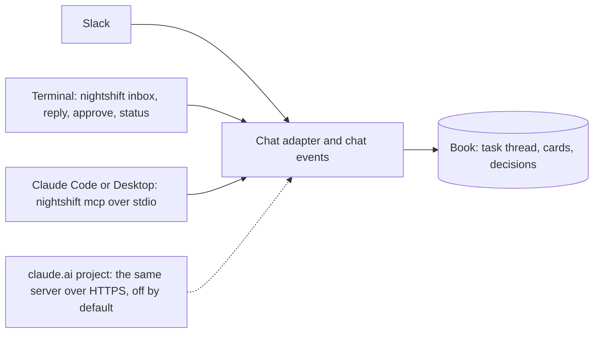

# Experience plane

> Part of the [Nightshift design](../design.md). How people and other agents reach the factory: chat, tracker and MCP doors and the control panel; what the factory measures is the Observability plane (section 27). A door turns a message into an event in the book; it decides nothing.

## 15. Doors and control panel

### Control panel: the Home tab of the Slack app

No web UI at the start: the factory's Slack Home tab is the panel (phone and desktop, same Socket Mode, no port, login or new service; Block Kit, up to 100 blocks, refreshed on open and on important events).

| Panel block | What is visible and what can be done |
|---|---|
| **In progress** | tasks by stage, role and provider, budget spent, thread link; pause, cancel |
| **Waiting for you** | review and decision queue with age, blast radius and reasons |
| **Switches** | review mode (`all` / `blast_radius` / `off`), SLA auto-merge, pause, parallelism, `weekly_share` |
| **Limits and spend** | weekly limit use (estimate), API credits left, tokens by role |
| **Quality** | escapes, Verifier returns, the owner's comments, rollbacks; the autonomy rung; rules in trial |
| **Task context** | what the agent received (`AGENTS.md`, standards and skills with SHAs, documents, level and reasons), transcript and trace links |
| **Blast radius rules** | the rules; "change" opens a form from which Lead makes a PR |

**Where settings live.** Static ones (roles, standards, blast radius rules, tenant pack) in git. Operational switches in the book's `settings` table, changed only from the panel or the owner's `/ns` command, each change a book event with author and time. At work, if the app is not allowed in the corporate Slack: `/ns status` in PR comments and the work instance's Grafana. A web UI of our own (Go, server-side HTML with htmx, behind Tailscale or SSO) is "Later".

### Other ways to talk to the factory

Slack is the default door, not a requirement. A tenant with `chat: { adapter: inbox }` gets the same task thread through other doors; thread, cards and decisions live in the book.

- **`inbox`** implements `Chat` on the book: `Post` stores the card in the thread; a reply or decision from any door becomes the same chat event as a Slack button, with the same checks (owner and approvers, card version, SHA binding), and records its `source` (`slack`, `cli`, `mcp`, `mcp-remote`).
- **The terminal**: `nightshift status` (`--task <id>` shows one task's moves, jobs and why a run ended), `inbox`, `reply <task> "text"`, `approve <task> [card]`, beside `task add` and `doctor`.
- **`nightshift mcp`** (official Go SDK `github.com/modelcontextprotocol/go-sdk`) wraps them as tools `task_add`, `status`, `inbox`, `reply`, `approve`. Over stdio the client starts it (`claude mcp add nightshift -- docker compose exec -T nightshift nightshift mcp`); no port. Lead's question arrives as an inbox card, the answer goes through `reply`. An approval names the card it answers (`approve` takes the card version from `inbox` or `status`; the terminal may leave it out for the card that waits now), so a spec the Lead replaced is refused, never approved unseen.
- **The remote door** serves the same tools over HTTPS for a claude.ai project: off by default, on with `mcp: { remote: { listen: 127.0.0.1:8765 } }` in `tenant.yaml`, behind an outbound tunnel the person starts, with a token from `mcp_token` in the secrets directory. It may read status, add tasks, answer Lead and approve a spec (work still passes the gates); Merge to Prod, Rollback and settings only from Slack or the local terminal.
- `github-only` stays for the `team` profile, where people discuss in the pull request.
