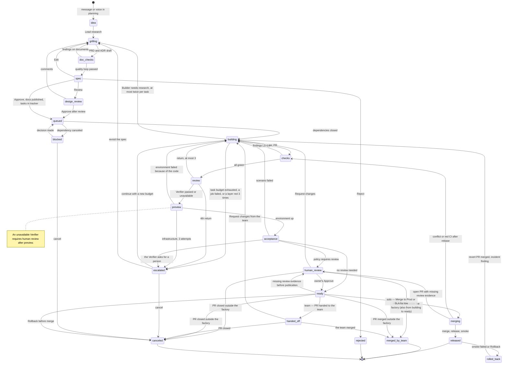

# Control plane

> Part of the [Nightshift design](../design.md). What happens to a task and in which order: the task state machine, the dispatcher, the merge train and the review waits. It decides; it does not run agents.

## 7. Task flow

From any active state, `/ns cancel` or a cancel in the tracker leads to `canceled`; these transitions are left off the diagram.

**Two ends of the path.** In the `solo` profile a task goes through the merge train to `released`. In the `team` profile it ends in `handed_off`: the PR leaves draft, carries a summary and evidence, and reviewers are assigned from CODEOWNERS or the `approvers` list. The team merges under the repository rules; `nightshift` polls GitHub and moves the task to `merged_by_team`, and Request changes from the team send it back to Builder. A pull request merged or closed on GitHub while the task waits in `human_review` or `ready` (the owner pressed the button, or a person closed it) is followed the same way: `merged_by_team` or `canceled`, recorded as `merged_outside` or `closed_outside`. In `solo`, an approver's merge of the verified head counts as the approval: the task goes through `ready` and the train to the release; any other merge ends in `merged_by_team` without a release, and the card says why. Deployment follows the company process. The merge train, `preview`, `release`, `rollback` and `smoke` are tenant capabilities (`project.yaml: capabilities`), not a mandatory part of the flow.

**Channels and messages.** This is the personal instance example; at work `tenant.yaml` defines the channels, and without a Slack app of its own the same cards go as comments on the PR and the tracker issue. The owner talks only to Lead (who is also the architect): discussion, plan and progress of a task live in its thread in `#planning`; PR review requests and "ready for production" cards go to `#deployments` with a link to the thread; triage happens in `#support`. Builder and Verifier do not post in Slack; their work shows as status lines in the thread. One task, one thread. Four message types of up to 60 words: "Question with options", "Decision needed" (Approve / Review / Edit / Reject or a PR review), "Ready for acceptance" (Merge to Prod / Rollback), "Blocker or summary". Details go to attachments and links. A recommendation or a spec card carries one short basis line (at most 25 words: what Lead opened, what it inferred, confidence); the `basis` field of the Lead reply is required with `recommended` or `spec_ready`, and `nightshift` sends a reply with low confidence or nothing checked back to Lead once. Every role report states what it checked and what it inferred (AGENTS.md "Evidence"). A tenant without Slack uses the `inbox` adapter (section 15): the same cards and the same thread live in the book and are read and answered from a terminal or a Claude client.

**One channel.** The `channels` map may point all three intents to the same channel, for example `{ planning: factory, support: factory, deployments: factory }`. One task is still one thread. Lead tells an idea from a problem report by the first message of a thread and, when unsure, asks with two buttons: [Idea] [Problem]. "Decision needed" and "Ready for acceptance" cards go into the task thread with a mention of the owner, and the Home tab "Waiting for you" list collects them. This fits a tenant with one person and few tasks; with several people or parallel tasks, separate channels keep the review queue apart from discussion.

- **#planning.** Text or voice → Lead → document quality loop → spec card asking "Do you want to review?". Approve: `nightshift` merges the docs PR with the PRD and ADR, creates tasks in the tracker, and the tasks are queued with their dependencies. Edit: a change in words or voice; the diff between versions is kept for learn. Reject: the reason is kept as a decision.
- **#support.** Lead looks for duplicates in tracker issues (through the projection in the book), PRs and commits. Duplicate → a link, no task. Otherwise: reproduction in a worktree from `main` or on the `main` preview, never on production or user data (a failing test or a playwright script), and a card: priority P0–P3, steps, evidence, [Create task] [Not needed].
- **#deployments.** Only after the full cycle: green checks and CI (Playwright Test headless), Verifier review, acceptance on preview (Playwright) and, if the policy requires, the owner's Approve. The card holds the tracker issue, preview URL, PR, video and screenshots, metrics, the blast radius level with reasons, and the `trace_id`. **Merge to Prod** runs the merge train, `release` and `smoke`; a failed smoke triggers an automatic rollback. **Rollback** before the merge closes the PR and tears down the preview; after a release it rolls production back.

**Flow rules enforced by code:**

- **Transitions are atomic.** Each transition is a compare-and-set on (state, version, `head_sha`) in one transaction. Decisions (Approve, Merge, Rollback) are bound to a SHA; repeating the same decision is idempotent. If conflicting decisions arrive at once (Approve in chat and Request changes in GitHub), the stricter one wins.
- **Verifier results.** Jobs API validates and stores findings with job completion. The conductor commits raised risk, consumption and the task transition together. If that transaction fails, the same verdict remains available and the stored findings stay available for retry. Only applied returns to Builder use the review-return budget.
- **Finding status.** A queued Builder job records its input findings as `handed_off` in the same transaction. The `book.finding_states` view shows that status for open findings with a Builder job. Unresolved findings remain available on retry. A passing Verifier review can confirm the findings listed for recheck on that head when its summary acknowledges the recheck. A still-reported finding stays unresolved. A local finding needs the same completed suite and report producers on the Builder patch being published. A CI finding needs positive results from the original failing check identities.
- **Task budget.** One per task: iterations, tokens, hours. It bounds all return loops (checks, Verifier, acceptance, review, train). When exhausted: `escalated` and a "Decision needed" card. Every move to `escalated` gets that card, named by its cause (`budget_exhausted`, `job_failed`, `infra_failed`, or `escalate` when a role asks for a person): the reason, the pull request, an acceptance job's preview and screenshots, and the buttons Continue, Revisit the spec and Cancel; a change already merged gets none.
- **Merge train.** Only `nightshift` merges, one PR per repository at a time: rebase on a fresh `main` → L1–L3 again → merge → `release` → `smoke`. Each step (`rebased_sha`, `ci_run`, `merged_sha`, `released_sha`) is written to the book before and after; after a restart the train reconciles with GitHub and continues from the right step. If the rebase had no conflicts and `git range-diff` is empty, the owner's Approve and the Verifier verdicts carry over to the new SHA; if Builder resolved a conflict, they are all dropped. A clean rebase that changes the patch-id, or one resumed after a crash that cannot vouch for it, also drops them: the train does not merge, and the task returns to human review at the rebased head.
- **Resuming publication.** A task in `ready` or `merging` needs a recorded path through the review gate backed by a passing Verifier result or an authorized decision for its recorded head. If review evidence is missing, an open pull request at the recorded head or a completed rebase returns to `human_review`. An unmatched head waits for reconciliation. After candidate CI, the train rechecks the live head and review decisions before merging. An objection to a patch-equivalent reviewed revision stays in scope when the candidate returns to human review. The train reconciles an already merged pull request with the release journal.
- **Rollback.** On `rolled_back` the tenant's train freezes and `nightshift` opens a revert PR itself; it passes only L1–L3 and merges out of turn. Then the task returns to `building` with an `incident` finding and the train unfreezes. This way the bad commit does not ship again with the next release.
- **Dependencies.** Tasks from `to-tickets` keep blocking links; the dispatcher runs only unblocked tasks. A dependency counts as closed at `released`, or at `merged_by_team` (the team, or someone outside the factory, merged it). If a dependency is canceled, dependent tasks move to `blocked` with a "Decision needed" card.
- **Changing a spec after Approve.** Edit stops only the spec's unmerged tasks and returns the spec to `grilling`. To change what is already merged, Lead opens new tasks.
- **Cancel.** `/ns cancel` or a cancel in the tracker: jobs stop, the PR closes, the preview is torn down, the worktree is deleted. From the tracker the factory accepts only cancel and priority; everything else is overwritten from the book (in Jira, within the existing workflow).
- **Capacity.** Limits on parallel tasks and previews per tenant live in `tenant.yaml`. Tasks in `human_review`, `handed_off`, `ready` and `merging` do not take a slot; their preview is torn down N hours after acceptance and brought back when needed.
- **Pause.** `/ns pause` stops the dispatcher and all trains; `/ns resume` resumes.
- **Day and night.** In the daytime (by default 09:00–22:00 in the tenant's time zone) there is dialogue: the owner sets and discusses tasks, approves specs, looks at reviews. At night (quiet hours 22:00–09:00) the factory runs everything approved during the day without the owner: Builder, checks, Verifier, preview, plus learn, audit and the polygon. No messages at night. If a task needs the owner's decision, it is parked until morning and the factory takes the next one. Waking the owner is allowed only for a production incident that the automatic rollback did not fix. No production releases at night (neither by SLA nor by schedule), only rollbacks. At 09:00 a morning summary arrives: what was done overnight, what waits for the owner, the review queue, limit usage. Quiet hours are a tenant setting; in the `team` profile the factory also works at night, but hands nothing to the team and posts nothing to shared channels until morning.
- **SLA auto-merge** (`solo` only) is a permission the owner gives in advance for blast radius `low`. It is switched on only by a toggle (panel or `/ns sla on`) and stays on until the owner switches it off. If the owner has not answered in N hours, the card goes through the merge train on its own. It never applies to `high` and `critical`, new dependencies, or PRs waiting for review.
- **Buttons** carry the `task_id` and the card version; a click on a stale card is rejected. Commands and decisions are accepted only from the tenant's `owner` and `approvers` (by their IDs in chat, GitHub and the tracker).
