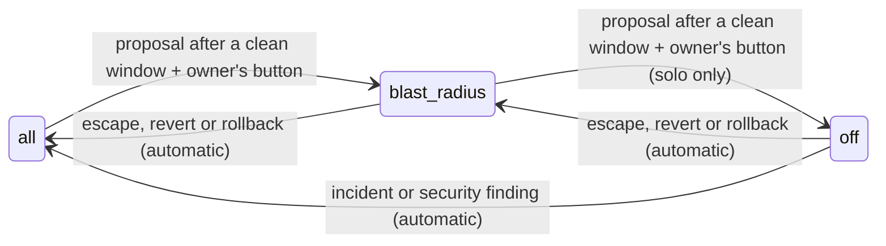

# Governance and assurance plane

> Part of the [Nightshift design](../design.md). What makes a change trustworthy: the quality loop, standards, gates, review policy and the engineer in the loop. A gate is code, never an agent's opinion.

## 8. Quality loop before a human

The owner receives only what passed everything cheap to check. Each layer returns machine-readable findings (SARIF or JSON by schema) with a `rule_id` to the author, who fixes them until the layer is green.

| Layer | What it does | Code | Documents (PRD, ADR, design) | Cost |
|---|---|---|---|---|
| **L0. Input** | The runner selects the applicable standards (by task kind and paths) and puts a short checklist with links into the prompt | Language and project standards, `LEARNINGS.md` | Templates (ADR by MADR 4.0), glossary, past ADRs | ~0 |
| **L1. Local tools** | `nightshift check` in the worktree before push | Formatters, linters, types, tests, opengrep, gitleaks, osv-scanner, squawk, hadolint, layer rules | doc-lint (sections, limits, front matter by JSON Schema, Given/When/Then in criteria, ≥ 2 alternatives in an ADR, English), markdownlint, Vale, lychee, mermaid rendering | Seconds, $0 |
| **L2. Change metrics** | Ratchet: no worse than `main` | New-line coverage, complexity, duplicates, PR size, new dependencies | Length, number of open questions, links to ADRs | Seconds, $0 |
| **L3. CI** | The same checks in a clean environment + e2e | GitHub Actions | GitHub Actions | CI minutes |
| **L4. LLM rubrics** | A cheap model without tools, fresh context, rubrics from standards; findings by schema | Spec conformance, error handling, observability, security, readability | Ambiguities, contradictions with ADRs, missing non-functional requirements (security, privacy, observability, rollback, cost), clarity for an engineer | Cents |
| **L5. Verifier** | A strong model, a different context (preferably another family); review and acceptance with evidence | Review + hidden scenarios on preview | Spec review against the goal and decisions | Dollars |
| **L6. Human** | By the review policy (section 11) | PR | Docs PR | The owner's time |

**Summaries for the human** are generated by the runner. For a PR: what and why (3–5 lines), a diagram of the touched modules, 2–5 places to look, and which layers found and fixed what. For a document: a 3-line TL;DR, the key decision and the rejected alternatives, a diagram.

**Findings tell the author how to fix:** each carries a short `remediation` (what to change, which standard), and our own rule messages are written for an agent reader.

**Reports** of each layer live in `artifacts/<tenant>/<task>/<job>/` (SARIF, JSON, logs). The book gets only findings, paths and file sha256.

**Rules that keep the loop from spinning:**

- **Baseline.** Only new violations relative to `main` block (by SARIF fingerprints). Old violations do not block the task and go to audit.
- **Dispute.** Builder's result schema has `dispute(finding_id, reason)`. Verifier settles the dispute; an accepted dispute counts as a false positive of the rule.
- **L4 repeats.** An L4 finding with the same fingerprint (`rule_id` + location) after "fixed" blocks at most twice, then becomes a warning. L4 rechecks only changed fragments.
- **Two automatic rounds per layer.** L1–L3 return a task to Builder at most twice per layer; a third red result moves it from `building` to `escalated` with a "Decision needed" card.
- **The task budget** bounds all iterations (section 7).

### Gates: which checks block a merge, per repository

The repository states in `.nightshift/gates.yaml` (named by `project.yaml: gates`) what must pass before a PR merges. Without the file every check blocks, as in sections 8 and 11. An entry names a check or a layer and gives its `mode` and, optionally, `when`:

```yaml
# .nightshift/gates.yaml
gates:
  - check: rubric:error-handling    # an L4 rubric card by id; or a stack-pack tool, ci, verifier, a project check
    mode: warn
    reason: too noisy until the card is tuned
  - check: verifier
    mode: block
    when: { blast: [medium, high, critical], paths: ["internal/store/**"] }
```

- **Modes.** `block` returns the task to Builder as in section 8. `warn` puts the finding in the summary and does not return the task. `off` does not run the check. Every `warn` and `off` entry needs a `reason`.
- **`when`.** Optional path globs from the diff and blast radius levels (section 11). The entry applies when any listed path is touched or the level matches. An entry without `when` applies to every PR.
- **The floor.** gitleaks, osv-scanner, the factory's security rules, the protected paths check, `verify`, the CI verdict and, for `critical`, Verifier and the owner's review are always `block` and cannot be narrowed by `when`. The schema rejects a file that tries, and `tenant doctor` reports it.
- **Weakening is `critical`.** Any change that lowers a mode, adds `when` to a `block` entry, or removes an entry needs the owner's Approve, like a weaker standards card (section 9). Making a gate stricter needs none. The file is under `.nightshift/`, so an agent's patch to it is rejected as a protected path (section 10).
- **A skip.** `/ns skip <check> <reason>` waives one `warn` check for one task and is an event in the book. A `block` check cannot be skipped.
- **From an agent.** The MCP door (section 15) gets tools to read the gates, the blast radius rules and the review mode, and to run `check --plan`. A tool that changes any of them opens a PR with the edit and never writes the file directly; a weakening still waits for the owner's Approve, and the door's token has no right to merge or to lower a gate.
- **A preview.** `nightshift check --plan` prints, for the current diff, each check, its mode and why it applies, without running any of them.

**Prior art:** `docs/prior-art.md`, "Entire and review tooling". A gate is a tool result or a review verdict with a `rule_id`, never an agent score or a natural-language check; a second reviewer plus a judge for `critical` is in "Later".

## 9. Standards: where they live and how they change

**Three levels, all files in git** (versions, diffs, review through PRs), indexed into the book for search and metrics:

| Level | Where | What | Who changes it |
|---|---|---|---|
| **industry** | `nightshift/standards/industry/` | Industry practices: Effective Go and Google Go Style, PEP 8 and typing, OWASP ASVS and Top 10, 12-Factor, MADR, Diátaxis, SRE (SLO, rollback), safe Postgres migrations | learn and audit through PRs to `nightshift` |
| **house** | `nightshift/standards/house/` | The owner's cross-project preferences, learned from the owner's edits in all projects. Not applied to `team` tenants by default: these are personal tastes, not team rules | learn through PRs to `nightshift` |
| **project** | `<project>/.nightshift/standards/` | Rules of a specific project (for example, "no writes to the client's external systems" or "foreign text only through a filter"), including the project's own instructions (`AGENTS.md`, skills) | `solo`: learn and Lead through PRs to the project. `team`: learn collects rules in the overlay `tenants/<name>/standards/` on the factory side and proposes them to the team as a weekly batch; they reach the project only through a regular team PR |

**Precedence:** factory rules on security and gates > project (including the project's own instructions) > house > industry. Overriding a more general rule requires a `reason` field. learn does not propose a rule that contradicts a higher-precedence rule.

**Who approves standard changes.** Only **new or stricter rules with `enforcement: tool`** go in without the owner, through trial (their behavior is checkable and reversible). Everything else (rubric, guidance, weakening and removing rules, skills, role prompts, templates, `AGENTS.md`, `LEARNINGS.md`) is blast radius `critical` and needs the owner's Approve. To avoid pinging the owner one by one, learn collects such changes into a weekly "Lessons of the week" card with a button per item.

**The owner's own path.** `/ns standard <text>`: Lead drafts a rule card, picks the level and enforcement and opens a PR. `/ns rule off <id>` switches a rule off immediately.

**External skills and rule packs** are vendored by commit SHA; an update is a PR the owner approves.

**A standard is a rule card** (example: `standards/industry/docs/adr-alternatives.yaml`): `id`, `title`, `applies_to` (kinds, paths, tags), `enforcement` (`tool`, `rubric` or `guidance`), the tool check or rubric question, `params`, `severity` (`block` or `warn`), `status` (`trial`, `active`, `retired`) and `source`.

- **`tool`**: a tool enforces the rule. Configs (`.golangci.yml`, `rules/*.opengrep.yaml`, `.squawk.toml`, `ruff.toml`) live next to it and are copied into the project by `nightshift standards sync` through a PR.
- **`rubric`**: a question that L4 asks the cheap model; the answer is a finding with a `rule_id`.
- **`guidance`**: text for the prompt when neither a tool nor a rubric fits.
- **Rule metrics** are computed in the book: how often it fired, how many false positives (the owner or Verifier rejected the finding), at which layer it catches, how many defects under it slipped further.
- **`params`**: values that differ between projects (API style and versioning, naming conventions). The card declares each param's type, its enum or stricter direction (for example `stricter: lower`) and a default; a project sets its values in a card with the same `id` in `.nightshift/standards/` with a `reason`. Only `rubric` and `guidance` cards and our own checks (doc-lint, `nightshift check`) read params. A third-party tool is configured by the project's own config extending the pack's config (Spectral `extends`, golangci-lint config, Vale `BasedOnStyles`), with no templating. Weakening (lower severity, `retired`, a value less strict than the default) is blast radius `critical` with the owner's Approve. Cards for the factory's security and gates have no params.

### Engineering disciplines

A discipline is not a new concept or role. It is a folder of cards in `standards/industry/<discipline>/`, the tools of the stack packs that enforce them, and skills from the catalog (section 12) selected by `applies_to`. Audit of a discipline is a Verifier audit mode with its rubrics. Stack packs exist per language (`go`, `python`, `ts`, `js`, `java-maven`, `java-gradle`) and per technology (`openapi`, `postgres`, `docker`, `web`): tools such as Spectral or squawk do not depend on the language. Discovery (section 17) proposes the packs from their `detect` files. A language without a pack still works through the project's toolchain and `verify` (section 5); a pack is added when the first tenant on that stack needs structured findings. Frameworks (React, Next.js, Vue, React Native) are not packs: the `ts` and `js` packs carry their tools, and framework skills are selected by the project's dependencies (section 12).

| Discipline | Cards and rubrics | L1–L2 tools | Skills | Phase |
|---|---|---|---|---|
| Security | OWASP ASVS and Top 10; L4 security rubric | gosec, bandit rules, opengrep, gitleaks, osv-scanner, zizmor | `security-review`, Trail of Bits set, own `threat-model` | 4 |
| DevOps | Dockerfile and CI rules, 12-Factor | hadolint, actionlint, shellcheck; kubeconform and IaC tools with the first tenant that has them | `gitops-workflow`, `k8s-*`, `terraform-*` | 4; IaC by tenant |
| SRE and monitoring | SRE (SLO, rollback); "a new handler or job emits a span, a metric and a structured log" | opengrep rules per stack | `slo-implementation`, `grafana-dashboards`, own `postmortem` | 4; smoke against tenant SLO in 6 |
| Database | Safe Postgres migrations, expand-only, indexes for new queries | squawk | `golang-database`; candidates `database-migration`, `supabase-postgres-best-practices` | 4 |
| API design | REST or gRPC style, versioning, errors, pagination as `params`; L4 API rubric | Spectral, oasdiff (`openapi` pack); candidate `proto` pack with `buf lint` and `buf breaking` for gRPC; OpenAPI diff in `java-maven` | candidate `api-design-principles` | 4 |
| Naming | Language naming rules; names match the project glossary | revive, ruff `N` rules; Vale vocabulary built from the glossary | `domain-modeling` | 4 |
| UX and UI | The project's design system and UI rules live in the project, not in the core | axe-core in Playwright e2e (`web` pack) | `frontend-design`, `web-design-guidelines` | With the first frontend tenant |
| Performance | Wall time never gates on the shared worker: runner noise is about 2.7% CV, so a 2% gate gives about 45% false positives ([CodSpeed](https://codspeed.io/blog/benchmarks-in-ci-without-noise)). A warn-only ratchet on `allocs/op` and `B/op` from `go test -bench -benchmem` for packages that have benchmarks | none in L1 | own, when needed | 4 (candidate, warn only) |
| Load testing | Project-defined thresholds | the `load` capability: the project's own script against preview | none | 6 at the earliest |

**What we deliberately do not do:** no DBA, SRE, security or UX roles (section 6: they need neither a different model nor a separate context); no performance gate or load tests before preview exists; no own skill where a vendor or community skill passes the polygon; no CodSpeed (an external service, and for Go it measures only wall time).

## 11. Engineer in the loop: design and code review

The **review policy** in the tenant config decides when people are called. Review gets only what passed layers L0–L5, and every review is a record in the book.

**Who approves.** In `solo` the `owner`. In `team` the `approvers` (people, a GitHub team or CODEOWNERS) under the repository rules in GitHub; since the code author is the factory bot, a required second person is one who did not create the task. `off` mode and SLA auto-merge cannot be switched on in `team`.

### Design documents

- **Format.** Templates in `templates/`: PRD (up to two screens: problem, goal and metric, solution, diagram, non-goals, risks, acceptance criteria), ADR (MADR 4.0, one screen), component design (two screens: purpose, input and output, diagram, failures, observability). An architecture or flow change needs a mermaid diagram.
- **Always a docs PR** (or a docs adapter such as Confluence). Approve approves the docs PR; `nightshift` merges it in `solo`, the team in `team`.
- **The owner is always asked.** The spec card asks "Do you want to review?" with [Approve] [Review] [Edit] [Reject]; a `high` or `critical` spec (new component, ADR, critical logic) arrives as a review request.
- **Review loop.** Line comments in GitHub, general ones in the thread (text or voice). Each comment is a record with a status and a finding for learn; Lead answers each ("fixed" or "disagree, because…"), the document passes the quality loop again and review is requested again. Builder never starts without Approve.

### Code

- **Visible work.** A draft PR from the first push, one thread line per stage change (what, which step, spend), `/ns status` for all active tasks.
- **When a human is needed** `nightshift` sets `nightshift/human-review` to pending, labels `needs-human-review`, requests the owner's GitHub review and posts a `#deployments` card mentioning the owner: the section 8 summary, the blast radius level and its rules, the thread link.
- **The answer** is Approve or Request changes in GitHub or by buttons (in `team` only in GitHub). On Request changes Builder answers every comment, fixes, all layers rerun and review is requested again. Approve is bound to the patch-id: a clean rebase keeps it, a new commit or a conflict drops it. A pending PR is not taken by the merge train.

### Review policy: switch + blast radius

1. **Mode switch** per tenant: `all` sends everything to the owner, `blast_radius` follows the rules below, `off` sends only `critical` (`team` has only the first two). Changed on the panel or with `/ns review all | blast_radius | off`; each switch is a book event. It starts at `all`; the autonomy ladder decides when to move.
2. **Blast radius rules** say how dangerous a change is; the project defines them and the factory classifies every PR and spec. The defaults below are starting values a project may override row by row (a domain where everything is critical: section 17).

| Level | By default | Default action |
|---|---|---|
| **low** | Only tests, docs, a small fix without public behaviour change, a small diff | Merges on its own (with SLA, if on) |
| **medium** | A regular feature or fix inside existing modules | Merges after all layers; a note in the summary |
| **high** | Architecture (new module or service, ADR, public API or data schema), infrastructure and deployment, a large diff | PR review (and spec review) |
| **critical** | Payments, auth and secrets, privacy and data deletion, production migrations, money and other people's accounts, new dependencies, CI and protected paths | Spec and PR review, production only by button; never `off` or SLA |

The rules are paths, tags and signals per level in `.nightshift/blast-radius.yaml` (example: `testdata/tenants/example-solo/.nightshift/blast-radius.yaml`; unmatched means `medium`). The actions per level, `sample` (share of `low` and `medium` PRs still reviewed, for calibration), `remind_after_hours` and `sla_automerge_hours` live under `review:` in `tenant.yaml` (`schemas/tenant.json`).

- **How the level is computed.** By code from diff paths, signals (new dependency, new module, migration, diff size) and tags; Lead sets tags at creation and Verifier may raise the level. **Agents only raise a level, never lower it.** The result is the maximum, shown on the card with its reason ("high: new dependency `x`, path `deploy/…`"). Whatever the rules say, a built-in protected path, a script that a `project.yaml` command runs (`setup`, `verify`, a preview or deploy capability) or its compose recipe is `critical`, because a privileged service runs it; scripts are found by section 10, item 8, and a computed path goes in `protected`.
- **Documents too.** A spec's level comes from its tags and components; `high` and `critical` require design review.
- **Changing the rules.** They live in git; by hand, from the panel or with `/ns blast <level> add <path or tag>` (Lead opens a PR, the owner confirms). Weekly, learn shows where the owner approved without comment and where `low` or `medium` hid problems, and proposes changes for the owner's button.
- **Commands:** `/ns review all | blast_radius | off`, `/ns review <task>`, `/ns reviews` (queue), `/ns blast` (current rules).
- **Tracking.** The `reviews` table holds task, type, level and reasons, round, comments and statuses, waiting time; the queue shows on the panel and in the morning summary, with reminders after 4 and 24 hours.

### Autonomy ladder: when the review mode changes

The modes form a ladder `all` → `blast_radius` → `off` (`team` stops at `blast_radius`). The factory moves a tenant **up** on its own as soon as something slips through and only **proposes** a move **down** for the owner's button: tightening is cheap and reversible, loosening needs evidence and a human (an error-budget policy).



**Metrics**, SQL over existing book records per tenant and level:

| Metric | What it counts | Source |
|---|---|---|
| Escapes after the gate | Defects found after merge (owner, smoke, production, a later task) in tasks the mode let through unreviewed | `findings` caught "human after merge" or "production", joined to `reviews` |
| Reverts and rollbacks | Of tasks merged without human review | merge-train and gitops `events` |
| Owner change rate | Share of reviewed PRs with a substantive Request changes or Edit; also the Verifier–human disagreement rate | `reviews` rounds and classified comments (section 10) |

An escape counts once the owner confirms it, without waiting for section 10's `verified` mark. A task enters the window only when **mature**, `maturity_days` after merge.

**Rules.**

- **Step down one rung, by proposal only:** at least `window_tasks` mature unreviewed tasks over at least `window_days`, zero escapes, reverts and rollbacks, at least `min_reviewed` reviewed PRs and an owner change rate at most `max_owner_change_rate`. The `#deployments` card shows the numbers with [Apply] [Not now]; "Not now" waits a full new window.
- **Step up at once, by code:** an escape, revert or rollback of an unreviewed task moves one rung up; a production incident or a security, privacy or data finding moves straight to `all`. The window restarts, the event names the cause, the chat gets one line.
- **The owner's switch always wins**, and the ladder counts from the new rung.
- **Fixed by code:** `team` never reaches `off`, `critical` is always reviewed, and the ladder changes only the mode, never the rules.

**Defaults** (`review.ladder` in `tenant.yaml`, from phase 7): `window_tasks: 30` (0 escapes in 30 tasks bounds the rate below 10% at 95% confidence, the "rule of three"), `window_days: 14`, `maturity_days: 7`, `min_reviewed: 10`, `max_owner_change_rate: 0.10` (the `sample` share). Learn shows them weekly beside the actual rates.

**Where it runs.** A nightly River job computes the window from a SQL view and writes `review.ladder.evaluated`; a step up runs in the handler of the finding, revert or rollback. The rung, window progress and metrics show in the panel's "Quality" and "Switches", the morning summary and the Grafana quality dashboard. No new service, table or role: the mode stays in `settings`, history in `events`. Prior art (SRE error budgets, Argo Rollouts analysis, levels of autonomy, DORA): `docs/prior-art.md`.
