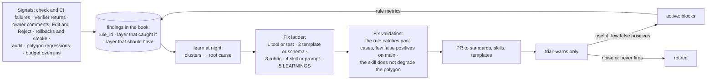

# Evolution loop

> Part of the [Nightshift design](../design.md). How the factory improves itself from its own findings: lessons, audits and proposals that go through the same gates as any change. It is a feedback loop over the other planes, not a floor of its own.

## 10. Self-improvement: how the factory fixes itself

**1. Everything becomes a finding:** source, `rule_id` (or `new`), category (code, design, docs, test, security, process, prompt), severity, evidence, **the layer that caught it** and **the cheapest layer that could have**. A cheap model classifies the owner's review comments and Edits (the owner corrects it with a reaction); `/ns feedback <text>` or 👎 on any factory message also makes a finding.

**2. The key metric is escapes:** a defect caught later than it could have been (by the owner, in production, by Verifier instead of a linter) means shifting a check left. "Could have caught" counts only once the new rule fires on the original commit; until then the escape is `unverified` and out of the metric. Learn aims to reduce escapes and owner comments per task.

**3. Nightly learn** clusters new findings (full text, plus embeddings if configured), finds the root cause (missing knowledge, check or template, a poor skill, a flaky test, the environment) and picks **the lowest rung of the ladder** that solves it. At most 3 PRs per night; a rule the owner rejected or that is `retired` returns only with new cases.

**4. Validation before rollout.** A tool rule must fire on the commits that had the defect and stay below a false-positive threshold on `main`. A skill, prompt or template change runs on the **polygon**: the score must not drop and the target cases must pass (ratchet). A new rule enters as `trial` (warn only) for N tasks; learn moves it to `active` or `retired` by its metrics, and only the owner switches off an `active` rule (`/ns rule off`).

**5. `LEARNINGS.md` without duplicates.** Learn searches for similar lessons (`ns search kind=learning`) and updates instead of adding; a lesson that became a tool rule is replaced by a link; the file is compressed to 100 lines monthly.

**6. The polygon** is reference tasks with known answers in `evals/tasks/` (ADR 0011), each a small Go, Python or TypeScript project: features with hidden tests, planted bugs, design tasks with planted mistakes, prompt injection traps. It starts with 10 tasks; every confirmed escape becomes a regression task; a third is holdout that learn never sees. It runs on twins and local git. Smoke and fast sets run only on changes to skills, prompts, rubrics, the model or the harness version; the full set runs weekly at night on API credits (section 20). Metrics: solve rate, escapes, cost, time, standard violations.

**7. Weekly audit** (Verifier in audit mode plus tools over the whole repository): vulnerable dependencies, secrets in history, dead code, duplicates, complexity, coverage trend, drift from accepted ADRs, stale documents, standards health (silent or noisy rules), factory health (escapes, returns, cost per task, time to merge). A fix of a few lines becomes a `low` PR; the rest stays a finding; the result is a Slack summary.

**8. Protection against self-damage (the "constitution").** Protected in `nightshift`: gates, review policy, merge train, security, roles and their prompts, standard precedence, the constitution itself. Protected in every project: `.nightshift/**`, `.github/**` (with `.github/agents/**` and `copilot-instructions.md`), `.claude/**`, `.mcp.json`, `opencode.json`, `.opencode/**`, the command scripts from `project.yaml`, `Makefile`, `mise.toml`, `mise.lock`, `AGENTS.md`, `LEARNINGS.md` and `project.yaml: protected`. `nightshift` rejects a Builder patch there; only Lead or learn change these paths, in a separate `critical` PR with the owner's review. Everything learn derives from tickets, #support, the web or previews goes through the owner, unless it is a tool rule in trial.

**9. Nightshift is a tenant of itself**, with the constitution on top. The instance doing this work runs a tagged release of `main` as its own compose project (`scripts/stable.sh up <tag>`), so a development build cannot break it, and the tag moves only after a live check. The `nightshift` tenant never deploys itself: `deploy/upgrade.sh` updates on the owner's command (live checks on the development stack, wait for idle, tag, start; restore the previous tag if startup fails, a service fails while settling, release logs show errors or state cannot be read; confirm core and worker run the restored release; the fast polygon joins in phase 6). If a broken version cannot fix itself, an interactive Claude Code session outside the factory repairs it.

**10. Sessions and logs are signals too (phase 7, ADR 0016).** SQL counters over `events` and job records, with no model: returns and retries per task, jobs per task, limit hits and fallbacks, tool errors, questions the memory page or search already answers, tokens per merged task. A counter over its threshold for several tasks becomes a `process` finding (`rule_id` such as `friction.retry_loop`). Only for such a cluster a model reads at most 5 masked transcripts, as foreign text, and proposes a finding or a fix, never a change; for `confidential` and `pci` tenants only on providers they allow.

**11. The tenant improvement report (phase 7).** Weekly, part of the "Lessons of the week" card: the top three recurring problems, the trend of escapes and owner comments per task, friction counters, cost per task and the ladder window. Each proposal is an open PR (tool rule, skill, memory entry), a PR to the tenant's `.nightshift/` files through section 17's path, or a question. The report is SQL; a model only words and ranks it. Protected paths stay `critical` (item 8) and the 3-PR nightly limit holds.

**12. The operator report (phase 7).** The operator runs an instance; at work that is not the tenant's owner, and the Nightshift maintainer is a third party. Tenant data reaches neither without consent.

- **Inside the instance** the operator sees per tenant only aggregates (counts and rates of tasks, escapes, returns, limits, cost) unless `tenant.yaml` sets `report.operator: detail`. In a personal instance the operator is the owner and sees everything.
- **To the maintainer**, off by default: it needs `report.upstream: counts` in the instance and the tenant (the lower wins), and `confidential` or `pci` tenants never contribute. Counts only (factory and harness versions, counts per core `rule_id`, error classes, gate failures, limit hits), no names, paths, text or transcripts, no group under 5. `nightshift report --preview` prints the exact payload and keeps a copy; the operator files it by hand as an issue until the owner approves an uploader's egress host (section 25).
