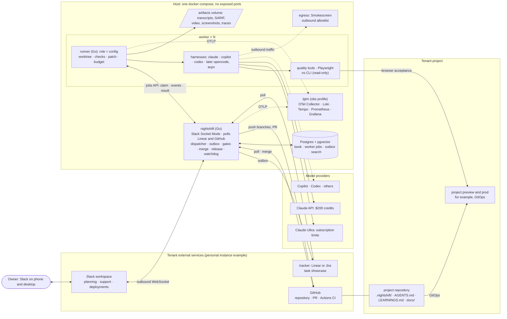

# Data foundation

> Part of the [Nightshift design](../design.md). Where state lives: one Postgres for the book, the River queue, the outbox and search, plus the containers of the first version. Each plane owns its part of the state and the rules for changing it; sharing one store gives no plane the right to write another's state, and the worker has no access at all.

## 3. Architecture of the first version



```yaml
# deploy/docker-compose.yml
# abridged to services, secrets and networks; the file holds images, volumes and limits
x-hardened: &hardened
  read_only: true
  security_opt: ["no-new-privileges:true"]
  cap_drop: [ALL]
  tmpfs: ["/tmp"]

services:
  postgres:
    secrets: [pg_admin, pg_owner_password, pg_nightshift_password, pg_backup_password]   # the init script creates the login roles
    networks: [core]

  migrate:                                  # one shot as the schema owner; serve never holds this secret
    <<: *hardened
    secrets: [pg_owner]
    networks: [core]

  nightshift:                               # Go: Slack, polling, dispatcher, outbox, gates, merge, release
    <<: *hardened
    user: "10001"
    secrets: [pg_nightshift, chat_bot_token, chat_app_token, worker_token_sha256, github_token, github_app_id, github_app_key, mcp_token, deployer_token]   # the only service with chat, GitHub and door secrets
    networks: [core, jobs, internet, deploy]

  backup:                                   # pg_dump hourly, restore test weekly
    secrets: [pg_backup_password]           # the read-only book_backup role, not the superuser
    networks: [core]

  offsite:                                  # restic copy of the dumps, daily, encrypted
    secrets: [restic_repository, restic_password]
    networks: [internet]

  worker:                                   # one job at a time; parallelism = replica count; no Postgres access
    <<: *hardened
    cap_add: [SETUID, SETGID]               # the runner (root without other capabilities) starts the agent as uid 20001
    secrets: [worker_token, harness]        # jobs API token + harness credentials
    networks: [jobs]                        # no direct way out

  egress:                                   # Smokescreen: the only way out for the worker, by allowlist
    networks: [jobs, internet]

  modcache:                                 # Athens: Go modules for the worker (the worker has GOPROXY=http://modcache:3000); the only container besides egress on jobs and internet
    networks: [jobs, internet]

  toolchain:                                # installs the toolchain a project pins (`mise install`) before the agent starts; the only container besides egress-install that reaches the tool hosts (ADR 0010)
    secrets: [worker_token]                 # the same token authenticates the worker's call
    networks: [jobs, install]               # the worker calls POST /install on the jobs network; its way out is the install allowlist

  egress-install:                           # Smokescreen with the tool hosts; only toolchain reaches it, the worker is not on the install network
    networks: [install, internet]

  deployer:                                 # brings previews and releases up on the Docker engine (section 17); the only service with the socket
    profiles: [deploy]
    <<: *hardened
    cap_add: [DAC_READ_SEARCH]              # root without it cannot open deployer_token
    user: "0"                               # the socket belongs to root; the worker never reaches this service
    secrets: [deployer_token]
    networks: [deploy]

  grafana-login:                            # obs profile: one shot, gives grafana_ro its login
    <<: *hardened
    profiles: [obs]
    secrets: [pg_owner, pg_grafana_password]
    networks: [core]

  lgtm:                                     # obs profile: logs, metrics, traces
    profiles: [obs]
    ports: ["127.0.0.1:3000:3000"]          # Grafana from the local machine only
    secrets: [pg_grafana_password, grafana_admin_password]   # grafana_ro for the book; a login, no anonymous access
    networks: [core, jobs, ui]              # ui, because a port cannot be published from an internal network

networks:
  core: { internal: true }                  # Postgres, nightshift, lgtm
  jobs: { internal: true }                  # worker ↔ nightshift (jobs API), lgtm, egress
  install: { internal: true }               # toolchain ↔ egress-install; the worker is not on it
  deploy: { internal: true }                # nightshift ↔ deployer
  ui: {}                                    # only to publish Grafana on 127.0.0.1
  internet: {}

secrets:                                    # files in deploy/secrets/, mode 0400, owned by the reading service's uid; not in git
  pg_admin: { file: ./secrets/pg_admin }                         # superuser; postgres only
  pg_owner_password: { file: ./secrets/pg_owner_password }       # postgres creates the roles from these two
  pg_nightshift_password: { file: ./secrets/pg_nightshift_password }
  pg_backup_password: { file: ./secrets/pg_backup_password }
  pg_owner: { file: ./secrets/pg_owner }                         # postgres://book_owner:<password>@postgres:5432/book
  pg_nightshift: { file: ./secrets/pg_nightshift }               # postgres://nightshift:<password>@postgres:5432/book
  pg_grafana_password: { file: ./secrets/pg_grafana_password }   # grafana_ro, which reads only the dash_* views
  grafana_admin_password: { file: ./secrets/grafana_admin_password }   # Grafana user admin
  chat_bot_token: { file: ./secrets/chat_bot_token }             # pasted by the owner; one chat app per instance
  chat_app_token: { file: ./secrets/chat_app_token }
  restic_repository: { file: ./secrets/restic_repository }
  restic_password: { file: ./secrets/restic_password }           # a copy lives in the owner's password manager
  deployer_token: { file: ./secrets/deployer_token }             # nightshift and the deployer only
  worker_token: { file: ./secrets/worker_token }                 # created by deploy/init-secrets.sh
  worker_token_sha256: { file: ./secrets/worker_token.sha256 }   # nightshift checks the token against its hash
  harness: { file: ./secrets/harness }      # directory, one file per credential
  github_token: { file: ./secrets/github_token }                 # empty until pasted; nightshift only
  github_app_id: { file: ./secrets/github_app_id }               # the GitHub App, preferred over the token
  github_app_key: { file: ./secrets/github_app_key }
  mcp_token: { file: ./secrets/mcp_token }                       # the remote door's bearer token

volumes: { pgdata: {}, dumps: {}, work: {}, artifacts: {}, agent-home: {}, repos: {}, lgtm: {}, modcache: {} }
```

- **Worker jobs.** `book.jobs` stores queued work for the agent roles. The jobs API leases a row, renews it on heartbeat and records the result. On the next claim after a lease expires, the API requeues the job if attempts remain or marks it failed. A late result carrying an expired lease cannot complete the job.
- **The worker never touches the database.** It takes a job through the internal HTTP API of `nightshift` on the `jobs` network: `claim` (long-poll), `heartbeat`, `events`, `complete`. The worker authenticates with `worker_token`, and each job gets its own short-lived token scoped to the task and role (the `ns` CLI uses it too). This keeps permissions simple. The agent physically cannot reach the book.
- **Outbox delivery.** River runs the periodic outbox flush inside `nightshift`, including at service startup. `book.outbox` holds each message, its idempotency key and its next attempt. The outbox retries due messages with backoff and marks permanent or exhausted failures. A crash before delivery is recorded leaves the message eligible for another attempt.
- **Isolation.** One job per worker container, so files and processes of different jobs never mix. Each task has its own worktree in `/work/<tenant>/<task>`; the agent writes only to its worktree and its job's artifact directory. No Docker-in-Docker.
- **Networks.** The worker sits in a network with no way out and reaches the internet only through `egress` by allowlist; private ranges are denied and preview hosts are allowed one by one. The designed `ci` profile gives `gh-runner`, which runs PR-branch code, its own network and `egress-ci`, away from the jobs API; it is not in `deploy/docker-compose.yml` yet, and `TestDesignComposeExample` keeps the example above in step with the file. Only `nightshift` talks to chat, tracker and GitHub directly.
- **Postgres roles.** `nightshift` has rights on the book but no `UPDATE` or `DELETE` on `events`. `grafana_ro` can only read the dashboard views (no hidden scenarios, no secrets). Migrations run under a separate schema-owner role, only in the one-shot `migrate` service (`nightshift serve --migrate-only`), which every start of a release runs; the running service never holds the owner's password. `book_backup` reads everything (`pg_read_all_data`) and may create only the scratch database of the restore test; the superuser password stays inside `postgres`.
- **Users in the worker.** The runner is root without capabilities except `SETUID` and `SETGID`. The agent and all project commands run as uid 20001 and cannot open the worker's secrets: they are mounted under `/run/worker-secrets`, a root-only directory of the image, because file modes alone do not hold on every host (Docker Desktop shows a mounted file as owned by its reader). The runner creates the checkout and runs git as that user, so it never changes file owners and never runs git as root on files the agent can write. The mirrors belong to `nightshift`; only the clone gets their group, so the agent cannot browse other repositories. Playwright's Chromium runs without its own sandbox (the Playwright default); the container provides isolation.
- **Images** are built locally (`docker compose build`); a second host would use GHCR.
- **Where it runs.** The personal instance on the owner's machine, later the same compose on a VM; the work instance on the employer's machine or VM. Both start from the same compose and images and differ only in `instance.yaml` (trust domain, providers, egress allowlist), `tenants/` and secrets; books, artifacts, logs and secrets are never shared.

## 14. Data and logs: what lives where

| Data | Where | Retention | Backup |
|---|---|---|---|
| Tasks, events, queue, reviews, findings, budgets, decisions, standards index | Postgres (book) | Forever; `events` is append-only | `pg_dump` hourly to disk; daily an encrypted restic copy off the machine (a second disk or a free cloud storage tier); weekly a restore test. The restic password is in the owner's password manager |
| PRDs, ADRs, standards, skills, `LEARNINGS.md` | git: project repositories and `nightshift` | Forever | GitHub |
| Project memory page, session handoffs | Postgres (book) | The page is capped at 40 entries and 4 KB, each entry expires after 90 days unless pinned; a handoff is kept with its harness sessions (30 days after the task closes) | With the book |
| Operator report (`nightshift report --preview`) | A local file in the instance's data directory; counts only | 90 days | Not needed |
| Search index | Postgres `documents` | Rebuilt from git and the book; `task_outcome` and superseded documents kept forever (superseded ones hidden from search); `proposed` notes not promoted by learn within 90 days are deleted | Not needed |
| Agent transcripts, SARIF and JSON reports, command logs | `artifacts/<tenant>/<task>/<job>/` volume, secrets masked | 90 days; longer if a finding refers to the file | Not needed |
| Video, screenshots, Playwright traces | `artifacts` + a copy in the chat thread if the data class allows; preview only on synthetic data | 30 days | Chat |
| Voice messages | Temporary job file | Deleted right after transcription | Not needed |
| Service logs | stdout as JSON (Docker `local` driver with rotation) + Loki in the `obs` profile | 14 days | Not needed |
| Metrics and traces | Prometheus and Tempo in `lgtm` | 30 days | Not needed |
| Secrets | `deploy/secrets/` (compose secrets, mode 0400, owned by the reading service's uid) | Rotation every 3 months and on suspicion | A copy in the owner's password manager |
| Worktrees, agent HOME, repository mirrors | `work`, `agent-home`, `repos` volumes | Worktree until the task closes; harness sessions 30 days; mirrors are refreshed by `nightshift` | Not needed: everything is restored from GitHub |
| What leaves the host | Model providers (code and prompts; training on data is off in the accounts), chat (summaries, video), GitHub (code), tracker (issue titles), LangSmith (only if enabled) | By the provider's terms | — |
| Data class limits | The tenant's `data_classification`: `public` and `internal`: everything as above; `confidential`: no video or screenshots in chat, no LangSmith, transcripts 30 days; `pci`: the same plus only an approved provider, and everything in PCI scope is `critical` with `overridable: false`; the instance pack sets the exact rules | — | — |

**Disk.** When a volume is 80% full, new jobs do not start, artifacts older than 30 days without references from findings are deleted, and the owner gets a message.
