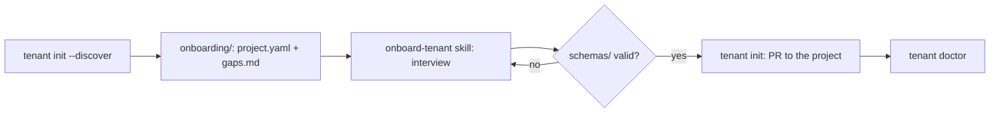

# Customization

> Part of the [Nightshift design](../design.md). How a project plugs in without a condition in the core. Configuration resolves along one axis: core, packs, instance, tenant, project, task.

## 17. Core and customization: packs, tenant, project

### Four layers

One core for everyone; what makes projects differ lives in three layers below it.

| Layer | What it holds | Where | Who changes it |
|---|---|---|---|
| **Core** | Task flow, gates, roles, book, review policy, schemas, adapter interfaces; no project names or concrete services | `internal/`, `schemas/`, `roles/` | PR to `nightshift` |
| **Packs** | Stack packs by language (`go`, `python`, `ts`, `java-maven`…) and technology (`openapi`, `postgres`, `docker`, `web`), `solo` and `team` presets, adapters, industry standards, external skills | `stacks/`, `internal/adapters/`, `standards/`, `skills/`; a project's own in `.nightshift/stacks/` | PR to `nightshift`, with the first tenant that needs it |
| **Tenant** | `tenant.yaml` (profile, data class, people, adapters, providers, resources, budgets, schedule), secrets, the learned-rule overlay of `team` | `tenants/<name>/` of its instance | The instance owner |
| **Project** | `.nightshift/project.yaml` and `blast-radius.yaml`, own standards, skills, roles and instructions (`AGENTS.md`), domain context, ADRs | The project repository | Its team or the owner, by PR |

**Layer rules.** A lower layer chooses from what the upper one provides and overrides its values, but cannot weaken security or gates. A missing feature is a new pack or schema field, never a condition in the core. The core is tested on the synthetic tenants `example-solo` and `example-team` in `testdata/tenants/`; real tenants are never named in code, tests or this document, and a real project is described in its own repository.

### Tenant pack

| Where | What |
|---|---|
| `instance.yaml` | Trust domain (`personal` or `work`), providers (`providers.yaml`), egress allowlist, registry mirrors |
| `tenants/<name>/tenant.yaml` | `governance`, `data_classification`, repositories, people (`owner`, `approvers`), chat, tracker and docs adapters, providers by role, capacity, worker resources, budgets, review policy, schedule |
| `deploy/secrets/tenants/<name>/` (not in git) | Tracker tokens, its own `github_token` (else the instance's App or token), kubeconfig if preview needs it. Chat tokens belong to the instance: one chat app per instance, a tenant is its channels |
| `tenants/<name>/standards/` | The learned-rule overlay of a `team` tenant (section 9) |
| Project `.nightshift/project.yaml`, `blast-radius.yaml` | Stack, instructions and skills, protected paths, `setup`, `verify`, test levels, capabilities (merge train, preview, release, rollback, smoke, load), blast radius rules, where documents live |
| Project `.nightshift/standards/`, `skills/`, `stacks/`, `roles/` | Project standards, skills, packs and role overrides |
| Project `AGENTS.md`, `LEARNINGS.md`, `docs/`, tool configs | Instructions (or a short index from the factory), lessons, ADRs, PRDs, glossary, linter configs |

### Synthetic tenants

`testdata/tenants/example-solo/` (personal instance, `governance: solo`, Slack and Linear, `claude-sub` first, merge train, preview, release and rollback scripts) and `testdata/tenants/example-team/` (work instance, `governance: team`, `data_classification: confidential`, `chat: { adapter: github-only }`, Jira and Confluence, `copilot` as Verifier on another model family, the team merges, `preview: { kind: external }`, external tests started by `approvers`) cover both profiles. They differ only in `tenant` schema values; schemas, T4 scenarios and the polygon run on them.

### What the project configures itself

- **Its own instructions and skills.** `project.yaml` points to an existing `AGENTS.md`, skills and agent configs; the factory does not rewrite, trim or vendor them. Only its security and gate rules apply on top.
- **Where a project customizes the factory:** files in its repository, changed by PR; no fork, no UI. Precedence is section 9's.

  | What | Where | `tenant doctor` checks |
  |---|---|---|
  | Instructions | `AGENTS.md` or a file in `project.yaml: instructions` | it exists |
  | Skills | `.agents/skills/` or `.nightshift/skills/`, in `project.yaml: skills` | `SKILL.md` format, skill-scanner, gitleaks |
  | Rules | cards in `.nightshift/standards/` | schema; a weaker value has a `reason` |
  | Own checks | `.nightshift/stacks/<name>/pack.yaml` or Opengrep rules in `.nightshift/rules/` | schema; the tool is in the worker |
  | Toolchain | `mise.toml` or `.tool-versions` | mise installs it |
  | Dependencies and checks | `project.yaml: setup` and `verify` | both pass on a clean worktree |
  | Risk | `.nightshift/blast-radius.yaml`, `protected` | schema |
  | Gates | `.nightshift/gates.yaml`, named by `project.yaml: gates` | schema; the floor is present; every `warn` and `off` has a `reason` |

  A project pack named like a factory pack replaces it for that project. The factory's own checks (gitleaks, osv-scanner, the security rules) belong to no pack and cannot be switched off. A stack with no pack runs on `verify` alone, and `tenant doctor` says so.
- **Test levels.** `verify` runs in the worker; `ci` is GitHub Actions, read from the PR checks; `external` (Docker, VPN, real sandboxes) is prepared by the factory and started by a person from `approvers` or a runner with access while the task waits.
- **Blast radius where everything is critical.** If the whole product is payments, the levels say *what* is touched: the payment state machine `critical`, the public contract and migrations `high`, one module `medium`, tests and docs `low`. Paths that may never be lowered (PCI scope) are `overridable: false`.
- **Tasks across several repositories** come in phase 10: one spec makes dependent tasks in related tenants, and the blast radius is the maximum over them. The task schema has kept `repo` since phase 1.

### Deploy targets

The core knows one small interface, `Deployer` in `internal/execution/deployapi` (`Up`, `Down`, `Release`, `Smoke`, `Rollback`, `Status`), and no platform (ADR 0014). Each platform is an adapter under `internal/adapters/deploy/`, with a twin in `deploy/fake`.

- **Rules for every adapter.** Operations are idempotent, keyed by tenant, task and step, and journaled in the book; after a restart the conductor asks `status` and continues. A revision is a commit of the task branch (preview) or of `main` (release); the recipe (compose file, chart, scripts) is always read from `main`. Unsupported operations are reported. A declared release needs a configured deployer and a usable recipe; a project whose team releases declares `release: null`. Only production `release` and `rollback` need a human's button.
- **Release scheduling.** The train reads the release capability before merging. A confirmed absent target merges at any hour; a production release waits for a readable quiet window and an allowed release time; an unreadable capability or window keeps the task in `merging` until the next tick.
- **Adapters.**

  | Adapter | Phase | What it does |
  |---|---|---|
  | `compose-local` | 6 | One Docker host. Preview is a compose project `ns-<tenant>-<task>` with its own network and a loopback port; release brings up production at a revision, rollback the previous one; smoke waits for healthchecks, then the project's check |
  | `script` | with the first tenant that needs it | The escape hatch: the project's commands from `main` as one-off jobs; `up` prints the URL, the exit code is the result |
  | `external` | with the first tenant that needs it | The team's existing environments (`envs`): `status` only |
  | `compose-ssh` | first tenant on a rented server | The same recipe over SSH; the key is a tenant secret, the host an exact egress entry |
  | `kubernetes` | first tenant on a cluster | Helm or `kubectl apply` from `main`; preview is namespace `pr-<task>`; kubeconfig limited to the tenant's namespaces. With GitOps, release is a merge and a tag |

  Creating servers or clusters is not an adapter: Terraform lives in the project (`infra/**` is `high`) and is applied on a human's button.
- **Configuration.** Chosen per capability; a bare string is `kind: script`; one tenant can mix adapters, and a project moves from laptop to server by changing `kind`.

  ```yaml
  capabilities:
    merge_train: true
    preview: { kind: compose-local, file: deploy/compose.yaml, entry: web, limits: { cpus: 2, memory: 2g } }
    release: { kind: kubernetes, chart: deploy/chart, namespace: prod }
    rollback: { kind: kubernetes }
    smoke: ./scripts/smoke-main-path.sh
  ```

  `capacity.previews` in `tenant.yaml` caps parallel previews; a preview is torn down on cancel and after section 7's time to live.
- **Where it runs.** The `deployer` service of `deploy/docker-compose.yml` (profile `deploy`), never the worker or the core: the only container with the Docker socket, reached by `nightshift` over the internal `deploy` network with `deployer_token`, holding one tenant's credentials per job (`deploy/secrets/tenants/<name>/`). It reads the recipe from `main` and keeps checkouts in `NIGHTSHIFT_DEPLOY_DIR`, mounted at the same path inside and on the host. Only `compose-local` runs there; `script` and `external` come with the first tenant that needs them. It runs no project command: a project's smoke command waits for a container without the engine socket, and health checks gate preview and release meanwhile.
- **`compose-local` and the Docker engine.** Engine access is root-equivalent. Before the render the deployer refuses `include`, `extends` of another file, `label_file`, a key whose YAML tag hides its name, a recipe in a linked directory and a `.env` linked out of the checkout. It renders the recipe (`docker compose config`) and accepts only allowlisted keys, then refuses privileged mode, host network, PID or IPC, added capabilities, devices, bind mounts outside the checkout or writable, env files outside the checkout, the Docker socket, and foreign networks or volumes. It binds ports to loopback, gives every service a limit (the tenant's, else 1 CPU, 1g, 256 processes), refuses more than 16g or 4096 processes, and isolates the stack's network. A preview comes up only after Verifier's review and green checks (section 7); Verifier reaches it through `egress-preview` by the exact name `<project>.preview.internal` for its lifetime: the deployer attaches only the entry service to the instance's `preview` network under that name, and the URL a job gets is that name and the container port; the loopback port stays for a person on the machine. A `preview` network and its hosts in egress were approved by the owner on 2026-11-25 (ADR 0028).
- **Tests.** T1 contract tests on `deploy/fake`; a T4 scenario of preview, acceptance, release, failed smoke and automatic rollback; T6 recipe-lint refusals; `compose-local` on a real engine in CI (L3) and in the drill on the owner's Mac.

### Connecting a new project from scratch

1. **Instance** by trust domain: personal → `personal`, company → `work`. Onboarding works on one tenant and never reads another instance's projects.
2. **Chat**, if the tenant needs its own: create the app per workspace from `deploy/slack-manifest.yaml` (Socket Mode, buttons, `/ns`, file reading), so it counts as internal. Without admin approval in a corporate workspace, use `chat: { adapter: github-only }` (phase 8).
3. **Tracker and GitHub:** tracker access and a project; the factory's GitHub App on the repository.
4. **Discovery.** `nightshift tenant init <name> --discover` reads the mirror without a model and writes `project.yaml` and `gaps.md` drafts into `tenants/<name>/onboarding/`, never editing the project.
5. **Interview.** The `onboard-tenant` skill (any harness) asks only about the gaps (profile, people, blast radius, preview, test levels) and fills `tenant.yaml` and `project.yaml`. It writes only into `onboarding/` and never touches secrets; the owner puts tokens into `deploy/secrets/tenants/<name>/`. Later changes use `configure-tenant`.
6. **Initialization.** `nightshift tenant init <name>` validates the drafts against `schemas/`, puts `tenant.yaml` in place, creates channels and tracker labels (Jira only within its workflow) and opens a PR with `.nightshift/` and what the project lacks: `AGENTS.md` (a short draft; an existing one is used as is), `LEARNINGS.md`, `docs/`, base standards and configs, CI with actions by SHA. In `team` this is a normal team-reviewed PR.
7. **Check.** `nightshift tenant doctor <name>`: tokens, channels, `verify`, quality checks against a baseline (existing violations do not block, new ones do), and a readiness report (build, tests, linters, instructions, dev environment, observability, security) that informs the owner's review mode without changing it. Merge the PR and the project is connected.

**Where project knowledge goes.** The factory reads these where they are and moves nothing.

| Knowledge | Where | Found by discovery |
|---|---|---|
| Agent instructions | `AGENTS.md`, `CLAUDE.md`, `.github/copilot-instructions.md`, `.cursor/rules/`; `project.yaml: instructions` | yes |
| Style and review rules | Tool configs and cards in `.nightshift/standards/`; a prose guide becomes a `guidance` card linking it | configs yes, guides by file name |
| Architecture and decisions | `docs/adr/`, design docs, PRDs; `project.yaml: docs` | yes |
| Domain and glossary | `docs/`, linked from `AGENTS.md` | by file name |
| Agent how-tos | Project skills; `project.yaml: skills` | yes |
| Risk | `.nightshift/blast-radius.yaml`, `protected` | no, asked |
| Test and preview | `verify`, `tests`, `capabilities` | `Makefile` and CI files; the rest asked |
| Lessons | `LEARNINGS.md`, written by learn | — |
| People, chat, tracker, providers, budgets | `tenants/<name>/tenant.yaml`, never the project | no, asked |

No onboarding role or wizard: discovery is plain code tested on the synthetic tenants, and the interview is one skill whose every question the owner sees; a generated instructions file is only a draft to review (`docs/prior-art.md`).



### Several tenants in one instance

One instance serves any number of tenants of one trust domain at once (ADR 0015). They are separate in the book and in policy and share the machine.

- **Separate per tenant:** `tenant` in every table, channels, tracker project, memory page, review policy, blast radius, budgets, provider chains (chosen from the instance's providers) and conductor state.
- **Shared, with rules:**
  - *Workers.* A worker claims the oldest queued job of the tenant with the fewest running jobs, weighted by `budget.weight`. A tenant starts no new task while `capacity.tasks` of its tasks are in work (`human_review`, `handed_off`, `ready` and `merging` do not count); a task sent back to work continues at once, so the count can pass the cap for a while.
  - *Model limits.* A provider's `concurrency` counts over all tenants. `claude-sub` ships with `concurrency: 1` by design (section 12), and `weekly_share` bounds the shared plan limit. Claims are serialized and take no job of a provider already at `concurrency`; an expired lease is requeued first, or failed after the third attempt. More parallelism means raising `concurrency` in `providers.yaml` or a paid API provider.
  - *Conductor.* One loop per tenant, so one tenant's slow call delays no other; the claim still holds `concurrency`. A repository belongs to one tenant (the config refuses a second). A step over `StepTimeout` (30 minutes) is cut and logged and retried from the book on the next tick; that is safe because every side effect repeats (`internal/control/dispatch/sideeffects_test.go`) and a canceled git gets SIGTERM to remove its locks.
  - *Worker state.* A job sees only its tenant's mirror; each attempt has its own checkout and artifact directory, removed after the job (and at start after a crash), and each tenant has its own agent HOME (`/home/agent/tenants/<tenant>`); a tenant directory replaced by a link is not followed (T6). Open (plan M3): `/tmp`, other work-root files and, with several replicas, one `/work` and uid are still shared.
  - *Secrets.* Code-host credentials come from `deploy/secrets/tenants/<name>/` when present, else the instance; chat and model credentials are the instance's.
- **Not isolated, by design:** the egress allowlist (each new host is the owner's decision), the Postgres role and model credentials. Data that must not meet another tenant's goes to another instance; personal versus corporate is an instance boundary.
- **Adding a tenant:** `tenants/<name>/` is read at start, so `docker compose restart nightshift` picks it up after `nightshift config validate`.

### Configuring a tenant with an agent

The owner's agent, connected through the inbox or the MCP door, configures a tenant with files and a PR, not write tools in the factory. The `configure-tenant` skill edits `.nightshift/` files, skills and instructions in a checkout, writes a proposed `tenants/<name>/tenant.yaml` beside the live one, runs `nightshift config validate` (instance, providers, every tenant and, with `--repo-dir`, the project against `schemas/` and cross-references; no secrets, no network) and `nightshift tenant doctor`, and opens a PR. It never edits secrets, `deploy/` or egress; lowering `review.mode` or a protection is the owner's decision. MCP write tools come later, only through PRs.
