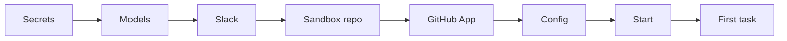

# Set up an instance

From a clean machine to a first pull request that you approve. A person or an agent can follow
it; steps marked **person** need your own accounts and cannot be delegated. Run commands from
the repository root unless a step says otherwise. Examples use the synthetic tenant
`example-solo`; replace `<owner>` with your GitHub login.



An agent must never read, print or commit a secret. The person puts each value into its file,
or explicitly allows the agent to copy one named variable from a local ignored file.

## 0. What you need

- Docker with Compose (Linux, or macOS with Docker Desktop), `git`, the `gh` CLI signed in as
  the owner of the repositories.
- At least one model credential: a Claude subscription or an Anthropic API key, or an OpenAI
  API key. Which one a role runs on is your choice per instance (step 2); a subscription shares its
  limit with your own Claude use (`docs/runbook.md`, "Who uses the model limit").

## 1. Secrets (agent; on Linux a person runs it with `sudo`)

```sh
deploy/init-secrets.sh          # Linux: sudo deploy/init-secrets.sh
```

The script generates the database, service and backup secrets and creates empty GitHub
credential files. Save `restic_password` in a password manager. [Secret inventory](secrets.md)

Before the first Compose command, create the two chat files it mounts for every instance.
Run this from the repository root. Existing files keep their contents. Create the config
directory as your login user so the setup wizard in section 6 can write to it.

```sh
mkdir -p deploy/config
for file in deploy/secrets/chat_bot_token deploy/secrets/chat_app_token; do
  if [ ! -e "$file" ]; then
    if [ "$(uname -s)" = Linux ]; then
      sudo sh -c 'umask 377; touch "$1" && chown 10001 "$1"' sh "$file"
    else
      (umask 377; touch "$file")
    fi
  fi
done
```

For Slack, fill the two prepared files in section 3. This example prompts for the bot
token in zsh and keeps file ownership. Repeat for `chat_app_token` with its own value.

```sh
file=deploy/secrets/chat_bot_token
if read -rs 'V?Token: '; then
  if [ "$(uname -s)" = Linux ]; then
    printf '%s' "$V" | sudo tee "$file" >/dev/null
  else
    (trap 'chmod 0400 "$file"' EXIT; chmod 0600 "$file" && printf '%s' "$V" > "$file")
  fi
fi
unset V
```

## 2. Model credentials (person)

One file per credential in `deploy/secrets/harness/`, named by the variable:

| Provider | File | Where the value comes from |
| --- | --- | --- |
| `claude-sub` (personal instance only) | `CLAUDE_CODE_OAUTH_TOKEN` | `claude setup-token` on a machine where you are signed in |
| `claude-api` | `ANTHROPIC_API_KEY` | the Anthropic console |
| `codex-api` | `OPENAI_API_KEY` | the OpenAI platform |
| `codex-sub` (personal instance only) | `CODEX_ACCESS_TOKEN` | a Codex personal access token of your ChatGPT account (it starts with `at-`; where ChatGPT creates it is not verified yet, see `docs/runbook.md`, "Harness credentials") |

## 3. Choose a door: Slack or no Slack (person)

In section 6, enter your Slack member ID and channel ID to use Slack. Leave both empty
to select `chat: { adapter: inbox }`. With Lead configured, its questions and spec cards
wait in the book.
Compose mounts the empty files from section 1 even when the tenant uses the inbox. After startup, use one of these doors.

| Door | Command |
| --- | --- |
| Terminal | From `deploy/`, run `docker compose exec nightshift nightshift inbox`. Use the same `docker compose exec nightshift nightshift` prefix for `reply <task> "text"`, `approve <task> [card]` and `status`. |
| Claude Code or Desktop | From the repository root, run `claude mcp add nightshift -- docker compose -f "$PWD/deploy/docker-compose.yml" exec -T nightshift nightshift mcp` (the tools `task_add`, `status`, `inbox`, `reply`, `approve`; nothing opens a port) |
| claude.ai project | off by default; set `mcp: { remote: { listen: 127.0.0.1:8765 } }` in the tenant, on a local machine expose the address with ngrok (free plan, runbook "Remote door through ngrok"; a deployed instance uses its own URL) and give the connector the bearer token from `deploy/secrets/mcp_token`; it cannot merge, roll back or change settings. A static-token connector is a beta limited to some organizations (design section 25) |

To use Slack instead, follow the steps below.

1. Get the link that creates the app already filled in, in `deploy/` (it needs section 1
   first):

   ```sh
   docker compose run --rm --build --no-deps -v "$PWD/slack-manifest.yaml:/manifest.yaml:ro" \
     nightshift setup chat-app --manifest /manifest.yaml
   ```

   Follow the printed steps for the two tokens; details:
   [`secrets.md`](secrets.md#slack-app-and-tokens).
2. Invite the bot to your channel: `/invite @nightshift`.
3. Note your member ID (profile > menu > Copy member ID) and the channel ID (channel details,
   at the bottom). Neither is secret.

## 4. Sandbox repository (agent, with the person's OK)

Try the factory on a repository where a mistake costs nothing. It needs a few files and one CI
check on pull requests, because the conductor waits until a check reports.

```sh
gh repo create <owner>/nightshift-sandbox --private --clone && cd nightshift-sandbox
mkdir -p .nightshift .github/workflows
printf '# nightshift-sandbox\n' > README.md
printf 'verify: sh test.sh\n' > .nightshift/project.yaml
printf 'levels:\n  critical:\n    paths: [".github/**", ".nightshift/**"]\n  low:\n    paths: ["**/*.md"]\n' > .nightshift/blast-radius.yaml
printf '#!/bin/sh\nset -e\nfor f in *.sh; do sh -n "$f"; done\n' > test.sh
cat > .github/workflows/ci.yml <<'YAML'
name: ci
on:
  pull_request:
  push:
    branches: [main]
permissions:
  contents: read
jobs:
  test:
    runs-on: ubuntu-24.04
    timeout-minutes: 5
    steps:
      - uses: actions/checkout@3d3c42e5aac5ba805825da76410c181273ba90b1 # v7.0.1
        with:
          persist-credentials: false
      - run: sh test.sh
YAML
git add -A && git commit -m "chore: seed the sandbox" && git push -u origin HEAD:main
```

## 5. GitHub App (person)

The factory acts as its own GitHub App, so its pull requests are not yours and you can approve
them. One app per instance.

Do section 1 first, then, in `deploy/`:

```sh
docker compose run --rm --build --no-deps --user 0 --cap-add CHOWN -p 127.0.0.1:8765:8765 \
  -v "$PWD/secrets:/out" nightshift setup github-app --name nightshift-<owner> --out /out --listen 0.0.0.0:8765
```

1. Open `http://127.0.0.1:8765`, press the button and confirm the app on GitHub. The command
   stores the App ID and the private key in the secrets; nothing is downloaded or copied.
2. Open the install link it prints: your account > **Only select repositories** > the
   tenant's repositories.

### An App made before the Code scanning alerts right

The morning digest and the health tasks read open alerts, which needs **Code scanning alerts: Read-only**.
Open the app's page (GitHub > Settings > Developer settings > GitHub Apps > your app >
**Permissions & events**), set the right, **Save changes**. Then open the installation
(Settings > Applications > Installed GitHub Apps > Configure) and **Accept new permissions**.
Until then the digest says "code-scanning alerts: unknown".

### By hand

If the command cannot be used:

1. Open this pre-filled form (change the name if it is taken), check that the webhook is off,
   and create the app:
   `https://github.com/settings/apps/new?name=nightshift-<owner>&url=https%3A%2F%2Fgithub.com%2F<owner>&public=false&webhook_active=false&contents=write&pull_requests=write&statuses=write&checks=read&actions=read&security_events=read`
   It must have: Contents, Pull requests, Commit statuses read and write; Checks, Actions, Code scanning alerts read.
   Never give it Workflows or Administration.
2. Note the **App ID** on the app's page (not secret).
3. **Private keys > Generate a private key.** A `.pem` file is downloaded.
4. **Install App** > your account > **Only select repositories** > the tenant's repositories.
5. Put both into the secrets (the key file is moved, so no copy stays in Downloads):

```sh
chmod 0600 deploy/secrets/github_app_id deploy/secrets/github_app_key
printf '%s' <app id> > deploy/secrets/github_app_id
cat ~/Downloads/<app name>.*.private-key.pem > deploy/secrets/github_app_key && rm ~/Downloads/<app name>.*.private-key.pem
chmod 0400 deploy/secrets/github_app_id deploy/secrets/github_app_key
```

On Linux run these with `sudo` and keep owner 10001.

## 6. Config (agent)

Once section 1 is done, one command asks for the answers and writes `config/` and `.env`
without overwriting anything, in `deploy/`:

```sh
docker compose run --rm --build --no-deps --user "$(id -u):$(id -g)" -v "$PWD:/out" \
  nightshift setup --out /out
```

Every question is also a flag (`--repo owner/name --providers claude-sub --review all`,
`--ask=false` to take defaults), so an agent can run it without a terminal. Give it the CLI
versions from `npm view @anthropic-ai/claude-code version` and `npm view @openai/codex version`.

The wizard configures Builder. To have Lead turn chat ideas into specs and Verifier review
the resulting changes, edit the tenant's `providers` map before starting. For example,
the following `deploy/config/tenants/example-solo/tenant.yaml` excerpt uses a personal
`claude-sub` provider from `providers.yaml`.

```yaml
providers:
  builder: [claude-sub]
  lead: [claude-sub]
  verifier: [claude-sub]
```

Keep the provider chains you intend for each role. Running a task uses that provider's
credential and subscription allowance or API budget. Get the owner's approval before
running a billable model. The service doctor checks the Builder chain.

### Config by hand

```sh
mkdir -p deploy/config/tenants/example-solo
cp testdata/instances/personal/instance.yaml deploy/config/
cp testdata/tenants/example-solo/tenant.yaml deploy/config/tenants/example-solo/
```

`deploy/config/providers.yaml`, keeping only the providers you have a credential for:

```yaml
claude-sub: { harness: claude, auth: subscription, concurrency: 1, batch: forbidden }
codex-api:  { harness: codex, auth: api_key, key_env: OPENAI_API_KEY, price: { input_per_mtok: 1.25, output_per_mtok: 10 } }
```

`price` (dollars per million tokens, from your provider's price list; the numbers above are
placeholders) lets a pool budget see the spend of `codex`, which reports tokens but no cost.
Without it, the cost of a codex job stays 0.

In `tenant.yaml` set:

| Field | Value |
| --- | --- |
| `repos` | `[github.com/<owner>/nightshift-sandbox]` |
| `people.owner` | `{ chat: <member ID>, github: <owner> }`, with `approvers: [owner]` |
| `chat.channels` | `{ planning: <channel ID> }` |
| `providers` | Use the role map from section 6 for a chat-to-review run. |

`deploy/.env` (ignored by git) pins the agent CLIs, so a later build does not drop one:

```sh
printf 'CLAUDE_CODE_VERSION=%s\nCODEX_VERSION=%s\n' \
  "$(npm view @anthropic-ai/claude-code version)" "$(npm view @openai/codex version)" > deploy/.env
printf 'NIGHTSHIFT_OTLP=http://lgtm:4318\nNIGHTSHIFT_TELEMETRY=1\n' >> deploy/.env
```

Without `npm`, write the versions by hand.

## 7. Start and check (agent)

From the repository root, validate the generated instance, then start the services.

```sh
docker compose -f deploy/docker-compose.yml config --quiet
docker compose -f deploy/docker-compose.yml run --rm --build --no-deps nightshift config validate --config /etc/nightshift
cd deploy && docker compose --profile obs up -d --build
docker compose --profile obs ps -a       # migrate and grafana-login Exited (0); nightshift healthy
docker compose logs nightshift           # "serving"; no "conductor is off"
```

Then let the factory check the setup. Each line is `ok`, or `fail` with the section to
revisit:

```sh
docker compose exec nightshift nightshift doctor
docker compose exec worker nightshift doctor --worker
```

Isolation, from inside the worker as the agent user. Both must fail:

```sh
docker compose exec -u 20001 worker test -r /run/worker-secrets/worker_token
docker compose exec -u 20001 worker ls /repos/<owner>
```

Grafana is on `http://127.0.0.1:3000`: user `admin`, password in `deploy/secrets/grafana_admin_password` (`sudo cat` on Linux).

## 8. First task

To try Lead, send a synthetic idea in the configured planning channel, answer its questions
and approve its spec. With a sandbox repository and an approved model allowance you can
also queue a task directly for Builder from `deploy/`:

```sh
docker compose exec nightshift nightshift task add example-solo "Add greet.sh that prints: hello"
docker compose exec -T postgres psql -U postgres -d book -c \
  "SELECT id, state, pr_number FROM book.tasks ORDER BY id DESC LIMIT 1"
```

It goes `queued`, `building`, `checks`, `review`. With `review.mode: all` it stops in
`human_review` until the **person** approves the pull request on GitHub (Files changed > Review
changes > Approve), and the factory takes it out of draft and merges it.

In a solo sandbox with `review.mode: off`, a noncritical change can advance automatically
when the repository has blast-radius rules and the Verifier passes the current revision.
If the Verifier is unavailable, the task history shows `verifier_unavailable` and the task
waits for an authorized GitHub review. Critical changes always require review.

## When it stops

Run the two `doctor` commands of section 7 first.

| Symptom | Look at |
| --- | --- |
| `conductor is off` | `github_app_id` and `github_app_key` are both filled |
| Task `escalated` | `SELECT kind, payload FROM book.events WHERE task_id = <id>` and `docker compose logs worker nightshift` |
| Task stays in `checks` | The repository has no CI check on pull requests |
| Bot ignores a message | Member ID and channel ID in `tenant.yaml`; the bot is in the channel |
| Network error in a job | The host is not in `deploy/egress-acl.yaml` (changing it needs the owner) |

Backups, rotation and recovery: [`runbook.md`](runbook.md).
