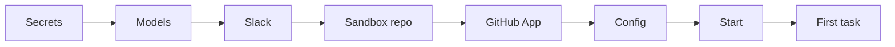

# Set up an instance

From a clean machine to a first pull request that you approve. A person or an agent can follow
it; steps marked **person** need your own accounts and cannot be delegated. Run commands from
the repository root unless a step says otherwise. Examples use the synthetic tenant
`example-solo`; replace `<owner>` with your GitHub login.



An agent must never read, print or commit a secret. The person puts each value into its file,
or explicitly allows the agent to copy one named variable from a local ignored file.

## 0. What you need

- Docker with Compose (Linux, or macOS with Docker Desktop), `git`, the `gh` CLI signed in as
  the owner of the repositories.
- At least one model credential: a Claude subscription or an Anthropic API key, or an OpenAI
  API key.

## 1. Secrets (agent; on Linux a person runs it with `sudo`)

```sh
deploy/init-secrets.sh          # Linux: sudo deploy/init-secrets.sh
```

It creates every file in `deploy/secrets/` and keeps existing ones. Save `restic_password` in
a password manager. What each file is: [`secrets.md`](secrets.md).

To fill a file that already exists: `chmod 0600 <file>`, write, `chmod 0400 <file>`. On Linux
keep the owner listed in `secrets.md`. To type a value without echo or shell history (zsh):

```sh
read -rs 'V?value: ' && printf '%s' "$V" > deploy/secrets/<file>; unset V
```

## 2. Model credentials (person)

One file per credential in `deploy/secrets/harness/`, named by the variable:

| Provider | File | Where the value comes from |
| --- | --- | --- |
| `claude-sub` (personal instance only) | `CLAUDE_CODE_OAUTH_TOKEN` | `claude setup-token` on a machine where you are signed in |
| `claude-api` | `ANTHROPIC_API_KEY` | the Anthropic console |
| `codex-api` | `OPENAI_API_KEY` | the OpenAI platform |

## 3. Slack (person; optional)

Skip it by setting `chat: { adapter: fake }` in the tenant; put any placeholder text into
`chat_bot_token` and `chat_app_token`, because Compose needs the files.

1. Get the link that creates the app already filled in, in `deploy/` (it needs section 1
   first):

   ```sh
   docker compose run --rm --build --no-deps -v "$PWD/slack-manifest.yaml:/manifest.yaml:ro" \
     nightshift setup chat-app --manifest /manifest.yaml
   ```

   Follow the printed steps for the two tokens; details:
   [`secrets.md`](secrets.md#slack-app-and-tokens).
2. Invite the bot to your channel: `/invite @nightshift`.
3. Note your member ID (profile > menu > Copy member ID) and the channel ID (channel details,
   at the bottom). Neither is secret.

## 4. Sandbox repository (agent, with the person's OK)

Try the factory on a repository where a mistake costs nothing. It needs a few files and one CI
check on pull requests, because the conductor waits until a check reports.

```sh
gh repo create <owner>/nightshift-sandbox --private --clone && cd nightshift-sandbox
mkdir -p .nightshift .github/workflows
printf '# nightshift-sandbox\n' > README.md
printf 'verify: sh test.sh\n' > .nightshift/project.yaml
printf 'levels:\n  critical:\n    paths: [".github/**", ".nightshift/**"]\n  low:\n    paths: ["**/*.sh", "**/*.md"]\n' > .nightshift/blast-radius.yaml
printf '#!/bin/sh\nset -e\nfor f in *.sh; do sh -n "$f"; done\n' > test.sh
cat > .github/workflows/ci.yml <<'YAML'
name: ci
on:
  pull_request:
  push:
    branches: [main]
permissions:
  contents: read
jobs:
  test:
    runs-on: ubuntu-24.04
    timeout-minutes: 5
    steps:
      - uses: actions/checkout@3d3c42e5aac5ba805825da76410c181273ba90b1 # v7.0.1
        with:
          persist-credentials: false
      - run: sh test.sh
YAML
git add -A && git commit -m "chore: seed the sandbox" && git push -u origin HEAD:main
```

## 5. GitHub App (person)

The factory acts as its own GitHub App, so its pull requests are not yours and you can approve
them. One app per instance.

Do section 1 first, then, in `deploy/`:

```sh
docker compose run --rm --build --no-deps --user 0 --cap-add CHOWN -p 127.0.0.1:8765:8765 \
  -v "$PWD/secrets:/out" nightshift setup github-app --name nightshift-<owner> --out /out --listen 0.0.0.0:8765
```

1. Open `http://127.0.0.1:8765`, press the button and confirm the app on GitHub. The command
   stores the App ID and the private key in the secrets; nothing is downloaded or copied.
2. Open the install link it prints: your account > **Only select repositories** > the
   tenant's repositories.

### By hand

If the command cannot be used:

1. Open this pre-filled form (change the name if it is taken), check that the webhook is off,
   and create the app:
   `https://github.com/settings/apps/new?name=nightshift-<owner>&url=https%3A%2F%2Fgithub.com%2F<owner>&public=false&webhook_active=false&contents=write&pull_requests=write&statuses=write&checks=read&actions=read`
   It must have: Contents, Pull requests, Commit statuses read and write; Checks, Actions read.
   Never give it Workflows or Administration.
2. Note the **App ID** on the app's page (not secret).
3. **Private keys > Generate a private key.** A `.pem` file is downloaded.
4. **Install App** > your account > **Only select repositories** > the tenant's repositories.
5. Put both into the secrets (the key file is moved, so no copy stays in Downloads):

```sh
chmod 0600 deploy/secrets/github_app_id deploy/secrets/github_app_key
printf '%s' <app id> > deploy/secrets/github_app_id
cat ~/Downloads/<app name>.*.private-key.pem > deploy/secrets/github_app_key && rm ~/Downloads/<app name>.*.private-key.pem
chmod 0400 deploy/secrets/github_app_id deploy/secrets/github_app_key
```

On Linux run these with `sudo` and keep owner 10001.

## 6. Config (agent)

```sh
mkdir -p deploy/config/tenants/example-solo
cp testdata/instances/personal/instance.yaml deploy/config/
cp testdata/tenants/example-solo/tenant.yaml deploy/config/tenants/example-solo/
```

`deploy/config/providers.yaml`, keeping only the providers you have a credential for:

```yaml
claude-sub: { harness: claude, auth: subscription, concurrency: 1, batch: forbidden }
codex-api:  { harness: codex, auth: api_key, key_env: OPENAI_API_KEY }
```

In `tenant.yaml` set:

| Field | Value |
| --- | --- |
| `repos` | `[github.com/<owner>/nightshift-sandbox]` |
| `people.owner` | `{ chat: <member ID>, github: <owner> }`, with `approvers: [owner]` |
| `chat.channels` | `{ planning: <channel ID> }` |
| `providers` | `{ builder: [claude-sub] }` |

`deploy/.env` (ignored by git) pins the agent CLIs, so a later build does not drop one:

```sh
printf 'CLAUDE_CODE_VERSION=%s\nCODEX_VERSION=%s\n' \
  "$(npm view @anthropic-ai/claude-code version)" "$(npm view @openai/codex version)" > deploy/.env
printf 'NIGHTSHIFT_OTLP=http://lgtm:4318\nNIGHTSHIFT_TELEMETRY=1\n' >> deploy/.env
```

Without `npm`, write the versions by hand.

## 7. Start and check (agent)

```sh
cd deploy && docker compose --profile obs up -d --build
docker compose --profile obs ps -a       # all Up; migrate Exited (0); nightshift healthy
docker compose logs nightshift           # "serving"; no "conductor is off"
```

Then let the factory check the setup. Each line is `ok`, or `fail` with the section to
revisit:

```sh
docker compose exec nightshift nightshift doctor
docker compose exec worker nightshift doctor --worker
```

Isolation, from inside the worker as the agent user. Both must fail:

```sh
docker compose exec -u 20001 worker cat /run/worker-secrets/worker_token
docker compose exec -u 20001 worker ls /repos/<owner>
```

Grafana is on `http://127.0.0.1:3000`.

## 8. First task

Until Lead exists the owner queues a task (agent, in `deploy/`):

```sh
docker compose exec nightshift nightshift task add example-solo "Add greet.sh that prints: hello"
docker compose exec -T postgres psql -U postgres -d book -c \
  "SELECT id, state, pr_number FROM book.tasks ORDER BY id DESC LIMIT 1"
```

It goes `queued`, `building`, `checks`, `review`. With `review.mode: all` it stops in
`human_review` until the **person** approves the pull request on GitHub (Files changed > Review
changes > Approve), and the factory takes it out of draft and merges it.

For a sandbox without a manual step, set `review.mode: off` in `tenant.yaml` and restart
`nightshift`: the task goes on to `merging` and `released`. This needs
`.nightshift/blast-radius.yaml` in the repository (without rules every change goes to a
person), still holds a `critical` change, and is not allowed for `governance: team`. Keep a
review on any repository that matters; a task already in `human_review` still waits.

## When it stops

Run the two `doctor` commands of section 7 first.

| Symptom | Look at |
| --- | --- |
| `conductor is off` | `github_app_id` and `github_app_key` are both filled |
| Task `escalated` | `SELECT kind, payload FROM book.events WHERE task_id = <id>` and `docker compose logs worker nightshift` |
| Task stays in `checks` | The repository has no CI check on pull requests |
| Bot ignores a message | Member ID and channel ID in `tenant.yaml`; the bot is in the channel |
| Network error in a job | The host is not in `deploy/egress-acl.yaml` (changing it needs the owner) |

Backups, rotation and recovery: [`runbook.md`](runbook.md).
