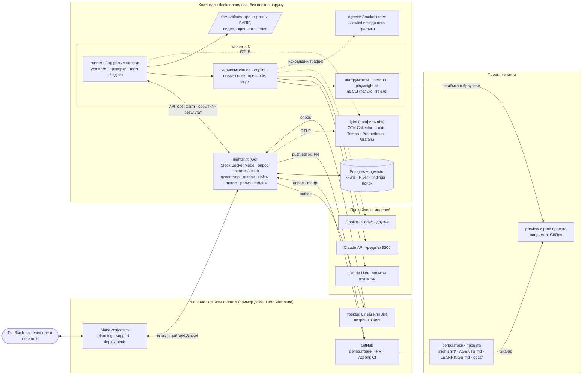
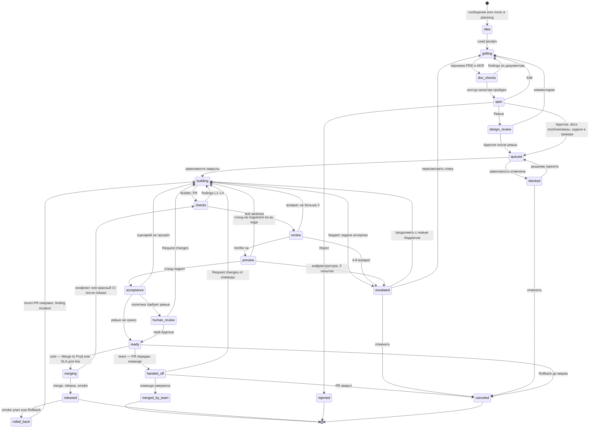
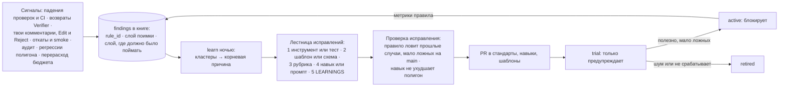

> ARCHIVE. Original Russian draft of the design, frozen on 2026-11-24. Do not use, edit or cite it. The current design is docs/design.md in the nightshift repository.

# Nightshift — фабрика разработки

> 24.11.2026 · Nightshift — отдельный продукт со своим репозиторием `nightshift`, своими версиями и своим планом. Один код и одни образы работают в разных инстансах, например **домашнем** (личные проекты) и **рабочем** (проекты работодателя). Документ описывает только ядро: конкретные проекты настраиваются своими паками и в нём не упоминаются (раздел 17). Место документа — `docs/design.md` репозитория `nightshift`.
> Принцип: keep it simple. Всё, без чего можно стартовать, — в разделе «Позже». «Ты» в документе — роль `owner` тенанта; где одобряют другие люди (`approvers`), это сказано явно.

## 0. Решения коротко

| Вопрос | Решение |
|---|---|
| Что это | Автономная фабрика разработки (уровень 4–5, dark factory): идея в Slack → спека → код → проверки → preview → карточка с доказательствами → прод по твоей кнопке |
| Люди | `owner` — владелец продукта и архитектор (human-on-the-loop), код не пишет. `approvers` — кто одобряет спеки и PR: дома это ты, на работе — команда по правилам репозитория. Общение — чат (Slack), на работе также GitHub и трекер (раздел 11) |
| Кастомизация | Ядро одно. Проект настраивается тремя слоями под ним: паки (стек, профиль, адаптеры), тенант (`tenant.yaml`, секреты, провайдеры), проект (`.nightshift/`, свои инструкции, skills и стандарты). Ядро проверяется на синтетических тенантах (раздел 17) |
| Инстансы и тенанты | **Инстанс — граница доверия:** дома и на работе — отдельные инстансы из одного кода и образов, со своими провайдерами моделей, секретами, книгой и логами. **Тенант — граница проекта** внутри инстанса. Профиль тенанта `governance: solo | team` решает, кто одобряет, мержит ли фабрика сама и где заканчивает работу (разделы 7, 11, 17) |
| Качество до человека | Многослойный контур: шаблоны и стандарты на входе → линтеры, анализаторы и тесты → метрики изменений → LLM-проверки по рубрикам → Verifier. Ты видишь результат только после всех слоёв (раздел 8) |
| Ревью человеком | Спека всегда спрашивает, хочешь ли ты её отревьюить. Для PR и документов есть переключатель режима (`all` / `blast_radius` / `off`) и настраиваемые правила blast radius: тесты и мелкие фиксы проходят сами, критичная логика, архитектура, инфраструктура и платежи идут к тебе (раздел 11) |
| Пульт | Slack: каналы для работы, вкладка Home приложения — пульт (что в работе, очередь ревью, переключатели, лимиты). Grafana — для глубокой диагностики (раздел 15) |
| Самоулучшение | Каждая ошибка — запись `finding`. Ночью learn превращает повторяющиеся ошибки в самое дешёвое исправление (проверка → шаблон → рубрика → навык → заметка), проверяет его на полигоне и предлагает PR (раздел 10) |
| Запуск | Один `docker compose up`: Postgres + `nightshift` + `worker` + `egress` (прокси исходящего трафика). Наблюдаемость и CI-runner — профили. Ни одного порта наружу |
| Книга учёта | Postgres — источник истины: задачи, события, очередь (River), ревью, findings, бюджеты, поиск. Чат и трекер — проекции |
| Роли | 3 агента — **Lead, Builder, Verifier** — и ночное задание **learn**. Роль = YAML-конфиг. Остальное — Go-код и инструменты |
| Навыки | Готовые наборы по стандарту Agent Skills (официальные от вендоров технологий + проверенные community), вендоринг по SHA, проверка безопасности и отбор на полигоне; свои — только для специфики фабрики (раздел 12) |
| Язык и режим | Артефакты — на английском, общаться можно по-русски. Днём — диалог и решения, ночью (22:00–09:00) — работа без сообщений, утром — сводка |
| Тестирование | Код фабрики — детерминированные тесты без моделей ($0): unit, свойства, интеграция, сценарии на двойниках с адаптером `fake`, сбои, побег из песочницы. Качество агентов — evals на полигоне: сначала оценщики-код, LLM-судьи только для документов, запускается только затронутое изменением, лимит $60 в месяц (раздел 20) |
| Агенты и вендоры | Все роли — через адаптеры харнесов (`claude`, `copilot`, позже `codex`, `opencode`, `acpx`) в контейнере `worker`. Провайдер — строка в конфиге. Провайдеры у каждого инстанса свои: дома — подписка Ultra и её API-кредиты, на работе — Claude или Copilot по лицензии компании (раздел 12) |
| Стек | Фабрика: Go 1.27 (ядро), Python (evals, транскрипция), Postgres 17 + pgvector, River, slack-go, OpenTelemetry, grafana/otel-lgtm, Smokescreen. Проекты — любой стек через stack packs (`go`, `python`, `ts`, позже `java-maven`) (раздел 5) |
| Бюджет | Дома — $200 в месяц (Claude Ultra и его $200 API-кредитов), инфраструктура локально, $0, Slack, Linear, GitHub, LangSmith — бесплатные тарифы. В рабочем инстансе — лицензии и бюджет работодателя |
| Где живёт | Домашний инстанс — на твоей машине, позже тот же compose на VM в Hetzner или AWS. Рабочий — на инфраструктуре работодателя, никогда на личной машине рядом с домашним |
| Репозитории | Дома — приватные, гейты держит сама фабрика, CI укладывается в бесплатный объём GitHub или уходит на self-hosted runner. На работе — репозитории организации: мержит команда по branch protection, фабрика передаёт готовый PR |

## 1. Что это и для кого

**Для кого.** Разработчик, который ведёт личные продукты и работает в команде. Дома фабрика делает всё до прода по твоей кнопке. На работе она доводит задачу до PR, готового к ревью командой, с доказательствами, а мержит и деплоит команда своим процессом.

**Как это выглядит.** Ты пишешь или надиктовываешь идею в `#planning`. Lead изучает код и практики, задаёт по 1–2 вопроса, спорит, если идея слабая, и готовит короткие PRD и ADR со схемами. Документы проходят контур качества (шаблон, doc-lint, LLM-рубрики) и только потом попадают к тебе с вопросом «Хочешь отревьюить?» и кнопками Approve / Ревью / Edit / Reject. После Approve Builder пишет код до зелёных проверок, Verifier проверяет код и проходит скрытые сценарии на preview. Если PR попадает под политику ревью, тебя отмечают в Slack. В `#deployments` приходит карточка: ссылки, видео, скриншоты, цифры и кнопки Merge to Prod / Rollback. На работе путь тот же до ревью, но заканчивается состоянием `handed_off`: PR с доказательствами передан команде.

**Чем это отличается от Claude Code, OpenCode или Deep Agents с навыками.** Харнес — это один инженер: одна сессия, одна задача, рядом сидит человек, который запускает, смотрит и мержит. Он сам пишет на диск память и `CLAUDE.md`, но только в рамках своей сессии и своей машины. Фабрика — это всё вокруг инженеров. Она не заменяет харнес, а запускает его внутри job:

| Нужно | Харнес с навыками | Фабрика |
|---|---|---|
| Написать код по задаче | Да | Да (через харнес) |
| Работать, пока ты спишь, по очереди из многих задач | Нет | Очередь, планировщик, бюджеты |
| Принимать задачи из чата, отвечать карточками, вести трекер | Нет | Да |
| Не дать смержить без проверок и твоего Approve | На честном слове | Гейты в коде |
| Помнить решения между задачами, ролями и вендорами | Частично, локально | Книга + поиск |
| Изоляция, секреты, откат прода | Нет | Да |
| Учиться на твоих правках и ошибках | Нет | findings → правила |

Риск переусложнения реален. Поэтому план идёт фазами, и фазы 0–3 — минимальное ядро, которое уже даёт пользу: Slack → PR с проверками → твоя кнопка. Каждая следующая фаза делается, только когда без неё уже больно.

**Три обязательных свойства:**
1. **Отдельный продукт.** Свой репозиторий и образы с версиями. Ничего про конкретные проекты в коде фабрики нет.
2. **Новый проект подключается конфигом** в любом инстансе — со своим чатом, трекером, репозиторием, стеком и профилем управления — без изменения кода фабрики (раздел 17).
3. **Фабрика улучшает себя сама** на твоей обратной связи, результатах проверок и аудитов, но не может ослабить собственные гейты без твоего решения (раздел 10).

## 2. Принципы

1. **Одна база.** Postgres — книга, очередь и поиск. Ни Kafka, ни Redis, ни Temporal, ни отдельной векторной БД.
2. **Книгу пишет программа, а не агент.** Каждый ход агента записывается раннером до и после выполнения.
3. **Агент — только там, где нужно суждение.** Диспетчер, гейты, merge, релиз, синхронизация, сторож — Go-код.
4. **Побочные эффекты делает код.** Агент возвращает результат по JSON-схеме. Push, PR, merge, сообщения в чат и трекер делает сервис `nightshift`. Токенов GitHub, чата и трекера нет ни у агента, ни у worker.
5. **Дешёвая проверка раньше дорогой.** Сначала детерминированные инструменты (секунды, $0), потом LLM-рубрики, потом сильная модель, потом человек.
6. **Правило — в инструмент, слово — последним.** Найденная ошибка становится линтером, правилом анализатора, тестом или схемой; текст в навыке или `LEARNINGS.md` — только если иначе нельзя.
7. **Гейты в коде фабрики.** Merge невозможен, пока не прошли проверки и, если политика требует, нет Approve нужных людей. В профиле `solo` мержит только `nightshift`, ruleset GitHub — дополнительная защита. В профиле `team` мержит команда по правилам репозитория, а фабрика только передаёт PR.
8. **Необратимое — только по кнопке человека.** Прод-деплой, прод-миграции, биллинг, удаление данных, доступы и секреты. Шлюз — код без ИИ. Единственное исключение — заранее включённое владельцем разрешение SLA для blast radius `low` в профиле `solo` (раздел 7); уровень `critical` под него не попадает никогда, в профиле `team` SLA нет.
9. **Доказательства, а не слова.** Считаются артефакты: отчёты инструментов, видео, скриншоты, trace, цифры до и после.
10. **Тяжёлое — в файлы.** Логи, транскрипты, отчёты SARIF, видео — в томе `artifacts`. В промпт попадает путь и краткая сводка.
11. **Документы — для человека.** PRD, ADR и дизайн компонентов короткие, по шаблону, со схемой mermaid.
12. **Инструкции проекта — его собственные.** Если у проекта уже есть `AGENTS.md`, skills и конфиги агентов, фабрика использует их как есть. Проекту без своих инструкций фабрика создаёт `AGENTS.md` — индекс на ~100 строк со ссылками на стандарты, `docs/`, навыки, глоссарий и `LEARNINGS.md`.
13. **Проект описывает себя сам.** Команды проекта — только из `.nightshift/project.yaml`, и всегда в версии из `main`, а не из ветки PR.
14. **Нет привязки к вендору.** Продукты вендоров (Claude Tag, Claude Code Projects, облачные агенты) — опция, не основа.
15. **Языки.** Код фабрики: Go — ядро, Python — evals и данные, TypeScript — только фронтенд и e2e фабрики; Java в коде фабрики нет, Rust — только при явной необходимости и с ADR. Проекты — на любом стеке: инструменты качества для них подключают stack packs.
16. **Рабочий язык — английский.** PRD, ADR, стандарты, навыки, код, комментарии, PR, коммиты, задачи в трекере и карточки — на английском. Ты можешь писать Lead по-русски: он ответит в треде по-русски, но всё, что уходит в git, трекер и карточки, остаётся на английском. Doc-lint это проверяет.
17. **Инстанс — граница доверия.** Личный и корпоративный код, их провайдеры, секреты, книга, артефакты и логи никогда не живут в одном инстансе.

## 3. Архитектура стартовой версии



```yaml
# deploy/docker-compose.yml
x-hardened: &hardened
  read_only: true
  security_opt: ["no-new-privileges:true"]
  cap_drop: [ALL]
  tmpfs: ["/tmp"]

services:
  postgres:
    image: pgvector/pgvector:pg17
    environment: { POSTGRES_PASSWORD_FILE: /run/secrets/pg_admin }
    secrets: [pg_admin]
    volumes: ["pgdata:/var/lib/postgresql/data"]
    networks: [core]
    healthcheck: { test: ["CMD", "pg_isready"], interval: 5s }

  nightshift:                               # Go: Slack, опрос, диспетчер, outbox, гейты, merge, релиз
    build: { context: .., target: nightshift }   # образы собираются локально
    <<: *hardened
    user: "10001"
    secrets: [pg_nightshift, tenants, worker_token_sha256]   # секреты всех тенантов — только этому сервису
    volumes: ["artifacts:/artifacts", "repos:/repos"]   # repos — зеркала репозиториев тенантов
    networks: [core, jobs, internet]
    depends_on: { postgres: { condition: service_healthy } }
    healthcheck: { test: ["CMD", "nightshift", "status", "--health"], interval: 15s }
    restart: unless-stopped

  worker:                                   # один job за раз; параллельность = число реплик; к Postgres доступа нет
    build: { context: .., target: worker }
    <<: *hardened
    cap_add: [SETUID, SETGID]               # runner (root без других прав) запускает агента под uid 20001
    shm_size: 1gb                           # Chromium для Playwright
    secrets: [worker_token, harness]        # токен к API jobs + учётные данные харнесов
    volumes: ["work:/work", "artifacts:/artifacts", "agent-home:/home/agent", "repos:/repos:ro"]   # HOME агента; зеркала репозиториев только на чтение
    networks: [jobs]                        # без выхода наружу
    environment:
      HTTPS_PROXY: "http://egress:4750"
      NO_PROXY: "nightshift,lgtm"
      CLAUDE_CODE_DISABLE_NONESSENTIAL_TRAFFIC: "1"
    deploy: { replicas: 2, resources: { limits: { cpus: "4", memory: 8g, pids: 2048 } } }
    healthcheck: { test: ["CMD", "nightshift", "status", "--health"], interval: 15s }
    restart: unless-stopped

  egress:                                   # Smokescreen: единственный выход worker наружу, по allowlist
    image: ghcr.io/stripe/smokescreen:<версия>
    command: ["--egress-acl-file", "/etc/smokescreen/acl.yaml"]
    volumes: ["./egress-acl.yaml:/etc/smokescreen/acl.yaml:ro"]
    networks: [jobs, internet]
    restart: unless-stopped

  egress-ci:                                # профиль ci: свой Smokescreen для gh-runner — без mTLS все клиенты получают роль default, поэтому роли = отдельные экземпляры
    image: ghcr.io/stripe/smokescreen:<версия>
    profiles: [ci]
    command: ["--egress-acl-file", "/etc/smokescreen/acl.yaml"]
    volumes: ["./egress-ci-acl.yaml:/etc/smokescreen/acl.yaml:ro"]
    networks: [ci, internet]
    restart: unless-stopped

  lgtm:                                     # профиль obs: логи, метрики, трейсы
    image: grafana/otel-lgtm:<версия>
    profiles: [obs]
    environment:
      GF_SECURITY_ADMIN_PASSWORD__FILE: /run/secrets/grafana_admin
      GF_ANALYTICS_REPORTING_ENABLED: "false"
      GF_ANALYTICS_CHECK_FOR_UPDATES: "false"
    secrets: [grafana_admin]
    ports: ["127.0.0.1:3000:3000"]          # Grafana только с локальной машины
    volumes: ["lgtm:/data"]
    networks: [core, jobs, ui]              # ui — потому что порт нельзя опубликовать из internal-сети

  gh-runner:                                # профиль ci: эфемерный self-hosted GitHub runner без Docker-сокета
    build: { context: .., target: gh-runner }
    profiles: [ci]
    environment: { HTTPS_PROXY: "http://egress-ci:4750" }
    networks: [ci]                          # код из веток PR не видит API jobs

networks:
  core: { internal: true }                  # Postgres, nightshift, lgtm
  jobs: { internal: true }                  # worker ↔ nightshift (API jobs), lgtm, egress
  ci: { internal: true }                    # gh-runner ↔ egress-ci
  ui: {}                                    # только для публикации Grafana на 127.0.0.1
  internet: {}

secrets:                                    # файлы в deploy/secrets/, права 0400, владелец — uid сервиса, который их читает; не в git
  pg_admin: { file: ./secrets/pg_admin }
  pg_nightshift: { file: ./secrets/pg_nightshift }
  worker_token: { file: ./secrets/worker_token }                 # создаёт nightshift doctor --init
  worker_token_sha256: { file: ./secrets/worker_token.sha256 }   # nightshift проверяет токен по хешу
  grafana_admin: { file: ./secrets/grafana_admin }
  harness: { file: ./secrets/harness.env }
  tenants: { file: ./secrets/tenants }      # каталог с secrets.env всех тенантов

volumes: { pgdata: {}, work: {}, artifacts: {}, agent-home: {}, repos: {}, lgtm: {} }
```

- **Очередь** — River поверх той же Postgres, только внутри `nightshift`: ретраи с backoff, уникальные задания, периодические задания (learn, audit, сверка Linear), транзакционная постановка вместе с изменением состояния.
- **Worker не ходит в базу.** Он забирает job через внутренний HTTP API `nightshift` в сети `jobs`: `claim` (long-poll), `heartbeat`, `events`, `complete`. Worker аутентифицируется токеном `worker_token`, на каждый job выдаётся свой короткий токен, ограниченный задачей и ролью (его же использует `ns` CLI). Так проще права: River — клиент только в `nightshift` (River выбирает лидера среди клиентов, и лидер чистит и планирует задания, поэтому клиент с урезанными правами в worker сломался бы), а агент физически не может дотянуться до книги.
- **Изоляция** — один job на контейнер worker: файлы и процессы разных jobs не пересекаются. На задачу свой worktree в `/work/<tenant>/<task>`; агент пишет только в свой worktree и свой каталог артефактов job. Docker-in-Docker не нужен.
- **Сети.** Worker и gh-runner сидят в разных сетях без выхода наружу (gh-runner выполняет код из веток PR, поэтому не видит API jobs); в интернет — только через свой Smokescreen (`egress` и `egress-ci`) по allowlist, приватные диапазоны (домашняя сеть, API кластера) запрещены, хосты preview разрешены точечно. Наружу ходит только `nightshift` (чат, трекер, GitHub).
- **Роли Postgres.** `nightshift` — права на книгу, но без `UPDATE` и `DELETE` на `events`. `grafana_ro` — только чтение представлений для дашбордов (без скрытых сценариев и секретов). Миграции — отдельной ролью-владельцем схемы, только в `deploy/upgrade.sh`.
- **Пользователи в worker.** Runner — root без capabilities, кроме `SETUID` и `SETGID`; агент и все команды проекта — uid 20001 без прав на `/run/secrets` (файлы 0400, владелец root). Chromium Playwright работает без собственной песочницы (по умолчанию в Playwright), изоляцию даёт контейнер.
- **Образы** собираются локально (`docker compose build`) — для одной машины реестр не нужен. Если понадобится реестр (VPS, второй хост), подойдёт GHCR: хранение и трафик Container registry GitHub сейчас бесплатны, о плате GitHub обещает предупредить заранее.
- **Где запускать.** Домашний инстанс — сейчас локально; позже тот же compose переезжает на VM в Hetzner или AWS без изменений в коде. Рабочий инстанс — на машине или VM работодателя.
- **Два инстанса.** Домашний и рабочий запускаются одним compose из одних образов. Различаются только `instance.yaml` (домен доверия, провайдеры, allowlist egress), каталог `tenants/` и секреты. Общее у них — только код в git; книги, артефакты, логи и секреты раздельны.

## 4. Компоненты

| Компонент | Назначение | Вход → выход | Где живёт | Язык |
|---|---|---|---|---|
| **nightshift** | Ядро: тенанты, адаптеры чата и трекера, проекции, диспетчер и справедливое планирование, API jobs для worker, роутер провайдеров, зеркала репозиториев и push, гейты, merge-поезд, релиз, outbox, индексатор, сторож | События чата, опрос трекера и GitHub, результаты jobs → книга, jobs, карточки, merge (в `solo`) | Контейнер `nightshift` | Go |
| **Книга** | Источник истины и очередь | `tasks`, `events`, `river_job`, `job_results`, `outbox`, `reviews`, `findings`, `standards_index`, `documents`, `budgets`, `settings`, `eval_runs` | Контейнер `postgres` | SQL |
| **runner** | Берёт job через API jobs, готовит worktree из зеркала репозитория (том `repos`, только чтение), подбирает стандарты и навыки, запускает роль и проверки под пользователем агента, отдаёт результат и патч | Job + роль → результат по схеме, патч, отчёты с sha256, usage | Контейнер `worker`, отдельный от агента пользователь ОС | Go |
| **Адаптеры харнесов** | Единый интерфейс к агентам и моделям (`claude`, `copilot`, `api`, `fake`, позже `codex`, `opencode`, `acpx`) | `Run(RunRequest)` → `RunResult`: результат по схеме, сессия, путь к транскрипту, usage, причина выхода (раздел 21) | Внутри runner; ночные batch-вызовы судей evals отправляет `nightshift` | Go |
| **ns CLI** | Инструменты агента только для чтения: поиск, стандарты, задача. Доступ ограничен ролью | Запрос + токен job → JSON со ссылками | Образ worker, ходит в `nightshift` | Go |
| **nightshift check** | `verify` проекта плюс проверки фабрики (gitleaks, osv-scanner, opengrep, doc-lint); приводит отчёты к SARIF и превращает новые нарушения в findings | Worktree + стандарты + базовая линия `main` → SARIF, findings | Внутри runner, выполняется под пользователем агента | Go |
| **doc-lint** | Структура документов: шаблон, разделы, лимиты длины, схема, front matter | Markdown → нарушения | Подкоманда `nightshift check` | Go |
| **Политика ревью** | Считает blast radius, решает, нужен ли человек; очередь ревью, напоминания | Задача, diff, теги, правила, переключатель → уровень, запрос ревью, `reviews` | Внутри `nightshift` | Go |
| **Пульт** | Вкладка Home Slack-приложения: что в работе, очередь ревью, переключатели, лимиты, контекст задачи | Книга, `settings` → вид Block Kit; клики → события и изменения настроек | Внутри `nightshift` | Go |
| **learn и audit** | Цикл самоулучшения и периодический аудит (раздел 10) | findings, отчёты → PR со стандартами, навыками, правилами | Периодические jobs River | Go + роли агентов |
| **Полигон и evals** | Регрессионные прогоны фабрики на эталонных задачах | Набор задач → метрики качества, стоимости, времени | Репозиторий `nightshift-polygon` + CI фабрики | Python |
| **Транскрипция** | Голосовые в Slack → текст | Аудио → текст в треде и книге | Job в worker, faster-whisper на CPU | Python |
| **Адаптеры интеграций** | Трекер (Linear; позже Jira), документы (git; позже Confluence), чат (своё Slack-приложение; на работе — корпоративный Slack или только GitHub), внешние проверки (CodeQL, Sonar как findings), логи (позже Splunk, только чтение) | Команды ядра → вызовы API; внешние события → события книги | Внутри `nightshift`, `internal/adapters/` | Go |
| **Stack packs** | Инструменты качества, конфиги и образ worker под стек проекта | `project.yaml: stack` → инструменты, конфиги, образ | `nightshift/stacks/<pack>/` | Dockerfile, YAML |
| **Tenant pack** | Всё, что фабрика знает о проекте | Файлы → загрузка при старте | `tenants/<имя>/` + `.nightshift/` в репозитории | YAML, Markdown |

## 5. Стек и инструменты

Версии всех инструментов закреплены в `mise.toml`, контрольные суммы — в `mise.lock` (lockfile включён); одинаково в образе worker и в CI. Версия `claude` тоже закреплена (см. раздел 12).

### Сама фабрика

| Слой | Выбор | Зачем |
|---|---|---|
| Язык ядра | Go 1.27 | Один бинарник `nightshift` с подкомандами `serve`, `work`, `check`, `standards`, `skills`, `tenant`, `eval`, `doctor`, `status` |
| База | Postgres 17 + pgvector | Книга, очередь, поиск в одной базе |
| Очередь | River (MPL-2.0) | Задания поверх Postgres: ретраи, уникальность, cron-задания, транзакционная постановка, плагин OpenTelemetry |
| Доступ к БД | pgx v5, sqlc, goose | Типизированные запросы, миграции только расширяющие |
| Интеграции | slack-go (Socket Mode, Block Kit), genqlient (Linear GraphQL), go-github + GitHub App | Без входящих портов |
| Конфиг и схемы | YAML + JSON Schema (santhosh-tekuri/jsonschema) | Валидация tenant pack, ролей и результатов агентов |
| Логи и телеметрия | log/slog (JSON) + OpenTelemetry Go SDK | Один формат для логов, трейсов и метрик |
| Тесты | go test (+ `-fuzz`), rapid для свойств машины состояний, httptest-двойники Slack, Linear и GitHub, адаптер `fake` со сценариями; интеграционные тесты с настоящей Postgres (testcontainers-go) — только в CI (L3), потому что в worker нет Docker-сокета | Вся логика фабрики тестируется без сети, токенов и моделей (раздел 20) |
| Python | uv, ruff, mypy, pytest | Оценщики evals полигона, транскрипция (faster-whisper) |
| CI фабрики | GitHub Actions, actions закреплены по SHA коммита; Dependabot | Защита от подмены тегов actions |

### Инструменты качества (stack packs: образ worker собирается из паков тенанта)

| Область | Инструменты | Что ловят |
|---|---|---|
| Go | golangci-lint v2 (staticcheck, gosec, errcheck, revive, gocognit, dupl, depguard), govulncheck | Ошибки, уязвимые конструкции, сложность, нарушения слоёв, уязвимые зависимости с учётом достижимости |
| Python | ruff (линт, формат, правила bandit), mypy, pytest + coverage | Стиль, типы, небезопасные вызовы, тесты |
| TypeScript (e2e, фронтенд) | tsc, ESLint, Playwright Test | Типы, e2e |
| Свои правила | Opengrep (LGPL-форк Semgrep, тот же формат правил) | Правила проекта и найденные фабрикой антипаттерны |
| Секреты | gitleaks | Ключи и токены в diff и истории |
| Зависимости | osv-scanner (все экосистемы), govulncheck | Известные уязвимости |
| Миграции Postgres | squawk | Блокирующие и ломающие миграции |
| Контейнеры и CI | hadolint, actionlint, zizmor, shellcheck | Ошибки Dockerfile, небезопасные workflows (инъекции шаблонов, утечки токенов) |
| Метрики изменений | Старт: размер diff, новые зависимости, покрытие из `go test -cover` и coverage.py. Позже: diff-cover, jscpd | Раздутые PR, непокрытый новый код, дубли |
| Документы (на английском) | doc-lint, markdownlint-cli2, mermaid-cli, Vale с готовыми стилями (Microsoft или Google, write-good) и своими правилами, lychee | Структура, длина, нерендерящиеся схемы, стиль, мёртвые ссылки |
| Java (пак `java-maven` — когда он нужен первому тенанту) | Maven wrapper, Spotless или Checkstyle, Error Prone или SpotBugs и PMD, ArchUnit для правил слоёв, JaCoCo для покрытия новых строк, Flyway, OpenAPI diff | Стиль, ошибки, нарушения архитектуры, непокрытый новый код, ломающие изменения контракта |
| Проектные паки | Подключаются в `.nightshift/standards/` (например, kubeconform для проектов на Kubernetes) | Специфика проекта |

### Наблюдаемость и безопасность

| Задача | Выбор |
|---|---|
| Телеметрия фабрики | OTLP из `nightshift` и runner: трейс на задачу, спан на job и ход агента |
| Телеметрия агентов | Claude Code: метрики и события через OpenTelemetry, трейсы — в бета-режиме; Codex: секция `[otel]` в `config.toml` |
| Хранилище и UI | `grafana/otel-lgtm` в профиле `obs`: OTel Collector, Loki, Tempo, Prometheus, Pyroscope, Grafana в одном контейнере, данные в томе `/data`. Официально рассчитан на dev, демо и тесты — для одного владельца достаточно |
| Почему не Splunk | Splunk — проприетарный. Бесплатная версия ограничена 500 МБ в день и одним инстансом, в ней нет алертов и пользователей; трейсов и метрик в формате OTel из коробки нет. LGTM — open source, один контейнер, все три сигнала (логи, метрики, трейсы) через OpenTelemetry, и Grafana умеет читать книгу Postgres напрямую. Если LGTM станет тесен, OTel позволяет сменить бэкенд без правки кода (SigNoz, OpenObserve, ClickStack) |
| Дашборды фабрики | Grafana читает книгу напрямую как источник Postgres |
| Egress | Smokescreen (HTTP CONNECT-прокси Stripe), сервис `egress` по умолчанию: worker в изолированной сети, наружу только через allowlist |
| Цепочка поставок | Версии в `mise.toml`, контрольные суммы в `mise.lock`, actions по SHA, zizmor, обновления зависимостей только через PR |

## 6. Роли

Отдельная роль — только там, где нужен **другой контекст, другая модель или конфликт интересов**. Остальное — режимы роли, инструменты или код.

| Роль | Что делает | Права |
|---|---|---|
| **Lead** | Единственный собеседник в чате. **#planning:** ресёрч → гриллинг → PRD, ADR, критерии и скрытые сценарии → нарезка на задачи с зависимостями. **#support:** поиск причин *не* заводить задачу → воспроизведение → карточка с приоритетом. Отвечает другим ролям по твоим прошлым решениям с цитатой, источником и датой | Чтение репозитория, `ns`. Пишет в worktree; наружу уходят только документы — патчем через `nightshift`. Web-ресёрч — отдельный job без доступа к коду: на вход только сформулированный вопрос, на выход — найденные данные |
| **Builder** | TDD, unit- и e2e-тесты, цикл «правка → `nightshift check`» до зелёного. Отвечает на findings всех слоёв (или оспаривает их) и на каждый комментарий твоего ревью | Пишет в worktree. Не видит скрытые сценарии; патч в защищённых путях (раздел 10, п. 8) `nightshift` отклоняет |
| **Verifier** | Свежий контекст, по возможности модель другого семейства. **review:** спека, затем качество. **acceptance:** скрытые сценарии на preview через playwright-cli. **audit** (по расписанию): аудит репозитория и самой фабрики (раздел 10). Решает споры по findings. После 3 возвратов — эскалация | Только чтение репозитория; запись только в каталог своего job. Скрытые сценарии получает от runner через tmpfs job; Builder из acceptance видит только описание упавшего поведения |
| **learn** (ночное задание) | Кластеризует findings, ищет корневую причину, предлагает самое дешёвое исправление, проверяет его и открывает PR (раздел 10) | PR в стандарты, навыки, шаблоны и `LEARNINGS.md`; что входит без тебя — раздел 9 |

**Почему этого хватает.** Автор и проверяющий разделены. Постановка и триаж требуют одного контекста, поэтому это режимы Lead. Аудит — режим Verifier, потому что ему тоже нужен свежий взгляд без авторства. LLM-проверки по рубрикам — не роль, а инструмент: один вызов дешёвой модели без инструментов. Диспетчер, тимлид-координатор, релиз-менеджер и сторож из схемы Majento — Go-код.

**Как Lead челленджит задачу.** Навык `challenge` поверх `grilling`:
1. Перед каждым вопросом ищет ответ в книге (`ns search`). Если ответ есть — цитирует решение, а не спрашивает.
2. Проверяет: какую проблему решаем и как поймём, что решили; почему сейчас и что будет, если не делать; самую маленькую версию, которая проверяет идею; противоречия с ADR, стандартами и прошлыми решениями; деньги, данные, доступы, архитектура, необратимость (тогда ставит тег, который поднимает blast radius, раздел 11); что сознательно не делаем.
3. Задаёт 1–2 вопроса за сообщение, у каждого 2–3 варианта и рекомендация. Может прямо рекомендовать Reject.
4. Останавливается на Definition of Ready: цель, критерии приёмки, границы, теги blast radius, задачи и их зависимости.

**Когда добавлять роль.** Режиму нужна другая модель; контекст роли раздувается; появился конфликт интересов; агент стал узким местом. Кандидаты: Critic на другой модели, Triage, Taste Judge со слепым тестом ≥ 90 %.

**Роль — это конфиг:**

```yaml
# nightshift/roles/verifier.yaml
name: verifier
on: [task.checks_green, task.preview_ready, cron.audit_weekly]
fresh_context: true                           # провайдеры роли — в tenant.yaml (providers.verifier), порядок = приоритет
access: read_only
skills: [sentry/code-review, sentry/find-bugs, obra/verification-before-completion, playwright/playwright-cli, own/evidence-report, own/audit]
inputs: [spec, diff_path, hidden_scenarios, standards]
output_schema: schemas/verdict.json           # pass | return(findings) | escalate
limits: { max_returns: 3, minutes: 30, tokens: 400000 }
```

Тенант может переопределить роль в `.nightshift/roles/<name>.yaml`.

## 7. Поток задачи



Из любого активного состояния `/ns cancel` или отмена в трекере ведёт в `canceled`; на схеме эти переходы опущены.

**Два конца пути.** В профиле `solo` задача идёт через merge-поезд до `released`. В профиле `team` она заканчивается в `handed_off`: PR снят с draft, в нём сводка и доказательства, ревьюеры назначены по CODEOWNERS или списку `approvers`. Мержит команда по правилам репозитория; `nightshift` опрашивает GitHub и переводит задачу в `merged_by_team`, а Request changes от команды возвращают её Builder. Деплой идёт процессом компании. Merge-поезд, `preview`, `release`, `rollback` и `smoke` — возможности тенанта (`project.yaml: capabilities`), а не обязательная часть потока.

**Каналы и сообщения.** Пример для домашнего инстанса; на работе каналы задаёт `tenant.yaml`, а при отсутствии своего Slack-приложения те же карточки идут комментариями в PR и задаче трекера. Ты общаешься только с Lead (он же архитектор): обсуждение, план и прогресс задачи — в её треде в `#planning`; запросы на ревью PR и карточки «готово к проду» — в `#deployments` со ссылкой на тред; триаж — в `#support`. Builder и Verifier в Slack не пишут, их работа видна как строки статуса в треде. Одна задача — один тред. Четыре типа сообщений до 60 слов: «Вопрос с вариантами», «Нужно решение» (Approve / Ревью / Edit / Reject или ревью PR), «Готово к приёмке» (Merge to Prod / Rollback), «Блокер или сводка». Подробности — во вложениях и по ссылкам.

- **#planning.** Текст или голос → Lead → контур качества документов → карточка спеки с вопросом «Хочешь отревьюить?». Approve: `nightshift` мержит docs-PR с PRD и ADR, заводит задачи в трекере, задачи встают в очередь с учётом зависимостей. Edit: правка словами или голосом, diff версий сохраняется для learn. Reject: причина сохраняется как решение.
- **#support.** Lead ищет дубли в задачах трекера (через проекцию в книге), PR и коммитах. Дубль → ссылка, задача не заводится. Иначе — воспроизведение в worktree от `main` или на preview `main`, но не на проде и не на данных пользователей (падающий тест или playwright-скрипт), и карточка: приоритет P0–P3, шаги, доказательства, [Создать задачу] [Не надо].
- **#deployments.** Только после полного цикла: зелёные проверки и CI (Playwright Test headless), Verifier review, acceptance на preview (playwright-cli) и, если политика требует, твой Approve. В карточке: задача в трекере, URL preview, PR, видео и скриншоты, метрики, уровень blast radius с причинами, `trace_id`. **Merge to Prod** — merge-поезд, `release`, `smoke`, при падении smoke — автоматический откат. **Rollback** — до мержа закрывает PR и сносит preview, после релиза откатывает прод.

**Правила потока, которые держит код:**
- **Переходы атомарны.** Каждый переход — compare-and-set по (состояние, версия, `head_sha`) в одной транзакции. Решения (Approve, Merge, Rollback) привязаны к SHA; повтор того же решения идемпотентен. Если одновременно пришли конфликтующие решения (Approve в чате и Request changes в GitHub), побеждает более строгое.
- **Бюджет задачи.** Один на задачу: итерации, токены, часы. Он ограничивает все циклы возвратов (проверки, Verifier, acceptance, ревью, поезд). Исчерпан — `escalated` и карточка «Нужно решение».
- **Merge-поезд.** Мержит только `nightshift`, по одному PR на репозиторий: rebase на свежий `main` → L1–L3 заново → merge → `release` → `smoke`. Каждый шаг (`rebased_sha`, `ci_run`, `merged_sha`, `released_sha`) пишется в книгу до и после; после рестарта поезд сверяется с GitHub и продолжает с нужного шага. Если rebase прошёл без конфликтов и `git range-diff` пуст, твой Approve и вердикты Verifier переносятся на новый SHA; если конфликт решал Builder, всё снимается.
- **Откат.** При `rolled_back` поезд тенанта замораживается, `nightshift` сам открывает revert-PR; он проходит только L1–L3 и мержится вне очереди. После этого задача возвращается в `building` с finding `incident`, поезд размораживается. Так плохой коммит не уедет в прод снова со следующим релизом.
- **Зависимости.** Задачи из `to-tickets` хранят блокирующие связи; диспетчер запускает только незаблокированные. Зависимость закрыта только при `released`. Если зависимость отменена, зависимые задачи переходят в `blocked` с карточкой «Нужно решение».
- **Изменение спеки после Approve.** Edit останавливает только несмерженные задачи спеки и возвращает спеку в `grilling`. Чтобы изменить уже смерженное, Lead заводит новые задачи.
- **Отмена.** `/ns cancel` или отмена в трекере: jobs останавливаются, PR закрывается, preview сносится, worktree удаляется. Из трекера фабрика принимает только отмену и приоритет, остальное перезаписывается книгой (в Jira — в пределах существующего workflow).
- **Ёмкость.** Лимиты параллельных задач и preview на тенант — в `tenant.yaml`. Задачи в `human_review` и `ready` слот не занимают; их preview сносится через N часов после acceptance и поднимается заново при необходимости.
- **Пауза.** `/ns pause` останавливает диспетчер и все поезда; `/ns resume` возобновляет.
- **Дневной и ночной режим.** Днём (по умолчанию 09:00–22:00 в часовом поясе тенанта) идёт диалог: ты ставишь и обсуждаешь задачи, утверждаешь спеки, смотришь ревью. Ночью (тихие часы 22:00–09:00) фабрика без тебя прогоняет всё, что утверждено за день: Builder, проверки, Verifier, preview, а также learn, audit и полигон. Сообщений ночью нет. Если задаче нужно твоё решение, она паркуется до утра, и фабрика берёт следующую. Будить разрешено только при инциденте на проде, если автоматический откат не помог. Релизы в прод ночью не идут (ни по SLA, ни по расписанию) — только откаты. В 09:00 приходит утренняя сводка: что сделано за ночь, что ждёт твоего решения, очередь ревью, расход лимитов. Тихие часы — настройка тенанта; в профиле `team` ночью фабрика тоже работает, но ничего не передаёт команде и не пишет в общие каналы до утра.
- **SLA-автомерж** (только профиль `solo`) — заранее данное тобой разрешение на blast radius `low`. Включается только переключателем (пульт или `/ns sla on`) и действует, пока ты его не выключишь. Если ты не ответил за N часов, карточка проходит merge-поезд сама. Не действует для `high` и `critical`, новых зависимостей и PR, ждущих ревью.
- **Кнопки** несут `task_id` и версию карточки; клик по устаревшей карточке отклоняется. Команды и решения принимаются только от `owner` и `approvers` тенанта (по их ID в чате, GitHub и трекере).

## 8. Контур качества до человека

Цель — чтобы до тебя доходил результат, который уже прошёл всё, что можно проверить дёшево. Каждый слой возвращает автору машиночитаемые findings (SARIF или JSON по схеме) с `rule_id`; автор исправляет, слой запускается снова. Ты видишь задачу, только когда все слои зелёные.

| Слой | Что делает | Код | Документы (PRD, ADR, дизайн) | Цена |
|---|---|---|---|---|
| **L0. Вход** | Runner подбирает применимые стандарты (по виду задачи и путям) и кладёт в промпт короткий чек-лист со ссылками | Стандарты языка и проекта, `LEARNINGS.md` | Шаблоны (ADR — по MADR 4.0), глоссарий, прошлые ADR | ~0 |
| **L1. Инструменты локально** | `nightshift check` в worktree до push | Форматтеры, линтеры, типы, тесты, opengrep, gitleaks, osv-scanner, squawk, hadolint, правила слоёв | doc-lint (разделы, лимиты, front matter по JSON Schema, Given/When/Then у критериев, ≥ 2 альтернатив в ADR, английский язык), markdownlint, Vale, lychee, рендер mermaid | Секунды, $0 |
| **L2. Метрики изменений** | Храповик: не хуже `main` | Покрытие новых строк, сложность, дубли, размер PR, новые зависимости | Длина, число открытых вопросов, ссылки на ADR | Секунды, $0 |
| **L3. CI** | Те же проверки в чистом окружении + e2e | GitHub Actions | GitHub Actions | Минуты CI |
| **L4. LLM-рубрики** | Дешёвая модель без инструментов, свежий контекст, по рубрикам стандартов; findings по схеме | Соответствие спеке, обработка ошибок, наблюдаемость, безопасность, читаемость | Неоднозначности, противоречия с ADR, пропущенные нефункциональные требования (безопасность, приватность, наблюдаемость, откат, стоимость), понятность для инженера | Центы |
| **L5. Verifier** | Сильная модель, другой контекст (по возможности другое семейство); review и acceptance с доказательствами | Review + скрытые сценарии на preview | Review спеки против цели и решений | Доллары |
| **L6. Человек** | По политике ревью (раздел 11) | PR | Docs-PR | Твоё время |

**Сводки для человека** генерирует runner, а не ты. Для PR: что и зачем (3–5 строк), схема затронутых модулей, 2–5 мест, куда смотреть, и какие слои что нашли и исправили. Для документа: TL;DR в 3 строки, ключевое решение и отвергнутые альтернативы, схема.

**Отчёты** каждого слоя лежат в `artifacts/<tenant>/<task>/<job>/` (SARIF, JSON, логи). В книгу попадают только findings, пути и sha256 файлов.

**Правила, которые не дают контуру зациклиться:**
- **Базовая линия.** Блокируют только новые нарушения относительно `main` (по отпечаткам SARIF). Старые нарушения не мешают задаче и уходят в audit.
- **Спор.** В схеме результата Builder есть `dispute(finding_id, reason)`. Спор решает Verifier; принятый спор считается ложным срабатыванием правила.
- **Повторы L4.** Finding L4 с тем же отпечатком (`rule_id` + место) после «исправлено» блокирует не больше двух раз, дальше становится предупреждением. L4 перепроверяет только изменённые фрагменты.
- **Бюджет задачи** ограничивает все итерации (раздел 7).

## 9. Стандарты: где хранятся и как меняются

**Три уровня, все — файлы в git** (версии, diff, ревью через PR), индексируются в книгу для поиска и метрик:

| Уровень | Где | Что | Кто меняет |
|---|---|---|---|
| **industry** | `nightshift/standards/industry/` | Отраслевые практики: Effective Go и Google Go Style, PEP 8 и typing, OWASP ASVS и Top 10, 12-Factor, MADR, Diátaxis, SRE (SLO, откат), безопасные миграции Postgres | learn и audit через PR в `nightshift` |
| **house** | `nightshift/standards/house/` | Твои сквозные предпочтения, выученные на твоих правках во всех проектах. К тенантам профиля `team` по умолчанию не применяется: это личные вкусы, а не правила команды | learn через PR в `nightshift` |
| **project** | `<проект>/.nightshift/standards/` | Правила конкретного проекта (например, «никаких записей во внешние системы клиента» или «чужой текст только через фильтр»), включая собственные инструкции проекта (`AGENTS.md`, skills) | `solo`: learn и Lead через PR в проект. `team`: learn копит правила в overlay `tenants/<имя>/standards/` на стороне фабрики и раз в неделю предлагает команде пакетом; в проект они попадают только обычным PR команды |

**Приоритет:** правила фабрики о безопасности и гейтах > project (включая инструкции самого проекта) > house > industry. Переопределение более общего правила требует поля `reason`. learn не предлагает правило, которое противоречит правилу с более высоким приоритетом.

**Кто утверждает изменения стандартов.** Без тебя, через trial, входят только **новые или ужесточённые правила с `enforcement: tool`** (их поведение проверяемо и обратимо). Всё остальное — rubric, guidance, ослабление и удаление правил, навыки, промпты ролей, шаблоны, `AGENTS.md`, `LEARNINGS.md` — blast radius `critical` и твой Approve. Чтобы не дёргать тебя по одному, learn собирает такие изменения в еженедельную карточку «Уроки недели» с кнопками по каждому пункту.

**Свой путь для тебя.** `/ns standard <текст>` — Lead оформляет карточку правила, подбирает уровень и способ исполнения и открывает PR. `/ns rule off <id>` мгновенно выключает правило.

**Внешние навыки и пакеты правил** (mattpocock/skills, obra/superpowers, пресеты линтеров) вендорятся в репозиторий по SHA коммита; обновление — PR с diff, который ты утверждаешь.

**Стандарт = карточка правила:**

```yaml
# standards/industry/docs/adr-alternatives.yaml
id: docs.adr.alternatives
title: В ADR минимум две рассмотренные альтернативы с причиной отказа
applies_to: { kind: [adr] }                 # или paths: ["**/*.go"], tags: [migrations]
enforcement: tool                           # tool | rubric | guidance
tool: { name: doc-lint, check: adr-alternatives }
rubric: null                                # для enforcement: rubric — вопрос для LLM-рубрики
severity: block                             # block | warn
status: active                              # trial | active | retired
source: https://adr.github.io/madr/         # или finding-id / ссылка на твой комментарий
```

- **`tool`** — правило исполняет инструмент: конфиги (`.golangci.yml`, `rules/*.opengrep.yaml`, `.squawk.toml`, `ruff.toml`) лежат рядом и копируются в проект командой `nightshift standards sync` через PR.
- **`rubric`** — вопрос, который L4 задаёт дешёвой модели; ответ — finding с `rule_id`.
- **`guidance`** — текст для промпта, когда ни инструмент, ни рубрика не подходят.
- **Метрики правила** считаются в книге: сколько раз сработало, сколько ложных срабатываний (ты или Verifier отклонили finding), на каком слое ловится, сколько дефектов по нему проскочило дальше.

## 10. Самоулучшение: как фабрика исправляет себя



**1. Всё становится finding.** Источник, `rule_id` (или `new`, если правила нет), категория (code, design, docs, test, security, process, prompt), серьёзность, доказательство, **слой, на котором поймали**, и **самый дешёвый слой, который мог поймать**. Твои комментарии в ревью и Edit классифицирует дешёвая модель; ты можешь поправить классификацию реакцией. Отдельная команда `/ns feedback <текст>` или 👎 на любое сообщение фабрики тоже создаёт finding.

**2. Главная метрика — проскоки.** Дефект, пойманный позже, чем мог бы (тобой, на проде, Verifier вместо линтера), — сигнал сдвинуть проверку влево. «Мог бы поймать» засчитывается, только когда новое правило реально сработало на исходном коммите; до этого проскок помечен `unverified` и в метрику не идёт. Цель learn — уменьшать проскоки и твои замечания на задачу.

**3. Ночной learn:** кластеризует новые findings (полнотекст, позже эмбеддинги), находит корневую причину (не хватает знания, проверки, шаблона, неудачный навык, флаки-тест, окружение) и выбирает **самую нижнюю ступень лестницы**, которая решает проблему. Не больше 3 PR за ночь. Отклонённое тобой или `retired` правило повторно не предлагается без новых случаев.

**4. Проверка до внедрения.**
- Новое правило инструмента прогоняется на коммитах, где дефект был, — оно обязано сработать; и на `main` — ложных срабатываний не больше порога.
- Изменение навыка, промпта или шаблона прогоняется на **полигоне**: оценка не должна упасть, целевые случаи должны исправиться (храповик).
- Новое правило входит как `trial` (только предупреждает) на N задач. Из `trial` learn сам переводит правило в `active` или `retired` по метрикам; `active` правило выключаешь только ты (`/ns rule off`).

**5. `LEARNINGS.md` без дублей.** Перед записью learn ищет похожие уроки (`ns search kind=learning`) и обновляет существующий, а не добавляет новый. Урок, ставший правилом инструмента, удаляется из файла со ссылкой на правило. Раз в месяц файл сжимается до 100 строк.

**6. Полигон** — репозиторий `nightshift-polygon`: небольшой проект на Go, Python и TypeScript и эталонные задачи с известным ответом: фичи со скрытыми тестами, подсаженные баги, задачи на дизайн с заложенными ошибками в постановке, ловушки prompt injection. Старт — 10 задач. Каждый подтверждённый проскок добавляется как регрессионная задача. Треть задач — holdout: learn её не видит и не может под неё подгоняться. Прогоняется без Slack, Linear и GitHub — на двойниках и локальном git. Наборы и их запуск — по правилам экономии (раздел 20): smoke и быстрый набор — только на изменения навыков, промптов, рубрик, модели или версии харнеса; изменения кода ядра проверяют тесты; полный набор — раз в неделю ночью на API-кредитах. Метрики: доля решённых, проскоки, стоимость, время, нарушения стандартов.

**7. Еженедельный аудит** (Verifier в режиме audit + инструменты по всему репозиторию): уязвимые зависимости, секреты в истории, мёртвый код, дубли, горячие точки сложности, тренд покрытия, расхождение кода с принятыми ADR, устаревшие документы, здоровье стандартов (правила, которые не срабатывают или шумят), здоровье фабрики (проскоки, возвраты, стоимость задачи, время до merge). Итог — сводка в Slack и findings.

**8. Защита от самопорчи («конституция»).** Список защищённых путей в `nightshift`: гейты, политика ревью, merge-поезд, безопасность, роли и их промпты, приоритет стандартов, сама конституция. В каждом проекте защищены `.nightshift/**`, `.github/**` (включая `.github/agents/**` и `copilot-instructions.md`), `.claude/**`, `.mcp.json`, `opencode.json`, `.opencode/**`, скрипты команд из `project.yaml`, `Makefile`, `mise.toml`, `mise.lock`, `AGENTS.md`, `LEARNINGS.md` и пути из `project.yaml: protected`. `nightshift` отклоняет патч Builder в этих путях; изменения там вносит только Lead или learn отдельным PR с blast radius `critical` и твоим ревью. Это же защищает от отравления правил через чужой текст: всё, что learn выводит из тикетов, #support, веба или preview, проходит через тебя, если это не правило инструмента в trial.

**9. Nightshift — тенант самой себя.** Улучшения кода фабрики идут тем же потоком, что и задачи других тенантов, с конституцией сверху. Но тенант `nightshift` никогда не выкатывается автоматически: обновление делает внешний скрипт `deploy/upgrade.sh` по твоей команде (остановить диспетчер, дождаться jobs, сменить тег образа, health и быстрый полигон; при провале — предыдущий тег). Если сломанная версия не может починить себя, аварийный путь — интерактивная сессия Claude Code вне фабрики.

## 11. Инженер в контуре: ревью дизайна и кода

Когда звать людей, решает **политика ревью** в конфиге тенанта. К ревью попадает только то, что прошло слои L0–L5. Каждое ревью — запись в книге.

**Кто одобряет.**
- **`solo`:** одобряет `owner`.
- **`team`:** одобряют `approvers` — люди, группа GitHub или CODEOWNERS; одобрение PR идёт в GitHub по правилам репозитория. Four-eyes: автор кода — бот фабрики, поэтому PR одобряет человек, который не ставил задачу, если правила репозитория требуют второго человека. Режим `off` и SLA-автомерж в `team` выключены и не включаются.

### Дизайн-документы

- **Формат.** Шаблоны в `nightshift/templates/`. PRD — до двух экранов: проблема, цель и метрика, решение, схема, что не делаем, риски, критерии приёмки. ADR — по MADR 4.0, до одного экрана: контекст, решение, альтернативы, последствия. Дизайн компонента — до двух экранов: назначение, вход и выход, схема, отказы, наблюдаемость. При изменении архитектуры или потока — минимум одна mermaid-схема.
- **Документы всегда идут через docs-PR** (или публикуются адаптером документов, например в Confluence). Approve одобряет docs-PR; в `solo` его мержит `nightshift`, в `team` — команда.
- **Тебя всегда спрашивают.** Карточка спеки: «Хочешь отревьюить?» и кнопки [Approve] [Ревью] [Edit] [Reject]. Для спек уровня `high` и `critical` (новый компонент, ADR, критичная логика) карточка сразу приходит как запрос ревью.
- **Цикл ревью.** Ты комментируешь docs-PR. Строки — в GitHub, общее — в треде текстом или голосом. Каждое замечание — запись со статусом и finding для learn. Lead отвечает на каждое («исправил» или «не согласен, потому что…»), документ снова проходит контур качества, и тебя снова просят ревью. Без твоего Approve Builder не стартует.

### Код

- **Видно, над чем работает агент.** Draft PR с первого push. В треде на каждой смене стадии — одна строка: что делает, какой шаг, сколько потрачено. `/ns status` — все активные задачи.
- **Когда нужен человек**, `nightshift` ставит в PR статус `nightshift/human-review` = pending, метку `needs-human-review`, запрашивает твоё ревью в GitHub и присылает в `#deployments` карточку с упоминанием тебя: сводка из раздела 8, уровень blast radius и сработавшие правила, ссылка на тред задачи.
- **Ответ** — Approve или Request changes в GitHub либо кнопками в чате (в `team` — только в GitHub, по правилам репозитория). Request changes: Builder отвечает на каждый комментарий, правит, все слои проходят заново, ревью запрашивается снова. Approve привязан к содержимому изменений (patch-id): rebase без конфликтов его сохраняет, новый коммит Builder или конфликт — снимает. Пока статус pending, merge-поезд PR не берёт.

### Политика ревью: переключатель + blast radius

Два независимых механизма:
1. **Переключатель режима** (на тенант; в `team` доступны только `all` и `blast_radius`): `all` — к тебе идёт всё; `blast_radius` — по правилам ниже; `off` — к тебе идёт только `critical`. Меняется на пульте или командой `/ns review all | blast_radius | off`; каждое переключение — событие в книге. На старте — `all`.
2. **Правила blast radius** — насколько опасно изменение. Их задаёт проект, фабрика по ним классифицирует каждый PR и каждую спеку. Таблица ниже — стартовые значения для нового проекта: проект переопределяет любую строку, в ядре нет уровней, которые нельзя поменять. Как быть в домене, где критично почти всё, — в разделе 17.

| Уровень | Что сюда попадает (по умолчанию) | Действие по умолчанию |
|---|---|---|
| **low** | Только тесты, документация, мелкий фикс без изменения публичного поведения, небольшой diff | Мержится сам (с SLA, если включено) |
| **medium** | Обычная фича или фикс внутри существующих модулей | Мержится после всех слоёв, тебе — уведомление в сводке |
| **high** | Архитектура (новый модуль или сервис, изменение ADR, публичного API, схемы данных), инфраструктура и деплой, большой diff | Ревью PR (и спеки) |
| **critical** | Платежи и биллинг, auth и секреты, приватность и удаление данных, прод-миграции, интеграции с деньгами и чужими аккаунтами, новые зависимости, CI и защищённые пути фабрики | Ревью спеки + ревью PR + прод только по кнопке; режим `off` и SLA не действуют |

```yaml
# testdata/tenants/example-solo/.nightshift/blast-radius.yaml — правила проекта
levels:
  critical:
    paths: ["**/migrations/**", "**/privacy/**", "**/billing/**", "**/auth/**", ".nightshift/**", ".github/**"]
    tags: [payments, auth, secrets, privacy, data_deletion]
    signals: { new_dependency: true }
  high:
    paths: ["deploy/**", "infra/**", "proto/**", "docs/adr/**"]
    tags: [architecture, public_api, schema_change]
    signals: { new_module: true, diff_lines_over: 400 }
  low:
    paths: ["**/*_test.go", "**/test_*.py", "e2e/**", "docs/guides/**"]
    max_diff_lines: 80
  # всё, что не подошло, — medium
```

```yaml
# testdata/tenants/example-solo/tenant.yaml — что делать на каждом уровне
review:
  mode: all                     # переключатель: all | blast_radius | off
  actions:
    low: auto
    medium: notify
    high: review
    critical: review_design_and_pr
  sample: 0.1                   # 10 % PR уровней low и medium всё равно к тебе — для калибровки
  remind_after_hours: [4, 24]
  sla_automerge_hours: 12       # действует только при включённом SLA
```

- **Как считается уровень.** Код, а не агент: пути из diff, сигналы (новая зависимость в lockfile, новый модуль, миграция, размер diff) и теги. Теги ставит Lead при постановке задачи (например, `payments`); Verifier может поднять уровень, если увидел критичную логику. **Агенты могут только повышать уровень, понижать — никогда.** Итог — максимум из всех признаков; он виден в карточке вместе с причиной («high: новая зависимость `x`, путь `deploy/…`»).
- **Документы тоже.** Спека получает уровень по своим тегам и затронутым компонентам; для `high` и `critical` ревью дизайна обязательно, для остальных тебя просто спрашивают.
- **Настройка.** Правила лежат в git (`.nightshift/blast-radius.yaml`) — версии и история. Менять их можно руками, с пульта или командой `/ns blast <уровень> add <путь или тег>`: Lead открывает PR, ты подтверждаешь. learn раз в неделю показывает статистику (где ты ставил Approve без замечаний, где находил проблемы на `low` и `medium`) и предлагает поправки — применяются только твоей кнопкой.
- **Команды:** `/ns review all | blast_radius | off`, `/ns review <задача>` — потребовать ревью конкретной задачи, `/ns reviews` — очередь ревью, `/ns blast` — текущие правила.
- **Трекинг.** Таблица `reviews`: задача, тип, уровень и причины, раунд, замечания и статусы, время ожидания. Очередь ревью видна на пульте и в утренней сводке; напоминания через 4 и 24 часа.

## 12. Модели и харнесы

**Провайдер = харнес + способ оплаты.** Список провайдеров — у каждого инстанса свой; тенант выбирает только из провайдеров своего инстанса, а пул бюджета привязан к тенанту или инстансу.

```yaml
# домашний инстанс: providers.yaml
claude-sub:   { harness: claude, auth: subscription, concurrency: 1, weekly_share: 0.6 }  # лимиты Ultra
claude-api:   { harness: claude, auth: api_key, key_env: ANTHROPIC_API_KEY, pool: anthropic-credits }                 # API-кредиты Ultra
claude-cheap: { harness: api, auth: api_key, model: <младшая модель>, pool: anthropic-credits, batch: allowed }  # L4, классификация, судьи evals
pools:
  anthropic-credits:
    monthly_usd: 200                                    # один бюджет кредитов на все API-провайдеры
    caps: { l4_and_classify: 40, learn_audit: 40, evals: 60, research: 20, reserve: 40 }   # мягкие лимиты по видам работы
# позже:
# codex:    { harness: codex, auth: chatgpt | api_key }
# deepseek: { harness: opencode, model: deepseek/<модель>, auth: api_key }
# any-acp:  { harness: acpx, agent: <имя> }
```

```yaml
# рабочий инстанс: providers.yaml — что разрешено, решает работодатель
claude-corp: { harness: claude, auth: org_api_key, pool: corp }     # Claude Team/Enterprise или API-организация компании
copilot:     { harness: copilot, auth: copilot_token, pool: corp }   # Copilot Business/Enterprise компании
pools: { corp: { monthly_usd: null } }                              # лимит задаёт компания
```

**Адаптеры:**
- `claude` — `claude -p --output-format json --json-schema <схема роли>` (результат в `structured_output`) или `--output-format stream-json --verbose` для потока событий; права — явно через `--permission-mode` и `--allowedTools`, плюс `--permission-prompts none`, потому что отвечать на запросы разрешений некому. Подписка — через токен `claude setup-token` (действует год). API-провайдеры запускаются с `--bare` и `ANTHROPIC_API_KEY`.
- `api` — прямой вызов Messages API без инструментов и без харнеса: L4-рубрики, классификация findings, судьи evals. Ничего не исполняет, поэтому песочница не нужна; ночные вызовы идут через Message Batches API со скидкой 50 % (раздел 20). Интерфейс тот же, что у харнесов; другой вендор — это другая реализация `api`.
- `copilot` — `copilot -p <промпт> --output-format=json --allow-tool=<список> --no-ask-user --secret-env-vars=<переменные>`: вывод — JSONL, права — явным списком инструментов. Проверки результата по JSON-схеме в CLI нет, поэтому роль пишет результат в файл `result.json`, runner валидирует его по схеме и при ошибке один раз просит исправить. Режим ACP-сервера (`copilot --acp`) пока в public preview — позже через `acpx`.
- `fake` — для тестов фабрики с первого дня: проигрывает сценарий из файла (раздел 20).
- Позже: `codex exec --json --sandbox workspace-write --output-schema` (песочницу задаём явно, по умолчанию она только на чтение), `opencode run`, `acpx --format json` как один адаптер ко всем ACP-агентам.

**Важно про `--bare`.** Anthropic рекомендует `--bare` для скриптов и собирается сделать его режимом по умолчанию для `-p`. В bare-режиме подписка не читается вообще — работает только API-ключ. Поэтому версия `claude` закреплена в `mise.toml`, а `nightshift doctor` проверяет, что `claude-sub` действительно идёт по подписке. Без `--bare` `claude -p` выполняет hooks из `.claude/settings.json` проекта и подключает MCP-серверы из `.mcp.json` — эти пути входят в защищённые (раздел 10, п. 8), а настройки роли runner передаёт через `--settings`.

**Инструкции и навыки передаются явно, одинаково для всех харнесов.** `--bare` не подхватывает `CLAUDE.md`, навыки, hooks и MCP, а другие харнесы ищут инструкции каждый по-своему. Поэтому runner не полагается на автообнаружение: инструкции проекта (`project.yaml: instructions`) и чек-лист стандартов L0 он собирает в один файл и передаёт системным дополнением (`--append-system-prompt-file` у `claude`; у других адаптеров — их способом), а отобранные для задачи навыки кладёт в отдельный каталог job и подключает явно (`--add-dir <каталог>`: bare-режим загружает навыки из его `.claude/skills/`) и перечисляет в промпте, потому что bare-режим не сообщает модели о доступных навыках. Так роль ведёт себя одинаково в режимах подписки и API и у разных вендоров. `--permission-prompts none` требует `claude` 2.1.259 или новее, поэтому закреплённая версия не ниже; права задаёт `--permission-mode dontAsk` плюс `--allowedTools`. Это проверяет контракт харнеса T8 ([CLI reference](https://code.claude.com/docs/en/cli-reference), [headless](https://code.claude.com/docs/en/headless)).

**Правила подписки Claude (домашний инстанс).** OAuth подписки — только для Claude Code и родных приложений Anthropic, а заявленные лимиты рассчитаны на обычное индивидуальное использование. Поэтому:
- `claude-sub` работает только через неизменённый `claude` и только одной сессией за раз (`concurrency: 1`), как один разработчик: диалоги Lead с тобой, Builder и Verifier по твоим задачам;
- фоновое и массовое — ночной полигон, learn, audit, L4-рубрики — идёт через `claude-api` и `claude-cheap` на API-кредитах;
- подписка никогда не используется в GitHub Actions и не отдаётся OpenCode, acpx-обёрткам и другим инструментам;
- `ANTHROPIC_API_KEY` передаётся только процессам API-провайдеров. Из окружения `claude-sub` runner убирает всё, что перекрывает подписку: `ANTHROPIC_API_KEY`, `ANTHROPIC_AUTH_TOKEN`, `apiKeyHelper`, переменные облачных провайдеров (`CLAUDE_CODE_USE_BEDROCK` и т. п.).

**Рабочий инстанс.** Личная подписка и личные API-кредиты для кода компании не используются никогда. По умолчанию — коммерческий аккаунт компании: по коммерческим условиям Anthropic (Team, Enterprise, API) код и промпты Claude Code не используются для обучения моделей, а для Enterprise доступен zero data retention. Copilot — по лицензии компании. Что именно разрешено, решает политика компании; решение фиксируется в паке рабочего инстанса. Тенант с `data_classification: pci` может использовать только провайдера, явно одобренного для этого класса данных.

**Непрерывность разговора.** Для каждой пары (задача, роль) в книге хранится id сессии харнеса; следующий ход Lead в треде продолжает её. При смене провайдера контекст собирается заново из книги: сводка треда, документы, решения.

**Роутер и планировщик.** Роутер берёт usage из ответов харнесов и считает примерный расход недельного лимита (точной цифры подписка не отдаёт, поэтому `weekly_share` — мягкий порог на всю фабрику). При ошибке лимита роль переключается на следующего провайдера; если список исчерпан — задача паркуется до сброса, в чат приходит «Блокер». Планировщик выдаёт задания по очереди между тенантами (веса — в `tenant.yaml`) с приоритетом: ответы Lead тебе → Builder и Verifier → learn, audit, полигон. У тенанта `nightshift` есть гарантированный минимум.

### Навыки

Навык — папка с `SKILL.md` по открытому стандарту Agent Skills: его понимают Claude Code, Codex, OpenCode, Cursor, Gemini CLI и др. Роль определяет, *кто* работает, навыки — *как* он это делает. Поэтому навыки дают основную часть качества, и писать их с нуля почти не нужно: в 2026 году есть официальные наборы от вендоров технологий и сильные community-наборы. Свои пишем только для того, что специфично для фабрики.

**Каталог по ролям и областям.** Имена и пути навыков проверены в репозиториях 23.11.2026; в `vendor.yaml` (ниже) фиксируется SHA. Из больших наборов берём только перечисленные навыки, а не весь репозиторий.

| Область | Навыки (точные имена) | Источник, лицензия | Роль |
|---|---|---|---|
| Постановка и анализ | `grilling`, `grill-with-docs`, `domain-modeling`, `to-spec`, `to-tickets`, `triage`, `research` | [mattpocock/skills](https://github.com/mattpocock/skills), MIT | Lead |
| Архитектура и документы | Свои: `challenge`, `write-adr` (MADR 4.0), `design-doc`, `prd`, `mermaid-diagrams`, `threat-model`, `hidden-scenarios` | свои | Lead |
| Процесс разработки | `test-driven-development`, `systematic-debugging`, `verification-before-completion`, `using-git-worktrees` | [obra/superpowers](https://github.com/obra/superpowers), MIT | Builder, Verifier |
| Go | Кандидат A: `golang-code-style`, `golang-error-handling`, `golang-testing`, `golang-concurrency`, `golang-context`, `golang-database`, `golang-observability`, `golang-security`, `golang-project-layout`. Кандидат B: `go-style-core`, `go-error-handling`, `go-testing`, `go-concurrency`, `go-context`, `go-interfaces`, `go-code-review` (по Google Go Style). Выбираем один на полигоне | A: [samber/cc-skills-golang](https://github.com/samber/cc-skills-golang), MIT; B: [cxuu/golang-skills](https://github.com/cxuu/golang-skills), Apache 2.0 | Builder, Verifier |
| Python | `python-type-safety`, `python-testing-patterns`, `python-error-handling`, `async-python-patterns`, `uv-package-manager`, `python-observability` | [wshobson/agents](https://github.com/wshobson/agents) (плагин `python-development`), MIT | Builder |
| Фронтенд (React, web) | `frontend-design`; `react-best-practices`, `web-design-guidelines` | [anthropics/skills](https://github.com/anthropics/skills), Apache 2.0; [vercel-labs/agent-skills](https://github.com/vercel-labs/agent-skills), MIT | Builder |
| Мобильные (Expo, React Native) | `expo-overview`, `expo-project-structure`, `expo-router`, `expo-native-ui`, `expo-data-fetching`, `expo-dev-client`, `eas-workflows`, `eas-update`, `eas-app-stores`; `react-native-skills` | [expo/skills](https://github.com/expo/skills), MIT; vercel-labs/agent-skills, MIT | Builder |
| e2e и UI-приёмка | `playwright-cli` (ставится `playwright-cli install --skills`); агенты Playwright Test planner, generator, healer; `webapp-testing` | [microsoft/playwright-cli](https://github.com/microsoft/playwright-cli), Apache 2.0; anthropics/skills, Apache 2.0 | Builder, Verifier |
| Ревью кода | `code-review`, `find-bugs`, `security-review` | [getsentry/skills](https://github.com/getsentry/skills), Apache 2.0 | Verifier |
| Безопасность | `differential-review`, `semgrep`, `sarif-parsing`, `supply-chain-risk-auditor`, `agentic-actions-auditor` (аудит GitHub Actions на уязвимости для ИИ-агентов) | [trailofbits/skills](https://github.com/trailofbits/skills), CC BY-SA 4.0 | Verifier (review, audit) |
| Java | Сначала собственные skills проекта; внешние Java-наборы подбираем на полигоне по тем же правилам | репозиторий проекта; внешние — по отбору | Builder, Verifier |
| Инфраструктура и деплой | `gitops-workflow`, `k8s-manifest-generator`, `k8s-security-policies`; Terraform — `terraform-style-guide`, `terraform-test`, когда появится Terraform | wshobson/agents (плагин `kubernetes-operations`), MIT; [hashicorp/agent-skills](https://github.com/hashicorp/agent-skills), MPL 2.0 | Builder |
| Инциденты, логи, трейсы | `postmortem-writing`, `incident-runbook-templates`, `connectivity-triage`; `distributed-tracing`, `grafana-dashboards`, `slo-implementation`; свой `postmortem` (наш шаблон и формат finding) | wshobson/agents (плагины `incident-response`, `observability-monitoring`), MIT + свой | Lead, Verifier |
| Сама фабрика | `skill-writer`, `skill-scanner`; `skill-creator`; `semgrep-rule-creator` (для первой ступени лестницы: finding → правило Opengrep); свои `evidence-report`, `audit`, `extract-lessons`, `fix-ladder` | getsentry/skills; anthropics/skills, Apache 2.0; trailofbits/skills; свои | learn, Verifier |

`doc-coauthoring` из anthropics/skills не берём: у него, в отличие от соседних навыков, нет файла лицензии. Навыки Trail of Bits под CC BY-SA 4.0: правки обязаны выходить под той же лицензией, поэтому мы их не правим, а кладём поверх свою надстройку (п. 5 ниже).

```yaml
# nightshift/skills/vendor.yaml — единственный источник внешних навыков
- id: sentry/code-review
  repo: https://github.com/getsentry/skills
  path: skills/code-review
  sha: <40 символов>          # обновление — только PR с diff и твоим Approve
  license: Apache-2.0
  roles: [verifier]
  applies_to: { always: true }
- id: expo/expo-router
  repo: https://github.com/expo/skills
  path: plugins/expo/skills/expo-router
  sha: <40 символов>
  license: MIT
  roles: [builder]
  applies_to: { paths: ["apps/mobile/**"] }
```

`nightshift skills sync` скачивает навыки по SHA в `skills/vendor/<id>/`, проверяет `skill-scanner` и gitleaks и открывает PR. В конфиге роли навыки указываются по `id` (`sentry/code-review`, `obra/verification-before-completion`), чтобы одинаковые имена из разных наборов не путались.

**Где искать ещё.** Каталог [skills.sh](https://skills.sh/official) (раздел официальных навыков: около 100 издателей, среди них Cloudflare, HashiCorp, Sentry, Expo, Flutter, Semgrep, Temporal, Stripe) и спецификация agentskills.io. Порядок предпочтения: официальный навык вендора технологии → признанный community-набор → свой.

**Отбор и подключение внешнего навыка:**
1. **Безопасность.** Навыки — та же цепочка поставок, что пакеты, но с правами агента: при аудите Snyk в феврале 2026 (3 984 навыка с ClawHub и skills.sh) у 13,4 % нашлась хотя бы одна критичная проблема, а 76 навыков оказались вредоносными. Поэтому навык вендорится в `nightshift/skills/vendor/<id>/` по SHA из `vendor.yaml`, его скрипты и инструкции проверяет `skill-scanner` и gitleaks, а добавление и обновление — blast radius `critical` и твой Approve. Навыки, которые скачивают что-то в рантайме, не берём.
2. **Польза.** Навык прогоняется на полигоне с ним и без него; берём, только если результат лучше, а стоимость не выросла заметно.
3. **Лицензия.** Указывается в карточке навыка (MIT, Apache 2.0, CC BY-SA и т. п.); навыки только с исходниками для ознакомления (source-available) не вендорим.
4. **Подключение.** В конфиге роли перечислены навыки; runner кладёт в харнес только те, что относятся к задаче (по путям, тегам и стеку проекта), чтобы не раздувать контекст. Проектные навыки — в `.nightshift/skills/` проекта.
5. **Улучшение.** learn правит навыки через ту же лестницу исправлений и полигон (раздел 10); внешний навык не правится на месте — поверх него кладётся тонкий свой навык-надстройка.

## 13. Поиск

**По коду — ничего не строим.** Харнесы ищут сами: grep, символы, чтение файлов. Наша часть — короткий `AGENTS.md` и понятная структура `docs/`.

**По знаниям — одна таблица в той же Postgres:**

```sql
documents(id, tenant_id, kind, source_url, title, body, quoted_at, visibility,
          tsv tsvector,        -- полнотекст, конфигурации russian и english
          embedding vector,    -- pgvector, с фазы 9
          created_at)
-- kind: decision | adr | prd | standard | learning | finding | tracker_issue | pr | commit | chat_thread | incident
-- visibility: all | lead_verifier (скрытые сценарии не видит Builder)
```

- **Индексатор** — job River: после merge в `main` переиндексирует изменённые документы и стандарты; после ответа в треде — решение.
- **Кто ищет:** Lead перед вопросом тебе, Lead в #support («это дубль?»), learn («правило уже есть?»), любая роль через `ns search` — в пределах своей видимости.
- **Старт:** полнотекст (`tsvector` + `ts_rank`). **Позже:** эмбеддинги в pgvector и Reciprocal Rank Fusion; модель эмбеддингов — локальная многоязычная (например, bge-m3 через Ollama) или API.
- Каждый результат — с цитатой, источником и датой. Slack Free показывает историю за 90 дней, поэтому нужное из тредов сразу копируется в книгу.

## 14. Данные и логи: что где лежит

| Данные | Где | Срок хранения | Резервная копия |
|---|---|---|---|
| Задачи, события, очередь, ревью, findings, бюджеты, решения, индекс стандартов | Postgres (книга) | Бессрочно; `events` только дописывается | `pg_dump` раз в час на диск; раз в сутки — зашифрованная копия restic вне машины (второй диск или бесплатный тариф облачного хранилища); раз в неделю — проверка восстановления. Пароль restic — в твоём менеджере паролей |
| PRD, ADR, стандарты, навыки, `LEARNINGS.md` | git: репозитории проектов и `nightshift` | Бессрочно | GitHub |
| Индекс поиска | Postgres `documents` | Пересобирается из git и книги | Не нужна |
| Транскрипты агентов, отчёты SARIF и JSON, логи команд | Том `artifacts/<tenant>/<task>/<job>/`, секреты замаскированы | 90 дней; дольше — если на файл ссылается finding | Не нужна |
| Видео, скриншоты, trace Playwright | `artifacts` + копия в треде чата, если класс данных разрешает; preview только на синтетических данных | 30 дней | Чат |
| Голосовые сообщения | Временный файл job | Удаляются сразу после транскрипции | Не нужна |
| Логи сервисов | stdout в JSON (драйвер Docker `local` с ротацией) + Loki в профиле `obs` | 14 дней | Не нужна |
| Метрики и трейсы | Prometheus и Tempo в `lgtm` | 30 дней | Не нужна |
| Секреты | `deploy/secrets/` (compose secrets, права 0400, владелец — uid читающего сервиса) | Ротация раз в 3 месяца и при подозрении | Копия в твоём менеджере паролей |
| Worktrees, HOME агента, зеркала репозиториев | Тома `work`, `agent-home`, `repos` | Worktree — до закрытия задачи; сессии харнеса — 30 дней; зеркала обновляются `nightshift` | Не нужна: всё восстанавливается из GitHub |
| Что уходит наружу | Провайдеры моделей (код и промпты; в аккаунтах выключено обучение на данных), чат (сводки, видео), GitHub (код), трекер (заголовки задач), LangSmith (только если включён) | По условиям провайдера | — |
| Ограничения по классу данных | `data_classification` тенанта: `public` и `internal` — всё как выше; `confidential` — без видео и скриншотов в чате, без LangSmith, транскрипты 30 дней; `pci` — то же плюс только одобренный провайдер и всё в PCI scope — `critical` с `overridable: false`; точные правила задаёт пак инстанса | — | — |

**Диск.** При заполнении тома на 80 % новые jobs не запускаются, артефакты старше 30 дней без ссылок из findings удаляются, тебе приходит сообщение.

## 15. Наблюдаемость и пульт управления

### Пульт: вкладка Home приложения в Slack

Отдельный веб-интерфейс на старте не строим. Его роль выполняет вкладка Home Slack-приложения фабрики: она есть на телефоне и десктопе, работает через тот же Socket Mode, без портов, логина и нового сервиса. Это настраиваемая вкладка на Block Kit с кнопками и выпадающими меню, до 100 блоков. Вкладка обновляется при открытии и при важных событиях.

| Блок пульта | Что видно и что можно сделать |
|---|---|
| **Сейчас в работе** | Задачи по стадиям: кто работает (роль, провайдер), сколько потрачено из бюджета задачи, ссылка на тред. Кнопки: пауза задачи, отмена |
| **Ждёт тебя** | Очередь ревью и решений с возрастом, уровнем blast radius и причинами |
| **Переключатели** | Режим ревью (`all` / `blast_radius` / `off`), SLA-автомерж, пауза всей фабрики, параллельность, `weekly_share` |
| **Лимиты и расход** | Расход недельного лимита Ultra (оценка), остаток API-кредитов, токены по ролям за неделю |
| **Качество** | Проскоки, возвраты Verifier, твои замечания на задачу, откаты за неделю; правила в trial |
| **Контекст задачи** | По кнопке у задачи — модальное окно: что получил агент (`AGENTS.md`, применённые стандарты и навыки с SHA, документы, уровень и причины), ссылки на транскрипт и трейс |
| **Правила blast radius** | Текущие правила; кнопка «изменить» открывает форму, по которой Lead делает PR |

**Где живут настройки.** Статичное (роли, стандарты, правила blast radius, tenant pack) — в git: версии, история, ревью. Оперативные переключатели (режим ревью, SLA, пауза, параллельность, `weekly_share`) — таблица `settings` в книге. Меняются только с пульта или командой `/ns` от тебя; каждое изменение — событие в книге с автором и временем.

На работе пульт — та же вкладка Home, если приложение разрешено в корпоративном Slack; иначе `/ns status` в комментариях PR и Grafana рабочего инстанса.

**Отдельный веб-интерфейс — позже**, когда фабрика переедет в облако или появится второй человек. Это Go-сервер с серверным HTML (htmx) поверх той же книги, доступ через Tailscale или SSO, без SPA. До этого глубокая диагностика — в Grafana.

### Телеметрия и диагностика

- **Трейс на задачу.** `nightshift` и runner пишут OTLP: корневой спан — задача, дочерние — jobs, ходы агентов, слои проверок, merge. Claude Code и Codex шлют свою телеметрию (токены, вызовы инструментов, задержки) в тот же коллектор. `trace_id` стоит в карточке, теле PR и trailer коммита — от любой точки можно дойти до трейса.
- **«Почему агент сделал X».** Каждый job записывает в книгу: роль и хеш её конфига, SHA навыков и стандартов, модель, провайдер, `session_id`, путь к транскрипту. Любое решение агента воспроизводимо по этим данным.
- **Твои действия** — клики, команды, комментарии — тоже события в книге.
- **Где смотреть.** Grafana на `127.0.0.1:3000` (профиль `obs`, пароль администратора из секрета): логи — Loki, трейсы — Tempo, метрики — Prometheus, дашборды фабрики — из книги через роль `grafana_ro`.
- **Дашборды:** поток задач (время от идеи до прода, где застревают), качество (проскоки по слоям, возвраты Verifier, твои замечания на задачу, откаты), стандарты (срабатывания, ложные), стоимость (токены по ролям, провайдерам и тенантам, доля недельного лимита, остаток кредитов), здоровье (очередь River, ошибки jobs, задержки внешних API).
- **Алерты.** Днём сторож пишет тебе в личку сразу только о том, что требует действия: упал прод или smoke, фабрика стоит, кончились лимиты, зацикливание (больше N jobs на задачу в час), слишком быстрый расход бюджета. В тихие часы будит только инцидент прода, который не закрыл автоматический откат. Остальное — в утреннюю сводку в 09:00 (что сделано, что ждёт тебя, очередь ревью, расход лимитов, сбои). Самого сторожа сторожит внешний бесплатный dead-man's switch (например, healthchecks.io): если фабрика перестала отмечаться, письмо придёт тебе на почту.
- **LangSmith** — опциональный экспорт трейсов для evals. Он отправляет транскрипты с кодом во внешний SaaS, поэтому по умолчанию выключен.

## 16. Безопасность

**Что защищаем:** приватный и корпоративный код, секреты (токены чата, трекера, GitHub App, учётные данные провайдеров моделей, kubeconfig), прод-окружения проектов, данные клиентов в корпоративных проектах, личности людей в чате.

**Угрозы:** prompt injection из тикетов, веба и контента preview → утечка или саботаж; отравление стандартов и навыков через learn; ошибка агента с разрушительным действием; вредоносные зависимости, которые добавляет агент; подмена инструментов и actions (атака на Trivy в марте 2026 подменила теги `trivy-action`); кража учётных данных из worker; самопорча фабрики; подделка команд в чате и трекере; смешение личных и корпоративных данных.

| Контроль | Как |
|---|---|
| Минимум прав у агента | Агент работает под отдельным пользователем ОС без токенов GitHub, чата и трекера; весь код проекта (проверки, тесты) выполняется тоже под ним. Worker получает код из зеркала репозитория, которое ведёт `nightshift` (том `repos`, только чтение), и возвращает изменения патчем. `nightshift` применяет патч в своей bare-копии (`core.hooksPath=/dev/null`, хуки и фильтры проекта не выполняются) и пушит токеном GitHub App; в worker токенов GitHub нет вообще. Ветки и заголовки PR генерирует `nightshift` (`ns/<task_id>`). Merge, чат и трекер — только у `nightshift` |
| Команды проекта | `preview`, `release`, `rollback`, `smoke` берутся из `main`, а не из ветки PR, и выполняются одноразовым job с учётными данными только этого тенанта. Если деплой делает GitOps (например, Argo CD), release — это merge и тег, kubeconfig фабрике не нужен |
| Секреты | Через compose `secrets:` в `/run/secrets`, не через переменные окружения целиком: runner передаёт харнесу только нужную переменную. Секреты тенантов — только в `nightshift`. Подписка подключается через `claude setup-token` (долгоживущий токен только для инференса). Маскирование по точным значениям известных секретов и gitleaks — на всех выходах: артефакты, логи, OTel, чат, GitHub, трекер |
| База и API jobs | Worker не подключается к Postgres (раздел 3). API jobs отдаёт job только данные его роли: Builder не получает скрытые сценарии, никто из агентов не может читать ревью и решения напрямую или подделать Approve. Токен job привязан к задаче и роли и живёт не дольше job |
| Гейты в GitHub | `team`: гейты — branch protection и rulesets организации плюс обязательный статус `nightshift/human-review`; мержит команда. `solo` (дома, без GitHub Pro): на бесплатном плане rulesets работают только для публичных репозиториев, поэтому гейты держит `nightshift`: только он мержит. У GitHub App нет права `workflows`; у workflows `permissions: contents: read`, секретов в Actions нет. Если появится Pro или репозиторий публичный, ruleset добавляется вторым слоем |
| Контейнеры | Не root (в worker root только у runner, без capabilities, кроме `SETUID` и `SETGID`), read-only rootfs (запись — только в worktree, каталог job и HOME агента), `no-new-privileges`, `cap_drop: ALL`, лимиты CPU, памяти и процессов, без Docker-сокета; один job на контейнер; gh-runner эфемерный |
| Исходящий трафик | Worker в сети без выхода наружу, единственный путь — Smokescreen по allowlist: API моделей, реестры пакетов (только чтение), сервисы проверки уязвимостей, точные хосты preview; у gh-runner свой список (GitHub). Приватные диапазоны запрещены. Web-ресёрч — отдельный job без кода. Outbox отправляет в Slack с выключенным разворачиванием ссылок и вырезает ссылки на хосты вне allowlist. Это рвёт канал утечки в связке «приватные данные + чужой текст + выход наружу» |
| Prompt injection | Чужой текст помечается как данные; у агента нет инструментов с побочными эффектами; результат проходит JSON-схему; необратимое — только по кнопке; Verifier только читает; выводы learn из чужого текста проходят через тебя (раздел 9) |
| Зависимости | Новая зависимость — blast radius `critical`: зовёт тебя при любом режиме, SLA не действует. Lockfile обязателен, установка с `--ignore-scripts`, проверяются возраст и популярность пакета (deps.dev) и известные уязвимости |
| Цепочка поставок | Инструменты с контрольными суммами в `mise.lock`, actions по SHA, внешние навыки вендорятся по SHA, zizmor и actionlint на workflows, обновления только через PR |
| Самопорча | Конституция (раздел 10): защищённые пути, ослабить гейты, правила или промпты ролей можно только твоим Approve |
| Подделка команд | Принимаются только события от `owner` и `approvers` тенанта (их ID в чате, GitHub и трекере); кнопки с версией карточки |
| Инстансы и классы данных | Личный и корпоративный код — в разных инстансах: секреты, книга, артефакты и логи не пересекаются. `data_classification` ограничивает провайдеров, вложения в чат, внешние экспорты и сроки хранения (раздел 14) |
| Приватные реестры пакетов | Агент не получает токенов реестров. Для рабочих проектов `nightshift` держит прокси-зеркало (например, Maven для `~/.m2`), и в allowlist egress worker открыто только оно |
| Целостность и аудит | `events` только дописывается. Runner пишет sha256 артефактов в книгу, поэтому подмену отчёта видно |

**Остаточный риск:** учётные данные харнеса лежат в worker, и агент технически может их прочитать. Снижение: egress allowlist, отдельный токен под фабрику, ротация раз в 3 месяца и сразу при подозрении (процедура в `docs/runbook.md`), API-кредиты без auto-reload.

## 17. Ядро и кастомизация: паки, тенант, проект

### Четыре слоя

Ядро одно для всех. Всё, чем проекты отличаются друг от друга, лежит в трёх слоях под ним, и каждый слой живёт у себя.

| Слой | Что в нём | Где живёт | Кто меняет |
|---|---|---|---|
| **Ядро** | Поток задачи, гейты, роли, книга, политика ревью, контракты, схемы и интерфейсы адаптеров. Имён проектов и конкретных сервисов нет | Репозиторий `nightshift`: `internal/`, `schemas/`, `roles/` | PR в `nightshift` |
| **Паки** | Stack packs (`go`, `python`, `ts`, `java-maven`…), пресеты профилей `solo` и `team`, адаптеры (Linear, Jira, Slack, Confluence…), industry-стандарты, внешние навыки | Репозиторий `nightshift`: `stacks/`, `internal/adapters/`, `standards/`, `skills/` | PR в `nightshift`; новый пак — когда он нужен первому тенанту |
| **Тенант** | `tenant.yaml`: профиль, класс данных, люди, адаптеры, провайдеры, ресурсы, бюджеты, расписание; секреты; overlay выученных правил для `team` | Каталог `tenants/<имя>/` своего инстанса | Владелец инстанса |
| **Проект** | `.nightshift/project.yaml` и `blast-radius.yaml`, свои стандарты, skills и роли, собственные инструкции (`AGENTS.md` и др.), контекст домена, ADR | Репозиторий проекта | Команда проекта или владелец через PR |

**Правила слоёв.**
- Нижний слой выбирает из того, что дал верхний, и переопределяет его значения, но не может ослабить правила фабрики о безопасности и гейтах.
- Если проекту чего-то не хватает, это новый пак или новое поле схемы, а не условие в ядре.
- Ядро проверяется на синтетических тенантах из `testdata/tenants/` (`example-solo` и `example-team`). Реальные тенанты в коде, тестах и этом документе не упоминаются.
- Описание реального проекта — домен, стандарты, правила blast radius, preview — живёт в его репозитории и его документах.

### Tenant pack

| Где | Что |
|---|---|
| Фабрика: `instance.yaml` | Домен доверия инстанса (`home` или `work`), провайдеры (`providers.yaml`), allowlist egress, зеркала реестров пакетов |
| Фабрика: `tenants/<имя>/tenant.yaml` | Профиль `governance`, `data_classification`, репозитории, люди (`owner`, `approvers`), адаптеры чата, трекера и документов, провайдеры по ролям, ёмкость, ресурсы worker, бюджеты, политика ревью, расписание |
| Фабрика: `tenants/<имя>/secrets.env` (не в git) | Токены чата, трекера, GitHub App, kubeconfig, если нужен preview. Лежат только в инстансе своего домена доверия |
| Фабрика: `tenants/<имя>/standards/` | Overlay выученных правил для тенантов `team` (раздел 9) |
| Проект: `.nightshift/project.yaml`, `.nightshift/blast-radius.yaml` | Стек, собственные инструкции и skills проекта, защищённые пути, уровни тестов, возможности (merge-поезд, preview, release, rollback, smoke), правила blast radius, где документы |
| Проект: `.nightshift/standards/`, `.nightshift/skills/`, `.nightshift/roles/` | Стандарты, навыки и переопределения ролей проекта, если своих нет |
| Проект: `AGENTS.md`, `LEARNINGS.md`, `docs/`, конфиги инструментов | Свои инструкции проекта или индекс ~100 строк от фабрики, уроки, ADR, PRD, глоссарий, конфиги линтеров |

### Синтетические тенанты

Два тенанта из `testdata/tenants/` покрывают оба профиля. Они различаются только значениями полей схемы `tenant` (раздел 21), и на них проверяются схемы, сценарии T4 и полигон.

```yaml
# testdata/tenants/example-solo/tenant.yaml — личный проект, домашний инстанс
name: example-solo
governance: solo
data_classification: internal
repos: [github.com/example-owner/example-solo]
people: { owner: { chat: U0OWNER, github: example-owner }, approvers: [owner] }
chat: { adapter: slack-app, channels: { planning: planning, support: support, deployments: deployments } }
tracker: { adapter: linear, project: EX }
docs: { adapter: git, path: docs/ }
providers: { lead: [claude-sub], builder: [claude-sub, claude-api], verifier: [claude-sub], cheap: [claude-cheap] }
capacity: { tasks: 2, previews: 1 }
resources: { cpus: 4, memory: 8g }
budget: { weight: 1, task: { iterations: 12, tokens: 2000000, hours: 8 } }
review: { mode: all }                      # переключатель и действия по уровням — раздел 11
schedule: { timezone: Etc/UTC, quiet_hours: "22:00-09:00", releases_in_quiet_hours: false, morning_summary: "09:00" }
language: { artifacts: en, chat: auto }    # артефакты всегда на английском, чат — на языке сообщения
```

```yaml
# testdata/tenants/example-team/tenant.yaml — командный проект, рабочий инстанс
name: example-team
governance: team
data_classification: confidential
repos: [github.com/example-org/example-team]
people: { owner: { chat: U0OWNER, github: example-owner }, approvers: [github-team:example-org/maintainers] }
chat: { adapter: github-only, channels: {} }   # карточки — комментариями в PR и задаче трекера
tracker: { adapter: jira, project: EX }        # существующие workflow и статусы, свои не создаём
docs: { adapter: confluence, space: EX }
providers: { lead: [claude-corp], builder: [claude-corp, copilot], verifier: [copilot], cheap: [claude-corp] }
capacity: { tasks: 1, previews: 0 }
resources: { cpus: 8, memory: 16g }
budget: { weight: 1, task: { iterations: 12, tokens: 3000000, hours: 10 } }
review: { mode: all }
schedule: { timezone: Etc/UTC, quiet_hours: "19:00-08:00", releases_in_quiet_hours: false, morning_summary: "08:30" }
language: { artifacts: en, chat: auto }
```

В профиле `team` Verifier может идти через `copilot` на модели другого семейства, чем у Builder.

```yaml
# testdata/tenants/example-solo/.nightshift/project.yaml
name: example-solo
stack: [go, python, ts]
instructions: [AGENTS.md]
skills: [.nightshift/skills/]
protected: []
verify: make verify                        # уровень fast: в worker
tests: { ci: github-actions, external: null }
capabilities:
  merge_train: true
  preview: { kind: script, up: ./scripts/preview-up.sh, down: ./scripts/preview-down.sh }   # up печатает URL
  release: ./scripts/release.sh
  rollback: ./scripts/rollback.sh
  smoke: ./scripts/smoke-main-path.sh
blast_radius: .nightshift/blast-radius.yaml   # правила уровней — раздел 11
docs: { adr: docs/adr, prd: docs/prd }
```

```yaml
# testdata/tenants/example-team/.nightshift/project.yaml
name: example-team
stack: [java-maven]
instructions: [AGENTS.md]                  # собственный файл проекта — как есть
skills: [.opencode/skills/]                # собственные skills проекта — без вендоринга
protected: [opencode.json, .opencode/**, .github/agents/**]
verify: ./mvnw -q verify -DskipITs
tests:
  ci: github-actions                       # внешние проверки (CodeQL, Sonar, ревью-боты) читаются как findings
  external: { kind: manual, ask: approvers }   # тесты, которым нужны Docker, VPN или реальные sandbox
capabilities:
  merge_train: false                       # мержит команда
  preview: { kind: external, envs: [qa] }  # существующие окружения команды
  release: null                            # деплой — процесс команды
  rollback: null
  smoke: null
blast_radius: .nightshift/blast-radius.yaml
docs: { adr: docs/adr }
```

### Что проект настраивает сам

- **Собственные инструкции и skills.** Если в репозитории уже есть `AGENTS.md`, skills и конфиги агентов, `project.yaml` ссылается на них. Фабрика их не переписывает в формат `.nightshift/`, не режет `AGENTS.md` до 100 строк и не вендорит проектные skills. Сверху действуют только правила фабрики о безопасности и гейтах.
- **Уровни тестов.** `verify` (fast) идёт в worker. `ci` — GitHub Actions, фабрика читает результаты checks PR. `external` — то, что не помещается в worker (Docker, VPN, реальные sandbox): фабрика готовит прогон, задача ждёт результата, запускает его человек из `approvers` или отдельный runner с доступом. Ресурсы worker и бюджет часов — у каждого тенанта свои.
- **Preview.** `kind: script` — свои скрипты проекта, например namespace `pr-<N>` в Kubernetes через Argo CD ApplicationSet с генератором по pull request (фабрике не нужны права в кластере). `kind: external` — существующие окружения команды; если приёмка в браузере недоступна, Verifier работает по результатам интеграционных тестов и логам. Preview через `docker compose` — позже: у worker нет Docker-сокета.
- **Blast radius в домене, где всё критично.** Если, например, весь продукт — платежи, тег `payments` сделал бы критичным каждый PR. Тогда уровни описывают, *что именно* затронуто: машина состояний платежа и подписи — `critical`, публичный контракт и миграции — `high`, изменение внутри одного модуля — `medium`, тесты и документация — `low`. Пути, которые нельзя понижать никогда (например, PCI scope), помечаются `overridable: false`.
- **Задачи на несколько репозиториев** — в фазе 10: группа связанных тенантов, одна спека порождает задачи в нескольких репозиториях с зависимостями («сначала контракт сервиса A, потом клиент в сервисе B»), blast radius — максимум по всем репозиториям. Схема задачи хранит `repo` с фазы 1, чтобы это не потребовало миграции.

### Подключение нового проекта с нуля

0. **Инстанс.** Выбрать инстанс по домену доверия: личный проект — домашний, проект компании — рабочий.
1. **Чат** (если тенанту нужен свой). Создать workspace или получить одобрение админов и создать приложение из манифеста `deploy/slack-manifest.yaml` (Socket Mode, кнопки, slash-команда `/ns`, чтение файлов для голоса). Приложение создаётся отдельно в каждом workspace, а не распространяется: так оно считается внутренним и не попадает под пониженные лимиты API для приложений вне Marketplace.
2. **Трекер и GitHub.** Доступ к трекеру (Linear или Jira) и проект в нём. Установить GitHub App фабрики на репозиторий (в организации — с одобрения её админов).
3. **Файлы.** `tenants/<имя>/tenant.yaml` и `secrets.env`.
4. **Инициализация.** `nightshift tenant init <имя>`: каналы, метки в трекере (в Jira — только в существующем workflow), PR в проект с `.nightshift/` и тем, чего у проекта нет: `AGENTS.md`, `LEARNINGS.md`, `docs/`, базовые стандарты и конфиги инструментов (`standards sync`), CI с actions по SHA. В профиле `team` это обычный PR на ревью команде.
5. **Проверка.** `nightshift tenant doctor <имя>`: токены, каналы, команда `verify`, проверки качества на текущем коде (базовая линия: существующие нарушения не блокируют, новые — блокируют). Смержить PR — проект подключён.

**Изоляция:** `tenant_id` во всех таблицах, свой чат, свой проект в трекере, свои секреты, провайдеры и пулы бюджета, свои каталоги worktree и артефактов, свои ресурсы worker. Провайдер одного тенанта нельзя использовать для другого. Граница между личным и корпоративным — инстанс, а не тенант.

## 18. Важно учесть

Безопасность, секреты и prompt injection — раздел 16; наблюдаемость — раздел 15; хранение данных — раздел 14. Здесь — остальное.

### Необратимые действия
Прод-деплой, прод-миграции, биллинг и платежи, удаление данных и тенантов, изменение доступов и секретов, сообщения реальным людям, DNS. Всё это — blast radius `critical`: SLA-автомерж и режим `off` на него не действуют. Миграции — только расширяющие (expand → contract), проверяются squawk; прод-миграция выполняется в `release` после кнопки, с бэкапом до неё. Поэтому откат кода не требует отката схемы: старая версия работает с новой схемой.

### Лимиты и стоимость домашнего инстанса (проверено 22.11.2026)
- **Claude Ultra, $200 в месяц:** 10× недельного лимита Pro и отдельный недельный лимит на модели Fable; у подтверждённых аккаунтов нет 5-часового лимита, недельные лимиты остаются. Лимит общий с твоими чатами и интерактивным Claude Code; `claude -p` по подписке тратит те же лимиты.
- **API-кредиты Ultra, $200 в месяц:** доступны, когда план активен не меньше 7 дней; привязываются к одной организации Claude Console, баланс общий для всех её ключей. Покрывают Claude API, Agent SDK и `claude -p` с API-ключом; запуски через GitHub Action Claude Code, IDE и десктоп-приложение не покрываются. Не переносятся. Когда кончаются, запросы останавливаются без доплат, если нет купленных кредитов или auto-reload. Подходят для L4-рубрик, классификации, полигона и learn.
- **LangSmith Developer:** $0, 1 место, 5 000 базовых трейсов в месяц, хранение 14 дней, только облако.
- **Linear Free:** до 250 задач и 2 команд, API и вебхуки есть. Подзадачи агентов — в книге, закрытые задачи архивируются.
- **Slack Free:** история видна 90 дней, данные старше года удаляются, до 10 приложений.
- **GitHub Free:** Actions бесплатно для публичных репозиториев; для приватных — включённый объём $12 в месяц, это около 2 000 минут Linux-раннера; self-hosted runner (профиль `ci`) сейчас бесплатен, объявленный сбор $0,002 за минуту отложен. Rulesets для приватных репозиториев — только на платных планах. Packages и артефакты Actions для приватных — 500 МБ на двоих; Container registry (GHCR) сейчас бесплатен.

### Условия подписок в автоматизации
- Подписка Claude — только через неизменённый `claude`, вход твоим аккаунтом, одна сессия за раз, для обычного индивидуального использования; фоновое и массовое — на API-кредитах (раздел 12). Риск: если Anthropic сочтёт использование не «обычным», ограничения ударят и по твоим личным чатам — поэтому `concurrency: 1` и мягкий `weekly_share`.
- Для кода компании личная подписка и личные кредиты не используются: рабочий инстанс работает на провайдере, одобренном компанией (раздел 12).
- Для других людей подписка Claude не подходит: хранить и использовать их учётные данные Claude запрещено. Если Nightshift станет продуктом для других, это либо их собственный инстанс Nightshift, либо их API-ключи по коммерческим условиям Anthropic.
- Codex: в CI рекомендован `CODEX_API_KEY`; вход ChatGPT через `auth.json` хранят как пароль.
- Условия меняются часто: `nightshift doctor` раз в неделю напоминает перепроверить их по ссылкам в конце документа.

### Надёжность
- River: ретраи с backoff, lease на job; зависшая job перезапускается, после 3 попыток — эскалация.
- Внешние эффекты — через outbox с ключами идемпотентности. Трекер раз в несколько минут сверяется с книгой.
- Merge-поезд журналирует каждый шаг и после рестарта сверяется с GitHub (раздел 7).
- Сбой харнеса → повтор на следующем провайдере. Лимит → парковка до сброса.
- Ответы 401 и 403 не ретраятся: работа тенанта паркуется, приходит «Блокер». `nightshift doctor` каждый день проверяет сроки токенов и предупреждает заранее.
- Откат прода — revert-PR и `rollback` проекта; автоматически при упавшем smoke. Откат фабрики — `deploy/upgrade.sh` на предыдущий тег образа (локальная сборка хранит два последних); миграции книги только расширяющие.

## 19. Что берём из каждого источника

| Источник | Берём | Не берём сейчас |
|---|---|---|
| [Majento «Dark Factory»](https://df.majento.ai/talk/) | Книгу, которую пишет программа; диспетчер и сторож как код; одного собеседника; ресёрч → гриллинг → PRD и ADR → тикеты; AGENTS.md ~100 строк; 4 типа сообщений до 60 слов; слои доверия; доказательства артефактами; приёмку свежей моделью; жёсткий шлюз без ИИ; поезд в прод; ночной цикл уроков с экзаменом и откатом; «слово последним» | TLA+ и мутанты как обязательные, отдельные тимлид, критик и арбитр, гейт производительности −10 % |
| [LangChain GTM-агент](https://www.langchain.com/blog/how-we-built-langchains-gtm-agent) | Карточки send / edit / cancel → Approve / Edit / Reject; SLA-автоотправку → SLA-автомерж; обучение на диффах со структурированными наблюдениями в Postgres; периодическое сжатие памяти; evals (правила + LLM-судья) в CI с моками; дрейф поведения = баг | LangSmith Deployment |
| [Deep Agents](https://docs.langchain.com/oss/python/deepagents/deploy) и [LangSmith](https://www.langchain.com/pricing) | Выгрузку больших результатов в файлы; LangSmith Developer как опциональный экспорт трейсов | Deep Agents как основу Lead: роли работают через харнесы |
| [Open SWE](https://github.com/langchain-ai/open-swe) | Песочницу на тред; запрет ревьюеру пушить; перезапуск только подтверждённо flaky CI-джобов | Сам фреймворк: в активной разработке, внешний вклад не принимает |
| [OpenAI Symphony](https://openai.com/index/open-source-codex-orchestration-symphony/) | Workspace на задачу; хуки подготовки и очистки; перезапуск зависших агентов; политику в файле в репозитории; proof of work с видео; токен трекера не отдаётся агенту; работа по графу зависимостей | Linear как машину состояний |
| [StrongDM Software Factory](https://simonwillison.net/2026/feb/7/software-factory/) | Скрытые сценарии (holdout); двойники внешних сервисов для полигона; «код не пишут люди» — читать можно по политике | Метрику satisfaction, бюджет $1000 в день |
| [obra/superpowers](https://github.com/obra/superpowers), [mattpocock/skills](https://github.com/mattpocock/skills) | Навыки процесса и постановки (раздел 12) | — |
| [anthropics/skills](https://github.com/anthropics/skills), [getsentry/skills](https://github.com/getsentry/skills), [trailofbits/skills](https://github.com/trailofbits/skills), [expo/skills](https://github.com/expo/skills), [vercel-labs/agent-skills](https://github.com/vercel-labs/agent-skills), [hashicorp/agent-skills](https://github.com/hashicorp/agent-skills), [wshobson/agents](https://github.com/wshobson/agents), [skills.sh](https://skills.sh/official), [agentskills.io](https://agentskills.io) | Готовые навыки по областям: документы, ревью, безопасность, мобильные, фронтенд, инфраструктура, инциденты; каталог и стандарт | Навыки с загрузкой кода в рантайме и source-available навыки |
| [acpx / ACP](https://github.com/janitrai/acpx), [Codex non-interactive](https://learn.chatgpt.com/docs/non-interactive-mode) | Один адаптер ко всем ACP-агентам; `codex exec --json --output-schema` | acpx как основной адаптер: pre-1.0, а подписка Claude — только в родном `claude` |
| [Playwright Test Agents](https://playwright.dev/docs/test-agents), [playwright-cli](https://playwright.dev/docs/getting-started-cli) | playwright-cli для приёмки (видео, trace, экономия токенов); planner, generator, healer для e2e | Playwright MCP |
| [Multica](https://github.com/multica-ai/multica) | «Go-сервер + Postgres + daemon, запускающий CLI агентов»; workspaces как тенанты | Свой UI и лицензию с ограничениями |
| [Paperclip](https://github.com/paperclipai/paperclip) | Бюджеты на уровне компании, проекта и агента; approval-гейты; несколько компаний в одном инстансе | Оргструктуру агентов |
| [Sortie](https://github.com/sortie-ai/sortie), [Cyrus](https://github.com/cyrusagents/cyrus) | Один Go-бинарник с адаптерами трекеров и агентов; возврат CI и ревью агенту; worktree на задачу | SQLite, облачную часть Cyrus |
| [Anthropic: Demystifying evals for AI agents](https://www.anthropic.com/engineering/demystifying-evals-for-ai-agents) | Старт с небольшого набора задач из реальных сбоев; регрессионные и на возможности; оценщики-код раньше LLM-судей; один судья — одно измерение и ответ «не знаю»; калибровка судей по человеку; чтение транскриптов; pass^k для надёжности; чистое окружение на каждый прогон | Большие наборы на старте |
| [Harbor](https://github.com/laude-institute/harbor) | Формат задачи полигона: `instruction.md`, `task.toml`, скрытые `tests/`, `solution/` | Запуск в Docker-окружениях Harbor — позже, для сравнения харнесов и моделей на хосте |
| [rapid](https://github.com/flyingmutant/rapid), [Message Batches API](https://docs.anthropic.com/en/docs/build-with-claude/batch-processing) | Тесты свойств машины состояний; −50 % на ночные вызовы судей | — |
| [MADR](https://adr.github.io/madr/), [Vale](https://vale.sh/), [Opengrep](https://github.com/opengrep/opengrep), [squawk](https://squawkhq.com), [zizmor](https://github.com/zizmorcore/zizmor), [River](https://riverqueue.com), [grafana/otel-lgtm](https://github.com/grafana/docker-otel-lgtm), [Smokescreen](https://github.com/stripe/smokescreen) | Шаблон ADR; линтер прозы с готовыми стилями; свои правила SAST; линтер миграций; аудит workflows; очередь на Postgres; наблюдаемость в одном контейнере; egress-прокси | — |

## 20. Тестирование фабрики и evals

Здесь два разных вопроса, и их не смешиваем:
1. **Правильно ли работает код фабрики** — машина состояний, гейты, merge-поезд, изоляция. Это обычные детерминированные тесты без моделей, они стоят $0 и идут на каждый PR.
2. **Хорошо ли работают агенты** — пишут ли Builder и Lead хороший код и документы, ловит ли Verifier дефекты. Это evals на полигоне. Они стоят денег, поэтому запускаются только тогда, когда изменилось то, что влияет на поведение агентов.

### Тесты кода фабрики: без моделей, $0

| Уровень | Что проверяет | Как | Когда |
|---|---|---|---|
| **T1. Unit** | Переходы состояний и CAS, blast radius, политика ревью, маскирование секретов, планировщик, разбор SARIF, YAML и вывода харнесов | `go test`, табличные тесты; `go test -fuzz` для парсеров (события Slack, SARIF, JSON харнесов) | `make verify`, каждый PR |
| **T2. Свойства** | Инварианты при случайных последовательностях событий. Общие: бюджет задачи не превышен; повтор решения идемпотентен; агент не может понизить blast radius; решение принимается только от `owner` или `approvers`. `solo`: нет merge без Approve, когда политика его требует; один merge на репозиторий за раз. `team`: фабрика никогда не мержит и не деплоит; задача выходит из `handed_off` только по событию GitHub или отмене; Approve в `team` не может дать человек, поставивший задачу, если включён four-eyes | [rapid](https://github.com/flyingmutant/rapid) (MPL 2.0): модель машины состояний и случайные шаги | `make verify` |
| **T3. Интеграция** | Миграции, River, outbox, права `grafana_ro`, API jobs (токен Builder не получает скрытые сценарии) | testcontainers-go с настоящей Postgres | CI |
| **T4. Сценарии** | Весь поток для обоих профилей: сообщение в чате → спека → PR → проверки → ревью → merge → релиз → откат (`solo`) или → `handed_off` → merge командой (`team`) | Двойники Slack, Linear и GitHub (`httptest`) + локальный git + адаптер `fake`, который проигрывает сценарий. Итог сравнивается с эталонной последовательностью событий книги (golden-файл, обновляется флагом `-update`) | CI; локально `make e2e` |
| **T5. Сбои** | Рестарт посреди merge-поезда, 429, 5xx и таймауты внешних API, падение worker посреди job, истёкший токен, заполненный диск | Двойники с инъекцией ошибок, `kill -9` внутри сценариев T4 | CI ночью и на изменения ядра |
| **T6. Побег из песочницы** | Агент не читает `/run/secrets` и чужие переменные, не выходит мимо `egress`, не достаёт домашнюю сеть и `169.254.169.254`, не пишет в защищённые пути, не видит Postgres и скрытые сценарии | Адаптер `fake` запускает в настоящем compose скрипты атаки из `testdata/escape/`; каждая попытка обязана провалиться | CI (на GitHub-раннерах есть Docker) при изменениях `deploy/`, runner, egress и раз в неделю |
| **T7. Контракты двойников** | Двойники ведут себя как настоящие Slack, Linear и GitHub (с фазы 8 — Jira и Confluence) | Раз в неделю те же сценарии T4 против тестового workspace, тестовой команды и тестового репозитория (бесплатные тарифы); расхождение — finding | Ночью, $0 |
| **T8. Контракт харнеса** | Адаптер понимает текущий `claude`: `structured_output`, отказ в правах, продолжение сессии, телеметрия, лимит | 3 крошечных запуска на `claude-api` | При смене версии в `mise.toml` и раз в неделю, центы |

**Сценарий для адаптера `fake`** — файл, в котором записано, что «агент» вернёт на каждом шаге:

```yaml
# testdata/scenarios/happy-path.yaml
given: { tenant: example-solo, review_mode: all }
steps:
  - slack: { channel: planning, user: owner, text: "Add CSV export" }
  - agent: { role: lead, result: fixtures/lead-spec.json }
  - click: { card: spec, action: approve }
  - agent: { role: builder, patch: fixtures/csv-export.patch, result: fixtures/builder-done.json }
  - ci: { status: success }
  - agent: { role: verifier, result: { verdict: pass } }
  - expect: { state: human_review, github_status: "nightshift/human-review=pending" }
  - github_review: { state: approved }
  - click: { card: deploy, action: merge }
  - expect: { state: released, events: golden/happy-path.events }
```

Из таких файлов собирается набор: счастливый путь `solo`, путь `team` до `handed_off` без merge фабрикой и с Request changes от команды, возврат Builder после красной проверки, спор по finding, Request changes, конфликт при rebase, отмена из трекера, откат после smoke, исчерпанный бюджет. Каждый найденный баг фабрики добавляется новым сценарием.

### Evals: качество агентов

**Полигон** (`nightshift-polygon`) — задачи в формате [Harbor](https://github.com/laude-institute/harbor) (Apache 2.0, фреймворк авторов Terminal-Bench): `instruction.md`, `task.toml`, скрытые `tests/`, эталонное `solution/`. Сам Harbor поднимает Docker-окружения, а у worker нет Docker-сокета, поэтому формат берём, а гоняем своим runner в worktree worker. Сам Harbor пригодится позже для сравнения харнесов и моделей на хосте.

Полигон содержит задачи на стеках всех подключённых паков: Go, Python и TypeScript с фазы 4, Java и Maven — когда подключается пак `java-maven`.

Задачи двух видов: **регрессионные** должны проходить почти всегда и защищают от деградации; **на возможности** сначала проходят редко и показывают, что агенты пока делают плохо. Освоенная задача переходит в регрессионные. Anthropic советует начинать с 20–50 задач из реальных сбоев; мы стартуем с 10 и растим набор из проскоков.

**Оценщики по цене:** сначала код (скрытые тесты, линтеры, размер diff, защищённые пути, стоимость), затем LLM-судья по рубрике — только там, где кодом не проверить (качество PRD и ADR, понятность сводки). Один судья проверяет одно измерение и может ответить «не знаю». Ты — только для калибровки судей.

| Уровень | Что оцениваем | Пример | Цена |
|---|---|---|---|
| **E1. Роль на замороженных входах** | Одну роль на готовых артефактах, без повторного запуска остальных | Verifier получает сохранённые diff с подсаженными багами: нашёл ли? L4-рубрика получает слабый PRD: поймала ли? Метрики — точность и полнота | Центы на случай |
| **E2. Роль на задаче** | Роль решает задачу полигона целиком | Builder делает фичу, оценивают скрытые тесты | Самый дорогой шаг |
| **E3. Вся фабрика** | Lead → Builder → Verifier на двойниках | Сырая идея → спека → код → вердикт | Раз в неделю |
| **E4. Прод** | Каждая настоящая задача | Проскоки, возвраты, твои замечания, откаты, стоимость задачи | $0, данные уже в книге |

**Калибровка судей.** 20–30 примеров ты размечаешь 👍/👎 прямо в чате. Пока совпадение судьи с тобой ниже 80 %, его finding только предупреждает и не блокирует. Раз в неделю Verifier в режиме audit читает 3 случайных транскрипта упавших evals: виноват агент или оценщик.

### Как экономить на evals

1. **Код раньше моделей.** Логику фабрики проверяют тесты T1–T8, а не evals. Изменение Go-кода ядра evals не запускает.
2. **Запускать только затронутое.** `evals/selection.yaml` сопоставляет пути изменений и наборы. Навык или промпт роли запускают E1 и E2 только этой роли. Рубрика запускает только E1 своей рубрики. Смена модели или версии харнеса запускает быстрый набор.
3. **Замороженные входы.** Чтобы оценить Verifier, Builder заново не запускается: берутся сохранённые артефакты прошлых прогонов и реальных задач.
4. **Кэш результатов.** Ключ — хеш задачи, конфига роли, SHA навыков и стандартов, модели и версии харнеса. Ничего не изменилось — результат берётся из книги.
5. **Наборы по уровням.** Smoke из 2 задач на PR с изменением навыков и промптов; быстрый из 5 — перед merge таких изменений; полный из 10 — раз в неделю ночью; holdout — раз в месяц.
6. **Парное сравнение и ранняя остановка.** Кандидат и текущая версия идут на одних задачах. По умолчанию одна попытка на задачу. Если кандидат уже проиграл на 2 из первых 3 задач, прогон останавливается. Три попытки — только на спорных задачах и перед внедрением; для регрессионных считаем pass^k (успех во всех k попытках), а не pass@k.
7. **Дешёвый судья, batch и кэш промпта.** Судьи работают на `claude-cheap` через адаптер `api`. Ночью — через Message Batches API, это минус 50 % к цене. Общий префикс (рубрика, стандарты) кэшируется: чтение из кэша стоит 10 % обычной цены входа или меньше, и скидки складываются.
8. **Маленькие задачи.** Задача полигона — до 30 минут и до 300 тысяч токенов; бюджет задачи обрывает зависший прогон и засчитывает его как провал.
9. **Жёсткий лимит.** На evals — $60 в месяц из пула API-кредитов (`caps.evals`). При превышении идёт только smoke, тебе приходит карточка.
10. **Прод — главный eval.** Метрики E4 бесплатны и честнее полигона. Полигон нужен, чтобы проверить изменение до прода, а не вместо прода.
11. **Подписка — только для маленького ручного прогона.** Ночные, полные, пакетные прогоны, судьи и CI — фоновая массовая работа, поэтому только API-ключ (раздел 12). Исключение: smoke-набор (до 2 задач), который ты запускаешь сам и на своей машине (`nightshift eval run --set smoke --provider claude-sub`). Он идёт через неизменённый `claude`, одной сессией, по тем же правилам, что и Builder: на подписке работает только проверяемая роль, а судьи и оценщики идут на API-ключе или коде. Фабрика сама такие прогоны на подписке не запускает. Условия Anthropic считают лимиты подписки рассчитанными на «ordinary, individual usage» ([legal and compliance](https://code.claude.com/docs/en/legal-and-compliance)), а `claude -p` по подписке тратит те же лимиты, что и твои чаты ([Agent SDK и подписка](https://support.claude.com/en/articles/15036540-use-the-claude-agent-sdk-with-your-plan)). Поэтому всё, что больше smoke, на подписке не запускается.

**Оценка до замеров:** E1 — центы на случай; задача E2 — порядка $0,5–3 в зависимости от модели и кэша; полный набор раз в неделю — порядка $10–30. Реальную цену задачи меряем в фазе 4 на дашборде стоимости и правим лимиты.

**Где лежит.** Задачи — `nightshift-polygon/tasks/<id>/`; оценщики — Python (uv, pytest) в `nightshift-polygon/evals/`; результаты — таблица `eval_runs` в книге и отчёты в `artifacts`. Запуск: `nightshift eval run --set fast --role builder --candidate <ветка>`.

**Локальный запуск своим ключом.** Evals не требуют запущенной фабрики: `nightshift eval run` работает и на машине разработчика, без Slack, GitHub и книги (результаты — в `./eval-runs/` вместо `eval_runs`). Провайдер выбирается так же, как в инстансе, — строкой из файла провайдеров (`--providers ./providers.local.yaml --provider <имя>`), а ключ берётся из переменной окружения, которую называет провайдер (например, `auth: api_key, key_env: ANTHROPIC_API_KEY`; для других вендоров — их ключ). Подписку можно взять только для ручного smoke-прогона (п. 11 выше), всё остальное идёт на API-ключе. Лимит `caps.evals` действует и локально, если задан в файле провайдеров.

## 21. Старт реализации

Документ готов как основа для фаз 0–3. Чтобы агент мог писать код без догадок, первыми PR фазы 0 появляются контракты — файлы, которые дальше проверяются CI. Контракты сразу рассчитаны на оба профиля (`solo`, `team`) и оба инстанса, а реализация того, что нужно только на работе, — в фазе 8.

**Структура репозитория:**

```
nightshift/
  cmd/nightshift/        # одна точка входа: serve, work, check, standards, skills, tenant, eval, doctor, status
  internal/
    book/                # схема, sqlc-запросы, миграции goose
    config/              # YAML-конфиги и их проверка по schemas/
    flow/                # машина состояний, CAS, бюджеты задач
    dispatch/            # River-задания, планировщик, роутер провайдеров
    jobsapi/             # API jobs для worker и ns CLI
    runner/              # worktree, запуск роли, проверки, патч
    harness/             # интерфейс + claude, api, fake; copilot — в фазе 8
    check/               # nightshift check, SARIF, базовая линия, doc-lint
    policy/              # blast radius, политика ревью, конституция
    train/               # merge-поезд, release, rollback
    gitops/              # зеркала репозиториев, push, PR
    adapters/            # tracker (linear; позже jira), docs (git; позже confluence), chat (slack-app, github-only), github, checks (SARIF); двойники — в */fake
    outbox/ mask/ telemetry/
  schemas/               # JSON Schema конфигов и результатов ролей
  roles/ standards/ templates/
  stacks/                # stack packs: go, python, ts; позже java-maven
  skills/                # vendor.yaml, vendor/, own/
  deploy/                # docker-compose.yml, egress-acl.yaml, slack-manifest.yaml, upgrade.sh, secrets/ (не в git)
  testdata/              # синтетические тенанты example-solo и example-team, сценарии fake, golden-события, скрипты побега
  docs/                  # ADR, runbook, этот документ
```

**Контракты фазы 0:**
- `schemas/`: `instance`, `tenant` (включая `governance`, `data_classification`, `people`, адаптеры), `project` (включая `stack`, `instructions`, `skills`, `protected`, `tests`, `capabilities`), `role`, `blast-radius`, `providers`; результаты ролей — `lead-reply`, `spec`, `builder-result` (сводка, изменённые файлы, тесты, `disputes[]`), `verdict` (`pass` | `return` | `escalate` + findings), `finding`, `rubric-result`, `eval-result`.
- Интерфейс харнеса:

```go
type Harness interface {
	Run(ctx context.Context, req RunRequest) (RunResult, error)
}

type RunRequest struct {
	Role         RoleConfig        // промпт, навыки, права, лимиты
	Workspace    string            // путь worktree
	Prompt       string
	OutputSchema json.RawMessage
	SessionID    string            // продолжение сессии, если есть
	Budget       Budget            // токены, минуты
	Env          map[string]string // только то, что нужно этому провайдеру
}

type RunResult struct {
	Output     json.RawMessage // уже проверен по схеме
	SessionID  string
	Transcript string          // путь в artifacts
	Usage      Usage           // токены, стоимость, признак лимита
	ExitReason string          // done | budget | rate_limit | error
}
```

- Интерфейсы адаптеров интеграций (в ядре — только они; конкретные сервисы — в `internal/adapters/`):

```go
type Tracker interface { // linear; позже jira
	Upsert(ctx context.Context, t TaskView) (ExternalRef, error) // в Jira — только существующие статусы
	Poll(ctx context.Context, since time.Time) ([]TrackerEvent, error)
}

type DocsTarget interface { // git; позже confluence
	Publish(ctx context.Context, d Doc) (ExternalRef, error)
}

type Chat interface { // slack-app; github-only — карточки комментариями в PR
	Post(ctx context.Context, c Card) (MessageRef, error)
	Events(ctx context.Context) (<-chan ChatEvent, error)
}

type ExternalChecks interface { // CodeQL, Sonar, Copilot review — читаем, не дублируем
	Findings(ctx context.Context, pr PRRef) ([]Finding, error)
}
```

- API jobs: `POST /jobs/claim` (long-poll, отдаёт job и токен job), `POST /jobs/{id}/heartbeat`, `POST /jobs/{id}/events`, `POST /jobs/{id}/complete` (результат, путь к патчу, sha256 артефактов); для `ns` — `GET /ns/search`, `/ns/standards`, `/ns/task` с фильтром по роли.
- `deploy/slack-manifest.yaml`: Socket Mode (токен приложения с `connections:write`); права бота `chat:write`, `channels:history`, `groups:history`, `channels:read`, `files:read`, `files:write`, `commands`, `im:write`, `reactions:read`; события `message.channels`, `message.groups`, `app_home_opened`, `reaction_added`; интерактивность и вкладка Home включены.
- `deploy/egress-acl.yaml` на старте: API моделей, `proxy.golang.org`, `sum.golang.org`, `pypi.org`, `files.pythonhosted.org`, `registry.npmjs.org`, `api.deps.dev`, `api.osv.dev`, точные хосты preview. Всё остальное и приватные диапазоны запрещены; браузеры Playwright уже в образе. Для gh-runner — отдельный экземпляр `egress-ci` со своим `deploy/egress-ci-acl.yaml`: `github.com`, `api.github.com`, хосты загрузки actions и реестры пакетов, без API моделей. Роли в одном Smokescreen различаются только по клиентскому сертификату mTLS, поэтому два экземпляра проще. ACL проверяет имена хостов, а приватные и внутренние диапазоны IP Smokescreen запрещает по умолчанию ([Smokescreen](https://github.com/stripe/smokescreen)).

**Definition of Done для каждого PR фабрики:** `make verify` зелёный; в `internal/` вне `adapters/` нет имён тенантов и конкретных сервисов (Linear, Jira, Argo CD и т. п.) — это проверяют depguard и grep в CI; тесты нужных уровней (логика — T1–T2, изменение потока — сценарий T4, безопасность и deploy — T6); архитектурное решение — ADR; документ обновлён; новая зависимость — только через ревью `critical`.

**Документы для передачи работы.** Работу над фабрикой может подхватить любой агент: локальная сессия, облачная или сама фабрика с фазы 3. Поэтому всё, что нужно для продолжения, лежит в репозитории, а не в чате. Файлов три, и у коротких есть жёсткий лимит:

| Файл | Что в нём | Лимит | Кто и когда обновляет |
|---|---|---|---|
| `docs/design.md` | Этот документ на английском: архитектура и решения | Без лимита; агент читает только нужные разделы | PR, который меняет архитектуру или поток, вместе с ADR |
| `docs/plan.md` | Фазы, их критерии готовности и список PR текущей фазы с отметками `[ ]` / `[x]` и ссылками | 150 строк | Каждый PR отмечает свой пункт; новый пункт — только если он следует из дизайна |
| `docs/status.md` | Что сделано последним, что дальше, блокеры, открытые вопросы к владельцу | 40 строк, перезаписывается, а не дописывается | В конце каждой сессии и в каждом PR |

Правила: агент начинает с `AGENTS.md` → `docs/status.md` → `docs/plan.md` и берёт следующий незакрытый пункт текущей фазы; работа вне плана — сначала правка `docs/plan.md` с согласия владельца. История живёт в git и ADR, а не в `status.md`. Лимиты проверяет `make verify` (подсчёт строк), поэтому файлы не разрастаются и не засоряют контекст.

**Порядок PR фазы 0.** Один PR — одна тема и до ~400 изменённых строк (правило `AGENTS.md`). PR с файлами из списка «Ask before you do it» в `AGENTS.md` (`.github/`, `deploy/`, `schemas/`, `Makefile`, `mise.toml`, новые зависимости) помечаются `needs-owner-review`.

| # | PR | Что внутри |
|---|---|---|
| 1 | `docs: add agent instructions, plan and status` | `AGENTS.md`, `CLAUDE.md`, `README.md`, `docs/plan.md`, `docs/status.md` — база для остальных PR |
| 2 | `docs: add design document` | Английская версия этого документа в `docs/design.md`; после merge мастер дизайна — файл в репозитории |
| 3 | `chore: scaffold Go module and make verify` | `go.mod` (Go 1.27), `cmd/nightshift` с подкомандами-заглушками, `Makefile`, `mise.toml` и `mise.lock`, конфиги golangci-lint, gitleaks, markdownlint, проверка лимитов строк |
| 4 | `ci: add verify workflow` | GitHub Actions с actions по SHA и `permissions: contents: read`, Dependabot |
| 5 | `feat(schemas): add config schemas and synthetic tenants` | Схемы `instance`, `tenant`, `project`, `role`, `blast-radius`, `providers`; `testdata/tenants/example-solo` и `example-team`; тест, который валидирует все примеры |
| 6 | `feat(schemas): add role result schemas` | `lead-reply`, `spec`, `builder-result`, `verdict`, `finding`, `rubric-result`, `eval-result` и примеры к ним |
| 7 | `feat(harness): add harness interface and fake adapter` | Интерфейс, адаптер `fake` по шагам `agent` сценария, проверка результата по схеме, golden-хелпер |
| 8 | `feat(jobsapi): define jobs API contract` | Типы запросов и ответов, маршруты, интерфейсы адаптеров интеграций; без сервера |
| 9 | `feat(deploy): add Slack manifest and egress ACL` | `deploy/slack-manifest.yaml`, `deploy/egress-acl.yaml`, `deploy/egress-ci-acl.yaml` |
| 10 | `docs: add first ADRs and runbook` | Четыре ADR по MADR 4.0, `docs/runbook.md`, каталоги `standards/`, `templates/`, `roles/`, `skills/vendor.yaml` |

Учебный PR с секретом, уязвимой зависимостью и ошибкой линтера открывается после PR 4, проверяет критерий готовности и закрывается без merge.

**Что ещё не решено и не блокирует старт:** стартовый набор навыков — к фазе 4. Вопросы конкретных тенантов и инстансов решаются в их паках.

## 22. План по фазам

Фабрику пишет агент. Фазы 0–3 — в интерактивных сессиях Claude Code: ты ставишь задачи и принимаешь результат. В фазах 0–2 сессия сама мержит свои PR, когда `make verify` и CI зелёные, а пункты из «Ask before you do it» в `AGENTS.md` (зависимости, секреты, egress, гейты) собирает и приносит тебе одной пачкой. В конце фазы 3 Nightshift подключается как тенант самой себя: дальше задачи фабрики идут через Builder и гейты (спеку пишешь ты в Slack), с фазы 5 — через Lead. Порядок фаз выбран так, чтобы изоляция и гейты появлялись раньше автономии. Каждая фаза заканчивается проверяемым критерием готовности; следующая не начинается, пока он не выполнен.

### Фаза 0. Каркас и контур качества самой фабрики
- Репозиторий `nightshift`: Go-модуль, `mise.toml` и `mise.lock` (версии и контрольные суммы инструментов), `Makefile` с `make verify`, `AGENTS.md`, `docs/design.md`, `docs/plan.md`, `docs/status.md` (раздел 21), `docs/runbook.md`, `docs/adr/` (первые ADR: Postgres + River, харнесы вместо фреймворка, гейты в коде, изоляция worker).
- Конфиги: golangci-lint, ruff, mypy, gitleaks, osv-scanner, govulncheck, actionlint, zizmor, markdownlint.
- CI на GitHub Actions с actions по SHA и `permissions: contents: read`; Dependabot.
- Структура репозитория и контракты из раздела 21: `schemas/`, интерфейс харнеса, API jobs, манифест Slack, allowlist egress.
- Каталоги `standards/`, `templates/`, `roles/`, `skills/` (`vendor.yaml`), `testdata/`.
- Тестовый каркас: адаптер `fake` проигрывает шаги `agent` из файла сценария (результат по схеме роли, патч, usage); golden-файлы и rapid подключены на первых тестах. Прогон сценариев целиком, с двойниками Slack, Linear и GitHub, — в фазе 3.
- **Готово:** `make verify` зелёный на каркасе; учебный PR с секретом, уязвимой зависимостью и ошибкой линтера краснеет в CI по каждой из трёх причин; все примеры конфигов из этого документа, включая синтетические тенанты `example-solo` и `example-team`, проходят валидацию своими схемами.

### Фаза 1. Книга и ядро
- Схема книги и миграции (goose), River, sqlc; роли Postgres (`nightshift`, `grafana_ro`, владелец схемы для миграций), `events` только на дописывание.
- `instance.yaml` и tenant pack с валидацией по JSON Schema; compose secrets; в схеме задачи поле `repo` (задел для задач на несколько репозиториев).
- Slack Socket Mode, ответ в треде только владельцу, outbox с маскированием секретов и выключенным разворачиванием ссылок; двойник Slack для тестов.
- Тесты T1–T3 для книги, outbox и машины состояний; первые свойства T2.
- slog + OpenTelemetry; `pg_dump` каждый час, restic раз в сутки, еженедельная проверка восстановления.
- **Готово:** `docker compose up` — бот отвечает в треде Slack первого тенанта; после рестарта состояние на месте; восстановление книги из копии проходит по `runbook.md`; тесты T1–T3 зелёные без сети.

### Фаза 2. Runner, харнесы и изоляция
- Образ worker (инструменты из `mise.toml`, Playwright, `claude`), один job на контейнер, раздельные пользователи runner и агента, HOME агента на томе.
- Сети `core`, `jobs`, `ci` без выхода наружу и `ui` для Grafana; `egress` и `egress-ci` (Smokescreen), у каждого свой allowlist.
- Интерфейс адаптера, адаптеры `fake` и `claude`; провайдеры `claude-sub` (`concurrency: 1`), `claude-api` и `claude-cheap`; валидация результата по схеме; бюджет задачи; сессии харнеса в книге.
- API jobs в `nightshift` (claim, heartbeat, events, complete) и токены job; зеркала репозиториев в томе `repos`; worktree на задачу; каталоги job; sha256 артефактов; патч → push из bare-копии `nightshift`.
- Профиль `obs` (`lgtm`), телеметрия Claude Code в коллектор (`CLAUDE_CODE_ENABLE_TELEMETRY=1`, `CLAUDE_CODE_ENHANCED_TELEMETRY_BETA=1`, `OTEL_TRACES_EXPORTER=otlp`; runner передаёт `TRACEPARENT`, чтобы спаны агента легли в трейс задачи).
- **Готово:** e2e-тест на `fake` проходит путь «job → worktree → результат → артефакты»; настоящий job `claude` виден в Grafana одним трейсом; агент не находит ни одного токена GitHub, не может открыть хост вне allowlist, домашнюю сеть и Postgres; токен Builder не получает скрытые сценарии из API jobs — всё это проверяют тесты T6.

### Фаза 3. Builder, проверки, гейты
- Роли из YAML; Builder; `nightshift check` (L1, L2) с базовой линией → SARIF → findings → автоматический возврат Builder; `dispute`.
- Защищённые пути (конституция) — проверка в `nightshift` при приёме патча; атомарные переходы состояний; merge-поезд с журналом шагов и сверкой после рестарта; перенос Approve при чистом rebase.
- PR от `nightshift`, опрос CI, статус `nightshift/human-review`, расчёт blast radius по `.nightshift/blast-radius.yaml`, переключатель режима (старт — `all`), карточки, отмена, `/ns pause`.
- Пульт v1 во вкладке Home: «Сейчас в работе», «Ждёт тебя», переключатели; таблица `settings`.
- Поле `governance` и путь `team` до `handed_off` в машине состояний: фабрика снимает draft, назначает ревьюеров и ждёт события GitHub. Адаптеры Jira и Confluence здесь не нужны.
- Двойники GitHub и Linear; сценарии T4 (счастливый путь `solo`, путь `team` до `handed_off`, возврат после красной проверки, Request changes, конфликт rebase, отмена) и сбои T5.
- Подключение тенанта `nightshift`.
- **Готово:** все сценарии T4 и T5 зелёные; в сценарии `team` фабрика доводит задачу до `handed_off` и не мержит; проверка CI не находит имён проектов и сервисов в ядре; сообщение в Slack → draft PR → L1–L3 зелёные → карточка с упоминанием тебя; красная проверка возвращает задачу Builder без твоего участия; без твоего Approve merge невозможен; патч Builder в `.github/` отклоняется; два параллельных PR мержатся по очереди без поломки `main` и без повторного ревью; `nightshift`, убитый посреди merge, после рестарта доводит его до конца.

### Фаза 4. Стандарты и контур качества документов
- Библиотека стандартов (карточки, приоритет уровней, индекс в книге), `standards sync`, базовый industry-пакет (Go, Python, документы, безопасность, миграции).
- Шаблоны PRD, ADR (MADR 4.0) и дизайна компонента на английском; doc-lint, Vale с готовыми стилями, lychee, рендер mermaid.
- L4-рубрики на `claude-cheap`; сводки для человека; метрики правил.
- Полигон: формат задач Harbor, первые 5 задач, `nightshift eval`, таблица `eval_runs`, `evals/selection.yaml`, кэш результатов; E1 для L4-рубрик; калибровка судьи на 20–30 твоих оценках; замер реальной цены задачи.
- Стартовый набор навыков из каталога (раздел 12): вендоринг по SHA, `skill-scanner`, отбор на быстром полигоне «с навыком и без».
- **Готово:** подсаженный слабый PRD в docs-PR (нет метрики, одна альтернатива, нет схемы, противоречит ADR) получает findings L1 и L4; подсаженные дефекты кода ловятся на L1 или L4, а не тобой; smoke и быстрый набор полигона запускаются по `evals/selection.yaml` на изменения навыков, промптов и рубрик, а изменения кода ядра — нет.

### Фаза 5. Lead: постановка и поддержка
- Lead с навыками `challenge`, `grilling`, `to-spec`, `to-tickets`; скрытые сценарии; зависимости задач; web-ресёрч отдельным job.
- Approve / Ревью / Edit / Reject; docs-PR и цикл ревью дизайна; проекция в трекер; индексатор и полнотекстовый поиск; #support с поиском дублей и воспроизведением; голос.
- **Готово:** сырая идея текстом или голосом → короткая спека со схемой, исправленная контуром качества до тебя → (по желанию) ревью и новая версия → задачи в трекере, без терминала. На 3 подготовленных дублях Lead не заводит задачу и даёт ссылку.

### Фаза 6. Verifier, preview, прод
- Verifier review и acceptance через playwright-cli, только чтение; скрытые сценарии через tmpfs job; хуки preview из `main`; карточка #deployments: задача в трекере, URL preview, PR, видео, скриншоты, метрики.
- `release`, `smoke`, `rollback` одноразовыми jobs; revert-PR и заморозка поезда при откате; лимиты ёмкости preview; `deploy/upgrade.sh` для самой фабрики.
- **Готово:** задача из Slack заканчивается карточкой с доказательствами; Merge выкатывает, Rollback откатывает; учебный сбой smoke откатывает прод сам, а плохой коммит не уезжает со следующим релизом.

### Фаза 7. Самоулучшение
- Полигон до 10 задач с holdout; E2 и E3, парное сравнение с ранней остановкой, Message Batches для судей, лимит `caps.evals`; метрики E4 из прода.
- Таксономия findings, проскоки; ночной learn (кластеры → причина → лестница исправлений → проверка → PR → trial → active или retired); карточка «Уроки недели»; `/ns feedback`, `/ns standard`, `/ns rule off`.
- Verifier audit раз в неделю; дашборды качества; алерты и внешний dead-man's switch.
- Пульт v2: блоки «Лимиты и расход», «Качество», «Контекст задачи», «Правила blast radius»; еженедельная статистика по уровням и предложения по настройке правил.
- **Готово:** подсаженный повторяющийся дефект за одну ночь превращается в правило инструмента, которое ловит прошлые случаи и проходит trial; изменение навыка, ухудшающее полигон, отклоняется автоматически; попытка learn ослабить правило или изменить навык уходит тебе на Approve.

### Фаза 8. Профиль `team` и второй инстанс
Начинается, когда появляется первый командный тенант и решены вопросы его инстанса (провайдер, где запускать, доступы) — они ведутся в паке этого инстанса.
- Отдельный инстанс на инфраструктуре работодателя из тех же образов: свой `instance.yaml`, провайдеры, секреты, книга, Grafana.
- Провайдеры `claude-corp` и адаптер `copilot` (результат через `result.json` и проверку по схеме); роутер внутри пула компании.
- Адаптеры: трекер Jira (существующий проект и статусы), документы Confluence (по возможности через существующие skills проекта), чат `github-only`, внешние проверки CodeQL и Sonar как findings; позже — Splunk только на чтение с маскированием PII.
- Stack pack `java-maven`, если ещё не подключён; прокси-зеркало Maven; уровни тестов `ci` и `external`; preview `external` (существующие окружения команды); ресурсы worker на тенант; ограничения `data_classification`.
- Overlay стандартов `team` и еженедельный пакет предложений команде; `house` не применяется.
- Полигон: задача на Java и Maven; сценарии T4 и T7 с двойниками Jira и Confluence.
- Пилот: первый тенант `team` в режиме `all`, сначала только задачи `low` (тесты, документация); тенанты с `data_classification: pci` подключаются последними.
- **Готово:** сценарии `example-team` на двойниках Jira и Confluence зелёные; задача первого командного тенанта из Jira доходит до `handed_off` с доказательствами, команда ревьюит и мержит сама; секреты, транскрипты и логи рабочего инстанса недоступны домашнему и наоборот (проверяют тесты T6 обоих инстансов).

### Фаза 9. Гибридный поиск
- pgvector, локальная многоязычная модель эмбеддингов, Reciprocal Rank Fusion.
- **Готово:** на наборе из 20 вопросов к книге (решения, дубли задач, уроки) гибридный поиск находит нужный документ в первой тройке чаще полнотекстового; Lead реже задаёт тебе вопросы, на которые ответ уже есть.

### Фаза 10. Новые проекты, задачи на несколько репозиториев и dark-режим дома
- Второй домашний проект с нуля, включая новый Slack workspace.
- Группа связанных тенантов: одна спека → задачи в нескольких репозиториях с зависимостями (например, контракт сервиса A → клиент в сервисе B), blast radius — максимум по репозиториям.
- Дома: переключение `review.mode: blast_radius`, когда ты сочтёшь правила настроенными; SLA для `low`.
- **Готово:** новый проект подключается меньше чем за час без изменения кода фабрики; спека на два репозитория даёт связанные PR в правильном порядке; дома за неделю задач `low` и `medium` без твоих кликов — 0 откатов, 0 инцидентов и 0 замечаний в выборке `sample`.

## 23. Позже

Роли Critic, Triage и Taste Judge (со слепым тестом); computer use по всему приложению; мутационные тесты, TLA+ для критичных модулей; гейт производительности; diff-cover и jscpd; ежемесячные учения с убийством сервисов; preview для проектов без кластера; вебхуки вместо опроса; доступ к preview снаружи дома (Tailscale); SOPS + age для секретов в git; SBOM и подписи образов; Deep Agents для Lead на API-кредитах; второй вендор моделей дома (Codex или DeepSeek через OpenCode) — интерфейс адаптера и роутер уже готовы; адаптер Splunk; ACP-режим Copilot через `acpx`; переезд домашнего инстанса в Hetzner или AWS; отдельный веб-интерфейс.

**Сознательно не делаем:** Claude Tag, Claude Code Projects и облачные агенты вендоров как основу, Temporal, Kafka, Redis, отдельную векторную БД, Kubernetes для самой фабрики, Java в коде самой фабрики, один инстанс на личные и корпоративные проекты.

## 24. Где описаны конкретные проекты

Не здесь. Каждый тенант описан в своём паке: `.nightshift/` и документы проекта в его репозитории, `tenants/<имя>/` в его инстансе. Ядро и этот документ о них не знают; список тенантов инстанса показывает `nightshift tenant list`. Если тенанту не хватает возможностей ядра, это задача на новый пак или поле схемы в `nightshift`, а не правка ядра под проект.

## 25. Открытые вопросы

**Решено:** название — Nightshift; ядро одно, проекты настраиваются паками, тенантом и проектом; личные и рабочие проекты — в разных инстансах из одного кода; рабочий язык — английский, общаться с Lead можно на своём; профили `solo` и `team`, в `team` фабрика не мержит и не деплоит; в личном инстансе — только Claude (подписка и её API-кредиты, `weekly_share` = 0,6), в рабочем — провайдер, одобренный работодателем (Claude или Copilot); домашний инстанс сейчас локально, позже Hetzner или AWS; переход с `all` на `blast_radius` — переключателем владельца, когда правила настроены.

- [ ] Стартовый набор навыков (нужен к фазе 4). Рекомендация: Go (кандидаты A и B на полигоне), Python, ревью, безопасность, Playwright; фронтенд и мобильные — когда появится тенант с таким стеком.

**Источники условий и тарифов:** [Claude Code: legal and compliance](https://code.claude.com/docs/en/legal-and-compliance) · [Agent SDK и подписка](https://support.claude.com/en/articles/15036540-use-the-claude-agent-sdk-with-your-plan) · [API-кредиты Max, Ultra, Team](https://support.claude.com/en/articles/17154008) · [Claude Code: мониторинг через OpenTelemetry](https://code.claude.com/docs/en/monitoring-usage) · [LangSmith](https://www.langchain.com/pricing) · [Linear](https://linear.app/pricing) · [Slack Free](https://slack.com/help/articles/115002422943-Slack-Free-plan) · [лимиты Slack для приложений вне Marketplace](https://docs.slack.dev/changelog/2025/05/29/rate-limit-changes-for-non-marketplace-apps) · [GitHub Actions billing](https://docs.github.com/en/billing/concepts/product-billing/github-actions) · [GitHub Packages billing](https://docs.github.com/en/billing/concepts/product-billing/github-packages) · [GitHub rulesets](https://docs.github.com/en/repositories/configuring-branches-and-merges-in-your-repository/managing-rulesets/available-rules-for-rulesets) · [атака на Trivy, март 2026](https://github.com/aquasecurity/trivy/security/advisories/GHSA-69fq-xp46-6x23) · [Snyk: аудит безопасности Agent Skills, февраль 2026](https://snyk.io/blog/toxicskills-malicious-ai-agent-skills-clawhub/) · [Splunk Free](https://help.splunk.com/en/splunk-enterprise/administer/admin-manual/9.3/configure-splunk-licenses/about-splunk-free) · [Codex non-interactive](https://learn.chatgpt.com/docs/non-interactive-mode) · [Copilot CLI: programmatic reference](https://docs.github.com/en/copilot/reference/copilot-cli-reference/cli-programmatic-reference) · [Copilot CLI: ACP server](https://docs.github.com/en/copilot/reference/copilot-cli-reference/acp-server) · [Claude Code: data usage](https://code.claude.com/docs/en/data-usage)
