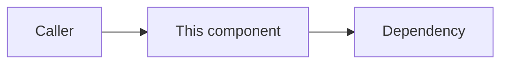

# Component name

## Purpose

One sentence: what the component owns and what it does not.

## Input and Output

- Input: what arrives, from whom, in which format.
- Output: what it produces, for whom, and what is a side effect.

## Diagram

## Failures

- What breaks, what the caller sees, and how it recovers or stops.

## Observability

- The events, logs, metrics and traces that show it works, and the one alert that matters.
