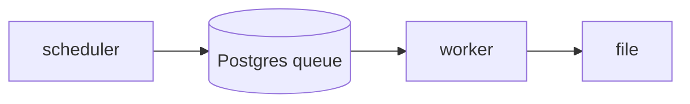

# Nightly export

## Problem

The report export takes 40 minutes and blocks the morning review.

## Goals

- p95 export time under 5 minutes, read from the job duration metric.

## Non-goals

- A new UI.

## Approach

Option A, a Postgres-backed queue, matches ADR 0001 and adds no service. Option B, a broker, is faster to scale but adds a service to run; rejected for now. Security: no new data leaves the host. Rollback: disable the schedule. Cost: none beyond compute.

## Acceptance Criteria

- Given a report, When the nightly job runs, Then the export file exists in under 5 minutes.
